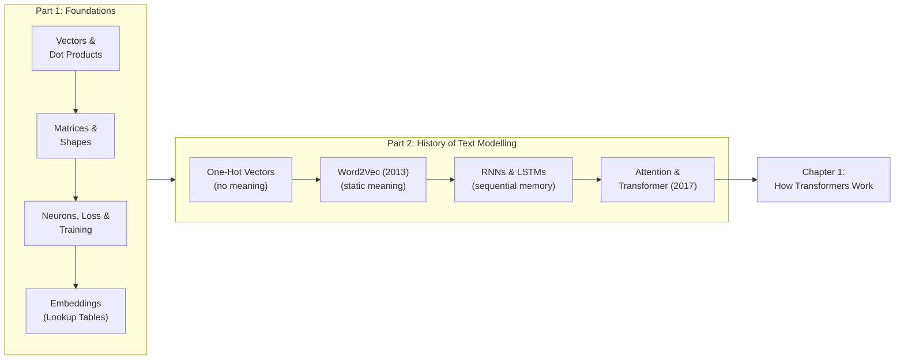
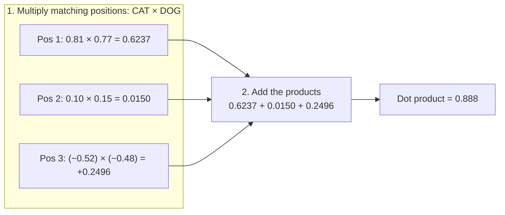
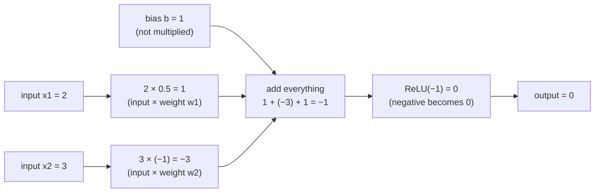
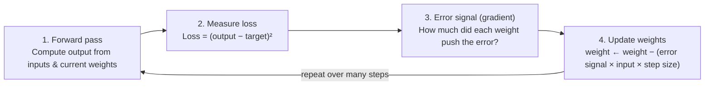
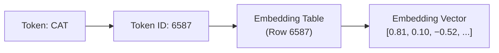
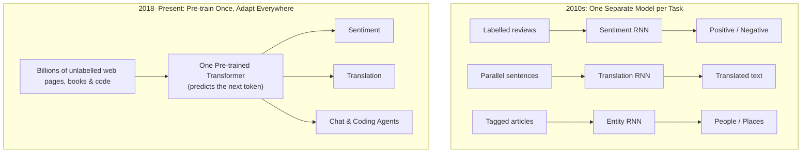
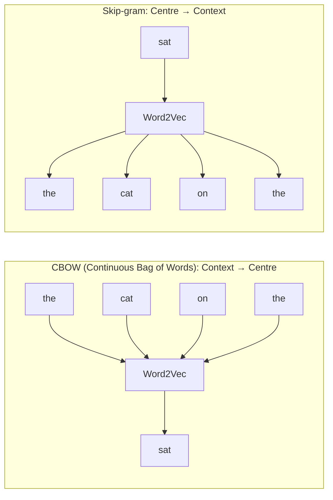
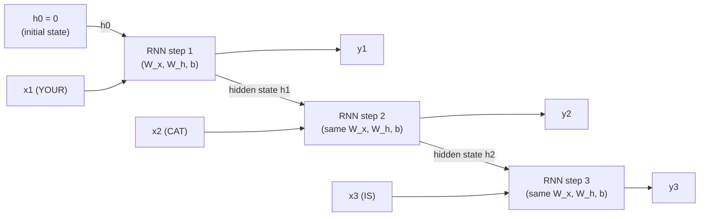
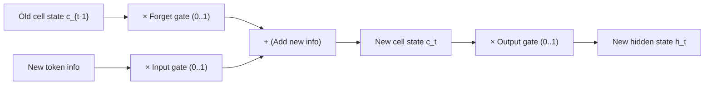
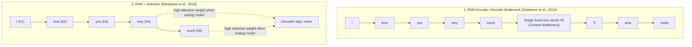

# Introduction: Foundations and History

## The big picture

These notes explain how large language models work, using plain words and real arithmetic at every step. Before [Chapter 1](01-transformers.md#the-big-picture) opens up the Transformer architecture, this introduction gives you the background needed to read the rest of the notes effortlessly:

1. **Foundations.** It reviews the small amount of linear algebra and machine learning that language models are built on: vectors, dot products, matrices, neural networks, loss functions, training, and embeddings. If you studied a computing or engineering degree years ago and your maths is rusty, short refreshers explain every operation from scratch.
2. **History.** It traces how computers learned to represent and process text—from one-hot vectors to Word2Vec to recurrent neural networks (RNNs and LSTMs)—and shows the exact bottlenecks that led to the invention of the Transformer in 2017.

Readers who are already comfortable with linear algebra and basic machine learning can skip straight to [Historical evolution of text modelling](#historical-evolution-of-text-modelling) or [Chapter 1](01-transformers.md#the-big-picture).

---

## What you need to know first

Everything a language model does—from reading your prompt to choosing the next word—is ordinary arithmetic on lists and tables of numbers. An LLM uses that arithmetic to statistically guess the most likely next token based on all the preceding context. This section defines those building blocks and walks through a small, hand-checkable calculation for each one, before [Chapter 1 explains how the Transformer](01-transformers.md#the-big-picture) carries out this process.

This section covers:

1. [Vectors](#vectors): a token as a list of numbers.
2. [The dot product: a measure of similarity](#the-dot-product-a-measure-of-similarity): one number that says how alike two vectors are.
3. [Matrices and their shapes](#matrices-and-their-shapes): a whole sentence as a table of numbers.
4. [Matrix multiplication](#matrix-multiplication): many dot products at once, and the rule for shapes.
5. [The transpose](#the-transpose): swapping rows and columns, and why attention needs it.
6. [What a neural network is](#what-a-neural-network-is): weighted sum, bias and activation, with a worked neuron.
7. [Where the weights and the bias come from](#where-the-weights-and-the-bias-come-from): random start, then one training step with numbers.
8. [Loss and training](#loss-and-training): the two core machine-learning terms in short.
9. [Softmax: turning scores into probabilities](#softmax-turning-scores-into-probabilities): from raw scores to probabilities that add up to 1.
10. [Embeddings](#embeddings): the learned vector for each token, read from a table.

### Vectors

A **vector** is an ordered list of numbers. If you write software, you can think of a vector as a fixed-length array of floating-point numbers, such as `float[3]` or `float[512]`. If you prefer geometry, you can think of a 3-number vector as the $[x, y, z]$ coordinates of a point in 3D space, or an arrow drawn from the origin $[0, 0, 0]$ to that point.

In a language model, every **token** (a word or word piece, such as `CAT`) is represented by a vector. The number of entries in the vector is called its **length** or **dimension**.

- To keep the arithmetic easy to read on the page, our worked examples shorten each token vector to **3 numbers** (dimension $= 3$).
- In the real 2017 base Transformer model, each token vector holds **512 numbers**. That vector length is called **$d_{\text{model}}$** (the dimension of the model).

| Token | Token ID | Toy vector in these notes (length $3$) | Real base-model vector (length $d_{\text{model}} = 512$) |
| --- | --- | --- | --- |
| `CAT` | `6587` | $[0.81,\; 0.10,\; -0.52]$ | $512$ numbers (too long to show) |

### The dot product: a measure of similarity

The **dot product** of two vectors of the same length multiplies them position by position and adds the products into a single number. For two vectors $a = [a_1, a_2, \dots, a_d]$ and $b = [b_1, b_2, \dots, b_d]$, the formula is:

$$
a \cdot b = \sum_{i=1}^{d} a_i b_i = a_1 b_1 + a_2 b_2 + \dots + a_d b_d
$$

- **$a$ and $b$** are two vectors of the same length.
- **$a \cdot b$** (read "$a$ dot $b$") is their dot product, which is a single number.
- **$d$** is the length (number of entries) of each vector.
- **$i$** is the position index, running from $1$ up to $d$.
- **$a_i$ and $b_i$** are the numbers at position $i$ in vector $a$ and vector $b$.
- **$\sum_{i=1}^{d}$** (the Greek capital letter sigma) means "add up the expression that follows for every position $i$ from $1$ to $d$".

The diagram below computes the dot product of two toy token vectors (made-up numbers): $a$ = `CAT` $= [0.81,\; 0.10,\; -0.52]$, the vector from the table above, and $b$ = `DOG` $= [0.77,\; 0.15,\; -0.48]$. In each box, the first number comes from `CAT` and the second from `DOG`.

!!! note "Quick refresher: Why does multiplying and adding measure similarity?"
    Think of two vectors as arrows starting from the same origin:

    - **Pointing in a similar direction (positive dot product):** Where one vector has a positive number, the other mostly has a positive number too ($+ \times + = +$); where one is negative, the other is mostly negative ($- \times - = +$). Most products are positive, so they add up to a **large positive total**.
    - **Unrelated / perpendicular (dot product near $0$):** Positive products in some positions cancel out negative products in others, leaving a sum near **$0$**. Two vectors whose dot product is exactly $0$ are at right angles ($90^\circ$) to each other and are called **orthogonal**.
    - **Pointing in opposite directions (negative dot product):** Where one vector is positive, the other is negative ($+ \times - = -$). The products are negative, so the sum is **negative**.

**Worked example** with three token vectors from [Chapter 1's embedding table](01-transformers.md#token-embeddings) (made-up numbers for illustration):

| Pair | Number-by-number products | Dot product |
| --- | --- | --- |
| `CAT` $[0.81, 0.10, -0.52]$ $\cdot$ `DOG` $[0.77, 0.15, -0.48]$ | $0.6237 + 0.0150 + 0.2496$ | **$0.888$** |
| `CAT` $[0.81, 0.10, -0.52]$ $\cdot$ `A` $[-0.05, 0.08, 0.91]$ | $-0.0405 + 0.0080 - 0.4732$ | **$-0.506$** |

**How each result is computed.** Pair the numbers by position (1st with 1st, 2nd with 2nd, 3rd with 3rd), multiply each pair, and add the three products.

`CAT` $\cdot$ `DOG`:

| Position | `CAT` | `DOG` | Multiply | Product |
| --- | --- | --- | --- | --- |
| 1st | $0.81$ | $0.77$ | $0.81 \times 0.77$ | $+0.6237$ |
| 2nd | $0.10$ | $0.15$ | $0.10 \times 0.15$ | $+0.0150$ |
| 3rd | $-0.52$ | $-0.48$ | $-0.52 \times -0.48$ | $+0.2496$ |
| **Sum** | | | $0.6237 + 0.0150 + 0.2496$ | **$0.8883 \approx 0.888$** |

`CAT` $\cdot$ `A`:

| Position | `CAT` | `A` | Multiply | Product |
| --- | --- | --- | --- | --- |
| 1st | $0.81$ | $-0.05$ | $0.81 \times -0.05$ | $-0.0405$ |
| 2nd | $0.10$ | $0.08$ | $0.10 \times 0.08$ | $+0.0080$ |
| 3rd | $-0.52$ | $0.91$ | $-0.52 \times 0.91$ | $-0.4732$ |
| **Sum** | | | $-0.0405 + 0.0080 - 0.4732$ | **$-0.5057 \approx -0.506$** |

`CAT` and `DOG`, which are nouns used in similar contexts, have matching signs in every position, so all three products are positive and the dot product is large. `CAT` and the article `A` have opposite signs in two positions, so the dot product is negative. Positions where both numbers are large count the most: in `CAT` $\cdot$ `A`, the 3rd position ($-0.52 \times 0.91 = -0.4732$) outweighs the other two products together ($-0.0405 + 0.0080 = -0.0325$). Attention in [Chapter 1](01-transformers.md#scaled-dot-product-attention-step-by-step) is built on this exact operation: it uses dot products to score how strongly each token should attend to every other token in a sentence.

### Matrices and their shapes

A **matrix** is a rectangular table of numbers arranged in rows and columns (like a 2D array `float[rows][columns]`). Its **shape** is always written as $\text{rows} \times \text{columns}$.

In a language model, we process a whole sentence at once by stacking its token vectors one below another as rows of a matrix. For our running sentence `YOUR CAT IS A LOVELY CAT` ($6$ tokens):

- With our 3-number toy vectors, stacking the $6$ tokens gives a **$6 \times 3$ matrix** ($6$ rows, $3$ columns).
- In the real base model, where each token vector has $512$ numbers, stacking the $6$ tokens gives a **$6 \times 512$ matrix** ($6$ rows, $512$ columns).

| Row (Token) | Column 1 | Column 2 | Column 3 | $\dots$ (up to Column 512 in base model) |
| --- | --- | --- | --- | --- |
| Row 1 (`YOUR`) | $0.12$ | $-0.40$ | $0.33$ | $\dots$ |
| Row 2 (`CAT`) | $0.81$ | $0.10$ | $-0.52$ | $\dots$ |
| Row 3 (`IS`) | $-0.30$ | $0.66$ | $0.05$ | $\dots$ |
| Row 4 (`A`) | $-0.05$ | $0.08$ | $0.91$ | $\dots$ |
| Row 5 (`LOVELY`) | $0.45$ | $0.62$ | $-0.11$ | $\dots$ |
| Row 6 (`CAT`) | $0.81$ | $0.10$ | $-0.52$ | $\dots$ |

### Matrix multiplication

To multiply matrix $A$ by matrix $B$, take the dot product of **each row of $A$** with **each column of $B$**. The resulting matrix has as many rows as $A$ and as many columns as $B$. The rule for shapes is:

$$
(m \times n) \cdot (n \times p) = (m \times p)
$$

- **$m$** is the number of rows in the first matrix $A$ (and in the result).
- **$n$** is the number of columns in $A$ **and** the number of rows in $B$.
- **$p$** is the number of columns in the second matrix $B$ (and in the result).

!!! tip "Key idea: Why the inner numbers ($n$) must match"
    Every cell in the result is a dot product between one row of $A$ (which holds $n$ numbers) and one column of $B$ (which also holds $n$ numbers). You can only take the dot product of two lists if they have the exact same length $n$. Once those $n$-number lists are dotted together, the inner dimension $n$ disappears, leaving the outer dimensions **$m \times p$**.

**Worked example: a $2 \times 3$ matrix times a $3 \times 2$ matrix.**

$$
A = \begin{bmatrix} 1 & 2 & 3 \\ 4 & 5 & 6 \end{bmatrix} \qquad B = \begin{bmatrix} 1 & 0 \\ 0 & 1 \\ 2 & 1 \end{bmatrix}
$$

| Result cell | Row of $A$ $\cdot$ Column of $B$ | Value |
| --- | --- | --- |
| Row 1, column 1 | $[1, 2, 3] \cdot [1, 0, 2] = (1 \times 1) + (2 \times 0) + (3 \times 2) = 1 + 0 + 6$ | $7$ |
| Row 1, column 2 | $[1, 2, 3] \cdot [0, 1, 1] = (1 \times 0) + (2 \times 1) + (3 \times 1) = 0 + 2 + 3$ | $5$ |
| Row 2, column 1 | $[4, 5, 6] \cdot [1, 0, 2] = (4 \times 1) + (5 \times 0) + (6 \times 2) = 4 + 0 + 12$ | $16$ |
| Row 2, column 2 | $[4, 5, 6] \cdot [0, 1, 1] = (4 \times 0) + (5 \times 1) + (6 \times 1) = 0 + 5 + 6$ | $11$ |

$$
A \cdot B = \begin{bmatrix} 7 & 5 \\ 16 & 11 \end{bmatrix} \qquad (2 \times 3) \cdot (3 \times 2) = (2 \times 2)
$$

In [Chapter 1](01-transformers.md#where-q-k-and-v-come-from), this same rule turns a 6-token sentence matrix of shape $6 \times 512$ into its query vectors by multiplying by a weight matrix of shape $512 \times 64$:

$$
(6 \times 512) \cdot (512 \times 64) = (6 \times 64)
$$

That single matrix multiplication produces one 64-number query vector for each of the 6 tokens at once.

### The transpose

The **transpose** of a matrix, written with a superscript $T$ (as in $A^T$), flips the matrix over its diagonal by swapping its rows and columns: row 1 becomes column 1, row 2 becomes column 2, and so on. A matrix of shape $m \times n$ becomes $n \times m$.

For example, the $2 \times 3$ matrix $A$ from above becomes a $3 \times 2$ matrix $A^T$:

$$
A = \begin{bmatrix} 1 & 2 & 3 \\ 4 & 5 & 6 \end{bmatrix} \quad \longrightarrow \quad A^T = \begin{bmatrix} 1 & 4 \\ 2 & 5 \\ 3 & 6 \end{bmatrix}
$$

| In $A$ (shape $2 \times 3$) | In $A^T$ (shape $3 \times 2$) |
| --- | --- |
| Row 1: $1, 2, 3$ | Column 1: $1, 2, 3$ |
| Row 2: $4, 5, 6$ | Column 2: $4, 5, 6$ |

Each number moves from $(\text{row } r, \text{column } c)$ to $(\text{row } c, \text{column } r)$. For instance, the number $6$ sits in row 2, column 3 of $A$, and moves to row 3, column 2 of $A^T$.

**Why attention needs the transpose.** In [Chapter 1](01-transformers.md#where-q-k-and-v-come-from), a 6-token sentence has a query matrix $Q$ of shape $6 \times 64$ and a key matrix $K$ of shape $6 \times 64$ (one row per token). We want the dot product of every token's query row with every token's key row. We cannot multiply $(6 \times 64) \cdot (6 \times 64)$ because the inner numbers ($64$ and $6$) do not match. Transposing $K$ into $K^T$ (shape $64 \times 6$) turns each token's key into a column, so the inner numbers match:

$$
Q \cdot K^T \;\;=\;\; (6 \times 64) \cdot (64 \times 6) \;\;=\;\; (6 \times 6)
$$

That one multiplication $Q K^T$ computes all $6 \times 6 = 36$ token-to-token dot products in a single step.

### What a neural network is

A **neural network** is a mathematical function built by chaining many simple calculation steps, each controlled by adjustable numbers called **weights**. The fundamental building block, a single **neuron**, takes a list of input numbers and does three things:

1. **Weighted sum (dot product):** Multiply each input by its matching weight and add the products together.
2. **Add a bias:** Add one extra adjustable number, called the **bias**, which shifts the sum up or down without being multiplied by any input.
3. **Apply an activation function:** Pass the sum through a simple non-linear rule. A very common activation function is **ReLU** (Rectified Linear Unit), which keeps positive numbers unchanged and replaces any negative number with $0$:

$$
\text{output} = \text{ReLU}(w_1 x_1 + w_2 x_2 + b) = \max(0,\; w_1 x_1 + w_2 x_2 + b)
$$

- **$x_1, x_2$** are the input numbers fed into the neuron.
- **$w_1, w_2$** are the neuron's **weights** (one weight per input).
- **$b$** is the neuron's **bias** (a single offset number).
- **$\text{ReLU}(\dots)$** is the activation function $\max(0, z)$, which outputs $z$ if $z > 0$ and $0$ if $z \le 0$.

**Worked example:** Suppose the inputs are $[2, 3]$, the weights are $[0.5, -1]$, and the bias is $1$ (made-up numbers):

- Weighted sum: $2 \times 0.5 + 3 \times (-1) = 1 - 3 = -2$. Add the bias: $-2 + 1 = -1$.
- Activation: $\text{ReLU}(-1) = \max(0,\; -1) = 0$. ReLU picks the larger of $0$ and the sum. Here the sum is $-1$, and $0$ is larger than $-1$, so the neuron outputs $0$. In effect, a negative sum switches the neuron off for this input.

For comparison, with the inputs $[4, 1]$ and the same weights and bias, the sum is $4 \times 0.5 + 1 \times (-1) + 1 = 2 - 1 + 1 = 2$. This time the sum is positive, so ReLU leaves it unchanged: $\text{ReLU}(2) = \max(0,\; 2) = 2$, and the neuron outputs $2$.

The diagram below shows the first example (inputs $[2, 3]$) from left to right. Because there are two inputs, the neuron has two weights: the first input ($2$) is multiplied by the first weight ($0.5$), and the second input ($3$) is multiplied by the second weight ($-1$).

Reading the diagram step by step:

| Step | What happens | Calculation | Result |
| --- | --- | --- | --- |
| 1 | Multiply first input by first weight | $2 \times 0.5$ | $1$ |
| 2 | Multiply second input by second weight | $3 \times (-1)$ | $-3$ |
| 3 | Add the two products and the bias. The bias is not multiplied by any input; it is a fixed extra number added to the sum | $1 + (-3) + 1$ | $-1$ |
| 4 | Apply ReLU: a negative value becomes $0$ | $\text{ReLU}(-1)$ | $0$ |

If we change the weights to $[0.5, 1]$ instead, the sum becomes $1 + 3 + 1 = 5$, and $\text{ReLU}(5) = 5$. Changing the weights changes what the neuron computes; finding the right weights is all that "learning" means.

### Where the weights and the bias come from

Nobody chooses the weights or the bias by hand. The values $0.5$, $-1$, and $1$ above were made up for illustration; in a real network, no human ever decides whether a weight should be $0.5$ or $0.8$. Every weight and bias is found automatically by **training**, which works in two phases:

**1. Start with random values.** Before training begins, every weight is filled with a small random number, for example drawn between $-0.1$ and $0.1$, and biases usually start at $0$. The starting weights must be random rather than all equal: if every neuron in a layer started with the exact same weights, every neuron would compute the exact same output, receive the exact same correction during training, and remain identical forever.

**2. Correct them a little, many times.** Training feeds the network an example whose true answer (the **target**) is known, measures how far the network's output is from the target (the **loss**), and nudges every weight and bias a tiny step in the direction that makes the loss smaller. The size of each weight's adjustment depends on how strongly that weight contributed to the error.

**Worked example: one training step.** Take the neuron with inputs $[2, 3]$, weights $[0.5, 1]$, and bias $1$, whose output is $5$ (since $5 > 0$, $\text{ReLU}(5) = 5$). Suppose the true target answer for inputs $[2, 3]$ is **$3$**. We measure the error using the squared error loss:

$$
\text{Loss} = (\text{output} - \text{target})^2 = (5 - 3)^2 = 4
$$

**The aim of the exercise:** change the two weights and the bias, all three at the same time, until the neuron outputs $3$. We are not solving for one particular parameter; training adjusts every one of them a little at each step. When the output equals the target, the loss is $(3 - 3)^2 = 0$. Because the loss is a squared number, it can never go below $0$, so $0$ is the best possible loss and the value training aims for.

The output ($5$) is $2$ units too high. To lower the output toward $3$, we reduce each weight and the bias in proportion to how strongly it pushed the output up:

| Parameter | Multiplied by input | Correction ($\text{error signal} \times \text{input} \times \text{step size}$) | New value |
| --- | --- | --- | --- |
| Weight 1 ($w_1$) | $2$ | $4 \times 2 \times 0.01 = 0.08$ | $0.5 - 0.08 = \mathbf{0.42}$ |
| Weight 2 ($w_2$) | $3$ | $4 \times 3 \times 0.01 = 0.12$ | $1 - 0.12 = \mathbf{0.88}$ |
| Bias ($b$) | (always $1$) | $4 \times 1 \times 0.01 = 0.04$ | $1 - 0.04 = \mathbf{0.96}$ |

- **The error signal ($4$)** is $2 \times (\text{output} - \text{target}) = 2 \times (5 - 3) = 4$. It grows with the size of the error, and its positive sign says "the output is too high, so nudge the weights down".
- **Weight 2 moves the most** ($-0.12$ vs $-0.08$) because it was multiplied by the larger input ($3$ vs $2$), making it more responsible for the output being too high.
- **The bias** acts like a weight whose input is always $1$, so it is adjusted by the exact same rule.
- **The step size ($0.01$)**, called the **learning rate**, keeps each update small so the network approaches the target smoothly instead of overshooting it.

!!! note "Quick refresher: Where does $2 \times (\text{output} - \text{target}) \times \text{input}$ come from?"
    If you remember derivatives from university calculus, this formula is the **chain rule** in action:

    1. For the loss function $L = (\text{output} - \text{target})^2$, the derivative (slope) of $x^2$ is $2x$, so the slope of the loss with respect to the output is $\frac{\partial L}{\partial \text{output}} = 2(\text{output} - \text{target}) = 2(5 - 3) = 4$.
    2. Since $\text{output} = w_1 x_1 + w_2 x_2 + b$ (when the sum is positive), the slope of the output with respect to weight $w_i$ is simply its input $x_i$.
    3. Multiplying the two slopes together gives each weight's **gradient**: $\frac{\partial L}{\partial w_i} = 2(\text{output} - \text{target}) \times x_i$. Subtracting $\text{learning rate} \times \text{gradient}$ steps downhill to reduce the loss.

With the updated weights $[0.42, 0.88]$ and bias $0.96$, the neuron's new output is:

$$
2 \times 0.42 + 3 \times 0.88 + 0.96 = 0.84 + 2.64 + 0.96 = 4.44
$$

The loss drops from $4.00$ to $(4.44 - 3)^2 = 1.44^2 \approx 2.07$. Repeating this exact update step by step brings the output steadily closer to $3$:

| Step | Weights ($w_1, w_2$) | Bias ($b$) | Output | Loss $= (\text{Output} - 3)^2$ |
| --- | --- | --- | --- | --- |
| 0 | $0.500,\; 1.000$ | $1.000$ | $5.00$ | $4.00$ |
| 1 | $0.420,\; 0.880$ | $0.960$ | $4.44$ | $2.07$ |
| 2 | $0.362,\; 0.794$ | $0.931$ | $4.04$ | $1.07$ |
| 3 | $0.321,\; 0.731$ | $0.910$ | $3.75$ | $0.56$ |
| 5 | $0.270,\; 0.654$ | $0.885$ | $3.39$ | $0.15$ |
| 10 | $0.225,\; 0.587$ | $0.862$ | $3.07$ | $0.006$ |
| 30 | $0.214,\; 0.571$ | $0.857$ | $3.00$ | $0.000$ |

*(Each loss is computed from the unrounded output, so it can differ slightly from squaring the rounded output shown: at step 2 the output is $4.0368$, and $(4.0368 - 3)^2 = 1.07$.)*

**The result.** After five steps the output is $3.39$ and the loss is $0.15$. After about $30$ steps the output is $3.00$ and the loss is practically $0$, so training stops: the neuron has learned weights $[0.214, 0.571]$ and bias $0.857$. Check: $2 \times 0.214 + 3 \times 0.571 + 0.857 = 0.428 + 1.713 + 0.857 = 2.998 \approx 3$ (the small gap comes from rounding to three decimals).

This is not the only answer. Other values also give an output of $3$, for example weights $[0, 1]$ and bias $0$ ($2 \times 0 + 3 \times 1 + 0 = 3$). Training does not look for one "correct" set of numbers; it stops at the first set it reaches whose loss is small enough, which here is a set close to the starting values. Nobody hand-picked those numbers: they are simply where the automatic adjustments arrived. A large language model learns in this exact way, except that it adjusts billions of weights at once across billions of text examples: a 7-billion-weight model has 7 billion numbers set this way. [Chapter 2](02-training.md#backpropagation-gradient-descent-and-the-optimiser) explains how gradients and backpropagation compute all those adjustments efficiently in a deep network.

**From one neuron to layers and deep networks.** A **layer** is a group of neurons working side by side on the same input vector—which is simply a matrix multiplication followed by an activation function. A neural network stacks multiple layers one after another, with the output of one layer feeding into the next. The Transformer's feed-forward network ([Chapter 1](01-transformers.md#the-feed-forward-network-in-detail)) is made of two such layers.

!!! tip "Key idea: Why every layer needs a non-linear activation"
    Without an activation function like ReLU between layers, stacking layers would accomplish nothing. Multiplying a vector by matrix $W_1$ and then immediately by matrix $W_2$ is mathematically identical to multiplying once by a single combined matrix $W = W_1 \cdot W_2$. Straight matrix multiplications can only represent flat, straight-line relationships. Inserting a non-linear bend like ReLU after each layer is what allows a deep network to learn rich, complex patterns.

### Loss and training

To summarise the two core machine-learning terms used throughout these notes:

- **Loss:** A single number that measures how wrong the model's predictions are on a set of examples. Lower is better; a loss of $0$ means a perfect prediction.
- **Training:** The loop that repeatedly adjusts every weight by a small step in the direction that reduces the loss across many examples.

[Chapter 2](02-training.md#the-big-picture) covers both in full detail: the specific loss function used for language modelling (cross-entropy), how backpropagation finds the direction to move every weight, and how modern optimisers take each step.

### Softmax: turning scores into probabilities

A model often ends with one raw score per possible answer, for example one score per word in the vocabulary. These raw scores are called **logits**: a higher logit means "more likely", but logits can be negative and do not add up to anything in particular, so they are not probabilities. **Softmax** is the function that turns a list of logits into probabilities: every result is between $0$ and $1$, and all results add up to $1$.

$$
P(k) = \frac{e^{z_k}}{\sum_{j=1}^{n} e^{z_j}}
$$

- **$z_k$** is the logit of answer $k$, and **$n$** is the number of possible answers.
- **$e \approx 2.718$** is Euler's number. $e^{z}$ is always positive, even when $z$ is negative, so every probability is positive.
- **$\sum_{j=1}^{n} e^{z_j}$** is the total of all the exponentials. Dividing by it makes the results add up to $1$.
- **$P(k)$** is the probability softmax gives to answer $k$.

In words: raise $e$ to the power of each logit, then divide each result by the total.

**Worked example** with the logits the notes use in later chapters, after the model has read `YOUR CAT IS A LOVELY` and scores four candidate next words (made-up logits, a four-word vocabulary for readability):

| Token | Logit $z$ | $e^{z}$ | Probability $= e^{z} \div 637.9$ |
| --- | --- | --- | --- |
| `CAT` | $6.2$ | $492.75$ | $0.772$ |
| `DOG` | $4.9$ | $134.29$ | $0.211$ |
| `IS` | $2.1$ | $8.17$ | $0.013$ |
| `LOVELY` | $1.0$ | $2.72$ | $0.004$ |
| **Total** | | **$637.9$** | **$1.000$** |

The exponential makes softmax favour the largest score strongly. `CAT`'s logit is only $1.3$ higher than `DOG`'s, but its probability is more than three times larger ($0.772$ vs $0.211$), because $e^{1.3} \approx 3.7$.

Softmax appears throughout these notes: in Word2Vec below, in attention ([Chapter 1](01-transformers.md#scaled-dot-product-attention-step-by-step)), when the model picks the next word ([Chapter 1](01-transformers.md#from-the-last-vector-back-to-a-word)), and in temperature sampling ([Chapter 3](03-inference.md#sampling-and-temperature)).

### Embeddings

An **embedding** is a learned vector that represents a discrete item, such as a word or a token. Inside the model, embeddings live in a lookup matrix called the **embedding table**, which has one row per token in the vocabulary. To turn a token ID into a vector, the model simply reads that row of the table.

The numbers in the embedding table start out random and are updated during training just like any other weights. Because words like `CAT` and `DOG` appear in similar sentences, training nudges their rows toward similar numbers—which is why `CAT` and `DOG` had a high dot product ($0.888$) in our earlier example. The rest of this chapter tells the story of how word embeddings were invented, and [Chapter 1](01-transformers.md#token-embeddings) shows how a Transformer builds on them.

---

## Historical evolution of text modelling

Modern chat assistants are the result of a sequence of breakthroughs over roughly a decade, each solving a concrete limitation of the method before it. Tracing that progression explains why the 2017 Transformer was such a turning point—and why understanding older ideas like Word2Vec and RNNs makes the Transformer's design immediately clear.

In short: language software went from one small model per task, trained on hand-labelled data, to one very large model trained on plain text and then adapted to many tasks. The Transformer (2017) made that change possible because it can be trained in parallel on huge amounts of text.

This section covers:

1. [Timeline](#timeline): the main steps from 1997 to today in one table.
2. [The task-specific era (the 2010s)](#the-task-specific-era-the-2010s): one separately trained model per task.
3. [The turning point (2017)](#the-turning-point-2017): attention replaces recurrence, and training becomes parallel.
4. [Scaling to modern LLMs (2018–2026)](#scaling-to-modern-llms-20182026): pre-train one large model, then adapt it.

### Timeline

| Year | Step | What changed |
| --- | --- | --- |
| 1997 | LSTM | A recurrent network with gated memory that can hold information over longer stretches of text (explained [later in this chapter](#the-lstm)) |
| 2013 | Word2Vec | Words are mapped to learned dense vectors in which words with similar meanings sit close together |
| 2014 | Sequence-to-sequence with attention | Recurrent encoder–decoder networks translate full sentences; an attention mechanism lets the decoder look back at every source word |
| 2017 | The Transformer, "Attention Is All You Need" | Recurrence is removed completely; attention alone connects tokens and trains across all positions in parallel ([Chapter 1](01-transformers.md#attention-is-all-you-need-2017)) |
| 2018 | BERT and GPT | One large Transformer is pre-trained on unlabelled text and then adapted to many different tasks |
| 2019 | GPT-2 | $1.5\text{ billion}$ weights; generates coherent multi-sentence paragraphs without task-specific training |
| 2020 | GPT-3 | $175\text{ billion}$ weights; performs new tasks from a few examples in the prompt alone, without updating weights |
| 2022 | ChatGPT | Supervised fine-tuning and preference training ([Chapter 2](02-training.md#stages-of-an-llms-life-pre-training-fine-tuning-and-preference-training)) turn a next-token predictor into a conversational assistant |
| 2023–2026 | Modern assistants and agents | Models such as Claude, GPT-4, and Gemini process long documents and images, call external tools, and act as coding agents that plan, run, and fix code across many steps |

### The task-specific era (the 2010s)

Before 2017, building natural language software meant training **a separate, specialised model for every task**:

- One model for **sentiment analysis** (classifying a product review as positive or negative),
- A second model for **machine translation** (translating English into German),
- A third model for **named-entity recognition** (highlighting people, places, and companies in a document).

Each system was typically a recurrent neural network (RNN or LSTM) trained from scratch on its own human-labelled dataset—often a few hundred thousand examples. Nothing learned by the sentiment model could be reused by the translation model. Because human-labelled data was slow and expensive to create, each model saw only a narrow slice of language, and every new business requirement meant collecting a new dataset and training a new model from zero.

### The turning point (2017)

In 2017, the paper *"Attention Is All You Need"* replaced recurrence with self-attention ([Chapter 1](01-transformers.md#attention-is-all-you-need-2017)). The breakthrough was not just higher translation accuracy—it was **parallelism**. Because an RNN reads one word after another, training on a 1,000-word document takes 1,000 sequential steps. A Transformer processes all 1,000 positions **in parallel** during training ([Chapter 2](02-training.md#why-training-happens-in-one-time-step)). That unlocked the full parallel computing power of GPUs: from then on, adding more training data, more weights, and more compute reliably produced a stronger model.

### Scaling to modern LLMs (2018–2026)

Starting in 2018 with BERT and GPT, the industry shifted from "one model per task" to **"one foundation model for all tasks"** in two steps:

1. **Pre-train** one large Transformer on a massive corpus of unlabelled text, using the self-supervised objective of predicting the next token. Because the next word in any text is already there to serve as the target answer, no human labels are needed ([Chapter 2](02-training.md#three-ideas-weights-prediction-error)).
2. **Adapt** that pre-trained model to specific uses: by fine-tuning it on a small set of instruction examples, by showing a few examples inside the prompt ([Chapter 6](06-prompting.md#in-context-learning)), or simply by asking it a question in plain English.

Once parallel training removed the compute bottleneck, model sizes grew by orders of magnitude in just three years:

| Model | Year | Number of weights | Scale compared with the 2017 base model |
| --- | --- | --- | --- |
| Transformer (base) | 2017 | $65\text{ million}$ | $1\times$ |
| GPT-2 | 2019 | $1.5\text{ billion}$ | about $23\times$ |
| GPT-3 | 2020 | $175\text{ billion}$ | about $2{,}700\times$ |

As models and datasets scaled up, qualitative new capabilities emerged: following complex instructions, writing and debugging code, and reasoning step by step. After preference alignment turned raw text predictors into helpful assistants in 2022, later generations added huge context windows, multimodal inputs, tool calling, and **agent workflows**—where a model plans a task, runs commands or searches, inspects the output, and iterates over many steps.

To appreciate why the Transformer's design works so well, the next two sections examine the two foundations it improved upon: how words are turned into vectors, and how networks read sequences.

---

## Vector embeddings: static representations

A computer can only do arithmetic on numbers, so every word must first be converted into a vector. How we construct those vectors determines what the model can understand about relationships between words. This section compares the two classic approaches before the Transformer: **one-hot encoding**, which treats every word as an isolated symbol with no meaning, and **Word2Vec**, which learns meaningful vectors from context but gives every word a single static vector regardless of the sentence.

This section covers:

1. [One-hot encoding](#one-hot-encoding): one slot per word, and why every word ends up equally far from every other.
2. [Word2Vec: learning vectors from context](#word2vec-learning-vectors-from-context): dense vectors learned by predicting neighbouring words.
3. [Vector arithmetic: Paris − France + Germany ≈ Berlin](#vector-arithmetic-paris-france-germany-berlin): directions in the space that carry meaning.
4. [The limits of Word2Vec](#the-limits-of-word2vec): one fixed vector per word, whatever the sentence.

### One-hot encoding

**One-hot encoding** represents each word in the **vocabulary** (the fixed list of words the model knows) by giving it a dedicated slot in a vector. Every word's vector has as many slots as there are words in the entire vocabulary, with a **$1$** in that word's own slot and **$0$** in every other slot:

- With a 5-word vocabulary, every word vector has $5$ numbers (one $1$ and four $0$s).
- With a realistic 50,000-word vocabulary, every word vector has $50{,}000$ numbers (one $1$ and $49{,}999$ zeros).

**Worked example** using a 5-word vocabulary: `cat`, `dog`, `bank`, `river`, `money`.

| Word | Slot index | One-hot vector |
| --- | --- | --- |
| `cat` | 1 | $[1,\; 0,\; 0,\; 0,\; 0]$ |
| `dog` | 2 | $[0,\; 1,\; 0,\; 0,\; 0]$ |
| `bank` | 3 | $[0,\; 0,\; 1,\; 0,\; 0]$ |
| `river` | 4 | $[0,\; 0,\; 0,\; 1,\; 0]$ |
| `money` | 5 | $[0,\; 0,\; 0,\; 0,\; 1]$ |

**Do one-hot vectors capture the fact that `cat` and `dog` are similar?** A good representation should place related words (`cat` and `dog`, both pets) closer together than unrelated words (`cat` and `bank`). Let us test this using the [dot product](#the-dot-product-a-measure-of-similarity), where a large positive number means similar and $0$ means unrelated:

| Slot | 1 (`cat`) | 2 (`dog`) | 3 (`bank`) | 4 (`river`) | 5 (`money`) | Sum (Dot product) |
| --- | --- | --- | --- | --- | --- | --- |
| `cat` | $1$ | $0$ | $0$ | $0$ | $0$ | |
| `dog` | $0$ | $1$ | $0$ | $0$ | $0$ | |
| `cat` $\times$ `dog` | $1 \times 0 = 0$ | $0 \times 1 = 0$ | $0 \times 0 = 0$ | $0 \times 0 = 0$ | $0 \times 0 = 0$ | **$0$** |

Every single product is $0$, because `cat` has its $1$ in slot 1 where `dog` has a $0$, and `dog` has its $1$ in slot 2 where `cat` has a $0$. The exact same thing happens for `cat` $\cdot$ `bank`, and for **every** pair of distinct words, because no two distinct words share a slot. Only a word dotted with itself scores $1$ (`cat` $\cdot$ `cat` $= 1 \times 1 = 1$).

| Word pair | Dot product | What it tells the model |
| --- | --- | --- |
| `cat` $\cdot$ `cat` | $1$ | Identical word |
| `cat` $\cdot$ `dog` | $0$ | Completely unrelated |
| `cat` $\cdot$ `bank` | $0$ | Completely unrelated (identical score to `cat` $\cdot$ `dog`) |

Measuring the straight-line **distance** between two vectors tells the exact same story.

!!! note "Quick refresher: Euclidean distance and orthogonal vectors"
    The straight-line distance between two vectors $a$ and $b$ is just Pythagoras' theorem extended to $d$ dimensions: subtract the vectors slot by slot, square each difference, add the squares, and take the square root:

    $$
    \text{distance}(a, b) = \sqrt{\sum_{i=1}^{d} (a_i - b_i)^2}
    $$

    For any two different one-hot vectors, such as `cat` $[1, 0, 0, 0, 0]$ and `dog` $[0, 1, 0, 0, 0]$:

    - Difference: `cat` $-$ `dog` $= [1, -1, 0, 0, 0]$.
    - Sum of squares: $1^2 + (-1)^2 + 0^2 + 0^2 + 0^2 = 1 + 1 = 2$.
    - Distance: $\sqrt{2} \approx 1.414$.

    For `cat` and `bank`, the difference is $[1, 0, -1, 0, 0]$ and the distance is again $\sqrt{1^2 + (-1)^2} = \sqrt{2} \approx 1.414$.

    The result is always the same because two different one-hot vectors always differ in exactly two slots: one slot gives $1 - 0 = 1$ and the other gives $0 - 1 = -1$. Every other slot is $0 - 0 = 0$. So the sum of squares is always $1 + 1 = 2$, and every word is exactly $\sqrt{2} \approx 1.414$ away from every other word.

    In geometric terms, think of a 3-word vocabulary with the vectors $[1, 0, 0]$, $[0, 1, 0]$ and $[0, 0, 1]$. Each one is an arrow of length $1$ along a different axis ($x$, $y$ or $z$), and each pair of arrows meets at a right angle ($90^\circ$), like the edges at the corner of a box. Vectors at right angles to each other are called **orthogonal**, and their dot product is $0$ (see [the dot product](#the-dot-product-a-measure-of-similarity)). One-hot vectors work the same way with $5$ or $50,000$ axes: each word has its own axis, so no word leans towards any other.

One-hot vectors therefore have two major flaws:

1. **Zero semantic meaning:** The model sees `cat` as no closer to `dog` than to `bank` or `money`.
2. **Extreme waste of space:** With a 50,000-word vocabulary, every token requires a 50,000-number vector that is $99.998\%$ zeros.

### Word2Vec: learning vectors from context

**Word2Vec** (introduced by Mikolov and colleagues at Google in 2013) replaces huge, sparse one-hot vectors with short, dense vectors—typically around $300$ numbers long—built on a simple linguistic insight: **a word is known by the company it keeps**. Words that appear surrounded by the same neighbours in text should be assigned similar vectors.

Word2Vec learns these vectors using a self-supervised **proxy task** (a practice task). We train a small network to guess a word from its neighbouring words in a sentence, or to guess the neighbours from the word. Nobody actually cares about the guesses after training finishes; the guessing game exists only because, in order to get good at it, the network is forced to place words that share similar contexts (`cat` and `dog`) at nearby coordinates in vector space. It is like practising scales on a piano: nobody performs scales at a concert, but practising them builds the finger control you actually want.

Consider the sentence `"the cat sat on the mat"` with a **context window** of $2$ words on each side of the centre word `"sat"`. Word2Vec offers two variants of the guessing game. They use the same words but swap the question and the answer:

- **CBOW** (continuous bag of words) hides the centre word and asks: *"Given `the`, `cat`, `on`, `the`, which word is in the middle?"* The four context vectors are averaged into one vector, so their order does not matter (hence "bag of words"), and the model makes **one** prediction: `sat`.
- **Skip-gram** does the reverse. It shows the centre word and asks: *"Given `sat`, which words are nearby?"* Each context word becomes its own training pair, so one window gives **four** predictions: (`sat` → `the`), (`sat` → `cat`), (`sat` → `on`), (`sat` → `the`).

| Proxy task variant | Input given to the model | Target the model must predict |
| --- | --- | --- |
| **CBOW** (continuous bag of words) | The surrounding context words: `the`, `cat`, `on`, `the` | The middle word: `sat` |
| **Skip-gram** | The middle word: `sat` | Each surrounding context word: `the`, `cat`, `on`, `the` |

**When each variant is used.** The difference in the number of predictions per window explains the choice:

| | CBOW | Skip-gram |
| --- | --- | --- |
| Predictions per window | $1$ | $1$ per context word ($4$ here) |
| Training speed | Several times faster | Slower |
| Best for | Large datasets; good vectors for frequent words | Smaller datasets; good vectors for rare words |

- **Use CBOW** when there is plenty of text and training time matters. Averaging the context smooths out noise, which works well for common words that appear many times anyway.
- **Use Skip-gram** when the text is limited or rare words matter. A rare word that appears only a few times still gets a separate training update for each of its neighbours, instead of being blended into an average.

The original Word2Vec paper compared the two variants with word-analogy tests: the model is given three words and must find the fourth from the word vectors alone. Skip-gram scored clearly higher on tests of word meaning (for example, `Paris` is to `France` as `Rome` is to `Italy`), while CBOW scored slightly higher on tests of grammar (for example, `walk` is to `walked` as `swim` is to `swam`).

During training, this window slides across billions of words of unlabelled text, nudging the word vectors at every step to make the predictions more accurate ([Chapter 2](02-training.md#what-training-is)). Because `"cat"` and `"dog"` repeatedly appear surrounded by the same words (`"the ___ sat"`, `"fed the ___"`, `"pet ___"`), training pushes their vectors close together. When training finishes, we throw away the prediction layer and keep the learned vectors.

**The network behind it.** Under the hood, Word2Vec is a tiny two-layer [neural network](#what-a-neural-network-is) with three parts:

| Network part | What it holds | Size (for a $50{,}000$-word vocabulary) |
| --- | --- | --- |
| **Input layer** | The input word encoded as a one-hot vector | $50{,}000$ numbers (one $1$, rest $0$s) |
| **Hidden layer** | The word's dense embedding vector | $300$ numbers |
| **Output layer** | One score per vocabulary word: how likely each word is to appear in the context | $50{,}000$ numbers |

The first weight matrix—connecting the $50{,}000$-number input to the $300$-number hidden layer—has shape $50{,}000 \times 300$ (one row of $300$ numbers for each word in the vocabulary). Multiplying a one-hot vector by this matrix simply **selects that word's row**, because every $0$ in the one-hot vector multiplies its row by $0$, while the single $1$ keeps its row intact.

**Worked example** using our 5-word vocabulary and 3 numbers per word instead of 300 (made-up weights). The one-hot vector for `dog` is $[0, 1, 0, 0, 0]$:

| Row of the weight matrix | Weights in that row | Multiplied by `dog`'s one-hot entry | Result |
| --- | --- | --- | --- |
| Row 1 (`cat`) | $[0.2,\; 0.8,\; -0.1]$ | $\times 0$ | $[0,\; 0,\; 0]$ |
| Row 2 (`dog`) | $[0.3,\; 0.7,\; 0.0]$ | $\times 1$ | $[0.3,\; 0.7,\; 0.0]$ |
| Row 3 (`bank`) | $[-0.6,\; 0.1,\; 0.9]$ | $\times 0$ | $[0,\; 0,\; 0]$ |
| Row 4 (`river`) | $[-0.4,\; 0.2,\; 0.5]$ | $\times 0$ | $[0,\; 0,\; 0]$ |
| Row 5 (`money`) | $[-0.5,\; -0.3,\; 0.8]$ | $\times 0$ | $[0,\; 0,\; 0]$ |
| **Sum (Hidden layer)** | | | **$[0.3,\; 0.7,\; 0.0]$ (Row 2)** |

The hidden layer for `dog` is literally Row 2 of the first weight matrix. **That row is `dog`'s embedding vector**, and the entire first weight matrix is the **embedding table**. When training adjusts the weights of that matrix, it is directly sculpting the word vectors.

**Negative sampling: a cheaper way to train.** Computing the full output layer is expensive: for every single word pair in the training text, the network would have to compute $50{,}000$ dot products (one for every word in the vocabulary) and turn them into probabilities with a [softmax](#softmax-turning-scores-into-probabilities) across all $50{,}000$ words. Across billions of words, that is far too slow.

**Negative sampling** replaces that huge 50,000-way question (*"Which of the 50,000 vocabulary words is the neighbour?"*) with a handful of fast binary yes/no questions:

1. **One positive pair:** Take a real pair of neighbouring words from the text, such as centre word `cat` and context word `sat`. The target answer to *"Is `sat` a true neighbour of `cat`?"* is **Yes** (target probability $= 1$).
2. **A few negative pairs:** Pick a few words at random from the vocabulary, such as `bank` and `river` (Word2Vec typically draws $2$ to $20$ random negatives per positive pair). Because random words are almost never true neighbours, the target answer for each is **No** (target probability $= 0$).
3. **Score each pair with a dot product and sigmoid:** For each pair, take the dot product $x$ of the two words' vectors and pass it through the **sigmoid** function $\sigma(x)$ to turn it into a probability of "Yes" between $0$ and $1$:

    $$
    \sigma(x) = \frac{1}{1 + e^{-x}}
    $$

    - **$x$** is the dot product of the two words' vectors.
    - **$e \approx 2.718$** is Euler's number (the base of natural logarithms).
    - **$\sigma(x)$** (the Greek letter sigma) is the output probability between $0$ and $1$.

4. **Measure the loss for each pair:** Use $-\ln(\sigma(x))$ for the positive ("Yes") pair, and $-\ln(1 - \sigma(x))$ for each negative ("No") pair, where $\ln$ is the natural logarithm.

!!! note "Quick refresher: How $e^{-x}$, sigmoid $\sigma(x)$, and $-\ln(p)$ work"
    If you have not used exponentials or logarithms since university, here is all you need to know:

    - **The exponential $e^{-x}$:** When the dot product $x$ is large and positive (say $x = 2.0$), $e^{-2.0} \approx 0.135$ is small, so $\sigma(2.0) = \frac{1}{1 + 0.135} \approx 0.881$ (close to $1$, meaning "Yes"). When $x = 0$, $e^0 = 1$, so $\sigma(0) = \frac{1}{1 + 1} = 0.5$ (unsure). When $x$ is negative (say $x = -1.0$), $e^{1.0} \approx 2.718$ is large, so $\sigma(-1.0) = \frac{1}{1 + 2.718} \approx 0.269$ (closer to $0$, meaning "No").
    - **The natural log penalty $-\ln(p)$:** For any probability $p$ between $0$ and $1$, $\ln(p)$ is negative (and $\ln(1) = 0$). Putting a minus sign in front makes $-\ln(p)$ a clean error penalty: when the model assigns a high probability to the right answer ($p = 0.881$), the loss $-\ln(0.881) = 0.127$ is tiny. When the model assigns a low probability to the right answer (for `cat, river`, the probability of "No" is $1 - 0.622 = 0.378$), the loss $-\ln(0.378) = 0.974$ is large.

**Worked example** (made-up dot products) for centre word `cat`, one true neighbour (`sat`), and two random negatives (`bank`, `river`):

| Word pair | Target answer | Dot product $x$ | Predicted "Yes" probability $\sigma(x)$ | Loss term |
| --- | --- | --- | --- | --- |
| `cat`, `sat` (positive) | Yes ($1$) | $2.0$ | $\sigma(2.0) = 0.881$ | $-\ln(0.881) = \mathbf{0.127}$ |
| `cat`, `bank` (negative) | No ($0$) | $-1.0$ | $\sigma(-1.0) = 0.269$ | $-\ln(1 - 0.269) = -\ln(0.731) = \mathbf{0.313}$ |
| `cat`, `river` (negative) | No ($0$) | $0.5$ | $\sigma(0.5) = 0.622$ | $-\ln(1 - 0.622) = -\ln(0.378) = \mathbf{0.974}$ |

Adding the three loss terms gives the total loss for this step:

$$
\text{Total loss} = 0.127 + 0.313 + 0.974 = 1.414
$$

The largest error ($0.974$) comes from `cat, river`, because the model currently gives that random pair a positive dot product ($0.5$). Training nudges the vectors of `cat` and `river` further apart while pulling `cat` and `sat` closer together. Best of all, this training step required only **$3$ dot products instead of $50{,}000$**.

### Vector arithmetic: Paris − France + Germany ≈ Berlin

Because Word2Vec organises words by the contexts they appear in, the learned vector space develops a remarkable geometric property: **directions in the space represent relationships**. For example, the arrow pointing from a country to its capital city has roughly the same direction and length for every country, so we can answer analogy questions using simple vector subtraction and addition.

**Illustrative 2-D example** (made-up 2-number vectors so you can picture them on an $(x, y)$ grid; real Word2Vec vectors have about $300$ numbers):

| Word | 2-D Vector $(x, y)$ |
| --- | --- |
| `France` | $(1,\; 1)$ |
| `Paris` | $(1,\; 3)$ |
| `Germany` | $(4,\; 1)$ |
| `Berlin` | $(4.1,\; 2.9)$ |
| `Italy` | $(7,\; 1)$ |
| `Rome` | $(7,\; 3.1)$ |

To find the capital of Germany from the vectors alone:

1. **Find the "capital of" direction** by subtracting `France` from `Paris` coordinate by coordinate:

    $$
    \text{Paris} - \text{France} = (1 - 1,\; 3 - 1) = (0,\; 2)
    $$

    Moving $+2$ units up on the second coordinate represents the step from a country to its capital.

2. **Add that step to `Germany`:**

    $$
    (0,\; 2) + (4,\; 1) = (0 + 4,\; 2 + 1) = \mathbf{(4,\; 3)}
    $$

3. **Measure the Euclidean distance** from $(4, 3)$ to every word in the table using $\sqrt{(x - 4)^2 + (y - 3)^2}$:

| Word | Coordinates | Distance calculation from $(4, 3)$ | Distance |
| --- | --- | --- | --- |
| **`Berlin`** | $(4.1,\; 2.9)$ | $\sqrt{(4.1 - 4)^2 + (2.9 - 3)^2} = \sqrt{0.01 + 0.01} = \sqrt{0.02}$ | **$0.14$** |
| `Germany` | $(4,\; 1)$ | $\sqrt{(4 - 4)^2 + (1 - 3)^2} = \sqrt{0 + 4}$ | $2.00$ |
| `Paris` | $(1,\; 3)$ | $\sqrt{(1 - 4)^2 + (3 - 3)^2} = \sqrt{9 + 0}$ | $3.00$ |
| `Rome` | $(7,\; 3.1)$ | $\sqrt{(7 - 4)^2 + (3.1 - 3)^2} = \sqrt{9 + 0.01}$ | $3.00$ |
| `France`, `Italy` | $(1,\; 1)$, $(7,\; 1)$ | $\sqrt{(\pm 3)^2 + (-2)^2} = \sqrt{9 + 4} = \sqrt{13}$ | $3.61$ |

The closest word in the space is **`Berlin`** (distance $0.14$). Nobody programmed a table of world capitals into Word2Vec: the geometry emerged automatically because `"Paris"` stands in the same relationship to `"France"` in news articles and books as `"Berlin"` stands to `"Germany"`.

### The limits of Word2Vec

Despite this breakthrough, Word2Vec vectors are **static**: once training ends, each word in the vocabulary has one fixed row in the lookup table, and that exact same vector is used in every sentence. Static embeddings have two fundamental blind spots:

- **No polysemy.** **Polysemy** means a single word having multiple distinct meanings. The word `"bank"` in *"we sat on the river bank"* and in *"the central bank raised interest rates"* gets the exact same Word2Vec vector—a blurred average of rivers and finance. A static vector cannot adapt to the sentence around it.
- **No word order.** Looking up the Word2Vec vectors for *"dog bites man"* and *"man bites dog"* returns the exact same set of three vectors. Word vectors alone describe what individual words mean in general, not how they combine to form the meaning of a sentence.

| Feature | Static embeddings (Word2Vec) | Contextual embeddings (Transformer) |
| --- | --- | --- |
| Starting lookup | One fixed vector per word/token in the embedding table | One fixed vector per token in the embedding table ([Chapter 1](01-transformers.md#token-embeddings)) |
| Word order | Ignored | Added via positional encoding ([Chapter 1](01-transformers.md#positional-encoding)) |
| Meaning in context (polysemy) | Same vector for `"bank"` in every sentence | Self-attention blends surrounding words so `"bank"` becomes a river vector or a finance vector ([Chapter 1](01-transformers.md#what-is-learned-and-what-changes-after-training)) |

Before the Transformer solved both problems with attention and positional encoding, the standard way to read words in order and build sentence context was the **recurrent neural network**, covered next.

---

## Sequence architectures: RNNs and LSTMs

Static word vectors capture general word meaning, but understanding a sentence requires reading words in order and remembering earlier words as later ones arrive. For most of the 2010s, recurrent neural networks (RNNs) and their gated variant (LSTMs) were the standard architecture for sequence tasks. Walking through how they work—and the four walls they hit—shows why the Transformer was invented.

This section covers:

1. [The recurrent neural network (RNN)](#the-recurrent-neural-network-rnn): reading one token at a time while carrying a memory.
2. [Worked example: three steps](#worked-example-three-steps): the memory computed by hand for `YOUR CAT IS`.
3. [The LSTM](#the-lstm): an RNN with gates that keep information for longer.
4. [Why RNNs hit a wall](#why-rnns-hit-a-wall): the four limits that stopped them from scaling.
5. [The bridge to Chapter 1](#the-bridge-to-chapter-1): how attention removes all four limits.

### The recurrent neural network (RNN)

A **recurrent neural network (RNN)** reads a sequence one token at a time, from left to right. It maintains a **hidden state** $h_t$: a vector that acts as the network's running memory of every token read so far. At each time step $t$, the RNN combines the new token vector $x_t$ with the previous hidden state $h_{t-1}$ to compute the updated hidden state $h_t$:

$$
h_t = \tanh\left(W_x\, x_t + W_h\, h_{t-1} + b\right)
$$

- **$t$** is the time step (the token's position in the sentence: $t = 1, 2, 3, \dots$).
- **$x_t$** is the input vector of the token at step $t$.
- **$h_{t-1}$** is the hidden state vector passed over from the previous step $t - 1$ (initialised to all zeros, $h_0 = 0$, before the first word), and **$h_t$** is the new hidden state produced at step $t$.
- **$W_x$ and $W_h$** are learned weight matrices, and **$b$** is a learned bias vector. Crucially, the **exact same weights** $W_x, W_h, b$ are reused at every step $t$—that weight reuse across steps is what "recurrent" means.
- **$\tanh$** (hyperbolic tangent) is a smooth activation function that squashes any real number into the range $-1$ to $+1$.

At any step $t$, the network can also pass $h_t$ through an output layer to produce a prediction $y_t$, such as predicting the next word.

!!! note "Quick refresher: What is the $\tanh$ function?"
    Just as the sigmoid function $\sigma(z)$ squashes any number into $[0, 1]$, the **hyperbolic tangent** $\tanh(z) = \frac{e^z - e^{-z}}{e^z + e^{-z}}$ is an S-shaped curve that squashes any number into **$[-1, +1]$**:

    - $\tanh(0) = 0$.
    - For small inputs near $0$, $\tanh(z)$ is nearly equal to $z$ itself (for example, $\tanh(0.191) \approx 0.189$ and $\tanh(0.500) \approx 0.462$).
    - For large positive or negative inputs, it flattens out towards $+1$ or $-1$, which keeps the hidden state $h_t$ bounded so it cannot blow up to infinity over many steps.

### Worked example: three steps

To make the arithmetic easy to check by hand, let each token $x_t$ and the hidden state $h_t$ be a single number rather than a vector (made-up values): $W_x = 0.5$, $W_h = 0.8$, $b = 0$, and the starting memory $h_0 = 0$. We feed in the first three tokens of our running sentence `YOUR CAT IS`, represented by $x_1 = 1.0$, $x_2 = 0.5$, and $x_3 = -0.5$:

| Step $t$ | Token ($x_t$) | Input term ($0.5 \times x_t$) | Memory term ($0.8 \times h_{t-1}$) | Sum ($0.5 x_t + 0.8 h_{t-1}$) | New hidden state $h_t = \tanh(\text{Sum})$ |
| --- | --- | --- | --- | --- | --- |
| 1 (`YOUR`) | $1.0$ | $0.50$ | $0.8 \times 0 = 0.000$ | $0.500$ | $\tanh(0.500) = \mathbf{0.462}$ |
| 2 (`CAT`) | $0.5$ | $0.25$ | $0.8 \times 0.462 = 0.370$ | $0.620$ | $\tanh(0.620) = \mathbf{0.551}$ |
| 3 (`IS`) | $-0.5$ | $-0.25$ | $0.8 \times 0.551 = 0.441$ | $0.191$ | $\tanh(0.191) = \mathbf{0.189}$ |

**How each hidden state is computed.** Each step applies the same formula $h_t = \tanh(0.5\, x_t + 0.8\, h_{t-1} + 0)$, and each step uses the result of the step before it:

1. **$h_1$ (reading `YOUR`):** there is no memory yet, so $h_0 = 0$. Sum $= 0.5 \times 1.0 + 0.8 \times 0 = 0.500$. Then $\tanh(0.500) = \frac{e^{0.5} - e^{-0.5}}{e^{0.5} + e^{-0.5}} = \frac{1.649 - 0.607}{1.649 + 0.607} = \frac{1.042}{2.256} = 0.462$.
2. **$h_2$ (reading `CAT`):** the memory is now $h_1 = 0.462$. Sum $= 0.5 \times 0.5 + 0.8 \times 0.462 = 0.250 + 0.370 = 0.620$. Then $\tanh(0.620) = \frac{1.859 - 0.538}{1.859 + 0.538} = \frac{1.321}{2.397} = 0.551$.
3. **$h_3$ (reading `IS`):** the memory is now $h_2 = 0.551$. Sum $= 0.5 \times (-0.5) + 0.8 \times 0.551 = -0.250 + 0.441 = 0.191$. Then $\tanh(0.191) = \frac{1.210 - 0.826}{1.210 + 0.826} = \frac{0.384}{2.036} = 0.189$.

The memory term $0.8 \times h_{t-1}$ is how earlier words reach later steps: $h_3$ depends on `IS` directly, on `CAT` through $h_2$, and on `YOUR` through $h_1$ inside $h_2$. In practice $\tanh$ is computed by a library function; the fractions above only show that it is ordinary arithmetic. Because these sums are small, each $\tanh$ result is close to the sum itself, as the refresher above notes.

After step 3, the single number $h_3 = 0.189$ holds the network's entire memory of the phrase `YOUR CAT IS`. Notice the strict sequential dependency: step 2 cannot begin until step 1 finishes computing $h_1 = 0.462$, and step 3 cannot begin until step 2 finishes computing $h_2 = 0.551$.

### The LSTM

In a standard RNN, every step overwrites the hidden state by multiplying it by $W_h$ and squeezing it through $\tanh$, which quickly washes out older memories. The **LSTM** (**Long Short-Term Memory**, invented by Hochreiter and Schmidhuber in 1997) is a specialised RNN designed to preserve information across much longer sequences.

Alongside the hidden state $h_t$, an LSTM maintains a second memory vector called the **cell state** $c_t$—which acts like a conveyor belt running straight down the sequence—controlled by three **gates**. Each gate outputs numbers between $0$ (block completely) and $1$ (let everything through), computed from the current token $x_t$ and the previous hidden state $h_{t-1}$:

- **Forget gate ($f_t$):** Decides what fraction of the old cell state $c_{t-1}$ to keep ($1$ keeps it intact; $0$ erases it).
- **Input gate ($i_t$):** Decides how much information from the new token $x_t$ to write into the cell state.
- **Output gate ($o_t$):** Decides how much of the updated cell state $c_t$ to expose as this step's hidden state $h_t$.

Because the cell state is updated by multiplying by the forget gate and adding new values—rather than being crushed through $\tanh$ at every step—memories can travel much further. If the forget gate stays close to $1$, say $0.99$, then after $50$ steps about $0.99^{50} \approx 0.61$ ($61\%$) of a stored value is still preserved. LSTMs were the workhorse behind commercial translation, speech recognition, and text systems from roughly 2014 to 2017.

### Why RNNs hit a wall

Even with LSTM gates, recurrent networks suffer from four fundamental limitations that prevented them from scaling into modern large language models.

**1. Vanishing and exploding gradients.** During training, backpropagation ([Chapter 2](02-training.md#the-gradient-which-way-to-move-each-weight)) sends an error signal backward from a prediction to every earlier step that influenced it. In an RNN, passing a signal back across $n$ steps multiplies it repeatedly by the recurrent weight $W_h$ (and by the slope of $\tanh$, which is at most $1$) at every step in between:

| Steps $n$ between an early word and the prediction | Signal multiplied by $W_h = 0.8$ (vanishing) | Signal multiplied by $W_h = 1.2$ (exploding) |
| --- | --- | --- |
| $10$ steps | $0.8^{10} = 0.107$ | $1.2^{10} = 6.2$ |
| $20$ steps | $0.8^{20} = 0.012$ | $1.2^{20} = 38.3$ |
| $50$ steps | $0.8^{50} = 0.000014$ | $1.2^{50} \approx 9{,}100$ |

- When the factor at each step is below $1$ (such as $0.8$), the learning signal from $50$ words earlier shrinks to $0.000014$—practically zero—so the network cannot learn long-distance connections (**vanishing gradient**).
- When the factor is above $1$ (such as $1.2$), the signal balloons to $9{,}100$ across $50$ steps, causing huge weight updates that make training unstable (**exploding gradient**). LSTMs soften this problem with their additive cell state, but do not eliminate it.

**2. Long-range dependencies are fragile.** Consider the sentence: *"The **keys** that the man left on the kitchen table **are** missing."* For the model to choose the plural verb **"are"** instead of *"is"*, the singular/plural feature of **"keys"** must survive eight consecutive updates of a single fixed-size state vector while sharing space with every other word in the clause. The more words intervene, the more likely that detail is overwritten.

**3. Sequential processing blocks parallel training.** In an RNN, step $t$ cannot start until step $t - 1$ has finished computing $h_{t-1}$. Reading a 1,000-token passage requires 1,000 sequential steps one after another, leaving thousands of parallel cores on a modern GPU sitting idle. That sequential bottleneck made RNNs far too slow to train on trillions of words of web text.

**4. One fixed-size summary: the context bottleneck.** In 2014, sequence-to-sequence translation models paired two RNNs: an **encoder** RNN read the source sentence word by word, and a **decoder** RNN generated the translated sentence. In the original design (Sutskever et al., 2014), the only thing passed from the encoder to the decoder was the encoder's **final hidden state**—one fixed-size vector.

To translate `"I love you very much"` into `"Ti amo molto"`, the decoder had to generate every Italian word from that single final vector, with no way to look back at the individual English words. While a 5-word sentence can fit into a 512-number vector, squeezing a 30-word or 50-word sentence into the exact same 512 numbers crushes earlier details—and experiments in 2014 (Cho et al., 2014) confirmed that translation quality dropped sharply as sentences grew longer.

The fix, introduced in the same year by Bahdanau et al. (2014), was the first **attention mechanism**: instead of discarding the intermediate encoder states and passing only the final vector, the decoder kept **all** of the encoder's hidden states ($h_1, h_2, \dots, h_5$, one per English word). At each output step, the decoder computed an attention weight for every source state and took their weighted sum—so when writing `"molto"`, it could focus directly on the states for `"very"` and `"much"`. Three years later, the 2017 Transformer kept that attention mechanism and threw away the slow recurrent chain altogether.

### The bridge to Chapter 1

The Transformer removes all four walls at once by dropping recurrence and relying entirely on **attention**, where every token can look directly at every other token in a single step ([Chapter 1](01-transformers.md#the-problem-it-solved)).

| RNN problem | How the Transformer's attention removes it |
| --- | --- |
| Vanishing and exploding gradients across many steps | Any two tokens are connected in **one** attention step, so gradients flow directly between them without passing through a long chain of multiplications |
| Long-range dependencies squeezed into one hidden state | The token `"are"` can attend directly to `"keys"`, no matter how many words sit between them |
| The whole source sentence squeezed into one fixed-size vector | Every decoder step attends across all source tokens directly, so no sentence ever has to be compressed into a single vector ([Chapter 1](01-transformers.md#self-attention-vs-cross-attention)) |
| Sequential step-by-step processing | All token positions are computed **in parallel** during training ([Chapter 2](02-training.md#why-training-happens-in-one-time-step)), saturating modern GPUs |

That final row is what made modern large language models possible: once training could run in parallel across thousands of GPU cores, models and datasets could scale up by thousands of times. [Chapter 1](01-transformers.md#the-big-picture) opens the Transformer and walks through every piece step by step.

---

## Cheat sheet

| Concept | One-line meaning |
| --- | --- |
| Vector | An ordered list of numbers; one per token in a language model |
| Dot product | Multiply number by number and add: large when two vectors are similar |
| Matrix and shape | A table of numbers, described as rows × columns |
| Matrix multiplication | Row-by-column dot products; $(m \times n) \cdot (n \times p) = (m \times p)$ |
| Transpose | Swap rows and columns; $QK^T$ compares every query with every key |
| Neuron | Weighted sum + bias, then an activation such as ReLU |
| Layer and network | Many neurons side by side; layers stacked one after another |
| Loss and training | A number measuring error; adjust the weights to lower it |
| Softmax | Turns raw scores (logits) into probabilities: $e^{z}$ for each, divided by the total |
| Embedding | A learned vector per item, read from a table |
| Task-specific era | One separately trained model per task, usually an RNN |
| Pre-train, then adapt | One large model trained on plain text, then used for many tasks |
| One-hot vector | A $1$ at the word's position, $0$ elsewhere: no notion of similarity |
| Word2Vec | Dense word vectors learned by predicting words from their context (CBOW) or context from a word (skip-gram) |
| Vector arithmetic | $\text{Paris} - \text{France} + \text{Germany} \approx \text{Berlin}$: directions in the space carry meaning |
| Static embedding | One vector per word in every sentence: no polysemy, no word order |
| RNN | Reads tokens one at a time, carrying a hidden state as memory |
| LSTM | An RNN with a cell state and gates that keep information longer |
| Vanishing / exploding gradient | Signals shrink or grow when multiplied through many steps |
| Why the Transformer won | Attention connects any two tokens directly and trains all positions in parallel |
| Context bottleneck | An RNN encoder–decoder passes the whole source as one fixed-size vector; attention removed this limit |

## Sources

- [Deep Learning (Goodfellow, Bengio and Courville, 2016)](https://www.deeplearningbook.org/): linear algebra, neural networks and recurrent networks
- [Speech and Language Processing, 3rd edition draft (Jurafsky and Martin)](https://web.stanford.edu/~jurafsky/slp3/): word vectors, RNNs and LSTMs
- [Efficient Estimation of Word Representations in Vector Space (Mikolov et al., 2013)](https://arxiv.org/abs/1301.3781): Word2Vec, CBOW and skip-gram
- [word2vec project page (Google, 2013)](https://code.google.com/archive/p/word2vec/): when to choose CBOW or skip-gram
- [Distributed Representations of Words and Phrases and their Compositionality (Mikolov et al., 2013)](https://arxiv.org/abs/1310.4546): word-vector arithmetic
- [Long Short-Term Memory (Hochreiter and Schmidhuber, 1997)](https://doi.org/10.1162/neco.1997.9.8.1735)
- [Sequence to Sequence Learning with Neural Networks (Sutskever et al., 2014)](https://arxiv.org/abs/1409.3215)
- [Neural Machine Translation by Jointly Learning to Align and Translate (Bahdanau et al., 2014)](https://arxiv.org/abs/1409.0473): attention added to recurrent translation
- [Attention Is All You Need (Vaswani et al., 2017)](https://arxiv.org/abs/1706.03762)
- [BERT: Pre-training of Deep Bidirectional Transformers for Language Understanding (Devlin et al., 2018)](https://arxiv.org/abs/1810.04805)
- [Improving Language Understanding by Generative Pre-Training (Radford et al., 2018)](https://cdn.openai.com/research-covers/language-unsupervised/language_understanding_paper.pdf): GPT
- [Language Models are Unsupervised Multitask Learners (Radford et al., 2019)](https://cdn.openai.com/better-language-models/language_models_are_unsupervised_multitask_learners.pdf): GPT-2
- [Language Models are Few-Shot Learners (Brown et al., 2020)](https://arxiv.org/abs/2005.14165): GPT-3
- [Scaling Laws for Neural Language Models (Kaplan et al., 2020)](https://arxiv.org/abs/2001.08361): why larger models and datasets keep improving results
- [On the Properties of Neural Machine Translation: Encoder-Decoder Approaches (Cho et al., 2014)](https://arxiv.org/abs/1409.1259): translation quality falls on long sentences
- [CME295: Transformers & Large Language Models, Lecture 1 (Stanford University, Afshine and Shervine Amidi)](https://cme295.stanford.edu/syllabus/): context bottleneck and Word2Vec training topics
