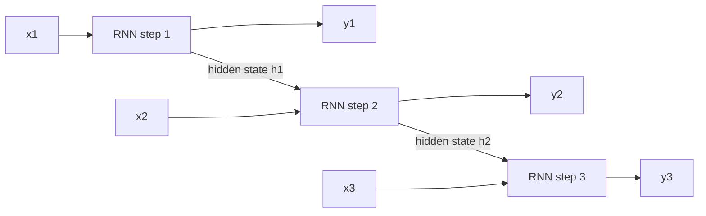

# Introduction: Foundations and History

## The big picture

This book explains how large language models work, with real arithmetic at every step. Before [Chapter 1](01-transformers.md) opens up the Transformer, this introduction does two things:

1. **Foundations.** It explains the small amount of maths and machine learning the rest of the book relies on: vectors, matrices, the dot product, and what a neural network, a loss and an embedding are.
2. **History.** It tells the story of how computers learned to model text, from one-hot vectors to Word2Vec to recurrent networks, and why each approach hit a wall that the Transformer removed.

Readers who already know linear algebra and basic machine learning can skip to the history sections, or go straight to [Chapter 1](01-transformers.md).

## What you need to know first

Everything a language model does is arithmetic on lists and tables of numbers. This section explains those lists and tables, and the few operations the book uses on them, each with a tiny example you can check by hand.

### Vectors

A **vector** is an ordered list of numbers. In language models, each token is represented by a vector. In Chapter 1's example, the token CAT is represented (in shortened form) by the vector \[0.81, 0.10, −0.52\]: 3 numbers, so its **length** or **dimension** is 3. In the real base model each token's vector has 512 numbers, the value called **d\_model**.

### The dot product: a measure of similarity

The **dot product** of two vectors of the same length multiplies them number by number and adds the results. It produces a single number that is large when the two vectors point in a similar direction, near 0 when they are unrelated, and negative when they point in opposite directions.

**Worked example** with three token vectors from [Chapter 1's embedding table](01-transformers.md#token-embeddings) (made-up numbers):

| Pair | Number-by-number products | Dot product |
| --- | --- | --- |
| CAT \[0.81, 0.10, −0.52\] · DOG \[0.77, 0.15, −0.48\] | 0.6237 + 0.0150 + 0.2496 | **0.888** |
| CAT \[0.81, 0.10, −0.52\] · A \[−0.05, 0.08, 0.91\] | −0.0405 + 0.0080 − 0.4732 | **−0.506** |

CAT and DOG, words used in similar ways, have a large positive dot product; CAT and the article A have a negative one. Attention in Chapter 1 is built on exactly this operation: it uses dot products to decide how much each token should look at each other token.

### Matrices and their shapes

A **matrix** is a table of numbers with rows and columns. Its **shape** is written rows × columns. Stacking the vectors of a 6-token sentence, each with 512 numbers, gives a 6 × 512 matrix: one row per token.

### Matrix multiplication

To multiply matrix A by matrix B, take the dot product of **each row of A** with **each column of B**. The result has as many rows as A and as many columns as B. The rule for shapes:

$$
(m \times n) \cdot (n \times p) = (m \times p)
$$

The inner numbers (n) must match, because each dot product pairs a row of n numbers with a column of n numbers. **m**, **n** and **p** are just the sizes of the matrices.

**Worked example: a 2 × 3 matrix times a 3 × 2 matrix.**

$$
A = \begin{bmatrix} 1 & 2 & 3 \\ 4 & 5 & 6 \end{bmatrix} \qquad B = \begin{bmatrix} 1 & 0 \\ 0 & 1 \\ 2 & 1 \end{bmatrix}
$$

| Result cell | Row of A · column of B | Value |
| --- | --- | --- |
| Row 1, column 1 | \[1, 2, 3\] · \[1, 0, 2\] = 1 + 0 + 6 | 7 |
| Row 1, column 2 | \[1, 2, 3\] · \[0, 1, 1\] = 0 + 2 + 3 | 5 |
| Row 2, column 1 | \[4, 5, 6\] · \[1, 0, 2\] = 4 + 0 + 12 | 16 |
| Row 2, column 2 | \[4, 5, 6\] · \[0, 1, 1\] = 0 + 5 + 6 | 11 |

$$
A \cdot B = \begin{bmatrix} 7 & 5 \\ 16 & 11 \end{bmatrix} \qquad (2 \times 3) \cdot (3 \times 2) = (2 \times 2)
$$

In Chapter 1 the same rule turns a sentence's 6 × 512 matrix into its queries: (6 × 512) · (512 × 64) = 6 × 64, one 64-number query per token ([Where Q, K and V come from](01-transformers.md#where-q-k-and-v-come-from)).

### The transpose

The **transpose** of a matrix, written with a superscript T, swaps its rows and columns: row 1 becomes column 1, and so on. A 2 × 3 matrix becomes 3 × 2:

$$
A^T = \begin{bmatrix} 1 & 4 \\ 2 & 5 \\ 3 & 6 \end{bmatrix}
$$

The attention formula in Chapter 1 uses QKᵀ: transposing K turns its rows (one per token) into columns, so that multiplying Q by Kᵀ computes the dot product of every query with every key in one matrix multiplication.

### What a neural network is

A **neural network** is a function built from many simple steps, each with adjustable numbers called **weights**. The basic step, one **neuron**, does three things:

1. Multiply each input by a weight and add the results (a dot product).
2. Add one more number, the **bias**.
3. Apply an **activation function**, a simple non-linear rule. A common one is **ReLU**: keep the value if it is positive, otherwise output 0.

**Worked example:** inputs \[2, 3\], weights \[0.5, −1\], bias 1:

- Weighted sum: 2 × 0.5 + 3 × (−1) = 1 − 3 = −2. Add the bias: −2 + 1 = −1.
- ReLU(−1) = 0. The neuron outputs 0.

With weights \[0.5, 1\] instead, the sum is 1 + 3 + 1 = 5 and the output is 5. Changing the weights changes what the neuron computes; that is all "learning" will mean.

A **layer** is many neurons working side by side on the same inputs, which is a matrix multiplication followed by the activation. A network stacks layers, each feeding the next. The Transformer's feed-forward network ([Chapter 1](01-transformers.md#the-feed-forward-network-in-detail)) is exactly two such layers.

Without the activation, stacking layers would be pointless: several matrix multiplications in a row equal one matrix multiplication, which can only describe straight-line relationships. The non-linear activation is what lets a deep network learn complicated patterns.

### Loss and training

- **Loss:** one number that measures how wrong the network's outputs are on some examples. Lower is better.
- **Training:** repeatedly adjusting every weight by a tiny amount in the direction that lowers the loss, over many examples.

[Chapter 2](02-training.md) explains both in detail with real numbers: the loss used for language (cross-entropy), how the direction to move each weight is found (gradients and backpropagation), and how each step is taken.

### Embeddings

An **embedding** is a learned vector that represents an item, such as a word or a token. A model keeps a table with one row per item; to represent an item, it reads that item's row. The numbers in the table start random and are adjusted by training, so items used in similar ways end up with similar vectors, as CAT and DOG did in the dot-product example. The rest of this introduction tells the story of how such vectors were invented, and [Chapter 1](01-transformers.md#token-embeddings) shows how a Transformer uses them.

## Historical evolution of text modelling

Today's chat assistants are the result of about a decade of steps, each fixing a limit of the one before. Knowing the order of those steps explains why the Transformer was such a turning point, and why the rest of this introduction looks at older methods at all.

### Timeline

| Year | Step | What changed |
| --- | --- | --- |
| 1997 | LSTM | A recurrent network that can remember information over longer stretches of text (explained later in this introduction) |
| 2013 | Word2Vec | Words get learned vectors in which similar words are close together |
| 2014 | Sequence-to-sequence with attention | Recurrent encoder–decoder networks translate whole sentences; attention lets the decoder look back at the source words |
| 2017 | The Transformer, "Attention Is All You Need" | Recurrence is removed entirely; attention alone, computed in parallel ([Chapter 1](01-transformers.md#attention-is-all-you-need-2017)) |
| 2018 | BERT and GPT | One large model is pre-trained on plain text, then adapted to many tasks |
| 2019 | GPT-2 | 1.5 billion weights; it writes surprisingly fluent paragraphs |
| 2020 | GPT-3 | 175 billion weights; it can do new tasks from a few examples in the prompt, without retraining |
| 2022 | ChatGPT | Fine-tuning and preference training ([Chapter 2](02-training.md#stages-of-an-llms-life-pre-training-fine-tuning-and-preference-training)) turn a text predictor into an assistant |
| 2023–2026 | Modern assistants and agents | Chat models such as Claude handle long documents and images, use tools, and act as coding agents that write, run and fix code over many steps |

### The task-specific era (the 2010s)

Before the Transformer, natural language processing meant building **a separate model for each task**:

- one model for **sentiment analysis** (is this review positive or negative?),
- another for **translation** (English to German),
- another for **named-entity recognition** (find the people, places and companies in a text).

Each was usually a recurrent neural network (RNN) trained from scratch on its own labelled data, often a few hundred thousand examples. Nothing learned by the sentiment model helped the translation model. Labelled data was expensive, so each model saw only a small slice of language, and every new task meant starting again.

### The turning point (2017)

The Transformer replaced recurrence with attention ([Chapter 1](01-transformers.md)). The important consequence was not only better translation: because every position is processed **in parallel** during training ([Chapter 2](02-training.md#why-training-happens-in-one-time-step)), Transformers could be trained on far more data with far more weights than recurrent networks, using the same hardware. One architecture now **scaled**: more data, more weights and more compute reliably gave a better model.

### Scaling to modern LLMs (2018–2026)

From 2018, the approach changed from "one model per task" to "**one model for all tasks**":

1. **Pre-train** one large model on huge amounts of unlabelled text, with the simple goal of predicting the next token. No human labels are needed ([Chapter 2](02-training.md#three-ideas-weights-prediction-error)).
2. **Adapt** it to each use: by fine-tuning on a small labelled set, by giving examples in the prompt, or simply by asking in plain language.

Model sizes grew very fast:

| Model | Year | Weights | Compared with the 2017 base model |
| --- | --- | --- | --- |
| Transformer (base) | 2017 | 65 million | 1× |
| GPT-2 | 2019 | 1.5 billion | about 23× |
| GPT-3 | 2020 | 175 billion | about 2,700× |

Larger models trained on more text kept getting better, and new abilities appeared along the way: following instructions, writing code, explaining their reasoning. After preference training made them helpful assistants (2022), the next steps were longer contexts, tool use and **agents**: models that plan, call tools, read the results and continue over many steps, such as coding agents that work inside a software project.

The sections below go back to the beginning of this story, to see the problems these steps solved: how words were first turned into vectors, and why the recurrent networks of the task-specific era could not scale.

## Vector embeddings: static representations

A model can only compute with numbers, so every word must first become a vector. How that vector is chosen decides what the model can know about the word. This section follows the two classic answers: one-hot vectors, which carry no meaning at all, and Word2Vec, the first widely used learned vectors, which carry meaning but still have serious limits.

### One-hot encoding

**One-hot encoding** gives each word in the vocabulary its own position. A word's vector has a 1 at its position and 0 everywhere else, so the vector is as long as the vocabulary.

**Worked example** with a 5-word vocabulary: cat, dog, bank, river, money.

| Word | One-hot vector |
| --- | --- |
| cat | \[1, 0, 0, 0, 0\] |
| dog | \[0, 1, 0, 0, 0\] |
| bank | \[0, 0, 1, 0, 0\] |
| river | \[0, 0, 0, 1, 0\] |
| money | \[0, 0, 0, 0, 1\] |

Now measure similarity with the dot product from the foundations section:

- cat · dog = 1×0 + 0×1 + 0×0 + 0×0 + 0×0 = **0**
- cat · bank = **0**
- The same holds for every pair of different words: the dot product is always 0, and the distance between any two words is always √2 ≈ 1.414.

The vectors are **orthogonal** (at right angles to each other): "cat" is exactly as far from "dog" as from "bank". One-hot vectors identify words but say nothing about their meaning. They are also wasteful: with a 50,000-word vocabulary, every word needs 50,000 numbers, all but one of them 0.

### Word2Vec: learning vectors from context

**Word2Vec** (Mikolov and colleagues at Google, 2013) learns a short, dense vector for every word, typically 300 numbers, with the idea that **a word is known by the company it keeps**: words that appear in similar contexts should get similar vectors.

It learns them with a **proxy task**: a simple prediction task nobody actually needs solved, set up only because solving it forces useful vectors to form. Take the sentence "the cat sat on the mat" and a **context window** of 2 words on each side of the word "sat":

| Proxy task | Input | Prediction target |
| --- | --- | --- |
| **CBOW** (continuous bag of words) | The context: the, cat, on, the | The middle word: sat |
| **Skip-gram** | The middle word: sat | Each context word: the, cat, on, the |

Training slides this window over billions of words of text and adjusts the vectors to make these predictions better, just as training adjusts weights to lower a loss ([Chapter 2](02-training.md#what-training-is)). Because "cat" and "dog" appear among the same neighbours (the, sat, fed, pet), they end up with similar vectors. The prediction task is then thrown away; the vectors are the product.

### Vector arithmetic: Paris − France + Germany ≈ Berlin

The learned space has a striking property: **directions carry meaning**. The step from a country to its capital points in roughly the same direction for every country, so it can be computed with ordinary vector arithmetic.

**Illustrative 2-D example** (made-up vectors; real Word2Vec vectors have about 300 numbers):

| Word | Vector |
| --- | --- |
| France | (1, 1) |
| Paris | (1, 3) |
| Germany | (4, 1) |
| Berlin | (4.1, 2.9) |
| Italy | (7, 1) |
| Rome | (7, 3.1) |

1. Paris − France = (1 − 1, 3 − 1) = (0, 2): the "capital of" direction.
2. Add Germany: (0, 2) + (4, 1) = **(4, 3)**.
3. Find the word whose vector is closest to (4, 3):

| Word | Distance from (4, 3) |
| --- | --- |
| **Berlin** | **0.14** |
| Germany | 2.00 |
| Paris | 3.00 |
| Rome | 3.00 |
| France, Italy | 3.61 |

The nearest word is Berlin. Nobody told Word2Vec what a capital is: the relationship emerged because capitals and their countries appear in similar contexts across many texts.

### The limits of Word2Vec

Word2Vec vectors are **static**: each word has exactly one vector, fixed after training, used in every sentence. That causes two problems.

- **No polysemy.** **Polysemy** means one word having several meanings. "Bank" in "the river bank" and in "the bank raised its rates" gets the same vector, a blurred average of both meanings. The model cannot tell which one a sentence means.
- **No word order.** The vectors of "dog bites man" and "man bites dog" are the same three vectors. Word vectors alone say what words mean in general, not what a particular sentence says.

The Transformer keeps the idea of a learned vector per token, its embedding table ([Chapter 1](01-transformers.md#token-embeddings)), but then lets attention change each token's vector according to the other tokens in the sentence. The starting vector of "bank" is still fixed, as [Chapter 1 notes](01-transformers.md#what-is-learned-and-what-changes-after-training); attention is what turns it into "river bank" or "money bank". Word order is added through positional encoding. Before that, the first attempt to read sentences in order was the recurrent network, described next.

## Sequence architectures: RNNs and LSTMs

Word vectors say what words mean in general; to understand a sentence, a model must also read the words in order and combine them. Recurrent networks were the standard way to do that for most of the 2010s. Seeing how they work, and where they fail, explains exactly what the Transformer changed.

### The recurrent neural network (RNN)

A **recurrent neural network (RNN)** reads a sequence one token at a time. It keeps a **hidden state**: a vector that acts as its memory of everything read so far. At each step it combines the new token with the previous hidden state to make the next hidden state:

$$
h_t = \tanh\left(W_x\, x_t + W_h\, h_{t-1} + b\right)
$$

- **x\_t** is the vector of the token at step t.
- **$h_{t-1}$** is the hidden state from the previous step (all zeros before the first step), and **h\_t** the new one.
- **W\_x** and **W\_h** are weight matrices, and **b** a bias. The **same** weights are used at every step: that reuse is what "recurrent" means.
- **tanh** is an activation function that squeezes any number into the range −1 to 1.

At each step the RNN can also produce an output y\_t from h\_t, for example a prediction of the next word.

### Worked example: three steps

To keep the arithmetic readable, each token and the hidden state are single numbers instead of vectors (made-up values): W\_x = 0.5, W\_h = 0.8, b = 0, and the start state h₀ = 0. The three tokens of `YOUR CAT IS` are represented by the numbers 1.0, 0.5 and −0.5.

| Step | Token value x\_t | 0.5 × x\_t | 0.8 × $h_{t-1}$ | Sum | h\_t = tanh(sum) |
| --- | --- | --- | --- | --- | --- |
| 1 (YOUR) | 1.0 | 0.50 | 0.8 × 0 = 0.000 | 0.500 | 0.462 |
| 2 (CAT) | 0.5 | 0.25 | 0.8 × 0.462 = 0.370 | 0.620 | 0.551 |
| 3 (IS) | −0.5 | −0.25 | 0.8 × 0.551 = 0.441 | 0.191 | 0.189 |

The final state 0.189 is the network's whole memory of the three words. Each step had to wait for the previous one, because step 2 needs h₁ and step 3 needs h₂.

### The LSTM

The **LSTM** (long short-term memory, Hochreiter and Schmidhuber, 1997) is an RNN designed to remember for longer. Besides the hidden state, it keeps a **cell state**, a second memory vector, and three **gates**. Each gate is a set of numbers between 0 and 1, computed from the current token and the previous hidden state, that controls how much information flows:

- **Forget gate:** how much of the old cell state to keep. A value of 1 keeps everything; 0 erases it.
- **Input gate:** how much of the new token's information to write into the cell state.
- **Output gate:** how much of the cell state to reveal in the hidden state at this step.

The key is that the cell state is updated mostly by multiplying by the forget gate and adding new information, rather than being squeezed through tanh at every step. If the forget gate stays near 1, information survives for many steps: with a forget gate of 0.99, about 0.99⁵⁰ ≈ 0.61 of a stored value is still there after 50 steps. LSTMs powered most translation and speech systems from about 2014 to 2017.

### Why RNNs hit a wall

**1. Vanishing and exploding gradients.** Training needs gradients ([Chapter 2](02-training.md#the-gradient-which-way-to-move-each-weight)) that tell each weight how it affected the loss. In an RNN, the effect of an early word on a late prediction passes back through every step in between, and is multiplied by W\_h (times the slope of tanh, which is at most 1) at each step:

| Steps between the word and the prediction | Factor with W\_h = 0.8 (vanishing) | Factor with W\_h = 1.2 (exploding) |
| --- | --- | --- |
| 10 | 0.8¹⁰ = 0.107 | 1.2¹⁰ = 6.2 |
| 20 | 0.8²⁰ = 0.012 | 1.2²⁰ = 38.3 |
| 50 | 0.8⁵⁰ = 0.000014 | 1.2⁵⁰ ≈ 9,100 |

With a factor below 1, the signal from 50 words back almost disappears, so the network cannot learn from it (**vanishing gradient**). With a factor above 1, it grows so large that training becomes unstable (**exploding gradient**). LSTMs reduce the problem but do not remove it.

**2. Long-range dependencies are hard.** In "The keys that the man left on the kitchen table **are** missing", the verb "are" must agree with "keys", eight words earlier. Everything the network knows about "keys" must survive eight updates of one fixed-size hidden state, shared with everything else it is trying to remember. The longer the gap, the more likely it is lost.

**3. Sequential processing blocks parallel training.** Step t cannot start until step t − 1 has finished. A 1,000-token text needs 1,000 steps one after another, even on a GPU that could do thousands of calculations at once. This makes RNNs slow to train on large datasets, which kept them small.

### The bridge to Chapter 1

The Transformer removes all three problems by dropping recurrence and using **attention**: every token looks directly at every other token ([Chapter 1](01-transformers.md#the-problem-it-solved)).

| RNN problem | How attention removes it |
| --- | --- |
| Vanishing and exploding gradients across many steps | Any two tokens are one attention step apart, so the gradient between them does not pass through a long chain of multiplications |
| Long-range dependencies squeezed into one hidden state | "are" can attend to "keys" directly, however far back it is |
| Sequential processing | All positions are computed at once in training ([Chapter 2](02-training.md#why-training-happens-in-one-time-step)), so GPUs are fully used |

That last point is what made today's models possible: once training could use parallel hardware fully, models and datasets could grow by thousands of times, as the timeline above shows. [Chapter 1](01-transformers.md) explains how the Transformer works, step by step.

## Cheat sheet

| Concept | One-line meaning |
| --- | --- |
| Vector | An ordered list of numbers; one per token in a language model |
| Dot product | Multiply number by number and add: large when two vectors are similar |
| Matrix and shape | A table of numbers, described as rows × columns |
| Matrix multiplication | Row-by-column dot products; (m × n) · (n × p) = (m × p) |
| Transpose | Swap rows and columns; QKᵀ compares every query with every key |
| Neuron | Weighted sum + bias, then an activation such as ReLU |
| Layer and network | Many neurons side by side; layers stacked one after another |
| Loss and training | A number measuring error; adjust the weights to lower it |
| Embedding | A learned vector per item, read from a table |
| Task-specific era | One separately trained model per task, usually an RNN |
| Pre-train, then adapt | One large model trained on plain text, then used for many tasks |
| One-hot vector | A 1 at the word's position, 0 elsewhere: no notion of similarity |
| Word2Vec | Dense word vectors learned by predicting words from their context (CBOW) or context from a word (skip-gram) |
| Vector arithmetic | Paris − France + Germany ≈ Berlin: directions in the space carry meaning |
| Static embedding | One vector per word in every sentence: no polysemy, no word order |
| RNN | Reads tokens one at a time, carrying a hidden state as memory |
| LSTM | An RNN with a cell state and gates that keep information longer |
| Vanishing / exploding gradient | Signals shrink or grow when multiplied through many steps |
| Why the Transformer won | Attention connects any two tokens directly and trains all positions in parallel |

## Sources

- [Deep Learning (Goodfellow, Bengio and Courville, 2016)](https://www.deeplearningbook.org/): linear algebra, neural networks and recurrent networks
- [Speech and Language Processing, 3rd edition draft (Jurafsky and Martin)](https://web.stanford.edu/~jurafsky/slp3/): word vectors, RNNs and LSTMs
- [Efficient Estimation of Word Representations in Vector Space (Mikolov et al., 2013)](https://arxiv.org/abs/1301.3781): Word2Vec, CBOW and skip-gram
- [Distributed Representations of Words and Phrases and their Compositionality (Mikolov et al., 2013)](https://arxiv.org/abs/1310.4546): word-vector arithmetic
- [Long Short-Term Memory (Hochreiter and Schmidhuber, 1997)](https://doi.org/10.1162/neco.1997.9.8.1735)
- [Sequence to Sequence Learning with Neural Networks (Sutskever et al., 2014)](https://arxiv.org/abs/1409.3215)
- [Neural Machine Translation by Jointly Learning to Align and Translate (Bahdanau et al., 2014)](https://arxiv.org/abs/1409.0473): attention added to recurrent translation
- [Attention Is All You Need (Vaswani et al., 2017)](https://arxiv.org/abs/1706.03762)
- [BERT: Pre-training of Deep Bidirectional Transformers for Language Understanding (Devlin et al., 2018)](https://arxiv.org/abs/1810.04805)
- [Improving Language Understanding by Generative Pre-Training (Radford et al., 2018)](https://cdn.openai.com/research-covers/language-unsupervised/language_understanding_paper.pdf): GPT
- [Language Models are Unsupervised Multitask Learners (Radford et al., 2019)](https://cdn.openai.com/better-language-models/language_models_are_unsupervised_multitask_learners.pdf): GPT-2
- [Language Models are Few-Shot Learners (Brown et al., 2020)](https://arxiv.org/abs/2005.14165): GPT-3
- [Scaling Laws for Neural Language Models (Kaplan et al., 2020)](https://arxiv.org/abs/2001.08361): why larger models and datasets keep improving results
