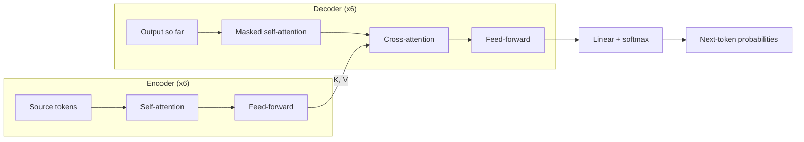

# How Transformers Work: BPE, Attention and Q/K/V

## The big picture

A language model turns text into numbers, mixes those numbers with attention, and predicts the next token. Every step is ordinary arithmetic on vectors; nothing is hand-coded about grammar or meaning.

1. **Tokenize.** A BPE tokenizer splits text into sub-word pieces, for example `unbelievable` → `un` · `believ` · `able`. Each piece has an integer ID.
2. **Embed.** Each ID selects a learned vector, for example 512 numbers long.
3. **Add position.** A position signal is added so the model knows word order.
4. **Transformer blocks (repeated N times).** Attention lets every token pull information from other tokens. A small feed-forward network then refines each token on its own.
5. **Predict.** The final vector is scored against every token in the vocabulary. Softmax turns the scores into probabilities.
6. **Generate.** Pick a token, append it to the input, and repeat.

The rest of this document walks through each step, with most detail on attention and where Q, K and V come from.

## BPE tokenizer: from text to token IDs

Byte Pair Encoding (BPE) builds a vocabulary by repeatedly merging the most frequent pair of adjacent symbols, starting from single characters. Frequent words end up as one token; rare words split into known pieces.

### Word, character, subword or byte?

**Why not just use words or characters?** A word vocabulary cannot handle a word it never saw (a typo, a new name, `Trusteer`). A character vocabulary handles anything but makes sequences very long, and attention cost grows with length squared. BPE sits in the middle. It started as a compression algorithm (Gage, 1994) and was adapted for translation by Sennrich et al. (2016). GPT-2 and later models use byte-level BPE: the starting alphabet is the 256 possible bytes, so any text in any language can be encoded with no "unknown" token.

A word missing from a word vocabulary is called **out-of-vocabulary (OOV)**. A word-level tokenizer can only replace it with a special unknown token, `[UNK]`, and its meaning is lost. The four possible sizes of token compare as follows:

| Token unit | Vocabulary size | Sequence length | Unknown words? | Example: `unbelievable` |
| --- | --- | --- | --- | --- |
| Word | Very large (hundreds of thousands of words) | Shortest | Yes: OOV words become `[UNK]` | 1 token if the word is in the vocabulary, otherwise `[UNK]` |
| Character | Small (letters, digits, punctuation) | Very long | No | 12 tokens: `u` `n` `b` `e` `l` `i` `e` `v` `a` `b` `l` `e` |
| Subword (BPE) | Medium, typically 32,000 to 128,000 | Medium | No: rare words split into known pieces | 3 tokens: `un` · `believ` · `able` |
| Byte | Fixed at 256 | Long | No: any text is a sequence of bytes | 12 bytes, the same as characters for plain English letters |

**Why bytes help.** Computers store text as **bytes** (numbers from 0 to 255) using the UTF-8 encoding. A plain English letter takes 1 byte, but other characters take more: `é` in `café` takes 2 bytes (so the 4-character word is 5 bytes), and the emoji 😀 takes 4. A character vocabulary would need an entry for every character of every language, more than 150,000; a byte vocabulary never needs more than 256. **Byte-level BPE** starts from those 256 bytes and then learns merges exactly as below, so common words still become single tokens while any rare symbol can always fall back to its bytes. This is why modern models never produce `[UNK]`.

### Training: learning the merges

1. Split every word in the training corpus into characters, with an end-of-word marker `</w>`.
2. Count every pair of adjacent symbols, weighted by how often the word occurs.
3. Merge the most frequent pair into a new symbol and add it to the vocabulary. Record the merge.
4. Repeat steps 2–3 until the vocabulary reaches the target size (a hyperparameter, e.g. 32,000 or 50,257).

**Worked example.** Corpus word counts: `low` ×5, `lower` ×2, `newest` ×6, `widest` ×3. Starting symbols:

- `l o w </w>` (5) · `l o w e r </w>` (2) · `n e w e s t </w>` (6) · `w i d e s t </w>` (3)

| Step | Pair merged | Count | Why that count | New token |
| --- | --- | --- | --- | --- |
| 1 | `e` + `s` | 9 | newest 6 + widest 3 | `es` |
| 2 | `es` + `t` | 9 | newest 6 + widest 3 | `est` |
| 3 | `est` + `</w>` | 9 | newest 6 + widest 3 | `est</w>` |
| 4 | `l` + `o` | 7 | low 5 + lower 2 | `lo` |
| 5 | `lo` + `w` | 7 | low 5 + lower 2 | `low` |

After five merges, `newest` is `n e w est</w>` and `low` is a single token. The word `lowest` never appeared in the corpus, yet it encodes cleanly as `low` · `est</w>`: two tokens built from patterns the tokenizer did learn.

### Encoding new text

Once trained, the tokenizer is a **recipe**: the list of merges in the order they were learned, plus a table giving each token an ID. To encode any new word, you replay that recipe.

1. **Split** the word into single characters and add `</w>` at the end.
2. **Apply the merges in learned order.** Go down the merge list from merge 1; wherever a merge's pair appears, join it. A merge that does not apply is skipped.
3. **Look up** each final piece in the vocabulary table to get its ID.

**Example 1: `lowest`** (never seen in training), using the 5 merges from the table above:

| Step | Merge applied | Pieces after this step |
| --- | --- | --- |
| Start | split into characters | `l` `o` `w` `e` `s` `t` `</w>` |
| 1 | `e` + `s` | `l` `o` `w` `es` `t` `</w>` |
| 2 | `es` + `t` | `l` `o` `w` `est` `</w>` |
| 3 | `est` + `</w>` | `l` `o` `w` `est</w>` |
| 4 | `l` + `o` | `lo` `w` `est</w>` |
| 5 | `lo` + `w` | `low` `est</w>` |

Result: 2 tokens, `low` and `est</w>`. With illustrative IDs, that becomes \[1031, 2754\], which is what the model actually receives.

**Example 2: `newer`.** Split gives `n` `e` `w` `e` `r` `</w>`. None of the 5 merges matches any adjacent pair, so nothing joins. The word stays as 6 single-character tokens. It can still be encoded, just less efficiently: no word is ever "unknown", it simply costs more tokens.

**Decoding** runs the other way: turn each ID back into its text piece, glue the pieces together, and turn `</w>` into a space. \[1031, 2754\] → `low` + `est</w>` → "lowest ".

### Practical consequences

- **Tokens are not words.** A leading space is usually part of the token, so `" cat"` and `"cat"` have different IDs (GPT-2 shows the space as `Ġ`).
- **Rough rule:** about 0.75 English words per token. Other languages and code often need more tokens per word.
- **Letter-level tasks are hard.** The model sees `strawberry` as two or three chunks, not ten letters, which is why counting letters trips models up.
- **The tokenizer is fixed before model training.** The model learns about tokens; it never sees raw characters.

**Other subword algorithms.** BPE is the most common way to build a subword vocabulary, but two others are widely used:

- **WordPiece** also merges pairs, but chooses the pair with the highest score = frequency of the pair ÷ (frequency of the first part × frequency of the second part), so it favours parts that rarely appear apart. On the corpus above, BPE's first merge is `e` + `s` (9 times); WordPiece's is `i` + `d`, which occurs only 3 times but never separately: 3 ÷ (3 × 3) = 0.333, against 9 ÷ (17 × 9) = 0.059 for `e` + `s`. WordPiece marks a piece that continues a word with `##`, for example `play` `##ing`.
- **Unigram** works the other way round: it starts from a very large vocabulary of candidate pieces and repeatedly removes the pieces whose removal hurts least, until the target size is reached. To encode a word, it picks the most probable of the possible splits.

| Algorithm | Builds the vocabulary by | Used by (examples) |
| --- | --- | --- |
| BPE (usually byte-level) | Merging the most frequent pair | GPT-2 and later GPT models, Llama 3 |
| WordPiece | Merging the highest-scoring pair | BERT and its family |
| Unigram | Removing the least useful pieces from a large set | T5 |

**SentencePiece** is not a fourth algorithm but a widely used library that runs BPE or Unigram directly on raw text, treating the space as an ordinary symbol, written `▁`. This suits languages such as Japanese or Chinese that do not separate words with spaces.

### Does the tokenizer change during or after training?

No. The BPE tokenizer is trained **first**, on its own, by counting and merging pairs as above. That step has no neural network and no gradients. Its output (the merge list and the token-to-ID table) is then frozen.

- **During model training:** the tokenizer is only *used*, to turn training text into IDs. The model's weights change; the tokenizer does not.
- **After training:** the same tokenizer must be used at inference. `lowest` is always `low` · `est</w>` with the same two IDs. Swap in a different tokenizer and the IDs point to the wrong rows of the embedding table, so the model produces nonsense.
- **Training the tokenizer** happens once per model family; that is why a model card always names its tokenizer and vocabulary size.

## From token IDs to vectors

This step turns each token into a list of numbers the network can compute with. It happens in two moves: token → **token ID** (a whole number), then token ID → **embedding vector** (512 numbers). A position vector is then added, giving a matrix X with one row per token. X is the input to the first Transformer block.

### What is a token ID?

A **token ID** is a whole number that identifies one token: it is the token's position (index) in the tokenizer's vocabulary table. If the vocabulary has 50,000 tokens, the IDs run from 0 to 49,999.

| Token | Token ID |
| --- | --- |
| YOUR | 105 |
| CAT | 6587 |
| IS | 5475 |
| A | 3578 |
| LOVELY | 65 |

- **Assigned once,** when the tokenizer is built, and never changed. `CAT` is 6587 in every sentence, in training and in use.
- **Just a label, with no meaning.** ID 65 and ID 66 are not related in any way, the same way two phone numbers that differ by one digit belong to unrelated people. The model cannot learn anything from the number itself.
- **What the model actually receives.** The text `YOUR CAT IS A LOVELY CAT` reaches the model only as the list \[105, 6587, 5475, 3578, 65, 6587\].

### Token embeddings

A token ID carries no meaning, so the model replaces each ID with a list of numbers that **can** carry meaning: an embedding vector. Three terms make this precise:

- **Vocabulary:** the complete, fixed list of every token the tokenizer knows, built during BPE training. GPT-2's vocabulary has 50,257 tokens; the token ID is a token's place in this list.
- **d\_model:** the length of each token's vector, i.e. how many numbers describe one token. In the paper d\_model = 512. The same size is kept through every layer of the model, which is why it is called the model dimension.
- **E (the embedding matrix):** "E" is just the name given to this table, short for *Embedding*. It has one row per vocabulary token and d\_model columns, so with a 50,000-token vocabulary it is 50,000 rows × 512 columns of numbers.

Putting it together: the token ID tells the model **which row** to read, and E is **the table** it reads from. For `CAT` (ID 6587), the model reads row 6587 of the embedding table E and gets 512 numbers. That list of 512 numbers is the token's embedding.

**Worked example,** using the same token IDs as the sentence above. A real row of E has 512 numbers; here each row is shortened to 3 numbers so it fits on the page. The numbers are made up.

| Token ID = row of E | Token | That row of E (shortened to 3 numbers) |
| --- | --- | --- |
| 65 | LOVELY | \[0.45, 0.62, −0.11\] |
| 105 | YOUR | \[0.12, −0.40, 0.33\] |
| 3578 | A | \[−0.05, 0.08, 0.91\] |
| 4012 | DOG | \[0.77, 0.15, −0.48\] |
| 5475 | IS | \[−0.30, 0.66, 0.05\] |
| 6587 | CAT | \[0.81, 0.10, −0.52\] |

(DOG is not in the sentence; it is included for comparison, and its ID is invented.)

Follow the words `YOUR CAT IS` through the table:

1. **Text:** `YOUR CAT IS`
2. **Token IDs** from the tokenizer: \[105, 6587, 5475\]
3. **Read those rows of E:** row 105 → \[0.12, −0.40, 0.33\]; row 6587 → \[0.81, 0.10, −0.52\]; row 5475 → \[−0.30, 0.66, 0.05\]
4. **Result:** one vector per word, stacked in sentence order. Here that is 3 words × 3 numbers; in the real model it is 3 words × 512 numbers.

- **Where the numbers come from:** E starts filled with random numbers and is learned during training, like every other weight. After training it is frozen.
- **Why it works:** tokens used in similar contexts get pushed toward similar vectors. In the table, `cat` and `dog` have close vectors even though their IDs mean nothing; that closeness is the learned meaning.

$$
\text{token} \xrightarrow{\text{tokenizer}} \text{token ID } k \xrightarrow{\text{row } k \text{ of } E} \text{embedding } \in \mathbb{R}^{d_{model}}
$$

### Positional encoding

A position vector of the same size as the embedding (512 numbers) is **added** to each token's embedding, so every token carries both what it means and where it sits.

**Why it is needed.** Attention compares every token with every other token at once, with no notion of left or right. Shuffle the words and each token receives exactly the same mix of information. Without a position signal, "dog bites man" and "man bites dog" would look identical to the model.

**What a good position signal must do:**

1. Give each token information about its position in the sentence.
2. Make nearby words look "close" and distant words look "distant".
3. Follow a regular pattern the model can learn to read.

### How it is added: a worked sentence

Take the sentence `YOUR CAT IS A LOVELY CAT`. Each token's embedding (512 numbers) gets the position vector for its slot added element by element. The sum is the encoder input.

| Position | Token | Token ID | Embedding (512) | + Position vector (512) | = Encoder input (512) |
| --- | --- | --- | --- | --- | --- |
| 0 | YOUR | 105 | E\[105\] | PE(0) | E\[105\] + PE(0) |
| 1 | CAT | 6587 | E\[6587\] | PE(1) | E\[6587\] + PE(1) |
| 2 | IS | 5475 | E\[5475\] | PE(2) | E\[5475\] + PE(2) |
| 3 | A | 3578 | E\[3578\] | PE(3) | E\[3578\] + PE(3) |
| 4 | LOVELY | 65 | E\[65\] | PE(4) | E\[65\] + PE(4) |
| 5 | CAT | 6587 | E\[6587\] | PE(5) | E\[6587\] + PE(5) |

Notice that `CAT` appears twice. Both copies get the **same** embedding E\[6587\], but different position vectors PE(1) and PE(5), so the encoder receives two different inputs. That is how the model can tell the first cat from the second.

PE(1) is the same vector in every sentence: position 1 in "YOUR CAT IS…" and position 1 in "I LOVE YOU" both receive PE(1). The position vectors depend only on the position and d\_model, never on the words, so they are **computed once and reused** for every sentence, in training and in inference.

### The formula

Each dimension of the position vector is a sine or cosine wave. Even dimensions use sine, odd dimensions use cosine, and each pair of dimensions uses a different wavelength:

$$
PE_{(pos,\,2i)} = \sin\!\left(\frac{pos}{10000^{2i/d_{model}}}\right) \qquad PE_{(pos,\,2i+1)} = \cos\!\left(\frac{pos}{10000^{2i/d_{model}}}\right)
$$

- **pos** is the token's position (0, 1, 2, …).
- **i** indexes dimension pairs: 2i is an even dimension, 2i + 1 the odd one after it, up to dimension 511.
- The divisor 10000^(2i/d\_model) grows with i, so early dimensions oscillate fast and later dimensions oscillate very slowly.

**Worked numbers** with a tiny d\_model = 4 (dimension 0–1 use divisor 1; dimensions 2–3 use divisor 10000^(2/4) = 100):

| pos | dim 0: sin(pos) | dim 1: cos(pos) | dim 2: sin(pos/100) | dim 3: cos(pos/100) |
| --- | --- | --- | --- | --- |
| 0 | 0.000 | 1.000 | 0.000 | 1.000 |
| 1 | 0.841 | 0.540 | 0.010 | 1.000 |
| 2 | 0.909 | −0.416 | 0.020 | 1.000 |
| 3 | 0.141 | −0.990 | 0.030 | 1.000 |

Dimensions 0–1 change a lot from one word to the next; dimensions 2–3 barely move. Think of a clock: the second hand (fast dimensions) separates neighbouring words, while the hour hand (slow dimensions) tells near from far across a long text. Together every position gets a unique fingerprint.

### Why sine and cosine?

- **Smooth and continuous.** Neighbouring positions get similar vectors and distant positions get different ones, which is exactly goal 2 above.
- **A regular pattern.** Plotted as position (x-axis) against dimension (y-axis), the values form clear repeating bands, fast at the low dimensions and stretching out at the high ones. A pattern that regular is easy for the model to learn.
- **Relative positions are easy.** For any fixed offset k, PE(pos + k) is a fixed rotation of PE(pos), so "three words back" looks the same everywhere in the sentence.
- **Values stay between −1 and 1**, and the formula works for positions longer than any seen in training.

### The encoder input

$$
X = \text{Embedding}(\text{token IDs}) \cdot \sqrt{d_{model}} + PE \qquad X \in \mathbb{R}^{n \times d_{model}}
$$

n is the number of tokens; the √d\_model scaling of the embeddings is a detail from the paper. Many modern models replace the sine and cosine table with learned position vectors (GPT-2, BERT) or RoPE (rotary position embedding), which rotates Q and K by an angle that depends on position.

### What is learned, and what changes after training?

Only things with trainable weights change during training, and once training ends **everything is frozen**: the same token always gets the same ID, the same embedding and, at the same position, the same position vector.

| Component | Built how | Changes during model training? | Changes after training (inference)? |
| --- | --- | --- | --- |
| BPE tokenizer (merges + vocabulary) | Learned from a text corpus *before* the model is trained | No, fixed for the whole run | No |
| Token embedding matrix E | Starts random, learned by backpropagation | Yes, every training step | No, a lookup table of fixed values |
| Sinusoidal positional encoding (the paper) | Computed from the formula | No, it has no weights | No, computed once and reused |
| Learned position embedding (GPT-2, BERT) | Starts random, learned like E | Yes | No |
| RoPE (modern LLMs) | A rotation from a formula | No | No |
| W\_Q, W\_K, W\_V, W\_O and feed-forward weights | Start random, learned | Yes | No |

**One fixed vector per token, different meaning in context.** After training, "bank" has a single embedding whether it means a river bank or a financial bank. The embedding is a starting point; the attention layers above it mix in the surrounding words, so by the upper layers the two "bank" vectors are very different. The context-aware meaning is computed fresh on every run; nothing in the embedding table is edited.

**Fine-tuning is just more training.** If you fine-tune a model (for example on banking documents), the embeddings and other weights move again during that run, then freeze again. If you add new tokens to the vocabulary, new rows are added to E and must be learned; tokens the model already knows keep their IDs.

## Where Q, K and V come from

**Where we are so far.** The previous section turned a sentence into a matrix X: for each token, its embedding (row of E) plus its position vector. Each row of X now says *what the word is* and *where it sits*, but each word still knows nothing about the other words around it. In `YOUR CAT IS A LOVELY CAT`, the row for `LOVELY` does not yet know it describes `CAT`.

The job of the Transformer block is to fix that: let every word look at the other words and pull in the information it needs. That mechanism is **attention**, and its very first step is to turn each row of X into three new vectors, called the **query (Q)**, the **key (K)** and the **value (V)**. This section explains where those three come from; the next section shows how attention uses them.

Q, K and V are not extra inputs. They are the same token vectors X multiplied by three different learned weight matrices:

$$
Q = X W_Q \qquad K = X W_K \qquad V = X W_V
$$

- **X** is the current representation of every token: the embeddings in the first layer, and the previous layer's output in every later layer.
- **W\_Q, W\_K, W\_V** are ordinary trainable weights of shape d\_model × d\_k (512 × 64 per head in the paper). They start as random numbers and are learned by backpropagation, exactly like every other weight in the network. Nobody designs them by hand.
- Each token row of X produces one query, one key and one value vector.

### Which X? All tokens, layer by layer

**X covers every token of the input at once.** X has one row per token of the whole sentence, and Q = X·W\_Q produces one query row per token in a single matrix multiplication. Likewise for K and V. For `YOUR CAT IS A LOVELY CAT` (6 tokens), X is 6 × 512, so Q, K and V are each 6 rows: one query, one key and one value for each word.

**The model is a stack of layers.** A Transformer is the same block repeated N times: 6 in the original paper, around 100 in today's large models. Each layer has **its own** W\_Q, W\_K and W\_V. A layer takes an X in and hands a new X of exactly the same shape (6 × 512) to the next layer. So "X" means a different thing depending on which layer you are in:

$$
X^{(1)} = \text{Embedding} + PE \qquad Q^{(\ell)} = X^{(\ell)} W_Q^{(\ell)},\; K^{(\ell)} = X^{(\ell)} W_K^{(\ell)},\; V^{(\ell)} = X^{(\ell)} W_V^{(\ell)} \qquad X^{(\ell+1)} = \text{Layer}_{\ell}\big(X^{(\ell)}\big)
$$

**Example** with the 6-layer model and the sentence `YOUR CAT IS A LOVELY CAT`, following the row for `LOVELY`:

| Layer | X used to compute Q, K, V | Shape | What the `LOVELY` row knows (simplified) |
| --- | --- | --- | --- |
| 1 | Embedding + position vector | 6 × 512 | Only itself: "the word LOVELY, at position 4" |
| 2 | Output of layer 1 | 6 × 512 | Plus its neighbours: it sits right before a CAT |
| 3 | Output of layer 2 | 6 × 512 | Plus a role: it is an adjective describing that CAT |
| 4–5 | Output of the layer before | 6 × 512 | Plus the bigger picture: the lovely cat is "your" cat, and the same cat as earlier |
| 6 (last) | Output of layer 5 | 6 × 512 | Full sentence context. The final X goes to Linear + softmax |

The descriptions in the last column are a simplified picture: real layers do not split the work this neatly. The point is that the rows get richer as they move up the stack, so the Q, K and V of a later layer are built from information the earlier layers have already gathered from all the tokens.

### What each one is for

| Vector | Question it answers | Search-engine analogy |
| --- | --- | --- |
| Query (Q) | What am I looking for? | The text you type in the search box |
| Key (K) | What do I contain, as advertised to others? | The title and tags of each page |
| Value (V) | What do I hand over if someone attends to me? | The content of the page |

A token compares its query with every token's key to decide *how much* to look at each one. It then collects the values in those proportions. Example: in "The bank approved the loan because **it** was low-risk", the query for `it` can learn to look for nouns that can be approved; the key for `loan` can learn to advertise "I am a noun, an object"; the value for `loan` carries the meaning that gets copied into `it`.

### Why three separate matrices?

The same token plays different roles. What `it` is looking for (a referent) is different from what `it` offers to others (a pronoun). If the model used X directly for all three, each token would match itself most strongly, and the match between two tokens would be symmetric: A would attend to B exactly as much as B attends to A. Separate W\_Q and W\_K let attention be one-directional, and a separate W\_V lets the information passed along differ from the information used for matching.

### Self-attention vs cross-attention

- **Self-attention:** Q, K and V all come from the same sequence. Tokens look at each other.
- **Cross-attention** (the decoder in the original paper): Q comes from the decoder, while K and V come from the encoder's output. The text being generated looks up the source sentence.

### Tiny worked example

Three tokens, d\_model = 4, d\_k = 2. Token vectors: `the` = \[1, 0, 1, 0\], `cat` = \[0, 2, 0, 2\], `sat` = \[1, 1, 1, 1\]. Suppose training produced these weights:

$$
W_Q = \begin{bmatrix} 1 & 0 \\ 0 & 1 \\ 1 & 0 \\ 0 & 1 \end{bmatrix} \quad W_K = \begin{bmatrix} 0 & 1 \\ 1 & 0 \\ 0 & 1 \\ 1 & 0 \end{bmatrix} \quad W_V = \begin{bmatrix} 1 & 0 \\ 0 & 1 \\ 0 & 0 \\ 0 & 0 \end{bmatrix}
$$

Multiplying each token vector by each matrix gives:

| Token | x | q = x·W\_Q | k = x·W\_K | v = x·W\_V |
| --- | --- | --- | --- | --- |
| the | \[1, 0, 1, 0\] | \[2, 0\] | \[0, 2\] | \[1, 0\] |
| cat | \[0, 2, 0, 2\] | \[0, 4\] | \[4, 0\] | \[0, 2\] |
| sat | \[1, 1, 1, 1\] | \[2, 2\] | \[2, 2\] | \[1, 1\] |

One input vector, three different vectors out. The next section uses these numbers to compute attention.

## Scaled dot-product attention, step by step

Attention turns each token's vector into a weighted average of all value vectors, with weights set by how well its query matches each key. The whole operation is one formula:

$$
\text{Attention}(Q, K, V) = \text{softmax}\!\left(\frac{Q K^{T}}{\sqrt{d_k}}\right) V
$$

1. **Score.** Compute Q·Kᵀ, an n × n table. Cell (i, j) is the dot product of token i's query with token j's key: large when they point in the same direction.
2. **Scale.** Divide by √d\_k. Dot products grow with vector length; without scaling, softmax becomes nearly one-hot and gradients vanish, so training stalls.
3. **Mask (decoder only).** Set every score where j comes after i to −∞. After softmax those become 0, so a token cannot peek at words it is supposed to predict.
4. **Softmax each row.** Each row becomes positive weights that sum to 1: how token i splits its attention.
5. **Mix the values.** Multiply the weights by V. Token i's output is the weighted average of every token's value vector.

### What the mask looks like

A decoder must predict each word **without seeing the words after it**, otherwise training would be cheating: the answer would be sitting in the input. The mask enforces this in the n × n attention table by blocking every cell above the diagonal.

For `YOUR CAT IS A LOVELY CAT`, each row is the word doing the looking and each column is the word being looked at. ✓ means allowed; **0** means the score was set to −∞ before softmax, so its attention weight became exactly 0:

| looks at → | YOUR | CAT | IS | A | LOVELY | CAT |
| --- | --- | --- | --- | --- | --- | --- |
| **YOUR** | ✓ | 0 | 0 | 0 | 0 | 0 |
| **CAT** | ✓ | ✓ | 0 | 0 | 0 | 0 |
| **IS** | ✓ | ✓ | ✓ | 0 | 0 | 0 |
| **A** | ✓ | ✓ | ✓ | ✓ | 0 | 0 |
| **LOVELY** | ✓ | ✓ | ✓ | ✓ | ✓ | 0 |
| **CAT** | ✓ | ✓ | ✓ | ✓ | ✓ | ✓ |

The first word sees only itself; the last word sees the whole sentence. The allowed cells form a lower triangle, which is why this is also called a **causal** or **triangular** mask.

**Example: the row for IS.** Suppose that, without a mask, `IS` would spread its attention like this (illustrative numbers):

|  | YOUR | CAT | IS | A | LOVELY | CAT |
| --- | --- | --- | --- | --- | --- | --- |
| Without mask | 0.147 | 0.132 | 0.262 | 0.097 | 0.218 | 0.145 |
| With mask | 0.272 | 0.244 | 0.484 | 0 | 0 | 0 |

The three future words drop to 0 and the remaining weights grow so the row still sums to 1. `IS` can now only gather information from `YOUR`, `CAT` and itself.

The encoder uses **no** causal mask, because it reads a complete input sentence and every word may look at every other word. Decoder-only models such as GPT and Claude apply this mask in every layer.

### Worked example (continuing from above)

Take `cat` as the query, q = \[0, 4\], and d\_k = 2 so √d\_k ≈ 1.414.

| Key token | k | q · k | ÷ √2 | Softmax weight | Weighted value |
| --- | --- | --- | --- | --- | --- |
| the | \[0, 2\] | 8 | 5.66 | 0.499 | 0.499 × \[1, 0\] |
| cat | \[4, 0\] | 0 | 0 | 0.002 | 0.002 × \[0, 2\] |
| sat | \[2, 2\] | 8 | 5.66 | 0.499 | 0.499 × \[1, 1\] |

The output for `cat` is the sum of the last column: **\[1.00, 0.50\]**. Notice `cat` barely attends to itself (0.002) because its query and its own key point in different directions. That is only possible because W\_Q and W\_K are different matrices.

### The cost of attention

Every token is scored against every other token, so the work grows with n². Doubling the context length roughly quadruples the attention compute and memory. This is the main reason long context windows are expensive.

## Multi-head attention

Instead of one attention operation, the model runs h smaller ones in parallel, each with its own W\_Q, W\_K and W\_V. In the paper h = 8 heads, each with d\_k = d\_model / h = 64.

$$
\text{head}_i = \text{Attention}(X W_Q^{(i)},\; X W_K^{(i)},\; X W_V^{(i)}) \qquad \text{MultiHead}(X) = \text{Concat}(\text{head}_1, \dots, \text{head}_8)\, W_O
$$

- The 8 outputs (64 numbers each) are concatenated back to 512 numbers, then mixed by one more learned matrix W\_O (512 × 512).
- **Why bother:** one softmax can only express one way of distributing attention. Eight heads can each specialise: one may track the previous word, another subject–verb links, another which noun a pronoun refers to.
- **Same cost:** eight 64-dimensional heads cost about the same as one 512-dimensional head, so the extra flexibility is almost free.

## The full Transformer block

A Transformer layer is attention followed by a small feed-forward network, each wrapped in a residual connection and layer normalisation. Stack that layer N times (N = 6 in the paper) and you have the model.

The encoder reads the whole source sentence at once; the decoder generates the output one token at a time and looks up the encoder through cross-attention.

### The pieces inside each layer

- **Attention sublayer:** multi-head attention as above. This is the only place tokens exchange information.
- **Feed-forward sublayer:** the same two-layer network applied to each token independently, expanding 512 → 2,048 → 512. Attention gathers information; the feed-forward network processes it. Much of the model's stored knowledge lives in these weights.
- **Residual connection:** each sublayer's output is *added* to its input, x + Sublayer(x). The signal and gradients can flow straight through, which makes deep stacks trainable.
- **Layer normalisation:** rescales each token vector to a stable range. The paper applies it after the addition; most modern models apply it before each sublayer ("pre-norm"), which trains more stably.

$$
\text{FFN}(x) = \max(0,\; x W_1 + b_1)\, W_2 + b_2 \qquad \text{output} = \text{LayerNorm}(x + \text{Sublayer}(x))
$$

### Layer normalisation in detail

After each sublayer the numbers in a token's vector can drift very large or very small, and across many layers that makes training unstable. Layer normalisation rescales **each token's vector on its own** so its numbers have an average of 0 and a spread of 1, then lets the model adjust that scale.

For one token vector x with d\_model numbers:

1. **Mean:** μ = the average of its numbers.
2. **Variance:** σ² = the average of (x\_j − μ)², a measure of how spread out they are.
3. **Normalise:** subtract the mean and divide by the spread. ε is a tiny number (e.g. 0.00001) that avoids dividing by zero.
4. **Rescale and shift:** multiply by **γ (gamma)** and add **β (beta)**. Both are learned, one value per dimension.

$$
\hat{x}_j = \frac{x_j - \mu}{\sqrt{\sigma^2 + \epsilon}} \qquad y_j = \gamma_j \, \hat{x}_j + \beta_j
$$

**Worked example** with a 4-number vector x = \[2, 4, 6, 8\]:

| Step | Calculation | Result |
| --- | --- | --- |
| Mean | (2 + 4 + 6 + 8) / 4 | μ = 5 |
| Variance | (9 + 1 + 1 + 9) / 4 | σ² = 5, so √σ² ≈ 2.236 |
| Normalise | (x − 5) / 2.236 | \[−1.342, −0.447, 0.447, 1.342\] |
| Scale and shift (γ = 1, β = 0 at the start of training) | 1 × x̂ + 0 | \[−1.342, −0.447, 0.447, 1.342\] |

**Why γ and β?** Forcing every vector to exactly mean 0 and spread 1 could be too restrictive. γ and β start at 1 and 0 and are learned, so the network can bring back a different scale or offset wherever that helps.

**Layer norm vs batch norm.** Batch normalisation, common in image models, computes the mean across many examples in a batch. Layer normalisation computes it across the 512 numbers of a single token, so each token is normalised independently, whatever the batch size or sentence length. That suits text, where sentences vary in length.

### The feed-forward network in detail

After attention has gathered information from the other tokens, the feed-forward network (FFN) processes **each token separately**. It is a small two-layer network:

1. **Expand:** multiply the token's 512 numbers by W₁ (512 × 2,048) and add b₁, giving 2,048 numbers.
2. **Activate:** apply ReLU, which keeps positive values and sets negatives to 0, i.e. max(0, value). This non-linearity lets the network learn more than straight-line relationships.
3. **Shrink:** multiply by W₂ (2,048 × 512) and add b₂, returning to 512 numbers so the shape matches the next layer.

- **Same weights for every token** within a layer, but each layer has its own FFN weights.
- **No mixing between tokens:** only attention moves information between words; the FFN works on each word's vector in isolation.
- **Where much of the knowledge sits:** in the base model a layer's attention weights total about 1 million numbers (4 matrices of 512 × 512), while the FFN has about 2.1 million (512 × 2,048 twice). So roughly two-thirds of each layer's weights are in the FFN, and research suggests much of a model's stored factual knowledge lives there.
- **A useful way to remember it:** attention lets words *talk to each other*; the FFN lets each word *think about what it heard*.

### Three ways the block is used today

| Architecture | Uses | Attention | Examples |
| --- | --- | --- | --- |
| Encoder–decoder | Translation, summarisation | Self + masked self + cross | Original Transformer, T5 |
| Encoder only | Classification, search, embeddings | Full (sees both directions) | BERT |
| Decoder only | Text generation, chat | Masked self-attention only | GPT family, Claude, Llama |

Modern chat models are decoder-only: they drop the encoder and cross-attention, and every token attends only to the tokens before it.

Encoder-only models such as BERT are trained differently, by filling in hidden words from both sides: see [Chapter 2](02-training.md#another-training-objective-masked-language-modelling).

## From the last vector back to a word

After the final layer, each token is still a vector of 512 numbers. To produce text, the model turns the vector at the last position into a score for **every token in the vocabulary**, converts the scores into probabilities, and picks a token.

Say the model has read `YOUR CAT IS A LOVELY` and must predict the next word.

1. **Take the last row.** The final X is 5 × 512 (one row per token read so far). Only the row for the last position, `LOVELY`, is used to predict what comes next. Thanks to the causal mask, that row has already gathered information from all earlier words.
2. **Linear layer → logits.** Multiply that row by an output matrix W\_out of shape 512 × vocabulary size. With a 50,000-token vocabulary this gives 50,000 numbers, one per token. These raw scores are called **logits**: higher means "more likely next", but they are not probabilities yet and can be negative.
3. **Softmax → probabilities.** Softmax exponentiates every logit and divides by the total, so all 50,000 values become positive and add up to 1.
4. **Pick a token.** The simplest rule takes the highest probability. The chosen token ID is turned back into text by the tokenizer.

$$
\text{logits} = x_{\text{last}} \, W_{out} \in \mathbb{R}^{|V|} \qquad P(\text{token } k) = \frac{e^{\text{logit}_k}}{\sum_{j} e^{\text{logit}_j}}
$$

**Worked example.** Pretend, for readability, that the vocabulary had only four tokens (the logits are illustrative):

| Token | Logit | e^logit | Probability |
| --- | --- | --- | --- |
| CAT | 6.2 | 492.7 | **0.772** |
| DOG | 4.9 | 134.3 | 0.211 |
| IS | 2.1 | 8.2 | 0.013 |
| LOVELY | 1.0 | 2.7 | 0.004 |
| Total |  | 637.9 | 1.000 |

`CAT` has the highest probability, so the model outputs `CAT` and the sentence becomes `YOUR CAT IS A LOVELY CAT`. `DOG` still gets 21%: it fits the sentence too, just less well. How the final token is chosen from these probabilities (always the top one, or a random draw) is a decoding choice, separate from the model itself.

**Two details worth knowing:**

- **Every position produces logits.** In training, the model computes the next-token probabilities at all positions in one pass and is scored on each. In generation, only the last position's prediction is used.
- **Weight tying.** The paper reuses the embedding matrix E (transposed) as W\_out. The same table that turns token IDs into vectors at the input also turns vectors back into token scores at the output, which saves parameters.

## "Attention Is All You Need" (2017)

The paper by Vaswani and seven co-authors at Google showed that a model built only from attention and feed-forward layers, with no recurrence and no convolution, could beat the best translation systems while training much faster. That architecture is the Transformer, and it underlies essentially every large language model today.

### The problem it solved

Before 2017, sequence models were mostly recurrent neural networks (RNNs and LSTMs). They read text one token at a time, carrying a hidden state forward. That caused two problems:

- **No parallelism.** Token 100 could not be processed until tokens 1–99 were done, so training on GPUs was slow.
- **Long-range forgetting.** Information from early tokens had to survive many steps of the hidden state to influence later ones.

Attention already existed as an add-on to RNNs (Bahdanau et al., 2014). The paper's claim, as its title says, is that the recurrent part can be removed entirely: attention alone is enough.

### What the paper introduced

- **Self-attention as the core operation:** any token connects to any other token in one step, and all tokens are processed in parallel.
- **Scaled dot-product attention** with the √d\_k scaling.
- **Multi-head attention:** 8 heads in parallel.
- **Sinusoidal positional encoding** to restore word order.
- **The encoder–decoder stack** with residual connections and layer normalisation, 6 layers each.

### Key settings of the base model

| Setting | Value |
| --- | --- |
| Layers (encoder / decoder) | 6 / 6 |
| d\_model | 512 |
| Feed-forward size d\_ff | 2,048 |
| Attention heads h | 8 |
| d\_k = d\_v per head | 64 |
| Parameters (base / big model) | \~65M / \~213M |
| Training hardware and time (big model) | 8 NVIDIA P100 GPUs, 3.5 days |

### Results and impact

On WMT 2014 English–German translation the big model scored 28.4 BLEU, more than 2 points above the previous best, including ensembles. On English–French it reached 41.8 BLEU at a fraction of earlier training costs. The bigger impact came later: because Transformers parallelise well, they could be scaled to huge datasets. BERT (2018) used the encoder, GPT (2018 onward) used the decoder, and that scaling path leads directly to today's LLMs.

## Training and generation

Every weight in the model, including W\_Q, W\_K, W\_V, W\_O, the embeddings and the feed-forward layers, is learned the same way: predict the next token, measure the error, nudge all weights to reduce it. This is the answer to "where do the Q, K, V weights come from": they are whatever values made next-token prediction most accurate over the training data.

- **Training** feeds the whole text in at once. The causal mask hides each position's answer, so every position is trained in parallel in one pass ([Chapter 2](02-training.md#teacher-forcing-why-training-happens-in-one-time-step)). The loss is [cross-entropy](02-training.md#the-loss-cross-entropy), and the [Adam optimiser](02-training.md#adam-a-smarter-step) adjusts every weight slightly after each batch. [Chapter 2](02-training.md) walks through each step with numbers.
- **Generation** runs the model once per new token: [pick the next token](03-inference.md#choosing-the-next-token) from the probabilities, append it to the input, and repeat until an end-of-sequence token or a length limit ([Chapter 3](03-inference.md#stopping)). The [KV cache](03-inference.md#the-kv-cache) stores the K and V of earlier tokens so they are not recomputed. [Chapter 3](03-inference.md#generation-step-by-step) covers this in detail.

## Cheat sheet

| Concept | One-line meaning |
| --- | --- |
| BPE | Learn sub-word tokens by repeatedly merging the most frequent adjacent pair |
| Embedding | Token ID → learned vector (a row lookup) |
| Positional encoding | Added signal so the model knows token order |
| Q = X·W\_Q | What each token is looking for |
| K = X·W\_K | What each token offers for matching |
| V = X·W\_V | The information each token passes on |
| W\_Q, W\_K, W\_V | Random at first, learned by backpropagation |
| softmax(QKᵀ / √d\_k)·V | Weighted average of values, weights from query–key match |
| Mask | Blocks attention to future tokens |
| Multi-head | Several smaller attentions in parallel, then merged by W\_O |
| Feed-forward | Per-token processing after attention |
| Residual + LayerNorm | Keeps deep stacks stable and trainable |

## Sources

- [Attention Is All You Need (Vaswani et al., 2017)](https://arxiv.org/abs/1706.03762)
- [Neural Machine Translation of Rare Words with Subword Units (Sennrich et al., 2016)](https://arxiv.org/abs/1508.07909)
- [Transformer from scratch, slides by Umar Jamil (CC BY-NC 4.0)](https://github.com/hkproj/transformer-from-scratch-notes)
- [Japanese and Korean Voice Search (Schuster and Nakajima, 2012)](https://static.googleusercontent.com/media/research.google.com/en//pubs/archive/37842.pdf): WordPiece
- [Subword Regularization (Kudo, 2018)](https://arxiv.org/abs/1804.10959): the Unigram tokenizer
- [SentencePiece (Kudo and Richardson, 2018)](https://arxiv.org/abs/1808.06226)
- [Tokenizer summary, Hugging Face Transformers documentation](https://huggingface.co/docs/transformers/tokenizer_summary): BPE, WordPiece and Unigram compared
