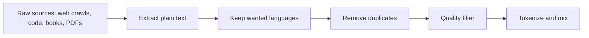

# Training: How the Model Learns

## The big picture

[Chapter 1](01-transformers.md) described a model that is already trained: its embedding table E, its W\_Q, W\_K, W\_V, W\_O and feed-forward weights are fixed numbers. This chapter explains where those numbers come from. In short, the model starts with random weights and plays a guessing game billions of times: guess the next token, see how wrong the guess was, and adjust every weight a tiny amount so the next guess is a little better.

One round of that game is called a **training step**. Each step does the following:

1. **Take a batch.** Pick a group of text examples from the training data and turn them into token IDs with the [tokenizer from Chapter 1](01-transformers.md#bpe-tokenizer-from-text-to-token-ids).
2. **Prepare inputs and targets.** Make every sequence the same length with padding, and shift the text by one position so that each position has a "correct next token" to predict.
3. **Forward pass.** Run the whole batch through the model, exactly as in [Chapter 1](01-transformers.md), to get a probability for every vocabulary token at every position.
4. **Measure the error.** Compare the probabilities with the correct next tokens and compute one number, the **loss**. A low loss means good guesses.
5. **Backward pass.** Compute, for every weight, which direction to move it to lower the loss.
6. **Update.** The optimiser moves every weight a small step in that direction.

Then the next batch is taken and the loop repeats. The original Transformer did this 100,000 times for its base model. The rest of the chapter walks through each step, with most detail on the parts that confuse newcomers: padding, the shifted-right decoder input, and why all positions are trained at once.

## What training is

Training is the process that turns a model full of random numbers into a model that predicts text well. It matters because nothing in a Transformer is designed by hand: every useful behaviour described in [Chapter 1](01-transformers.md) is the result of this process.

### Three ideas: weights, prediction, error

- **Weight (parameter):** one trainable number inside the model. Every entry of E, W\_Q, W\_K, W\_V, W\_O, W₁, W₂ and the layer-normalisation γ and β is a weight. The base model of the original paper has about 65 million of them.
- **Prediction:** at each position, the model outputs a probability for every token in the vocabulary, as shown in Chapter 1's section "[From the last vector back to a word](01-transformers.md#from-the-last-vector-back-to-a-word)".
- **Error:** how far that prediction is from the token that really came next in the text. Training only ever tries to make this error smaller.

The training data needs no human labels. The text itself provides the answers: in `YOUR CAT IS A LOVELY CAT`, after `YOUR CAT IS A LOVELY` the correct next token is `CAT`, simply because that is what the text says. This is why models can be trained on huge amounts of ordinary text. This style of learning is called **self-supervised**: the labels come from the data itself.

### What training changes, and what it does not

Chapter 1's section "[What is learned, and what changes after training?](01-transformers.md#what-is-learned-and-what-changes-after-training)" listed every component. Training touches only the ones with trainable weights:

| Component | Changed by training? | Why |
| --- | --- | --- |
| BPE tokenizer and token IDs | No | Built before model training and frozen |
| Embedding matrix E | Yes | Starts random, learned |
| Sinusoidal positional encoding | No | Computed from a formula, has no weights |
| W\_Q, W\_K, W\_V, W\_O in every layer and head | Yes | Start random, learned |
| Feed-forward W₁, b₁, W₂, b₂ | Yes | Start random, learned |
| Layer-norm γ and β | Yes | Start at 1 and 0, learned |
| Output matrix W\_out | Yes | Learned (or shared with E through weight tying) |

### A first look at "adjusting a weight"

Take [Chapter 1's example](01-transformers.md#from-the-last-vector-back-to-a-word): after `YOUR CAT IS A LOVELY` the model gives `CAT` a probability of 0.772. The correct answer is `CAT`, so the guess is good but not perfect. Training computes how each weight should move so that 0.772 becomes a little larger next time, then moves all 65 million weights at once by a tiny amount. Later in this chapter, the section on backpropagation shows with real numbers that one such step raises the probability from 0.772 to about 0.807.

No single step makes the model smart. The knowledge builds up over many steps and many batches, which is why training a large model takes weeks on thousands of GPUs, while using it afterwards takes seconds.

## Training data and batches

The model does not learn from one sentence at a time; it learns from groups of sentences processed together. This section defines those groups and explains why they force every sentence in a group to have the same length, which leads directly to padding in the next section.

### Training data

The **training data (corpus)** is the collection of text the model learns from: books, web pages, code, or, for a translation model, pairs of sentences in two languages. The original paper used about 4.5 million English–German sentence pairs. Before training, all of it is converted to token IDs with the frozen tokenizer.

### Where pre-training data comes from

A modern model's pre-training data is not a tidy library: it is assembled from raw sources and then aggressively cleaned, because the model learns whatever patterns the data contains, including spam, duplicates and errors. Llama 3, for example, was pre-trained on more than 15 trillion tokens.

1. **Collect.** Most text comes from **web crawls**. Common Crawl, a non-profit, publishes snapshots of billions of web pages; the FineWeb dataset was built from 96 of them. Code comes from public repositories; academic text is extracted from PDFs.
2. **Extract.** Strip the HTML, menus and adverts, keeping the main text of each page.
3. **Identify the language.** A small classifier labels each document's language, and only the wanted languages are kept.
4. **Deduplicate.** The web repeats itself: copied articles, boilerplate, mirrored sites. **Deduplication** removes exact copies and near-copies, so the model does not over-learn repeated text or memorise it word for word.
5. **Filter for quality.** Simple rules (too short, too many symbols, mostly lists of links) remove obvious junk. Many pipelines then use a **quality classifier**, a small model trained to score how useful a page is, for example how educational it reads, and keep only the best-scoring pages.
6. **Tokenize and mix** the sources into the final training set, as described next.

**Worked example** with made-up but typical proportions:

| Stage | Pages left | Share of the crawl |
| --- | --- | --- |
| Crawled pages | 1,000,000 | 100% |
| After text extraction and language identification (45% kept) | 450,000 | 45.0% |
| After removing exact duplicates (30% removed) | 315,000 | 31.5% |
| After removing near-duplicates (10% removed) | 283,500 | 28.4% |
| After the quality filter (40% kept) | 113,400 | 11.3% |

Only about one page in nine survives. This is normal: careful filtering of web data gives better models than using everything, even though the training set becomes much smaller.

### Choosing the data mixture

The final training set mixes several **sources** (also called domains): web pages, code, books, scientific papers, maths. The **data mixture** is the share of training tokens taken from each, and it strongly affects what the model is good at: more code improves coding, more maths improves maths, and every extra share for one source is taken from the others.

Testing mixtures on the full model would cost a full training run each time. Instead, teams train many **small proxy models**, each on a different mixture, measure their loss on the kinds of text they care about, and fit a simple model that predicts the loss for any mixture. The predicted best mixture is then used for the large model (methods such as DoReMi and RegMix work this way).

Training also often happens in **stages**: most of the tokens come from the broad mixture, and a final stage uses a smaller set of the highest-quality data, with more code, maths and reasoning text, to sharpen those skills.

### Model collapse: training on AI-written text

More and more web text is written by LLMs. If a model is trained on text produced by earlier models, which were themselves trained on model-written text, quality can decline from one generation to the next. This is called **model collapse**.

The main cause is that **rare things get lost**. A model only reproduces what appears often enough in its training data, and a finite sample of a model's output under-represents rare words, facts and styles.

**Worked example.** Suppose a rare word has probability 0.001 in a model's output, and the next model is trained on 1,000 tokens sampled from it (tiny numbers, for illustration):

- The chance that the word never appears in the 1,000 samples is 0.999¹⁰⁰⁰ ≈ 0.368.
- So in about 37% of cases, the next model never sees the word at all, and gives it no probability. Once lost, it cannot come back in later generations.
- A common word with probability 0.01 is almost never lost: 0.99¹⁰⁰⁰ ≈ 0.00004.

Repeated over generations, the rare cases (the "tails" of the distribution) disappear first, and the text becomes more uniform and less varied. This is one more reason why data pipelines filter carefully and value original, human-written text.

### What a batch is

A **batch** is a small group of training examples that go through the model together in one training step. The model computes the loss for every example in the batch, averages the results, and makes one weight update from that average.

- **Batch size (B):** the number of sequences in one batch.
- **Sequence length (n):** the number of tokens in each sequence of the batch.
- **Step:** one batch in, one weight update out.
- **Epoch:** one full pass over the whole training data.

Why not one sentence at a time? A GPU can process many sequences in parallel almost as fast as one, so batches use the hardware well. Averaging over many examples also gives a steadier direction for the update: one odd sentence cannot pull the weights too far. The paper built its batches by token count, about 25,000 source tokens and 25,000 target tokens per batch, rather than by a fixed number of sentences.

### Tensors and shapes

A **tensor** is a block of numbers with several dimensions: a vector has 1 dimension, a matrix 2, and a batch of matrices 3. The model processes a whole batch as tensors. Take a batch of B = 2 sentences, each n = 6 tokens long, with [Chapter 1's settings](01-transformers.md#key-settings-of-the-base-model):

| Stage | Shape | Numbers in it |
| --- | --- | --- |
| Token IDs | 2 × 6 | 12 |
| After embedding + position (X) | 2 × 6 × 512 | 6,144 |
| Q, K or V for one head | 2 × 6 × 64 | 768 |
| Attention scores QKᵀ for one head | 2 × 6 × 6 | 72 |
| Attention scores, all 8 heads | 2 × 8 × 6 × 6 | 576 |
| Logits (with a 50,000-token vocabulary) | 2 × 6 × 50,000 | 600,000 |

Every formula from [Chapter 1](01-transformers.md) stays the same; there is simply one extra dimension at the front for the batch.

### Why every sequence in a batch must have the same length

A tensor must be a perfect rectangle (or box): every row has the same number of entries. Real sentences have different lengths. Take these two sentences:

| Sentence | Token IDs | Length |
| --- | --- | --- |
| `YOUR CAT IS A LOVELY CAT` | \[105, 6587, 5475, 3578, 65, 6587\] | 6 |
| `YOUR CAT IS LOVELY` | \[105, 6587, 5475, 65\] | 4 |

The second row is 2 entries short, so the two rows cannot be stacked into a 2 × 6 tensor, and the GPU cannot run a single matrix multiplication over them. The fix is to fill the short sentence up to the length of the longest one with a special filler token. That is padding, described next.

## Padding and the padding mask

Padding makes a batch rectangular by filling short sentences with a filler token; the padding mask then makes the model ignore that filler. Both are needed: without padding the batch cannot be built, and without the mask the filler would change the model's results.

### Step 1: pad the short sentences

**Padding** means appending a special token, written `<pad>`, to every sentence shorter than the longest one in the batch. `<pad>` is an ordinary entry in the vocabulary with its own ID. Here it is given ID 0 (a made-up value; each tokenizer chooses its own).

| Position | 0 | 1 | 2 | 3 | 4 | 5 |
| --- | --- | --- | --- | --- | --- | --- |
| Sentence A | YOUR (105) | CAT (6587) | IS (5475) | A (3578) | LOVELY (65) | CAT (6587) |
| Sentence B | YOUR (105) | CAT (6587) | IS (5475) | LOVELY (65) | `<pad>` (0) | `<pad>` (0) |

The batch is now a clean 2 × 6 tensor of IDs: \[\[105, 6587, 5475, 3578, 65, 6587\], \[105, 6587, 5475, 65, 0, 0\]\].

### Step 2: build the padding mask

The `<pad>` tokens are meaningless, but the model does not know that. They have an embedding row in E, so they would produce keys and values, and real words would attend to them. Sentence B's result would then depend on how many pads happened to be added, which depends on what other sentence shared its batch. That would be a bug.

The **padding mask** is a list of 1s and 0s, one per position: 1 for a real token, 0 for `<pad>`.

| Position | 0 | 1 | 2 | 3 | 4 | 5 |
| --- | --- | --- | --- | --- | --- | --- |
| Sentence A mask | 1 | 1 | 1 | 1 | 1 | 1 |
| Sentence B mask | 1 | 1 | 1 | 1 | 0 | 0 |

### Step 3: apply it inside attention

The mask is applied exactly like the causal mask in Chapter 1's section "[What the mask looks like](01-transformers.md#what-the-mask-looks-like)": every attention score whose **column** (the token being looked at) is a `<pad>` is set to −∞ before softmax, so its weight becomes exactly 0. For sentence B in the encoder, which uses no causal mask, the table becomes:

| looks at → | YOUR | CAT | IS | LOVELY | `<pad>` | `<pad>` |
| --- | --- | --- | --- | --- | --- | --- |
| **YOUR** | ✓ | ✓ | ✓ | ✓ | 0 | 0 |
| **CAT** | ✓ | ✓ | ✓ | ✓ | 0 | 0 |
| **IS** | ✓ | ✓ | ✓ | ✓ | 0 | 0 |
| **LOVELY** | ✓ | ✓ | ✓ | ✓ | 0 | 0 |
| **`<pad>`** | ✓ | ✓ | ✓ | ✓ | 0 | 0 |
| **`<pad>`** | ✓ | ✓ | ✓ | ✓ | 0 | 0 |

Only the columns are blocked. The `<pad>` rows still produce an output, but nobody uses it: no real token looks at it, and the loss ignores it (Step 4). The rows are not blocked completely because a row of only −∞ would make softmax divide 0 by 0.

**Example: the row for LOVELY in sentence B.** Suppose that without a mask the weights were as below (illustrative numbers):

|  | YOUR | CAT | IS | LOVELY | `<pad>` | `<pad>` | Sum |
| --- | --- | --- | --- | --- | --- | --- | --- |
| Without mask | 0.200 | 0.300 | 0.100 | 0.200 | 0.100 | 0.100 | 1.000 |
| With padding mask | 0.250 | 0.375 | 0.125 | 0.250 | 0 | 0 | 1.000 |

The real tokens kept 0.800 of the weight, and each is divided by 0.800: for example 0.300 / 0.800 = 0.375. Setting the scores to −∞ before softmax gives exactly this result, because softmax then shares the total only among the remaining tokens.

### Padding mask + causal mask in the decoder

The decoder needs both masks at once. A cell is allowed only if **both** masks allow it: the column must not be in the future (causal mask) **and** must not be `<pad>` (padding mask). For sentence B:

| looks at → | YOUR | CAT | IS | LOVELY | `<pad>` | `<pad>` |
| --- | --- | --- | --- | --- | --- | --- |
| **YOUR** | ✓ | 0 | 0 | 0 | 0 | 0 |
| **CAT** | ✓ | ✓ | 0 | 0 | 0 | 0 |
| **IS** | ✓ | ✓ | ✓ | 0 | 0 | 0 |
| **LOVELY** | ✓ | ✓ | ✓ | ✓ | 0 | 0 |
| **`<pad>`** | ✓ | ✓ | ✓ | ✓ | 0 | 0 |
| **`<pad>`** | ✓ | ✓ | ✓ | ✓ | 0 | 0 |

The top-left part is [Chapter 1's triangle](01-transformers.md#what-the-mask-looks-like); the two pad columns are blocked on every row.

### Step 4: ignore padding in the loss

The loss (explained later in this chapter) is computed per position and then averaged. Positions whose correct answer is `<pad>` are left out of that average, so the model is never rewarded or punished for predicting filler. In the batch above, 10 positions hold real tokens and 2 hold `<pad>`, so the loss is the sum over the 10 real positions divided by 10, not by 12.

### Padding mask vs causal mask

|  | Causal mask (Chapter 1) | Padding mask |
| --- | --- | --- |
| What it blocks | Tokens **after** the current position | `<pad>` tokens |
| Depends on | Position only | The content of each sentence |
| Shape | The same triangle for every sentence of length n | Different for each sentence in the batch |
| Used in | Decoder self-attention only | Encoder, decoder and cross-attention, and the loss |
| Why | Stop the model from seeing the answer | Stop filler from changing the results |
| Needed at inference? | Yes, in every decoder layer | Only when several prompts are batched together |

### Packing: the alternative to padding

Padding wastes work: every `<pad>` position goes through the whole model and is then thrown away. In the batch above, 2 of the 12 positions (17%) are padding. With real data the waste can be much larger. If training examples average 1,000 tokens and every sequence is padded to 4,096, about (4,096 − 1,000) ÷ 4,096 ≈ 76% of all positions are padding.

**Packing** avoids this. Instead of giving each example its own padded row, several examples are joined end to end into one sequence of the fixed length, separated by an end token, and that long sequence is cut into rows. Almost every position then holds a real token.

**Worked example** with sentences A and B from above:

| | Rows | Positions | Real tokens | Wasted |
| --- | --- | --- | --- | --- |
| Padded | A (6) and B (4 + 2 `<pad>`) | 2 × 6 = 12 | 10 | 2 `<pad>` |
| Packed | A, `<EOS>`, B in one row | 11 | 10 | 0 (1 separator) |

With 1,000-token examples and a fixed length of 4,096, about four examples fit in each packed row instead of one.

**Keeping packed examples apart.** In a packed row, the first token of B should not attend to the tokens of A: they come from unrelated texts. Many pipelines therefore combine the causal mask with a **document mask** that blocks attention across the separator. For a tiny packed row `X Y <EOS> P Q` (two examples, X Y and P Q):

| looks at → | X | Y | `<EOS>` | P | Q |
| --- | --- | --- | --- | --- | --- |
| **X** | ✓ | 0 | 0 | 0 | 0 |
| **Y** | ✓ | ✓ | 0 | 0 | 0 |
| **`<EOS>`** | ✓ | ✓ | ✓ | 0 | 0 |
| **P** | 0 | 0 | 0 | ✓ | 0 |
| **Q** | 0 | 0 | 0 | ✓ | ✓ |

The result is one causal triangle per example: P and Q see only each other, exactly as if they had their own row. Some pre-training pipelines skip the document mask and let the end token alone mark the boundary; fine-tuning on separate conversations usually keeps it.

## The decoder input "shifted right": `<SOS>` and `<EOS>`

To train a decoder, each position needs an input to read and a correct token to predict. The trick is to feed the decoder the target sentence moved one place to the right, so that at every position the correct answer is simply the next word. Two special tokens make this work.

### The special tokens

- **`<SOS>` (start of sentence):** a token that means "the sentence begins here". It gives the decoder something to read at the very first position, before any real word exists.
- **`<EOS>` (end of sentence):** a token that means "the sentence is finished". The model learns to predict it after the last word, which is how, during generation, it signals that it wants to stop.

Like `<pad>`, both are ordinary vocabulary entries with their own IDs and embedding rows, learned like any other token.

### The translation example

The task is to translate "I love you very much" into "Ti amo molto". To keep the tables short, each word is treated as one token (a simplification; a real BPE tokenizer may split some words). Three sequences are built from the sentence pair:

| Sequence | Tokens | Length | Goes to |
| --- | --- | --- | --- |
| Encoder input | `<SOS>` I love you very much `<EOS>` | 7 | The encoder |
| Decoder input | `<SOS>` Ti amo molto | 4 | The decoder |
| Target (label) | Ti amo molto `<EOS>` | 4 | The loss only, never into the model |

The decoder input and the target are the same Italian sentence, offset by one position. The decoder input starts with `<SOS>` and drops `<EOS>`; the target drops `<SOS>` and ends with `<EOS>`. Writing the target with `<SOS>` in front pushes every word one slot to the right, hence the name **shifted right**.

### Input and target, position by position

| Position | Decoder input at this position | What the position can see (causal mask) | Target: what it must predict |
| --- | --- | --- | --- |
| 0 | `<SOS>` | `<SOS>` | Ti |
| 1 | Ti | `<SOS>` Ti | amo |
| 2 | amo | `<SOS>` Ti amo | molto |
| 3 | molto | `<SOS>` Ti amo molto | `<EOS>` |

Read each row as a small exam question: "Given the English sentence (from the encoder) and the Italian words so far, what is the next Italian word?" The [causal mask from Chapter 1](01-transformers.md#what-the-mask-looks-like) guarantees that position 1, for example, sees `<SOS>` and Ti but not amo, the word it must predict.

Every position also looks at the full English sentence through cross-attention (Chapter 1, "[Self-attention vs cross-attention](01-transformers.md#self-attention-vs-cross-attention)"). The encoder needs no causal mask: the English sentence is given, not predicted.

### With padding

Implementations usually fix one sequence length for all batches, for example 8 tokens, and pad up to it with the mask from the previous section:

| Position | 0 | 1 | 2 | 3 | 4 | 5 | 6 | 7 |
| --- | --- | --- | --- | --- | --- | --- | --- | --- |
| Encoder input | `<SOS>` | I | love | you | very | much | `<EOS>` | `<pad>` |
| Decoder input | `<SOS>` | Ti | amo | molto | `<pad>` | `<pad>` | `<pad>` | `<pad>` |
| Target | Ti | amo | molto | `<EOS>` | `<pad>` | `<pad>` | `<pad>` | `<pad>` |

Only positions 0 to 3 count in the loss.

### The same idea in decoder-only models

GPT-style models and Claude have no encoder, but they use exactly the same shift. The input is the text without its last token, and the target is the text without its first token. For `YOUR CAT IS A LOVELY CAT`:

| Position | 0 | 1 | 2 | 3 | 4 |
| --- | --- | --- | --- | --- | --- |
| Input | YOUR | CAT | IS | A | LOVELY |
| Target | CAT | IS | A | LOVELY | CAT |

Six tokens give five training examples, one per position. Position 4 is the case from [Chapter 1's logits example](01-transformers.md#from-the-last-vector-back-to-a-word): after `YOUR CAT IS A LOVELY`, the target is `CAT`.

## Teacher forcing: why training happens in one time step

During training the decoder always reads the correct previous words, never its own guesses, and all positions are computed in a single pass. This is the main reason Transformers train so much faster than the older recurrent networks described in Chapter 1's section "[The problem it solved](01-transformers.md#the-problem-it-solved)".

### What teacher forcing means

**Teacher forcing** means that, during training, the input at each position is the **true** previous token from the training data, not the token the model predicted. The name comes from a teacher who corrects a student after every word, so one mistake cannot lead to a chain of mistakes.

**Example.** Suppose that early in training, at position 1, the model's top guess after `<SOS>` Ti is "adoro" instead of the correct "amo" (made-up numbers for illustration):

| Position | Decoder input (from the data) | Model's top guess | Target | Effect |
| --- | --- | --- | --- | --- |
| 0 | `<SOS>` | Ti | Ti | Correct, low loss |
| 1 | Ti | adoro | amo | Wrong, high loss |
| 2 | amo | molto | molto | Correct: it read "amo", not "adoro" |
| 3 | molto | `<EOS>` | `<EOS>` | Correct, low loss |

The wrong guess at position 1 is punished by the loss at position 1, but it does not reach position 2. Position 2 still reads the correct word "amo", so it gets a fair chance to learn "molto".

### Why training happens in one time step

Because all inputs come from the data, nothing has to wait for the model's own output. The whole decoder input is known before the pass starts. So the complete sequence `<SOS>` Ti amo molto goes through the decoder **at once**, as one 4 × 512 matrix (Chapter 1, "[Which X? All tokens, layer by layer](01-transformers.md#which-x-all-tokens-layer-by-layer)"), and the output gives logits for all four positions together:

$$
\underbrace{[\langle SOS\rangle,\ \text{Ti},\ \text{amo},\ \text{molto}]}_{\text{decoder input, } 4 \times 512} \xrightarrow{\ \text{one forward pass}\ } \underbrace{[P_0,\ P_1,\ P_2,\ P_3]}_{4 \times |V| \text{ probabilities}} \xrightarrow{\ \text{compare with}\ } [\text{Ti},\ \text{amo},\ \text{molto},\ \langle EOS\rangle]
$$

Here P\_i is the probability list at position i, and |V| is the vocabulary size.

What stops position 1 from simply copying the answer "amo", which sits at position 2 of the same input? The causal mask. Position 1 can attend only to positions 0 and 1, so the answer is in the input matrix but invisible to it. The mask is what makes it safe to give the model the whole sentence at once.

### Training vs generation for the same sentence

[Chapter 3](03-inference.md) covers generation in detail. The table shows why the two are so different in speed:

|  | Training (teacher forcing) | Generation (Chapter 3) |
| --- | --- | --- |
| Decoder input comes from | The training data | The model's own previous outputs |
| Known before starting? | Yes, the whole sentence | No, one word at a time |
| Forward passes for "Ti amo molto `<EOS>`" | 1 | 4 (Ti → amo → molto → `<EOS>`) |
| Predictions used per pass | All 4 positions | Only the last position |
| A mistake at one position | Does not affect the next input | Is fed back in and can spread |

The same holds at scale: one batch of 25,000 target tokens in the paper gives about 25,000 predictions, all scored in one forward pass. An RNN would have to step through each sentence one token at a time.

### The trade-off: exposure bias

Teacher forcing has one known weakness, called **exposure bias**: during training the model only ever sees correct previous words, but during generation it sees its own words, including its own mistakes. It was never trained to recover from a bad word. In practice the speed benefit is so large that all large language models use teacher forcing, and the effect is reduced by training on huge amounts of data and by the later training stages described at the end of this chapter.

## The loss: cross-entropy

The loss is the single number that says how wrong the model's predictions were. Training has only one goal, making this number smaller, so it is worth knowing exactly how it is computed.

### Definitions

- **Loss:** one number that measures the error of the predictions. 0 means perfect; larger means worse.
- **Target distribution:** what the model *should* have predicted. For next-token prediction it is **one-hot**: probability 1 for the correct token and 0 for every other token.
- **Cross-entropy:** a standard way to measure how far the predicted probabilities are from the target distribution.

$$
L = -\sum_{k=1}^{|V|} y_k \ln p_k \qquad \text{with a one-hot target:} \qquad L = -\ln p_{\text{correct}}
$$

- **L** is the loss for one position.
- **|V|** is the vocabulary size, and **k** runs over every token in it.
- **y\_k** is the target probability of token k: 1 for the correct token, 0 for the others.
- **p\_k** is the model's predicted probability for token k (after softmax).
- **ln** is the natural logarithm.

Because every y\_k is 0 except the correct one, the sum collapses to one term: the loss is minus the logarithm of the probability the model gave to the correct token. Only that one probability matters directly.

### Worked example: Chapter 1's probabilities

After `YOUR CAT IS A LOVELY`, [Chapter 1's model](01-transformers.md#from-the-last-vector-back-to-a-word) predicted CAT 0.772, DOG 0.211, IS 0.013, LOVELY 0.004. The table shows the loss for each possible correct answer:

| If the correct next token were | Probability the model gave it | Loss = −ln(p) |
| --- | --- | --- |
| CAT | 0.772 | 0.259 |
| DOG | 0.211 | 1.556 |
| IS | 0.013 | 4.343 |
| LOVELY | 0.004 | 5.521 |

In the real text the next token is `CAT`, so this position's loss is **0.259**. Three things to notice:

- **Perfect costs nothing:** a probability of 1 gives −ln(1) = 0.
- **Confident and wrong is punished hard:** a probability of 0.004 costs about 21 times more than 0.772 (5.521 / 0.259 ≈ 21.3).
- **Only the correct token's probability enters the formula,** but because all probabilities share a sum of 1, raising the correct one automatically lowers the others.

### From one position to a whole batch

The loss of a batch is the **average** of the per-position losses over all real (non-`<pad>`) positions. Take the translation example from the previous sections, with made-up probabilities for the correct token at each position:

| Position | Target | Probability given to the target | Loss = −ln(p) |
| --- | --- | --- | --- |
| 0 | Ti | 0.60 | 0.511 |
| 1 | amo | 0.80 | 0.223 |
| 2 | molto | 0.50 | 0.693 |
| 3 | `<EOS>` | 0.90 | 0.105 |
|  |  | **Sum** | 1.532 |
|  |  | **Average (÷ 4)** | **0.383** |

The value 0.383 is the number training tries to reduce. All four positions came from the single forward pass described in the teacher-forcing section.

### Perplexity: the same number in friendlier units

**Perplexity** is e raised to the average loss. It can be read as "how many tokens the model is hesitating between, on average". Here e^0.383 ≈ 1.47: the model is about as uncertain as if it were choosing between 1.5 equally likely tokens. A perfect model has perplexity 1. Model papers often report perplexity instead of the raw loss. [Chapter 5](05-evaluation.md#perplexity) shows how perplexity is used to compare models, and why it is only comparable between models that share a tokenizer.

## Backpropagation, gradient descent and the optimiser

Once the loss is known, the model must decide how to change each of its millions of weights to make the loss smaller. This section explains the three tools that do it (backpropagation, gradient descent and the Adam optimiser) and two techniques the paper used to stop the model from simply memorising its training data (dropout and label smoothing).

### The gradient: which way to move each weight

A **gradient** is, for one weight, the answer to: "if I increase this weight by a tiny amount, does the loss go up or down, and how fast?" It is a single number per weight.

- **Positive gradient:** increasing the weight increases the loss, so the weight should go **down**.
- **Negative gradient:** increasing the weight decreases the loss, so the weight should go **up**.
- **Large gradient (positive or negative):** the loss is very sensitive to this weight.

### Backpropagation: computing every gradient at once

**Backpropagation** is the method that computes the gradient of every weight in one backward pass through the model, from the loss back to the embeddings. It uses the **chain rule** from calculus: the effect of a weight on the loss equals its effect on the next layer, times that layer's effect on the layer after, and so on up to the loss. Deep-learning libraries (PyTorch, JAX) do this automatically; nobody writes the derivatives by hand.

The first link of the chain has a very simple form for softmax followed by cross-entropy. The gradient with respect to each logit is the predicted probability minus the target:

$$
\frac{\partial L}{\partial z_k} = p_k - y_k
$$

Here z\_k is the logit of token k (the raw score before softmax), p\_k its probability and y\_k its target (1 or 0). With [Chapter 1's numbers](01-transformers.md#from-the-last-vector-back-to-a-word), where the correct token is CAT:

| Token | p\_k | y\_k | Gradient p\_k − y\_k | Meaning |
| --- | --- | --- | --- | --- |
| CAT | 0.772 | 1 | −0.228 | Push the CAT logit up |
| DOG | 0.211 | 0 | +0.211 | Push the DOG logit down |
| IS | 0.013 | 0 | +0.013 | Push down slightly |
| LOVELY | 0.004 | 0 | +0.004 | Push down very slightly |

The gradients sum to 0. The wrong token that received the most probability (DOG) gets the strongest push down. Backpropagation then carries these four numbers backwards through W\_out, the feed-forward networks, W\_O, W\_Q, W\_K, W\_V and finally E, giving every weight its own gradient.

### Gradient descent: taking the step

**Gradient descent** moves each weight a small step against its gradient:

$$
w_{\text{new}} = w_{\text{old}} - \eta \cdot g
$$

- **w** is one weight.
- **g** is that weight's gradient.
- **η (eta)** is the **learning rate**: how big a step to take. Too large and training jumps around and diverges; too small and it takes forever.

**Worked example.** To see the effect without following 65 million weights, pretend for a moment that the four logits themselves were the weights, and use η = 0.5 (a toy simplification; in the real model, the logits change because the weights that produce them change):

| Token | Old logit | Gradient | New logit = old − 0.5 × gradient | New probability |
| --- | --- | --- | --- | --- |
| CAT | 6.2 | −0.228 | 6.314 | **0.807** |
| DOG | 4.9 | +0.211 | 4.795 | 0.177 |
| IS | 2.1 | +0.013 | 2.094 | 0.012 |
| LOVELY | 1.0 | +0.004 | 0.998 | 0.004 |

The probability of the correct token rises from 0.772 to 0.807, and the loss falls from 0.259 to −ln(0.807) = 0.214. One training step is exactly this, applied to every weight at once, with the gradient averaged over all positions in the batch.

### Adam: a smarter step

Plain gradient descent uses the same learning rate for every weight. The paper used **Adam** (adaptive moment estimation), an **optimiser** (the rule that turns gradients into weight changes) that adapts the step for each weight. It keeps two running averages per weight:

- **m (momentum):** the recent average of the gradient. It smooths out noise from one batch to the next, like a ball rolling downhill that keeps its speed.
- **v:** the recent average of the **squared** gradient. It measures how large the gradients for this weight usually are.

$$
m_t = \beta_1 m_{t-1} + (1-\beta_1)\, g_t \qquad v_t = \beta_2 v_{t-1} + (1-\beta_2)\, g_t^2
$$

$$
\hat m_t = \frac{m_t}{1-\beta_1^{\,t}} \qquad \hat v_t = \frac{v_t}{1-\beta_2^{\,t}} \qquad w_t = w_{t-1} - \eta\, \frac{\hat m_t}{\sqrt{\hat v_t} + \epsilon}
$$

- **t** is the step number and **g\_t** the gradient at step t.
- **β₁, β₂** control how long the averages remember: the paper used β₁ = 0.9 and β₂ = 0.98.
- **m̂, v̂** are the averages corrected for starting at 0 (the "bias correction").
- **ε** is a tiny number (10⁻⁹ in the paper) to avoid dividing by 0.

**Worked example: the first step (t = 1), m and v start at 0.**

| Quantity | Weight A: g = 0.2 | Weight B: g = 0.002 |
| --- | --- | --- |
| m₁ = 0.1 × g | 0.02 | 0.0002 |
| v₁ = 0.02 × g² | 0.0008 | 0.00000008 |
| m̂₁ = m₁ / (1 − 0.9) | 0.2 | 0.002 |
| v̂₁ = v₁ / (1 − 0.98) | 0.04 | 0.000004 |
| √v̂₁ | 0.2 | 0.002 |
| Step = η × m̂₁ / √v̂₁ | η × 1 = η | η × 1 = η |

The two gradients differ by a factor of 100, yet both weights move by the same amount η. Adam divides each gradient by its own typical size, so weights with tiny gradients still learn and weights with large gradients do not jump too far. This is why Adam, and its variant AdamW, is used to train almost every large language model.

### The learning rate and the warm-up schedule

The paper did not keep the learning rate fixed. It used a **schedule**: a formula giving the learning rate at each step.

$$
\eta(\text{step}) = d_{model}^{-0.5} \cdot \min\left(\text{step}^{-0.5},\ \text{step} \cdot \text{warmup}^{-1.5}\right)
$$

- **d\_model** = 512, so d\_model^−0.5 = 1 / √512 ≈ 0.0442.
- **step** is the training step number, starting at 1.
- **warmup** = 4,000 steps.

For the first 4,000 steps the second term is smaller, so the learning rate **rises in a straight line** (the **warm-up**). After that the first term is smaller, so it **decays** in proportion to 1 / √step.

| Step | Phase | Learning rate | Compared with the peak |
| --- | --- | --- | --- |
| 1 | Warm-up | 0.000000175 | 1 / 4,000 |
| 1,000 | Warm-up | 0.000175 | 1 / 4 |
| 4,000 | Peak | 0.000699 | 1 |
| 16,000 | Decay | 0.000349 | 1 / 2 |
| 100,000 (end of base training) | Decay | 0.000140 | 1 / 5 |

**Why warm up?** At the start the weights are random, so gradients are large and point in unreliable directions, and Adam's averages m and v have seen almost no data. Big steps at that moment can throw the model into a bad region it never recovers from. Starting small and increasing gives the averages time to settle. **Why decay?** Late in training the model is close to a good solution, and smaller steps let it settle in instead of bouncing around it. Modern models use the same idea, usually with a warm-up followed by a cosine-shaped decay.

### Dropout: forcing the model not to rely on any single number

**Overfitting** means the model memorises its training examples instead of learning patterns that also work on new text. **Dropout** fights it: during training, each number in a vector is set to 0 with probability p, chosen at random again at every step, and the surviving numbers are multiplied by 1 / (1 − p) so the average size of the vector stays the same.

The paper used p = 0.1, applied to the output of every sublayer (before it is added to the residual) and to the sum of embeddings and positional encodings. **Example** with a 4-number vector and p = 0.25 (a larger toy value so that one number drops):

|  | Value 1 | Value 2 | Value 3 | Value 4 |
| --- | --- | --- | --- | --- |
| Before dropout | 0.8 | −0.4 | 1.2 | 0.6 |
| Random keep (1) or drop (0) | 1 | 1 | 0 | 1 |
| After dropout, kept values × 1 / (1 − 0.25) = × 1.333 | 1.067 | −0.533 | 0 | 0.800 |

Because any number can disappear, the model cannot depend on one specific path and has to spread useful information across many. **Dropout is switched off at inference**: every number is kept and nothing is rescaled, so results are repeatable.

### Label smoothing: do not aim for 100% certainty

With a one-hot target, the loss only reaches 0 when the model gives the correct token probability 1, which pushes the logits towards extreme values and makes the model overconfident. **Label smoothing** softens the target: the correct token gets 1 − ε, and the remaining ε is shared equally among all tokens. The paper used ε = 0.1.

$$
y_k = (1-\varepsilon)\cdot[\,k = \text{correct}\,] + \frac{\varepsilon}{|V|}
$$

Here \[k = correct\] is 1 for the correct token and 0 otherwise, and |V| is the vocabulary size. With [Chapter 1's four-token toy vocabulary](01-transformers.md#from-the-last-vector-back-to-a-word), ε/|V| = 0.1 / 4 = 0.025:

| Token | One-hot target | Smoothed target | Model's p | y × (−ln p) with smoothing |
| --- | --- | --- | --- | --- |
| CAT | 1 | 0.925 | 0.772 | 0.925 × 0.259 = 0.240 |
| DOG | 0 | 0.025 | 0.211 | 0.025 × 1.556 = 0.039 |
| IS | 0 | 0.025 | 0.013 | 0.025 × 4.343 = 0.109 |
| LOVELY | 0 | 0.025 | 0.004 | 0.025 × 5.521 = 0.138 |
| **Loss** | 0.259 |  |  | **0.526** |

The smoothed loss is higher (0.526 instead of 0.259) because tokens with very small probabilities now also cost something. The model can no longer win by pushing the wrong tokens to almost 0, so it stays less overconfident. The paper reports that label smoothing made perplexity slightly worse but improved accuracy and the BLEU translation score.

## Another training objective: masked language modelling

Everything so far trains a model to predict the **next** token, which is what decoder models such as GPT and Claude do. Encoder-only models such as BERT ([Chapter 1](01-transformers.md#three-ways-the-block-is-used-today)) are trained with a different game: fill in hidden words using the text on **both** sides. They cannot generate text well, but they produce very good representations of a whole text, which is why they are still widely used for classification and search.

### Masked language modelling (MLM)

In **masked language modelling**, some tokens of the input are hidden and the model must predict them. BERT picks 15% of the tokens at random. Of the picked tokens:

- 80% are replaced by a special `[MASK]` token,
- 10% are replaced by a random token,
- 10% are left unchanged.

The mix stops the model from relying on seeing `[MASK]`, which never appears in real use. In a 1,000-token text, 150 tokens are picked: about 120 become `[MASK]`, 15 become random tokens, and 15 stay the same. The loss is the usual cross-entropy, computed **only at the 150 picked positions**.

**Worked example.** Take `YOUR CAT IS A LOVELY CAT` and hide position 4:

| Position | 0 | 1 | 2 | 3 | 4 | 5 |
| --- | --- | --- | --- | --- | --- | --- |
| Input | YOUR | CAT | IS | A | `[MASK]` | CAT |
| Target | — | — | — | — | LOVELY | — |

The encoder has no causal mask, so position 4 sees `YOUR CAT IS A` on its left **and** `CAT` on its right. Suppose it gives `LOVELY` a probability of 0.60 (made-up number). The loss at that position is −ln 0.60 = 0.511, and the other five positions add nothing to the loss.

A decoder trained on the same sentence would predict `LOVELY` from the left side only (`YOUR CAT IS A`). Seeing both sides makes the masked task easier and gives every token a representation informed by its whole context, which is what encoder models are for.

### Next sentence prediction and the tokens `[CLS]` and `[SEP]`

BERT was also trained on a second task, **next sentence prediction**: given two segments of text, decide whether the second really followed the first in the original document (half the examples) or was taken at random from elsewhere (the other half). Two special tokens frame the input:

- **`[CLS]`** (classification) is placed at the very start. Its output vector is used as a summary of the whole input; a small classifier on top of it gives the yes/no answer.
- **`[SEP]`** (separator) marks the end of each segment.

For example: `[CLS] YOUR CAT IS LOVELY [SEP] IT SLEEPS ALL DAY [SEP]` should be labelled "really follows". Later work (RoBERTa) found that next sentence prediction adds little and trained with masked language modelling alone, but the `[CLS]` vector idea remained.

### Next-token prediction vs masked language modelling

| | Next-token prediction | Masked language modelling |
| --- | --- | --- |
| Models | Decoder-only (GPT, Claude, Llama) | Encoder-only (BERT and its successors) |
| Each position sees | Only the tokens before it (causal mask) | All tokens, both sides |
| Positions that give a loss | All of them | Only the masked 15% |
| Good at | Generating text | Understanding and representing text: classification, search |
| Typical use after training | Chat, writing, code | Fine-tuned with a small classifier on `[CLS]`, or used to turn texts into vectors for search |

## Stages of an LLM's life: pre-training, fine-tuning and preference training

A chat model like Claude is not trained once but in several stages, each with different data and a different goal. The architecture and the tokenizer stay the same through all of them; only the weights keep changing, as Chapter 1's note "[Fine-tuning is just more training](01-transformers.md#what-is-learned-and-what-changes-after-training)" said.

### Stage 1: pre-training

**Pre-training** is the long first stage described in this whole chapter: next-token prediction with cross-entropy on a huge amount of ordinary text (web pages, books, code), often trillions of tokens. All weights start random. The result is a **base model**: it knows grammar, facts and patterns, but it only continues text. Ask it "What is the capital of France?" and it may answer, or it may continue with three more quiz questions, because both are plausible continuations. This stage uses by far the most compute, typically weeks to months on thousands of GPUs.

### Stage 2: supervised fine-tuning (SFT)

**Fine-tuning** means continuing training from the pre-trained weights on a smaller, specially chosen dataset. In **supervised fine-tuning**, the data is examples of good conversations: a user prompt and a high-quality answer, often written or checked by people. When the examples are instructions paired with good responses, as here, this is also called **instruction tuning**. The loss is still cross-entropy on the next token, but only the **answer** tokens count: the prompt tokens are excluded from the loss, exactly as `<pad>` tokens are ("Step 4: ignore padding in the loss"). The model learns the *format* of a helpful assistant: answer the question, follow instructions, stop when done.

**Example** (illustrative):

| Part | Text | Counts in the loss? |
| --- | --- | --- |
| Prompt | Translate to Italian: I love you very much | No |
| Answer | Ti amo molto `<EOS>` | Yes |

### Stage 3: preference training

Some qualities are easier to judge than to write down: which of two answers is clearer, more honest or safer. **Preference training** learns from such comparisons instead of from single correct answers.

- **RLHF (reinforcement learning from human feedback):** people see two answers to the same prompt and pick the better one. A separate **reward model** is trained to predict those choices and give any answer a score. The language model then generates answers and is adjusted, with a reinforcement-learning method such as PPO, to get higher scores while staying close to its SFT version. This was the method behind InstructGPT and early ChatGPT.
- **DPO (direct preference optimisation):** a simpler alternative that skips the separate reward model. It uses the pairs of preferred and rejected answers directly in a loss that raises the probability of the preferred answer relative to the rejected one.
- **AI feedback:** some of the comparisons can be made by an AI model following a written set of principles. Anthropic's Constitutional AI is an example.

In all of these, the loss is no longer "predict the text in the data" but "make preferred answers more likely than rejected ones". The weights change; nothing else does.

### Inside RLHF: training the reward model

The reward model is usually a copy of the language model with its last layer replaced by a single output: one number, the **reward**, that scores an answer to a prompt. It is trained on pairs: for a prompt x, a preferred answer y\_w (w for "winner") and a rejected answer y\_l (l for "loser"). The training rule, called the **Bradley–Terry** loss, wants the preferred answer to get the higher score:

$$
L = -\ln \sigma\big(r(x, y_w) - r(x, y_l)\big) \qquad \sigma(a) = \frac{1}{1 + e^{-a}}
$$

- **r(x, y)** is the reward the model gives to answer y for prompt x.
- **σ (sigmoid)** turns any number into a probability between 0 and 1. Here σ(r\_w − r\_l) is the model's probability that the preferred answer is the better one.
- The loss is −ln of that probability, exactly like cross-entropy.

**Worked example** (made-up scores):

| Scores: preferred, rejected | Difference | σ(difference) | Loss | Reading |
| --- | --- | --- | --- | --- |
| 2.0, 0.5 | +1.5 | 0.818 | −ln 0.818 = 0.201 | Correct order: small loss |
| 0.5, 2.0 | −1.5 | 0.182 | −ln 0.182 = 1.701 | Wrong order: large loss |

Only the **difference** between the two scores matters, so the reward model learns to rank answers, not to give them absolute marks.

### Inside RLHF: the KL penalty and reward hacking

The language model is then trained to produce answers that the reward model scores highly. Left alone, it finds the reward model's weaknesses. If the reward model slightly prefers longer answers, the language model learns to write ever longer answers, whether or not they are better. Getting a high reward without being better is called **reward hacking**.

The fix is a penalty for drifting too far from the starting model (the SFT model, kept frozen as a **reference**). The distance between the two models' probabilities is measured with the **KL divergence** (Kullback–Leibler divergence):

$$
\text{KL}(\pi \,\|\, \pi_{\text{ref}}) = \sum_k \pi_k \ln \frac{\pi_k}{\pi_{\text{ref},k}}
$$

- **π\_k** is the probability the model being trained gives to token k; **π\_ref,k** is the reference model's probability.
- KL is 0 when the two lists are identical and grows as they move apart.

The training goal becomes **reward − λ × KL**, where λ (lambda) sets how strongly drifting is penalised.

**Worked example** with Chapter 1's probabilities as the reference (CAT 0.772, DOG 0.211, IS 0.013, LOVELY 0.004), against two possible trained models (made-up numbers):

| Trained model's probabilities (CAT, DOG, IS, LOVELY) | KL from the reference |
| --- | --- |
| 0.800, 0.185, 0.011, 0.004 (a small change) | 0.002 |
| 0.950, 0.040, 0.007, 0.003 (a large change) | 0.197 − 0.067 − 0.004 − 0.001 ≈ 0.125 |

The large change is penalised far more heavily: 0.125 against 0.002. The model may still move far from the reference, but only where the reward gain is worth it.

### Inside DPO: preferences without a reward model

DPO reaches the same goal in one supervised step. It never trains a reward model; it works directly with the probabilities that the model being trained and the frozen reference give to the preferred and rejected answers:

$$
L_{\text{DPO}} = -\ln \sigma\!\left(\beta \left[\ln \frac{\pi(y_w \mid x)}{\pi_{\text{ref}}(y_w \mid x)} - \ln \frac{\pi(y_l \mid x)}{\pi_{\text{ref}}(y_l \mid x)}\right]\right)
$$

- **π(y | x)** is the probability the model being trained gives to the whole answer y for prompt x; **π\_ref** is the reference's probability.
- **ln(π ÷ π\_ref)** says how much more (positive) or less (negative) likely the trained model makes an answer than the reference did.
- **β** (beta, often 0.1) plays the role of the KL penalty: it controls how far the model may move from the reference.

The loss is small when the preferred answer has gained probability relative to the reference **more** than the rejected one has.

**Worked example** with β = 0.1:

| Moment | ln ratio, preferred | ln ratio, rejected | β × difference | σ | Loss |
| --- | --- | --- | --- | --- | --- |
| Start: trained model = reference | 0 | 0 | 0 | 0.500 | 0.693 |
| After some training | +2.0 | −3.0 | 0.1 × 5.0 = 0.5 | 0.622 | 0.474 |

The structure is the same as the reward model's loss: −ln σ of a difference. DPO's insight is that the model's own probability ratios can play the role of the reward.

### RLHF vs DPO: what each costs

| | RLHF with PPO | DPO |
| --- | --- | --- |
| Training steps | Train a reward model, then reinforcement learning | One supervised training run |
| Models in memory | 4: the model being trained, the frozen reference, the reward model, and a **value model** that PPO uses to estimate how good a partial answer is | 2: the model being trained and the frozen reference |
| Weights alone, if each model has 7 billion weights in 16-bit format ([Chapter 4](04-quantization.md#worked-example-a-7-billion-weight-model)) | 4 × 14 GB = 56 GB | 2 × 14 GB = 28 GB |
| New answers generated during training? | Yes, the model writes answers that are then scored | No, it learns from a fixed set of pairs |
| Strength | Can keep improving on fresh answers of its own | Simpler, cheaper and more stable |

Reasoning models use another reinforcement-learning method, GRPO, which drops the value model; it is covered with reasoning models in Chapter 6.

### What changes in each stage

|  | Pre-training | Supervised fine-tuning | Preference training |
| --- | --- | --- | --- |
| Starts from | Random weights | Base model | SFT model |
| Data | Huge amounts of raw text | Prompt + good-answer examples | Pairs of answers ranked better/worse |
| Size of data | Trillions of tokens | Thousands to millions of examples | Thousands to millions of comparisons |
| What the loss rewards | Predicting the next token of any text | Predicting the answer tokens | Preferred answers over rejected ones |
| Weights changed | All | All, or a small add-on (LoRA) | All, or a small add-on |
| Tokenizer and architecture | Fixed | Fixed | Fixed |
| Result | Base model: continues text | Follows instructions | Helpful, honest, safer answers |
| Compute | By far the largest | Small in comparison | Small to medium |

### Cheap fine-tuning: LoRA

**LoRA (low-rank adaptation)** is a cheap way to fine-tune: the original weights are frozen and small extra matrices are trained and added to them. For example, instead of changing a 512 × 512 matrix (262,144 numbers), LoRA with rank 8 trains a 512 × 8 and an 8 × 512 matrix (8,192 numbers in total), about 3% as many.

**The formula.** For a weight matrix W₀ with d rows and k columns, LoRA learns a change ΔW written as the product of two thin matrices:

$$
W = W_0 + \Delta W = W_0 + B \cdot A \qquad B: d \times r \qquad A: r \times k
$$

- **W₀** is the original, frozen weight matrix.
- **B** and **A** are the two small trainable matrices; their product B · A has the same shape as W₀.
- **r** is the **rank**, a small number such as 8 or 16. It limits how complex the change can be, and sets how many numbers are trained: r × (d + k) instead of d × k.
- **B starts at zero**, so at the beginning B · A = 0 and the model behaves exactly like the original. Training then moves B and A away from zero.

**Worked example** with a 2 × 2 matrix and rank 1 (made-up numbers):

$$
W_0 = \begin{bmatrix} 1 & 2 \\ 3 & 4 \end{bmatrix} \qquad B = \begin{bmatrix} 1 \\ 0.5 \end{bmatrix} \qquad A = \begin{bmatrix} 0.2 & -0.4 \end{bmatrix}
$$

$$
B \cdot A = \begin{bmatrix} 0.2 & -0.4 \\ 0.1 & -0.2 \end{bmatrix} \qquad W = W_0 + B \cdot A = \begin{bmatrix} 1.2 & 1.6 \\ 3.1 & 3.8 \end{bmatrix}
$$

At this tiny size there is no saving (4 trained numbers either way). The saving grows with the matrix: for a 4,096 × 4,096 matrix, the full change has 16,777,216 numbers, while rank 8 trains 8 × (4,096 + 4,096) = 65,536, about 0.4%.

**Where the adapters go.** The original LoRA paper added B · A only to W\_Q and W\_V in the attention layers. Today it is common to add them to every weight matrix of attention and of the feed-forward network, which usually works better for little extra cost. For a model with settings like Llama 2 7B (32 layers, d\_model = 4,096, d\_ff = 11,008), rank 8 on all of them trains about 20 million numbers, about 0.3% of the model's 6.7 billion weights.

**Why it is so cheap.**

| | Full fine-tuning | LoRA | QLoRA |
| --- | --- | --- | --- |
| Base weights | Trained | Frozen, 16-bit | Frozen, **4-bit** ([Chapter 4](04-quantization.md#how-quantization-works)) |
| Memory for a 7-billion-weight model (weights, plus gradients and Adam's m and v for whatever is trained) | 4 numbers × 4 bytes × 7 billion ≈ 112 GB | About 14 GB of frozen weights, plus a small amount for the adapters | About 3.5 GB of frozen weights, plus the adapters |
| Trained numbers | 7 billion | About 20 million | About 20 million |

The memory figures cover the weights and optimiser state only (as in [Chapter 3](03-inference.md#why-inference-needs-less-memory)); activations add more in every case. **QLoRA** combines LoRA with a base model quantized to 4 bits, which makes it possible to fine-tune large models on a single GPU.

**One base model, many tasks.** Because the base weights never change, a company can keep one copy of the base model in memory and train a separate small adapter for each task (for example fraud labelling, email triage, translation), then swap adapters in and out as requests arrive.

**Other parameter-efficient methods.** LoRA belongs to a family called **parameter-efficient fine-tuning (PEFT)**. Two other members: **adapters**, small extra layers inserted inside each Transformer block, and **prefix tuning**, which trains a few extra key and value vectors that every token can attend to, as if a learned prompt were placed in front of the input.

After the last stage, all weights are frozen again and the model is ready for inference, which is the subject of [Chapter 3](03-inference.md).

## Distillation: a small model learns from a large one

Large models are expensive to run ([Chapter 4](04-quantization.md#why-size-matters)). **Distillation** trains a small model, the **student**, to imitate a large trained model, the **teacher**. The student ends up much better than if it had been trained on the raw data alone, because the teacher's outputs carry more information than the data's correct answers. Many small models are produced this way.

### Learning from the teacher's probabilities

Normal training uses a **one-hot** target: probability 1 for the token that really came next, 0 for all others ([The loss: cross-entropy](#the-loss-cross-entropy)). In distillation, the target is the teacher's whole probability list, called a **soft target**. The loss is still cross-entropy, now summed over every token:

$$
L = -\sum_k t_k \ln s_k
$$

- **t\_k** is the teacher's probability for token k (the soft target).
- **s\_k** is the student's probability for token k.
- With a one-hot target, only the correct token's term is left, which is the usual loss.

**Worked example.** After `YOUR CAT IS A LOVELY`, the teacher gives Chapter 1's probabilities: CAT 0.772, DOG 0.211, IS 0.013, LOVELY 0.004. Two students (made-up numbers):

| | CAT | DOG | IS | LOVELY | Loss, one-hot target (CAT) | Loss, teacher's soft target |
| --- | --- | --- | --- | --- | --- | --- |
| Teacher (target) | 0.772 | 0.211 | 0.013 | 0.004 | — | — |
| Student A | 0.700 | 0.250 | 0.040 | 0.010 | −ln 0.70 = 0.357 | 0.276 + 0.292 + 0.042 + 0.018 = **0.628** |
| Student B | 0.950 | 0.030 | 0.015 | 0.005 | −ln 0.95 = **0.051** | 0.039 + 0.740 + 0.055 + 0.021 = 0.855 |

- With the **one-hot** target, student B looks better: it is more confident about CAT.
- With the **teacher's** target, student A is better: like the teacher, it treats DOG as a reasonable alternative. Student B is penalised for being almost certain that DOG is wrong.

The soft target teaches the student which wrong answers are nearly right, knowledge that the one-hot target throws away. The lowest possible soft-target loss here is 0.607, reached when the student matches the teacher exactly. The idea is close to [label smoothing](#label-smoothing-do-not-aim-for-100-certainty), except that the probability spread over the other tokens comes from the teacher, not from a fixed rule.

### Three ways to distil a language model

| Method | What the student learns from | Example |
| --- | --- | --- |
| **Soft-target distillation** | The teacher's probabilities at every position of the training text, as above | Training a small model alongside a large one on the same text |
| **Distilling outputs, including chains of thought** | Complete answers written by the teacher, used as supervised fine-tuning data | DeepSeek-R1's reasoning answers used to fine-tune smaller Qwen and Llama models |
| **On-policy distillation** | The student writes its own answers; the teacher scores each token of them with its probabilities, and the student moves toward those | Training on the student's own mistakes |

On-policy distillation addresses the weakness of teacher forcing described in [The trade-off: exposure bias](#the-trade-off-exposure-bias): the student practises on text it actually produces, including its own errors, with the teacher showing at each token what it should have done instead. A related variant, **self-distillation**, uses the same model as teacher and student, giving the teacher extra help such as the correct solution in its prompt.

## Cheat sheet

| Concept | One-line meaning |
| --- | --- |
| Training step | One batch in: forward pass, loss, backward pass, weight update |
| Weight (parameter) | One trainable number; about 65 million in the base model |
| Self-supervised | The text supplies its own answers: the next token |
| Batch | Sequences processed together, with one averaged update |
| Tensor | A block of numbers with several dimensions, e.g. 2 × 6 × 512 |
| `<pad>` | Filler token that makes short sequences as long as the longest |
| Padding mask | Blocks attention to `<pad>` columns and drops them from the loss |
| Causal mask | Blocks attention to future positions (decoder only) |
| `<SOS>` / `<EOS>` | Start and end of a sentence |
| Shifted right | Decoder input = `<SOS>` + target without its last token |
| Teacher forcing | Feed the true previous tokens, not the model's guesses |
| One time step | All positions trained in one pass, made safe by the causal mask |
| Cross-entropy | Loss = −ln(probability given to the correct token) |
| Perplexity | e^(average loss): roughly how many tokens the model hesitates between |
| Gradient | How the loss changes when one weight increases slightly |
| Backpropagation | Computes every gradient in one backward pass (chain rule) |
| Gradient descent | w\_new = w\_old − η × gradient |
| Learning rate η | Step size; warm-up for 4,000 steps, then decay |
| Adam | Optimiser that scales each weight's step by its typical gradient size |
| Dropout | Randomly zero 10% of numbers in training; off at inference |
| Label smoothing | Correct token's target is 1 − ε plus a share of ε (ε = 0.1), not exactly 1 |
| Pre-training | Next-token prediction on huge raw text: gives the base model |
| Supervised fine-tuning | Train on prompt + good answer; loss on answer tokens only |
| Preference training (RLHF, DPO) | Make preferred answers more likely than rejected ones |
| Pre-training data pipeline | Collect, extract text, keep wanted languages, deduplicate, filter for quality |
| Data mixture | Share of tokens from each source; chosen with small proxy models |
| Model collapse | Training on model-written text loses rare cases, generation after generation |
| Packing | Join several examples into one fixed-length row instead of padding each |
| Masked language modelling | Hide 15% of tokens and predict them from both sides (BERT) |
| Instruction tuning | Supervised fine-tuning on instructions paired with good responses |
| Reward model | Scores answers; trained so the preferred answer scores higher: −ln σ(r\_w − r\_l) |
| KL penalty | Keeps the trained model close to its reference, preventing reward hacking |
| DPO loss | −ln σ(β × difference of log-probability ratios); no reward model needed |
| LoRA / QLoRA | Train small matrices B·A added to frozen weights / the same on a 4-bit base |
| Distillation | A small student learns to match a large teacher's probabilities |

## Sources

- [Attention Is All You Need (Vaswani et al., 2017)](https://arxiv.org/abs/1706.03762): training setup, Adam settings, warm-up schedule, dropout 0.1, label smoothing 0.1
- [Transformer from scratch, slides by Umar Jamil (CC BY-NC 4.0)](https://github.com/hkproj/transformer-from-scratch-notes): `<SOS>`/`<EOS>` shifted-right inputs and training in one time step
- [Adam: A Method for Stochastic Optimization (Kingma and Ba, 2014)](https://arxiv.org/abs/1412.6980)
- [Dropout: A Simple Way to Prevent Neural Networks from Overfitting (Srivastava et al., 2014)](https://jmlr.org/papers/v15/srivastava14a.html)
- [Rethinking the Inception Architecture for Computer Vision (Szegedy et al., 2016)](https://arxiv.org/abs/1512.00567): origin of label smoothing
- [Training language models to follow instructions with human feedback (Ouyang et al., 2022)](https://arxiv.org/abs/2203.02155): InstructGPT, SFT and RLHF
- [Direct Preference Optimization (Rafailov et al., 2023)](https://arxiv.org/abs/2305.18290)
- [Constitutional AI: Harmlessness from AI Feedback (Bai et al., 2022)](https://arxiv.org/abs/2212.08073)
- [LoRA: Low-Rank Adaptation of Large Language Models (Hu et al., 2021)](https://arxiv.org/abs/2106.09685)
- [The FineWeb Datasets: Decanting the Web for the Finest Text Data at Scale (Penedo et al., 2024)](https://arxiv.org/abs/2406.17557): building a pre-training corpus from Common Crawl
- [The Llama 3 Herd of Models (Llama Team, Meta, 2024)](https://arxiv.org/abs/2407.21783): 15 trillion pre-training tokens, final high-quality training stage
- [DoReMi: Optimizing Data Mixtures Speeds Up Language Model Pretraining (Xie et al., 2023)](https://arxiv.org/abs/2305.10429) and [RegMix: Data Mixture as Regression for Language Model Pre-training (Liu et al., 2024)](https://arxiv.org/abs/2407.01492): choosing the data mixture with small proxy models
- [The Curse of Recursion: Training on Generated Data Makes Models Forget (Shumailov et al., 2023)](https://arxiv.org/abs/2305.17493): model collapse
- [CME295: Transformers & Large Language Models, Lecture 3 (Stanford University, Afshine and Shervine Amidi)](https://cme295.stanford.edu/syllabus/): pre-training data, fine-tuning and preference training topics
- [BERT: Pre-training of Deep Bidirectional Transformers for Language Understanding (Devlin et al., 2018)](https://arxiv.org/abs/1810.04805): masked language modelling, next sentence prediction, `[CLS]` and `[SEP]`
- [RoBERTa: A Robustly Optimized BERT Pretraining Approach (Liu et al., 2019)](https://arxiv.org/abs/1907.11692): training without next sentence prediction
- [Proximal Policy Optimization Algorithms (Schulman et al., 2017)](https://arxiv.org/abs/1707.06347): PPO
- [QLoRA: Efficient Finetuning of Quantized LLMs (Dettmers et al., 2023)](https://arxiv.org/abs/2305.14314)
- [Parameter-Efficient Transfer Learning for NLP (Houlsby et al., 2019)](https://arxiv.org/abs/1902.00751): adapters
- [Prefix-Tuning: Optimizing Continuous Prompts for Generation (Li and Liang, 2021)](https://arxiv.org/abs/2101.00190)
- [Distilling the Knowledge in a Neural Network (Hinton et al., 2015)](https://arxiv.org/abs/1503.02531): soft targets
- [DeepSeek-R1: Incentivizing Reasoning Capability in LLMs via Reinforcement Learning (DeepSeek-AI, 2025)](https://arxiv.org/abs/2501.12948): distilling reasoning answers into smaller models
- [On-Policy Distillation of Language Models: Learning from Self-Generated Mistakes (Agarwal et al., 2023)](https://arxiv.org/abs/2306.13649)
