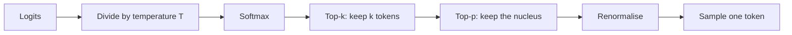

# Inference and Decoding: How the Model Generates Text

## The big picture

[Chapter 2](02-training.md) explained how the model's weights are learned. This chapter explains what happens when the trained model is used: you type a prompt, and the model writes an answer one token at a time. This use of a trained model is called **inference**.

Each answer is produced by a simple loop:

1. **Read the prompt.** Tokenize it and run it through the model once, exactly as in [Chapter 1](01-transformers.md).
2. **Score every token.** The last position gives a probability for every token in the vocabulary.
3. **Choose one token.** A decoding rule picks the next token from those probabilities: always the most likely one, or a random choice shaped by settings such as temperature.
4. **Append and repeat.** Add the chosen token to the input and go back to step 2.
5. **Stop.** End when the model produces an end token or a length limit is reached, then turn the token IDs back into text.

The rest of the chapter walks through each step. It starts with what makes inference different from training, then shows the loop on the translation example, explains why the first token is slower than the others and how the KV cache speeds things up, and ends with the decoding rules that turn probabilities into a choice.

## Inference vs training

Inference uses the same model and the same forward pass as training, but nothing is learned. Knowing exactly what is switched off explains why using a model is so much cheaper than training it, and why the same prompt can give the same answer every time.

### Definitions

- **Inference:** running a trained model on new input to get an output. In a chat model, it means generating an answer to a prompt.
- **Frozen weights:** weights that are only read, never changed. After the last training stage, every weight in E, W\_Q, W\_K, W\_V, W\_O and the feed-forward layers is frozen.
- **Forward pass:** one run of the input through the model, from token IDs to probabilities, as described in [Chapter 1](01-transformers.md).

### What is switched off

| | Training ([Chapter 2](02-training.md)) | Inference |
| --- | --- | --- |
| Weights | Change after every batch | Frozen: read only |
| Forward pass | Yes | Yes, the same computation |
| Correct answer known? | Yes, the next token in the training text | No: the model's output *is* the answer |
| Loss | Computed at every position | Not computed: there is nothing to compare with |
| Backward pass (backpropagation) | Yes | No |
| Optimiser (Adam) | Updates every weight | Not used |
| [Dropout](02-training.md#dropout-forcing-the-model-not-to-rely-on-any-single-number) | On: randomly zeroes 10% of numbers | Off: every number is kept |
| Decoder input | The true text ([teacher forcing](02-training.md#teacher-forcing-why-training-happens-in-one-time-step)) | The model's own previous outputs |
| Typical cost | Weeks on thousands of GPUs | Seconds per answer |

The most important row is "Correct answer known?". During training, after `YOUR CAT IS A LOVELY`, the text says the next token is `CAT`, so the model's probability of 0.772 for `CAT` can be turned into a loss of 0.259 ([Chapter 2](02-training.md#worked-example-chapter-1s-probabilities)). At inference, the same probabilities come out: CAT 0.772, DOG 0.211, IS 0.013, LOVELY 0.004. But there is no correct answer to compare them with. The model simply **uses** them to choose the next token. With no loss there is nothing to backpropagate, and with no gradients there is nothing for the optimiser to do.

### Why inference needs less memory

Training must keep more than the weights in memory. For every weight it also stores a **gradient** and Adam's two running averages **m** and **v** ([Chapter 2](02-training.md#adam-a-smarter-step)). That is four numbers per weight instead of one.

**Worked example** with the base model's 65 million weights, each stored as a 32-bit number of 4 bytes ([Chapter 4](04-quantization.md#number-formats) explains number formats):

| What is stored | Numbers per weight | Memory |
| --- | --- | --- |
| Inference: weights only | 1 | 65,000,000 × 4 bytes = 260 MB |
| Training: weights + gradients + m + v | 4 | 4 × 260 MB = 1,040 MB |

Training needs four times as much memory before counting anything else. (Training also keeps the intermediate results of the forward pass for the backward pass, which adds more.) Inference has one extra cost of its own, the KV cache, explained later in this chapter.

### Same input, same output?

With frozen weights and dropout switched off, the forward pass is **deterministic**: the same prompt always gives exactly the same probabilities. Any variety in a model's answers comes only from step 3 of the loop, the decoding rule. If the rule always picks the most likely token, the answer is the same every time; if it picks randomly according to the probabilities, answers can differ. The decoding rules are explained at the end of this chapter.

## Generation step by step

A model writes its answer one token at a time: each new token needs its own forward pass, and each pass can only start once the previous token is chosen. This section follows that loop on the translation example from [Chapter 2](02-training.md#the-translation-example), then shows that chat models such as Claude work the same way.

### Encoder–decoder: translating "I love you very much"

The task is the one used to train the model in Chapter 2: translate "I love you very much" into Italian. As there, each word counts as one token to keep the tables short.

**The encoder runs once.** The source sentence `<SOS>` I love you very much `<EOS>` (7 tokens) goes through the encoder in a single pass. Its output, one 512-number vector per source token (a 7 × 512 matrix), is kept and reused, unchanged, at every decoder step. The decoder reads it through cross-attention ([Chapter 1](01-transformers.md#self-attention-vs-cross-attention)): the encoder output supplies the K and V, the decoder supplies the Q.

**The decoder runs once per output token.** It starts with only `<SOS>` and grows its input by one token per step:

| Step | Decoder input | Positions in the input | Prediction used | Chosen token |
| --- | --- | --- | --- | --- |
| 1 | `<SOS>` | 1 | Position 0 | Ti |
| 2 | `<SOS>` Ti | 2 | Position 1 | amo |
| 3 | `<SOS>` Ti amo | 3 | Position 2 | molto |
| 4 | `<SOS>` Ti amo molto | 4 | Position 3 | `<EOS>`: stop |

The final decoder input `<SOS>` Ti amo molto is exactly the decoder input used in training. The difference is how it was built: in training it came from the data and went through the model in one pass; here the model built it itself, one token per pass. [Chapter 2's comparison table](02-training.md#training-vs-generation-for-the-same-sentence) sums this up: 1 forward pass in training, 4 in generation.

**One step in detail.** At step 2 the decoder reads `<SOS>` Ti and the last position outputs a probability for every Italian token. With made-up numbers:

| Candidate | Probability |
| --- | --- |
| amo | 0.81 |
| adoro | 0.12 |
| voglio | 0.04 |
| all other tokens together | 0.03 |

The simplest decoding rule, taking the most likely token, picks `amo`. It is appended, and step 3 starts from `<SOS>` Ti amo. Other decoding rules are explained at the end of this chapter.

**Why only the last position is used.** At step 4 the decoder outputs predictions for all four positions, but positions 0 to 2 only repeat the predictions already made at steps 1 to 3. Only the last position says something new. Recomputing the earlier positions is wasted work: across the four steps the decoder processes 1 + 2 + 3 + 4 = 10 positions to produce 4 tokens. The KV cache, later in this chapter, removes most of that waste.

### Decoder-only: how chat models generate

GPT-style models and Claude have no encoder ([Chapter 1](01-transformers.md#three-ways-the-block-is-used-today)). The prompt and the answer live in **one sequence**: the model reads the prompt, then keeps appending its own tokens to the end of that same sequence.

The same translation, asked as a prompt, looks like the supervised fine-tuning example in [Chapter 2](02-training.md#stage-2-supervised-fine-tuning-sft):

| Step | Model input (prompt + answer so far) | Chosen token |
| --- | --- | --- |
| 1 | Translate to Italian: I love you very much | Ti |
| 2 | Translate to Italian: I love you very much Ti | amo |
| 3 | Translate to Italian: I love you very much Ti amo | molto |
| 4 | Translate to Italian: I love you very much Ti amo molto | `<EOS>`: stop |

The prompt plays the role the encoder played above: it is the information the answer depends on. The causal mask ([Chapter 1](01-transformers.md#what-the-mask-looks-like)) is the same as in training, so each new token sees the prompt and the answer so far, and nothing after it.

The same loop also explains [Chapter 1's logits example](01-transformers.md#from-the-last-vector-back-to-a-word). Given the prompt `YOUR CAT IS A LOVELY`, the last position outputs CAT 0.772, DOG 0.211, IS 0.013, LOVELY 0.004. Taking the most likely token appends `CAT`, and the next pass starts from `YOUR CAT IS A LOVELY CAT`.

In a chat, "the prompt" is the whole conversation so far: earlier messages, the new question, and some special tokens that mark who is speaking. The model generates until it produces its end-of-answer token.

**What a chat looks like as tokens.** Each model family has a fixed **chat template**: special tokens, added to the vocabulary for this purpose, that mark where each message starts and ends and who wrote it. Llama 3's template, for the translation request above, gives this sequence:

| Piece | Tokens | Meaning |
| --- | --- | --- |
| Start of text | <code>&lt;&#124;begin_of_text&#124;&gt;</code> | The conversation begins (the model's `<SOS>`) |
| User header | <code>&lt;&#124;start_header_id&#124;&gt;</code> user <code>&lt;&#124;end_header_id&#124;&gt;</code>, then a blank line | The next message is from the user |
| User message | Translate to Italian: I love you very much | The user's words, as ordinary tokens |
| End of turn | <code>&lt;&#124;eot_id&#124;&gt;</code> | The user's message is finished |
| Assistant header | <code>&lt;&#124;start_header_id&#124;&gt;</code> assistant <code>&lt;&#124;end_header_id&#124;&gt;</code>, then a blank line | The next message is from the assistant |

The prompt ends right after the assistant header, so the most likely continuation is the assistant's answer. The model generates `Ti`, `amo`, `molto`, and then its own `<|eot_id|>`, the end-of-turn token at which generation stops (see [Stopping](#stopping)). A **system message** (instructions from the application, such as "You are a translation assistant") is added the same way, with the role `system`, before the first user message. A longer conversation simply repeats header, message and end-of-turn for every turn.

The model learns this format during supervised fine-tuning ([Chapter 2](02-training.md#stage-2-supervised-fine-tuning-sft)), where only the assistant's messages count in the loss. The template must be reproduced exactly at inference: a model given a different format sees an unfamiliar sequence and answers worse.

### Encoder–decoder vs decoder-only at inference

| | Encoder–decoder (translation model) | Decoder-only (chat model) |
| --- | --- | --- |
| What reads the input | The encoder, once | The same stack that writes the answer |
| Where the answer goes | A separate decoder sequence starting with `<SOS>` | Appended to the end of the prompt |
| How the answer sees the input | Cross-attention to the encoder output | Ordinary masked self-attention over the prompt |
| Forward passes for "Ti amo molto `<EOS>`" | 1 encoder pass + 4 decoder passes | 4 passes (the first one also reads the prompt) |
| Stops at | `<EOS>` or a length limit | End-of-answer token or a length limit |

## Prefill vs decode: why the first token is slower

Generation has two phases that use the hardware in very different ways. Knowing them explains two things every chat user notices: there is a pause before the first word appears, and after that the words stream out at a steady pace.

### Definitions

- **Prefill (prompt processing):** the first forward pass, which reads the whole prompt and produces the first output token.
- **Decode (token generation):** every pass after that, each producing one more token.
- **Time to first token (TTFT):** how long the user waits before the first token appears. It is mostly the prefill time.
- **Time per output token:** how long each following token takes. Its inverse is the familiar "tokens per second".
- **FLOP (floating-point operation):** one multiplication or addition of two numbers. Running one token through a model costs about **2 × (number of weights)** FLOPs, because each weight is used in one multiplication and one addition.

### Prefill works like training

The whole prompt is known before generation starts, just as the whole target sentence is known in training. So all prompt tokens go through the model **in one pass**, in parallel, with the causal mask keeping each position from seeing later ones ([Chapter 2](02-training.md#why-training-happens-in-one-time-step)). A 1,000-token prompt does not need 1,000 passes; it needs one pass over a 1,000-row matrix.

Decode cannot do this. Token 2 of the answer depends on which token 1 was chosen, so each decode pass must wait for the one before it. With the KV cache (next section), each decode pass only has to process the **one new token**.

### Why decode is limited by memory, not arithmetic

Every forward pass has to read **all the weights** from the GPU's memory, whether it processes 1,000 tokens or 1. What changes is how much arithmetic each weight read pays for.

**Worked example with the base model** (65 million weights at 4 bytes each = 260 MB):

| | Prefill, 1,000-token prompt | Decode, 1 new token |
| --- | --- | --- |
| Weights read from memory | 260 MB | 260 MB |
| Arithmetic: 2 × 65,000,000 × tokens | 130,000,000,000 FLOPs | 130,000,000 FLOPs |
| Arithmetic per byte read | 500 FLOPs | 0.5 FLOPs |

In prefill, each weight is read once and used for 1,000 tokens, so the GPU is busy calculating: prefill is **compute-bound** (limited by arithmetic speed). In decode, each weight is read and used for a single token, so the GPU spends most of its time waiting for memory: decode is **memory-bound** (limited by how fast memory can be read). This counts only the weights; attention adds a smaller cost that grows with the length of the text.

### Worked example: a 7-billion-weight model

The effect is easier to feel on a model the size of today's small open models. Assume a model with 7 billion weights stored in 16-bit format, 2 bytes each ([Chapter 4](04-quantization.md#number-formats) covers number formats), and a GPU that can read 2,000 GB of memory per second and compute 500 trillion FLOPs per second. These are round illustrative figures; real GPUs vary.

- Weights in memory: 7,000,000,000 × 2 bytes = **14 GB**.

| | Prefill, 1,000-token prompt | Decode, 1 token |
| --- | --- | --- |
| Time to read the weights: 14 GB ÷ 2,000 GB/s | 7 ms | 7 ms |
| Time for the arithmetic: 2 × 7 billion × tokens ÷ 500 trillion per second | 28 ms | 0.028 ms |
| Time taken (the slower of the two) | **28 ms**, limited by arithmetic | **7 ms**, limited by memory |

For a 1,000-token prompt and a 200-token answer:

- The first token appears after about **28 ms** (prefill).
- Each later token takes about **7 ms**, so the model streams at most 1 ÷ 0.007 ≈ **143 tokens per second**.
- The whole answer takes about 28 ms + 200 × 7 ms = **1.43 seconds**.

Prefill handled 1,000 tokens in 28 ms; decode would need 1,000 × 7 ms = 7 seconds for the same number of tokens. Per token, prefill is 250 times faster, because it reads the weights once for all of them.

### What this means in practice

- **Long prompts delay the first token.** Prefill time grows with the prompt length, so a 10,000-token document takes about ten times longer to process than a 1,000-token prompt before any answer appears.
- **Streaming speed depends on memory speed and model size.** Each decode step reads every weight, so a smaller model, or the same model stored in fewer bytes per weight, generates faster. This is a main reason for quantization ([Chapter 4](04-quantization.md#fewer-bytes-also-means-faster-generation)).
- **Serving many users at once is efficient.** When several users' decode steps are grouped into one batch, the weights are read once and used for all of them. The memory cost is shared, which is why providers batch requests together.

## The KV cache

The KV cache is the main trick that makes generation fast: it stores the keys and values of tokens already processed, so each decode step only computes them for the one new token. It saves a great deal of arithmetic, but it costs memory, and that memory cost shapes how long a conversation can be and how many users a GPU can serve.

### The waste it removes

In the translation example, the decoder processed 1 + 2 + 3 + 4 = 10 positions to produce 4 tokens. At step 4, for example, it recomputed the key and value vectors of `<SOS>`, Ti and amo, which it had already computed at steps 1 to 3, and got exactly the same numbers.

They are exactly the same because nothing that produces them has changed:

- The weights W\_K and W\_V are frozen.
- A token's vector at every layer depends only on itself and the tokens **before** it, because the causal mask ([Chapter 1](01-transformers.md#what-the-mask-looks-like)) hides everything after it. Appending a new token at the end cannot change the vectors of the tokens before it.

So the key and value of each earlier token, in every layer and head, can be computed once and kept.

### What the KV cache is

The **KV cache** is a store, in GPU memory, of the key vector k and value vector v of every token processed so far, for every layer and every head. Each decode step then does only this, in each layer and head:

1. Compute q, k and v for the **new token only**: one row of 512 numbers times W\_Q, W\_K and W\_V, giving three vectors of 64 numbers ([Chapter 1](01-transformers.md#where-q-k-and-v-come-from)).
2. Append the new k and v to the cache.
3. Compare the new q with **every** key in the cache to get the attention scores, apply softmax, and take the weighted sum of **every** value in the cache.

Only the new token's query is needed: earlier tokens' predictions were already made, so their queries are never used again. This is why the cache holds K and V, but not Q.

### The cache growing, step by step

For the decoder's self-attention in the translation example:

| Step | New token computed | Keys and values in the cache after the step | Positions processed |
| --- | --- | --- | --- |
| 1 | `<SOS>` | `<SOS>` | 1 |
| 2 | Ti | `<SOS>`, Ti | 1 |
| 3 | amo | `<SOS>`, Ti, amo | 1 |
| 4 | molto | `<SOS>`, Ti, amo, molto | 1 |
| **Total** | | | **4** instead of 10 |

The saving grows with length. For an answer of 1,000 tokens, the decoder without a cache would process 1 + 2 + … + 1,000 = 500,500 positions; with the cache it processes 1,000.

For cross-attention the saving is even simpler: the K and V computed from the encoder output never change during the translation, so they are computed once, before step 1, and reused at every step. In a decoder-only chat model, prefill fills the cache with the keys and values of the whole prompt in one pass, and each decode step adds one token.

### How much memory the cache needs

For every token, the cache holds one key and one value vector in every layer. Across all heads of a layer, these are d\_model numbers each (8 heads × 64 = 512 in the base model). So:

$$
\text{cache bytes per token} = 2 \times \text{layers} \times d_{model} \times \text{bytes per number}
$$

- **2** counts the key and the value.
- **layers** is the number of layers that attend to earlier tokens.
- **d\_model** is the number of key (or value) numbers per token per layer, summed over all heads.
- **bytes per number** is 4 for 32-bit numbers and 2 for 16-bit numbers.

**Base model** (6 decoder layers, d\_model = 512, 4 bytes):

| Quantity | Calculation | Result |
| --- | --- | --- |
| Per token | 2 × 6 × 512 × 4 bytes | 24,576 bytes ≈ 24.6 KB |
| 1,000 tokens | 24,576 × 1,000 bytes | ≈ 24.6 MB |

That is about 9% of the 260 MB of weights: small, because the base model is small.

**A 7-billion-weight model** with settings similar to Llama 2 7B (32 layers, d\_model = 4,096, 16-bit numbers of 2 bytes):

| Quantity | Calculation | Result |
| --- | --- | --- |
| Per token | 2 × 32 × 4,096 × 2 bytes | 524,288 bytes ≈ 0.52 MB |
| One conversation of 4,096 tokens | 524,288 × 4,096 bytes | ≈ 2.15 GB |
| 32 users at once, 4,096 tokens each | 32 × 2.15 GB | ≈ 68.7 GB |

The weights of this model take 14 GB (previous section). With 32 users the cache takes almost five times as much memory as the model itself.

### The trade-off

- **Compute saved:** each decode step processes one new token instead of recomputing every earlier token.
- **Memory spent:** the cache grows by a fixed amount with every token, for every user. On a busy server it, not the weights, often decides how many conversations fit on one GPU.
- **Attention still grows with length:** the new query must still be compared with every cached key, so each step does a little more work than the one before. This is much smaller than the work the cache saves.

This is why longer conversations cost more to serve, and why model designers try to shrink the cache. Chapter 4 describes the two main ways: storing it in fewer bytes ([quantization](04-quantization.md#what-weights-activations-or-the-kv-cache)) and sharing keys and values between heads ([grouped-query attention](04-quantization.md#grouped-query-attention-gqa)).

## Choosing the next token

Every decode step ends with a probability for every token in the vocabulary. A **decoding rule** (also called a decoding strategy or sampling method) turns those probabilities into one chosen token. The rule does not change the model at all, yet it decides whether answers are repetitive or varied, safe or creative.

All the rules below use the same example from [Chapter 1](01-transformers.md#from-the-last-vector-back-to-a-word). After the prompt `YOUR CAT IS A LOVELY`, the model's last position gives these logits (raw scores) and, after softmax, these probabilities. For simplicity, the vocabulary is just these four tokens.

| Token | Logit | Probability |
| --- | --- | --- |
| CAT | 6.2 | 0.772 |
| DOG | 4.9 | 0.211 |
| IS | 2.1 | 0.013 |
| LOVELY | 1.0 | 0.004 |

### Greedy decoding

**Greedy decoding** always picks the token with the highest probability. Here it picks `CAT` (0.772), every time.

- **Deterministic:** the same prompt always gives the same answer, because the forward pass is deterministic and so is the choice.
- **Short-sighted:** it picks the best token for this one step, without checking whether that choice leads to a good sentence overall.
- **Prone to repetition:** in long answers it can fall into loops, repeating the same phrase, because once a phrase is likely, repeating it often stays the most likely choice.

### Beam search

**Beam search** looks a few steps ahead by keeping several partial answers at once instead of one. Each partial answer is called a **beam**, and the **beam width** (here 2) is how many are kept after each step. A beam's score is the probability of the whole sequence: the product of the probabilities of its tokens.

**Worked example, beam width 2.** The step-1 probabilities are the ones above. The step-2 probabilities are made up for illustration: after `CAT` the model is unsure how to continue, while after `DOG` it is confident the sentence should end.

**Step 1.** Keep the 2 most likely tokens: `CAT` (0.772) and `DOG` (0.211).

**Step 2.** Extend each beam with its 2 most likely next tokens, and score each extended sequence:

| Beam after step 1 | Next token | Its probability | Sequence score |
| --- | --- | --- | --- |
| CAT (0.772) | `<EOS>` | 0.20 | 0.772 × 0.20 = 0.154 |
| CAT (0.772) | AND | 0.18 | 0.772 × 0.18 = 0.139 |
| DOG (0.211) | `<EOS>` | 0.95 | 0.211 × 0.95 ≈ **0.200** |
| DOG (0.211) | AND | 0.02 | 0.211 × 0.02 = 0.004 |

Keep the 2 best: `DOG <EOS>` (0.200) and `CAT <EOS>` (0.154). Both have ended, so the search stops and returns the best one, `YOUR CAT IS A LOVELY DOG`.

**Greedy decoding on the same example** picks `CAT` at step 1 and `<EOS>` at step 2, for a sequence score of 0.154. Beam search found a sequence with a higher total probability, 0.200, because it kept `DOG` alive even though `DOG` lost the first step.

Three practical details:

- **Logarithms instead of products.** Multiplying many probabilities gives numbers too small for a computer to store accurately, so implementations add the logarithms instead: ln 0.211 + ln 0.95 = −1.607 is higher than ln 0.772 + ln 0.20 = −1.868, giving the same ranking.
- **Length penalty.** Every extra token multiplies the score by a number below 1, so plain beam search favours short answers. Implementations divide the score by a function of the length to correct this. The original Transformer used a beam width of 4 for translation, with a length penalty.
- **Where it is used.** Beam search suits tasks with one best answer, such as translation and speech recognition. Chat models rarely use it: it is slower (several beams per step), and its answers tend to be bland and repetitive. They use sampling instead, described next.

### Sampling and temperature

Instead of always taking the top token, a model can **sample**: pick a token at random, with each token's chance equal to its probability. With the table above, sampling picks `CAT` 77.2% of the time, `DOG` 21.1%, `IS` 1.3% and `LOVELY` 0.4%. Over 1,000 runs of the same prompt you would expect about 772 `CAT`, 211 `DOG`, 13 `IS` and 4 `LOVELY`. Sampling is what lets a chat model give a different answer each time you ask.

**Temperature** controls how adventurous sampling is. Before softmax, every logit is divided by a number T, the temperature:

$$
p_k = \frac{e^{z_k / T}}{\sum_{j} e^{z_j / T}}
$$

- **z\_k** is the logit of token k, and **p\_k** its probability after softmax.
- **T** is the temperature, a positive number chosen by the user or the application.
- **j** runs over every token in the vocabulary, so the probabilities add up to 1.

Dividing by T stretches or squeezes the gaps between logits. A small T makes the gaps bigger, so the top token takes even more of the probability. A large T makes the gaps smaller, so the probabilities become more even. T = 1 leaves the model's probabilities unchanged.

**Worked example, T = 2.**

1. Divide each logit by 2: CAT 3.1, DOG 2.45, IS 1.05, LOVELY 0.5.
2. Take e to each: e^3.1 = 22.20, e^2.45 = 11.59, e^1.05 = 2.86, e^0.5 = 1.65. Their sum is 38.29.
3. Divide each by the sum: CAT 22.20 / 38.29 = 0.580, DOG 0.303, IS 0.075, LOVELY 0.043.

**The same logits at three temperatures:**

| Token | Logit | T = 0.5 | T = 1 | T = 2 |
| --- | --- | --- | --- | --- |
| CAT | 6.2 | 0.931 | 0.772 | 0.580 |
| DOG | 4.9 | 0.069 | 0.211 | 0.303 |
| IS | 2.1 | 0.0003 | 0.013 | 0.075 |
| LOVELY | 1.0 | 0.00003 | 0.004 | 0.043 |

(Values are rounded, so a column can add up to 1.001 instead of exactly 1.)

- **T = 0.5 (low):** `CAT` rises from 0.772 to 0.931. Sampling almost always gives the top token; `IS` comes up about 3 times in 10,000.
- **T = 1:** the model's own probabilities.
- **T = 2 (high):** `CAT` falls to 0.580, and `LOVELY` becomes about ten times more likely (0.004 → 0.043). Answers are more varied but more often odd or wrong.

Two points that are easy to miss:

- **The order never changes.** Dividing every logit by the same positive number keeps `CAT` first and `LOVELY` last at every temperature. Temperature only changes how much the top tokens dominate.
- **T = 0 means greedy.** Dividing by 0 is not possible, but as T gets closer to 0 the top token's probability gets closer to 1. APIs therefore treat a temperature of 0 as "always pick the top token", which is greedy decoding.

Low temperatures (around 0 to 0.3) suit tasks with one right answer, such as extracting data or writing code. Higher ones (around 0.7 to 1) suit open-ended writing. Very high values make the text drift into nonsense, because unlikely tokens keep getting picked.

### Top-k sampling

Even at a sensible temperature, sampling can occasionally pick a token that makes no sense, simply because a real vocabulary has tens of thousands of tokens and each unlikely one keeps a tiny chance. **Top-k sampling** removes that risk: keep only the k most likely tokens, set every other token's probability to 0, and **renormalise** (divide the kept probabilities by their sum so they add up to 1 again). Then sample from what is left.

**Worked example, k = 2.**

1. Keep the 2 most likely tokens: CAT 0.772 and DOG 0.211. Drop IS and LOVELY.
2. Add the kept probabilities: 0.772 + 0.211 = 0.983.
3. Divide each by 0.983: CAT 0.772 / 0.983 = 0.785, DOG 0.211 / 0.983 = 0.215.

| Token | Original probability | k = 1 | k = 2 | k = 3 |
| --- | --- | --- | --- | --- |
| CAT | 0.772 | 1 | 0.785 | 0.775 |
| DOG | 0.211 | 0 | 0.215 | 0.212 |
| IS | 0.013 | 0 | 0 | 0.013 |
| LOVELY | 0.004 | 0 | 0 | 0 |

- **k = 1** keeps only the top token: it is greedy decoding.
- **k = 2** makes `IS` and `LOVELY` impossible; `CAT` and `DOG` share their probability in the same ratio as before.
- **Larger k** lets in more tokens. With a real vocabulary, values such as k = 40 or k = 50 are common.

**The weakness: k is fixed, but the model's confidence is not.** Two prompts, with made-up probabilities:

| Prompt | What the model's probabilities look like | What k = 2 does | What k = 50 does |
| --- | --- | --- | --- |
| "The capital of France is" | Paris 0.97; the remaining 0.03 spread over thousands of tokens | Keeps Paris and one unlikely token | Keeps Paris and 49 unlikely tokens |
| "My favourite colour is" | blue 0.20, green 0.18, red 0.17, purple 0.15, yellow 0.12, black 0.10; the remaining 0.08 spread over other tokens | Keeps only blue (0.526) and green (0.474), dropping red although it is almost as likely as green | Keeps all the good colours, plus some unlikely tokens |

No single k suits both prompts: when the model is confident, even a small k lets in tokens that should be excluded, and when it is unsure, a small k cuts out good options. Top-p sampling, next, fixes this by letting the number of kept tokens change with the model's confidence.

### Top-p (nucleus) sampling

**Top-p sampling**, also called **nucleus sampling**, keeps the smallest group of top tokens whose probabilities add up to at least p, then renormalises and samples from that group. The kept group is called the **nucleus**. Because the rule is about probability, not about a number of tokens, the nucleus is small when the model is confident and large when it is unsure.

**The procedure:**

1. Sort the tokens from most to least likely.
2. Add their probabilities one by one, keeping a running total (the **cumulative probability**).
3. Stop at the first token where the running total reaches p. Keep that token and every token before it; drop the rest.
4. Renormalise the kept probabilities and sample.

**Worked example, p = 0.9.**

| Token | Probability | Running total | Kept? |
| --- | --- | --- | --- |
| CAT | 0.772 | 0.772 | Yes: 0.772 is below 0.9, so continue |
| DOG | 0.211 | 0.983 | Yes: 0.983 reaches 0.9, so stop here |
| IS | 0.013 | 0.996 | No |
| LOVELY | 0.004 | 1.000 | No |

The nucleus is {CAT, DOG}, with a total of 0.983. Renormalising gives CAT 0.772 / 0.983 = 0.785 and DOG 0.211 / 0.983 = 0.215: on this example, the same result as top-k with k = 2.

**Different values of p on the same example:**

| p | Running total at the stop | Nucleus | Renormalised probabilities |
| --- | --- | --- | --- |
| 0.7 | 0.772 | CAT | CAT 1: same as greedy |
| 0.9 | 0.983 | CAT, DOG | CAT 0.785, DOG 0.215 |
| 0.99 | 0.996 | CAT, DOG, IS | CAT 0.775, DOG 0.212, IS 0.013 |

**How it fixes top-k's weakness.** The same two prompts as in the top-k section, with p = 0.9:

| Prompt | Running total | Nucleus | Tokens kept |
| --- | --- | --- | --- |
| "The capital of France is" | Paris alone: 0.97, already above 0.9 | Paris | 1 |
| "My favourite colour is" | blue 0.20 → green 0.38 → red 0.55 → purple 0.70 → yellow 0.82 → black 0.92 | All six colours | 6 |

With one setting, top-p keeps 1 token for the confident prompt and 6 for the unsure one. After renormalising (dividing by 0.92), the colours become blue 0.217, green 0.196, red 0.185, purple 0.163, yellow 0.130 and black 0.109: red is kept this time, and every unlikely token outside the nucleus is excluded.

Common values are p = 0.9 to 0.95. A lower p makes answers safer and more predictable; p = 1 keeps every token, which is plain sampling.

### How the rules combine

In practice the rules are not alternatives: an application sets several of them at once, and they run one after the other at every decode step. A common order, used for example by the Hugging Face Transformers library, is:

Each filter renormalises what it keeps, so the next one works on probabilities that add up to 1. The order matters: temperature runs first, so it changes the probabilities that top-k and top-p then filter.

**Worked example: T = 2, k = 3, p = 0.9** on the CAT/DOG logits.

| Stage | CAT | DOG | IS | LOVELY |
| --- | --- | --- | --- | --- |
| Logits | 6.2 | 4.9 | 2.1 | 1.0 |
| Softmax at T = 2 (from the temperature table) | 0.580 | 0.303 | 0.075 | 0.043 |
| Top-k, k = 3: drop LOVELY, divide by 0.580 + 0.303 + 0.075 = 0.958 | 0.605 | 0.316 | 0.078 | 0 |
| Top-p, p = 0.9: running total 0.605, then 0.921, so stop after DOG; divide by 0.921 | **0.657** | **0.343** | 0 | 0 |

The final step samples `CAT` with probability 0.657 and `DOG` with probability 0.343. (The top-k row adds up to 0.999 because of rounding.)

**The same settings with T = 1:** softmax gives the original 0.772, 0.211, 0.013, 0.004; top-k with k = 3 gives 0.775, 0.212, 0.013 (as in the top-k table); top-p stops at a running total of 0.987 and leaves **CAT 0.785, DOG 0.215**.

Compare the two results. Raising the temperature from 1 to 2 made `DOG` more likely (0.215 → 0.343), which is the variety temperature is meant to add. But `IS` and `LOVELY`, which T = 2 alone had raised to 0.075 and 0.043, were still filtered out by top-p. This is why the rules are used together: temperature adds variety among good candidates, and top-k and top-p stop that variety from reaching unlikely tokens.

### Typical settings

| Task | Temperature | Top-p | Why |
| --- | --- | --- | --- |
| Extracting data, classification, code | 0 to 0.2 | 1 (has little effect) | One right answer: the most likely token is wanted every time |
| General questions and chat | about 0.7 | 0.9 to 0.95 | Natural-sounding variety, with unlikely tokens filtered out |
| Brainstorming, fiction | 0.9 to 1 | 0.95 | More variety; top-p still blocks nonsense |

These are starting points, not rules; each model and provider documents its own defaults. Many API guides recommend changing **either** temperature **or** top-p, not both at once, because both control the same thing (how far the choice strays from the top token) and their effects are hard to predict together. For the [fraud example](05-evaluation.md#the-big-picture) in Chapter 5, where a model labels transactions, a temperature of 0 is the natural choice: the same transaction should always get the same label.

### Constrained decoding

The rules above choose among all tokens, so nothing stops a model from answering a classification question with a polite sentence, or from producing JSON with a missing bracket. When an application needs output in an exact format, **constrained decoding** (also called guided decoding or structured output) enforces it: at every step, any token that would break the format is **masked**, its probability set to 0, and the remaining probabilities are renormalised before the usual decoding rule picks one.

**Worked example: the fraud label.** The application from [Chapter 5](05-evaluation.md#the-big-picture) asks the model to answer with exactly one label, `FRAUD` or `OK`. Suppose the model's probabilities for the first token are (made-up numbers):

| Token | Probability | Allowed? | After masking and renormalising |
| --- | --- | --- | --- |
| FRAUD | 0.55 | Yes | 0.55 ÷ 0.85 = 0.647 |
| OK | 0.30 | Yes | 0.30 ÷ 0.85 = 0.353 |
| I (as in "I think…") | 0.08 | No | 0 |
| The | 0.05 | No | 0 |
| All other tokens | 0.02 | No | 0 |

Masking is done on the logits, exactly like the causal mask in Chapter 1: the logits of forbidden tokens are set to −∞, so softmax gives them exactly 0 and shares the probability among the allowed tokens. The arithmetic is the same as for top-k: keep some tokens, divide by their total. The answer is now guaranteed to be a valid label; with greedy decoding it is `FRAUD`.

**Longer formats.** For JSON, SQL or any format defined by a grammar, a small program follows the output as it is generated and knows, at each step, which tokens may come next. After `{"label": "` only the start of `FRAUD` or `OK` is allowed; after the label, only the closing `"`; and so on until the object is complete.

Two cautions:

- **A valid format is not a correct answer.** Constrained decoding guarantees that the output can be read by the program, not that the label is right; that is what the metrics in Chapter 5 measure.
- **Measure what you deploy.** Renormalising changes the numbers: here the fraud score rises from 0.55 to 0.647. A threshold chosen on one kind of score (see [Moving the threshold](05-evaluation.md#moving-the-threshold-the-roc-curve-and-auc)) must be applied to the same kind of score in production.

## Stopping

The generation loop has no natural end: after every token, the model can always predict another one. Something must decide when the answer is finished. Three conditions do this, and every generation stops at whichever comes first.

### The three stop conditions

| Condition | Who decides | What happens |
| --- | --- | --- |
| **End token** (`<EOS>`, or an end-of-turn token in chat models) | The model | The model chooses the end token as its next token, just as it learned in training ([Chapter 2](02-training.md#the-special-tokens)). This is the normal, clean ending. |
| **Maximum tokens** (max tokens) | The user or application | Generation stops after a fixed number of output tokens, even in the middle of a sentence. |
| **Stop sequence** | The user or application | Generation stops as soon as the output contains a chosen piece of text, such as a blank line or a tag. |

**End token.** In the translation, step 4 chose `<EOS>` after "molto", and the loop ended there. The end token is a choice like any other: it is picked by the decoding rule from the probabilities. With sampling at a high temperature, the model can occasionally skip a likely `<EOS>` and keep writing, which is one more reason to set the other two limits.

**Maximum tokens.** With max tokens = 2, the translation would stop after "Ti amo", before "molto", and the answer would be cut off. The limit protects against answers that run on, and it caps the cost and waiting time: with the 7 ms per token of the earlier 7B example, a limit of 1,000 tokens means at most 1,000 × 7 ms = 7 seconds of decoding.

**Stop sequence.** Suppose an application asks a model to label a transaction and expects one line such as `Label: FRAUD`. Setting the stop sequence to a line break ends generation as soon as that line is complete, even if the model would have gone on to explain its answer. The stop sequence itself is usually not included in the returned text.

APIs report which condition ended the answer. Anthropic's API, for example, returns a `stop_reason` of `end_turn`, `max_tokens` or `stop_sequence`. An application should check it: `max_tokens` means the answer is probably incomplete.

### The context window: a hard limit

The **context window** is the maximum number of tokens the model can handle at once, prompt and answer together. It is fixed when the model is built and trained. If a model has a context window of 8,192 tokens and the prompt uses 7,000, at most 8,192 − 7,000 = 1,192 tokens are left for the answer, whatever max tokens is set to. Every one of those tokens also adds to the KV cache, as shown earlier in this chapter.

### After the loop: from IDs back to text

Generation produces token IDs, not text. The last step is **decoding** in the tokenizer's sense ([Chapter 1](01-transformers.md#encoding-new-text)): each ID is turned back into its text piece and the pieces are joined. The end token is dropped. In chat interfaces this happens continuously: each token is decoded and shown as soon as it is chosen, which is the **streaming** effect of words appearing one by one.

## Cheat sheet

| Concept | One-line meaning |
| --- | --- |
| Inference | Using a trained model: frozen weights, no loss, no backpropagation, dropout off |
| Generation loop | Score every token, choose one, append it, repeat until a stop condition |
| Deterministic forward pass | Same prompt, same probabilities; variety comes only from the decoding rule |
| Encoder–decoder generation | Encoder runs once; decoder runs once per output token, reading the encoder through cross-attention |
| Decoder-only generation | The answer is appended to the prompt in one sequence |
| Prefill | First pass: the whole prompt at once, in parallel; compute-bound |
| Decode | One pass per new token; memory-bound, because every weight is read for one token |
| Time to first token | Mostly prefill time; grows with prompt length |
| KV cache | Stored keys and values of earlier tokens, so each step computes only the new token |
| KV cache size | 2 × layers × d\_model × bytes per number, per token |
| Greedy decoding | Always pick the most likely token |
| Beam search | Keep the best few partial answers; return the sequence with the highest total probability |
| Sampling | Pick at random, each token with its probability |
| Temperature T | Divide logits by T before softmax: T < 1 sharper, T > 1 flatter, T = 0 greedy |
| Top-k | Keep the k most likely tokens, renormalise, sample |
| Top-p (nucleus) | Keep the smallest top group summing to at least p, renormalise, sample |
| Typical order | Temperature → softmax → top-k → top-p → sample |
| Stop conditions | End token, max tokens or stop sequence, whichever comes first |
| Context window | Maximum tokens for prompt and answer together |

## Sources

- [Attention Is All You Need (Vaswani et al., 2017)](https://arxiv.org/abs/1706.03762): beam search with beam size 4 and a length penalty
- [Transformer from scratch, slides by Umar Jamil (CC BY-NC 4.0)](https://github.com/hkproj/transformer-from-scratch-notes): inference one time step at a time, greedy decoding and beam search
- [Hierarchical Neural Story Generation (Fan et al., 2018)](https://arxiv.org/abs/1805.04833): top-k sampling
- [The Curious Case of Neural Text Degeneration (Holtzman et al., 2019)](https://arxiv.org/abs/1904.09751): nucleus (top-p) sampling and the weaknesses of a fixed k
- [Efficiently Scaling Transformer Inference (Pope et al., 2022)](https://arxiv.org/abs/2211.05102): prefill and decode costs, KV cache memory
- [Llama 2: Open Foundation and Fine-Tuned Chat Models (Touvron et al., 2023)](https://arxiv.org/abs/2307.09288): settings of the 7-billion-weight example
- [Generation strategies, Hugging Face Transformers documentation](https://huggingface.co/docs/transformers/generation_strategies): decoding settings and the order they are applied in
- [Stop reasons, Claude Platform documentation](https://platform.claude.com/docs/en/build-with-claude/handling-stop-reasons): `stop_reason` values
