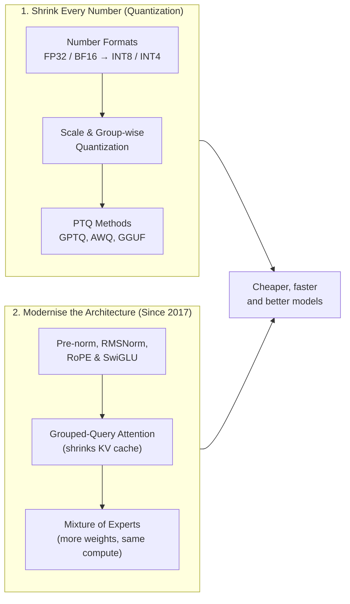
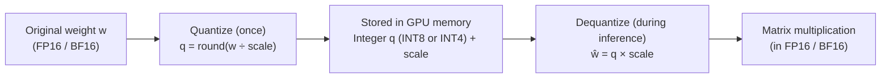
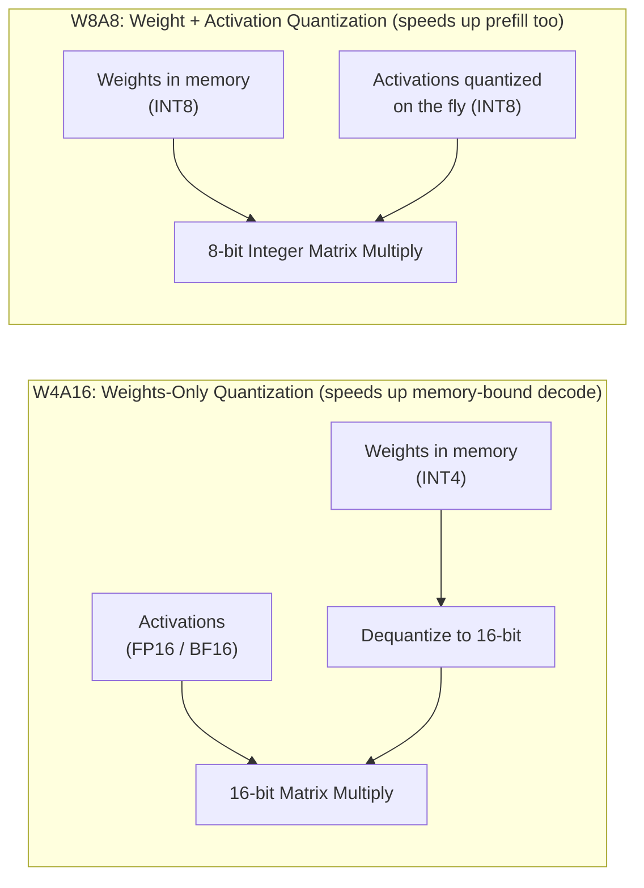
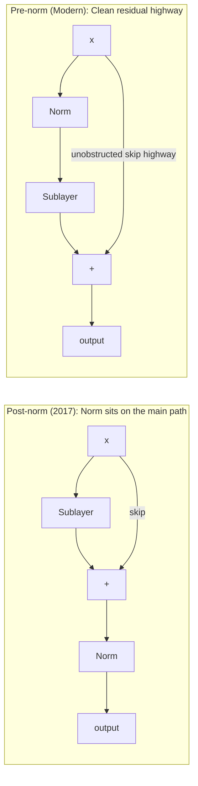
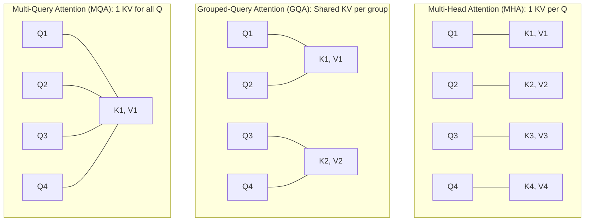
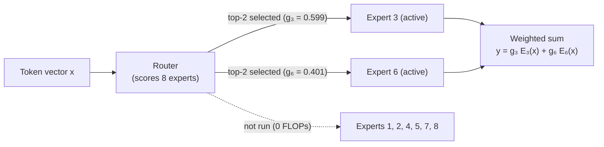

# Quantization, Efficiency and the Modern Transformer

## The big picture

[Chapter 3](03-inference.md#why-decode-is-limited-by-memory-not-arithmetic) showed that generating text is limited mostly by memory: every decode step reads every weight, and the KV cache grows with every token. This chapter is about making models smaller and faster without making them noticeably worse. The main tool is **quantization**: storing each number with fewer bits.

A trained model stores its weights as **floating-point** numbers (numbers with a decimal point), usually 2 or 4 bytes each. Quantization **replaces** them with small **whole numbers** (integers) of 1 byte or half a byte, plus one shared conversion number, the **scale**, for each group of weights. In short, the process has three steps:

1. **Choose a scale** for a group of weights: the largest weight divided by the largest integer allowed. For 8-bit integers (largest value 127) and a largest weight of 1.30, the scale is 1.30 ÷ 127 = 0.010236.
2. **Store each weight as a whole number:** divide it by the scale and round. The weight 0.42 becomes 0.42 ÷ 0.010236 = 41.03, stored as **41**, in 1 byte instead of 4.
3. **Convert back when the weight is used:** multiply the integer by the scale. 41 × 0.010236 = 0.4197, very close to the original 0.42. The small difference, 0.0003, is the **rounding error**: the only price paid for the smaller size.

[How quantization works](#how-quantization-works) goes through this process in detail.

The chapter follows one question, "how many bytes does this model need, and what do we lose by using fewer?":

1. **Why size matters:** memory = number of weights × bytes per weight, and decode speed follows from it.
2. **Number formats:** what FP32, FP16, BF16, INT8 and INT4 can and cannot store.
3. **How quantization works:** turning real numbers into small integers with a scale, and the rounding error this causes.
4. **Kinds of quantization:** when it is done, what is quantized, and the common methods (GPTQ, AWQ, GGUF).
5. **Quality vs speed:** when the savings start to cost accuracy.
6. **What changed since 2017:** the improvements that turned the original Transformer of [Chapter 1](01-transformers.md#attention-is-all-you-need-2017) into today's models, several of them also aimed at efficiency.
7. **Mixture of Experts:** models with many more weights that use only a few of them for each token.

## Why size matters

A model's size decides which hardware can run it and how fast it generates. Both follow from one multiplication.

The multiplication is: memory = number of weights × bytes per weight. For a given model the number of weights is fixed, so the memory depends on one factor only: the **number format** each weight is stored in, which sets its bytes per weight ([Number formats](#number-formats) explains each one). A 7-billion-weight model needs 28 GB in 32-bit floating point (FP32, 4 bytes per weight), 14 GB in 16-bit floating point (FP16 or BF16, 2 bytes), 7 GB in 8-bit integers (INT8, 1 byte) and only 3.5 GB in 4-bit integers (INT4, half a byte). Because generating each token means reading every weight from memory, a smaller model in memory is also a faster one.

**Why this matters in practice: running a model on your own computer.** Tools such as **Ollama**, which run open models on a laptop or desktop, offer each model in several number formats, and the choice decides whether the model fits in your computer's memory. For example, Llama 3.1 8B (8 billion weights) is offered as:

| Ollama tag | Format | File size |
| --- | --- | --- |
| `llama3.1:8b-instruct-fp16` | 16-bit floating point | 16 GB |
| `llama3.1:8b-instruct-q8_0` | 8-bit integers | 8.5 GB |
| `llama3.1:8b-instruct-q4_K_M` | 4-bit integers | 4.9 GB |

The default tag, `llama3.1` (or `llama3.1:8b`), is the 4-bit `q4_K_M` version: a third of the 16-bit size, so it runs on an ordinary laptop. The names `q8_0` and `q4_K_M` are quantization types of the GGUF file format that Ollama uses; [How: three names you will meet](#how-three-names-you-will-meet) explains them, and [Quality vs speed](#quality-vs-speed) explains what each step down costs in quality.

This section covers:

1. [Memory = weights × bytes per weight](#memory-weights-bytes-per-weight): the formula and what a byte per weight means.
2. [Worked example: a 7-billion-weight model](#worked-example-a-7-billion-weight-model): the same model in 32, 16, 8 and 4 bits.
3. [Fewer bytes also means faster generation](#fewer-bytes-also-means-faster-generation): why a smaller file generates tokens faster.

### Memory = weights × bytes per weight

Every weight is stored as a number in a fixed format, and each format uses a fixed number of bytes. So:

$$
\text{memory for the weights} = \text{number of weights} \times \text{bytes per weight}
$$

- **number of weights** is the parameter count, e.g. 65 million for the base model of [Chapter 1](01-transformers.md#key-settings-of-the-base-model) or 7 billion for a small modern model.
- **bytes per weight** depends on the number format: 4 bytes for 32-bit numbers, 2 for 16-bit, 1 for 8-bit and half a byte for 4-bit. The formats are explained in the next section.

The base model at 4 bytes per weight needs 65,000,000 × 4 = 260 MB, as in [Chapter 3](03-inference.md#why-inference-needs-less-memory).

### Worked example: a 7-billion-weight model

| Format | Bytes per weight | Memory for 7 billion weights |
| --- | --- | --- |
| 32-bit (FP32) | 4 | 7,000,000,000 × 4 = 28 GB |
| 16-bit (FP16 or BF16) | 2 | 14 GB |
| 8-bit (INT8) | 1 | 7 GB |
| 4-bit (INT4) | 0.5 | 3.5 GB |

What this means in practice:

- **At 32 bits** the model does not fit on a typical 24 GB graphics card.
- **At 16 bits** it fits, with 10 GB left for the KV cache. One 4,096-token conversation needs about 2.15 GB of cache ([Chapter 3](03-inference.md#how-much-memory-the-cache-needs)), so the total is about 16.1 GB.
- **At 4 bits** it fits on a laptop with 8 GB of memory.

The same arithmetic decides which large models are practical. A 70-billion-weight model needs 140 GB at 16 bits, more than any single common GPU holds, but 35 GB at 4 bits.

### Fewer bytes also means faster generation

[Chapter 3](03-inference.md#why-decode-is-limited-by-memory-not-arithmetic) showed that each decode step must read every weight from memory, so the speed limit is roughly memory speed ÷ model size. With the same illustrative GPU that reads 2,000 GB per second:

| Format | Model size | Maximum tokens per second (2,000 ÷ size in GB) |
| --- | --- | --- |
| FP32 | 28 GB | 71 |
| FP16 / BF16 | 14 GB | 143 |
| INT8 | 7 GB | 286 |
| INT4 | 3.5 GB | 571 |

Halving the bytes per weight roughly doubles the decode speed limit. In practice the gain is a little smaller, because the small integers must be converted back to ordinary numbers before the arithmetic, but the direction is the same. This is the main reason quantization is used almost everywhere models are served.

## Number formats

Every number in a model, whether a weight, an activation or a value in the KV cache, is stored in a **number format**: a fixed rule for turning a pattern of bits into a value. The format decides how much memory each number uses, how large or small a value it can hold, and how precisely it holds it.

This section covers:

1. [Floating-point numbers: range and precision](#floating-point-numbers-range-and-precision): how a number with a decimal point is stored in bits, and the trade-off between range and precision.
2. [Worked example: storing the same values in each format](#worked-example-storing-the-same-values-in-each-format): what each format does to the same numbers.
3. [Integer formats](#integer-formats): the whole-number formats used by quantized models.
4. [Summary of the formats](#summary-of-the-formats): all formats in one table.

### Floating-point numbers: range and precision

Most model numbers are **floating-point** numbers. A floating-point number works like scientific notation, 1.2345 × 10³, stored in binary. Its bits are split into three parts:

- **Sign (1 bit):** positive or negative.
- **Exponent:** the power of 2 that sets the size of the number. More exponent bits give a wider **range**, from very small to very large values.
- **Fraction (also called mantissa):** the significant digits. More fraction bits give more **precision**, that is, more correct digits.

The three floating-point formats used in LLMs split their bits differently:

| Format | Total bits | Sign | Exponent | Fraction | Largest value | Correct decimal digits (about) |
| --- | --- | --- | --- | --- | --- | --- |
| FP32 (single precision) | 32 | 1 | 8 | 23 | 3.4 × 10³⁸ | 7 |
| FP16 (half precision) | 16 | 1 | 5 | 10 | 65,504 | 3 to 4 |
| BF16 (brain float 16) | 16 | 1 | 8 | 7 | 3.4 × 10³⁸ | 2 to 3 |

FP16 and BF16 both use 16 bits but make opposite choices. FP16 keeps more fraction bits, so it is more precise, but its 5 exponent bits give a small range. BF16, designed at Google for machine learning, keeps FP32's 8 exponent bits, so it has the same huge range as FP32, but only 7 fraction bits.

!!! note "Quick refresher: How binary floating-point numbers work"
    In ordinary base-10 scientific notation, a number is written as $\pm \text{digits} \times 10^{\text{exponent}}$. A computer's floating-point format does the same in base 2:

    $$
    \text{value} = (-1)^{\text{sign}} \times (1.\text{fraction}_2) \times 2^{\text{exponent}}
    $$

    A field of $b$ bits can hold $2^b$ distinct patterns:

    - **Exponent bits set the range:** FP16 has 5 exponent bits ($2^5 = 32$ patterns), so its highest power of 2 is $2^{15} = 32{,}768$ and its largest representable number is $65{,}504$. FP32 and BF16 both have 8 exponent bits ($2^8 = 256$ patterns), reaching $2^{127} \approx 1.7 \times 10^{38}$ (and $3.4 \times 10^{38}$ with the fraction bits).
    - **Fraction bits set the precision:** Each extra fraction bit halves the gap between adjacent numbers. With 23 fraction bits ($2^{23} \approx 8.4\text{ million}$ steps between powers of 2), FP32 gives about 7 decimal digits of accuracy; with 7 fraction bits ($2^7 = 128$ steps), BF16 gives about 2 to 3 decimal digits.

### Worked example: storing the same values in each format

The values below were stored in each format and read back (computed with NumPy):

| Value to store | FP32 stores | FP16 stores | BF16 stores |
| --- | --- | --- | --- |
| 0.1234567 (a typical weight) | 0.1234567 | 0.12347 | 0.12354 |
| 70,000 (a large activation) | 70,000 | **infinity** (too large) | 70,144 |
| 0.00000001 (a tiny gradient) | 0.00000001 | **0** (too small) | 0.0000000100 |

- **A typical weight:** all three formats keep the value close. FP16's error is 0.000017 and BF16's is 0.000078, both small compared with the weight itself.
- **A large value:** FP16 cannot store anything above 65,504, so 70,000 becomes infinity and the calculation breaks. BF16 stores it with a small error.
- **A tiny value:** FP16 rounds 0.00000001 to 0, so the information is lost. BF16 keeps it.

This is why **BF16 is the usual format for training** today: running out of range breaks training, while BF16's lower precision is usually harmless. For inference, both FP16 and BF16 are common.

### Integer formats

Quantized models store weights as **integers** (whole numbers) with very few bits:

| Format | Bits | Bytes | Values it can hold |
| --- | --- | --- | --- |
| INT8 | 8 | 1 | 256 whole numbers, from −128 to 127 |
| INT4 | 4 | 0.5 | 16 whole numbers, from −8 to 7 |

Because $b$ bits provide $2^b$ distinct patterns, an 8-bit integer holds $2^8 = 256$ whole numbers and a 4-bit integer holds $2^4 = 16$ whole numbers. An integer format cannot store 0.1234567 at all, only whole numbers such as 12 or −3. To use it for weights, every weight must be mapped onto those few whole numbers, and mapped back when it is needed. That mapping is quantization, explained in the next section.

### Summary of the formats

| Format | Bytes per number | Range | Precision | Typical use |
| --- | --- | --- | --- | --- |
| FP32 | 4 | Huge | High | Optimiser state, master copy of weights during training |
| BF16 | 2 | Huge | Low | Training and inference |
| FP16 | 2 | Small | Medium | Inference |
| INT8 | 1 | 256 steps, with a scale | Steps of a fixed size | Quantized weights, KV cache |
| INT4 | 0.5 | 16 steps, with a scale | Coarse steps | Quantized weights |

## How quantization works

**Quantization** means storing numbers in a format with fewer bits, usually by mapping real-valued weights onto a small set of whole numbers. The mapping uses one extra number, the **scale**, which says how much one integer step is worth. Understanding the scale explains both why quantization works so well and where its errors come from.

This section covers:

1. [Definitions](#definitions): quantize, dequantize, scale and rounding error.
2. [Worked example: five weights to INT8](#worked-example-five-weights-to-int8): the full calculation with real numbers.
3. [The same weights in INT4](#the-same-weights-in-int4): fewer bits, bigger steps, larger errors.
4. [Zero-point (asymmetric) quantization](#zero-point-asymmetric-quantization): using the integer range better when the weights are not centred on zero.
5. [The outlier problem and group-wise scales](#the-outlier-problem-and-group-wise-scales): why one large weight hurts all the others, and how one scale per small group fixes it.

### Definitions

- **Quantize:** turn a real number into a small integer, q = round(w ÷ scale).
- **Dequantize:** turn the integer back into an approximate real number, ŵ = q × scale. This happens just before the weight is used in a calculation.
- **Scale:** the size of one integer step, chosen so the largest weight lands on the largest allowed integer.
- **Rounding error:** the difference between the original weight w and the dequantized ŵ. It can never be larger than half a step (scale ÷ 2).

$$
\text{scale} = \frac{\max |w|}{q_{\max}} \qquad q = \text{round}\!\left(\frac{w}{\text{scale}}\right) \qquad \hat{w} = q \times \text{scale}
$$

- **w** is the original floating-point weight.
- **max |w|** is the largest weight in the group, ignoring its sign.
- **q\_max** is the largest integer used: 127 for INT8 and 7 for INT4.
- **round(...)** rounds to the nearest whole number, producing the stored integer **q**.
- **$\hat{w}$** (read "w-hat") is the approximate floating-point weight reconstructed when multiplying **q** back by **scale**.

This version is called **symmetric** quantization: 0 stays exactly 0, and positive and negative weights use the same step.

### Worked example: five weights to INT8

Take five weights (made-up values): 0.42, −1.30, 0.053, 0.871, −0.317.

1. **Find the scale.** The largest weight ignoring sign is 1.30, so scale = 1.30 ÷ 127 = 0.010236.
2. **Quantize.** Divide each weight by the scale and round to the nearest whole number.
3. **Store** the five integers (1 byte each) and the one scale.
4. **Dequantize** when needed: multiply each integer by the scale.

| Weight w | w ÷ scale | Stored integer q | Dequantized ŵ = q × 0.010236 | Rounding error |
| --- | --- | --- | --- | --- |
| 0.42 | 41.03 | 41 | 0.4197 | 0.0003 |
| −1.30 | −127.00 | −127 | −1.3000 | 0.0000 |
| 0.053 | 5.18 | 5 | 0.0512 | 0.0018 |
| 0.871 | 85.09 | 85 | 0.8701 | 0.0009 |
| −0.317 | −30.97 | −31 | −0.3173 | 0.0003 |

The largest error is 0.0018, below the half-step limit of 0.010236 ÷ 2 = 0.0051. Each weight is now stored in 1 byte instead of 4, and its value is still correct to about 2 decimal places.

### The same weights in INT4

INT4 allows only the integers −7 to 7 here, so the steps are much bigger: scale = 1.30 ÷ 7 ≈ 0.1857 (the table uses the unrounded value 0.185714 to compute ŵ).

| Weight w | w ÷ scale | Stored integer q | Dequantized ŵ = q × 0.1857 | Rounding error |
| --- | --- | --- | --- | --- |
| 0.42 | 2.26 | 2 | 0.3714 | 0.0486 |
| −1.30 | −7.00 | −7 | −1.3000 | 0.0000 |
| 0.053 | 0.29 | 0 | 0.0000 | 0.0530 |
| 0.871 | 4.69 | 5 | 0.9286 | 0.0576 |
| −0.317 | −1.71 | −2 | −0.3714 | 0.0544 |

The largest error grows from 0.0018 to 0.0576, about 30 times larger than with INT8, and the small weight 0.053 has become exactly 0. Each weight now takes only half a byte. Whether these errors matter depends on how many weights there are and how cleverly the rounding is done, the subject of the next two sections.

### Zero-point (asymmetric) quantization

The weights above range from −1.30 to 0.871, but symmetric INT8 reserves integers up to +127 for positive values that never appear: the largest positive weight only reaches 85. **Asymmetric** quantization fixes this by mapping the actual range, minimum to maximum, onto all 256 values of an unsigned 8-bit integer (0 to 255). It needs a second stored number, the **zero point**: the integer that represents the real value 0.

- scale = (0.871 − (−1.30)) ÷ 255 = 0.008514
- zero point = round(1.30 ÷ 0.008514) = 153
- q = round(w ÷ scale) + zero point, so −1.30 → 0, 0 → 153, and 0.871 → 255.

The step is now 0.0085 instead of 0.0102, because no integer values are wasted. Asymmetric quantization is most useful for activations, which are often all positive (for example after ReLU), so half of a symmetric range would be wasted.

### The outlier problem and group-wise scales

The scale is set by the **largest** weight in the group: that weight must fit on the largest integer (7 for INT4). Every other weight is then measured in steps of that size. This works well when all the weights in the group have similar sizes. It fails when one weight is much larger than the others, because that one weight makes the steps very large, and small weights become smaller than half a step and round to 0.

**Example.** Take the five weights above, which in INT4 had a scale of 0.1857 (1.30 ÷ 7). Now add one large weight, 10.0, to the same group and quantize all six to INT4 with one shared scale:

- scale = 10.0 ÷ 7 = 1.43
- 0.42, 0.053 and −0.317 all round to 0, and −1.30 becomes −1.43.
- 0.871 becomes 1.43 (0.871 ÷ 1.43 = 0.61, rounded up to 1): an error of 0.56, against 0.058 with the old scale.

Three of the five ordinary weights are wiped out by one **outlier** (a value much larger than the rest). Real models do have such outliers, so quantizing a whole matrix with one scale gives poor results.

The standard fix is **group-wise quantization**: split each row of weights into small groups, typically 32, 64 or 128 weights, and give each group its own scale. An outlier then only spoils the scale of its own group. The cost is the extra scales. With one 16-bit scale per group:

| Group size | Bits per weight for INT4 | Bits per weight for INT8 |
| --- | --- | --- |
| 32 | 4 + 16 ÷ 32 = 4.5 | 8.5 |
| 64 | 4.25 | 8.25 |
| 128 | 4.125 | 8.125 |

So a "4-bit" 7-billion-weight model with groups of 32 really uses 4.5 bits per weight: 7,000,000,000 × 4.5 ÷ 8 ≈ 3.9 GB, not 3.5 GB.

## Kinds of quantization

"A 4-bit model" can mean several quite different things. Quantization methods differ in **when** the quantization is done, **what** is quantized, and **how** the rounding is chosen. This section sorts them out, so that names such as GPTQ, AWQ or a GGUF file can be placed at a glance.

This section covers:

1. [When: after training, or during it](#when-after-training-or-during-it): post-training quantization against quantization-aware training.
2. [What: weights, activations, or the KV cache](#what-weights-activations-or-the-kv-cache): which numbers are stored in fewer bits.
3. [How: three names you will meet](#how-three-names-you-will-meet): GPTQ, AWQ and GGUF.
4. [Summary](#summary): the choices in one table, with the most common option today.

### When: after training, or during it

| | Post-training quantization (PTQ) | Quantization-aware training (QAT) |
| --- | --- | --- |
| When | After training is finished | During training (or extra fine-tuning) |
| How | Take the trained weights and round them, as in the previous section | The forward pass simulates the rounding, so the model learns weights that still work after rounding |
| Cost | Minutes to hours; needs at most a few hundred example prompts | A training run, with all its data and compute ([Chapter 2](02-training.md#what-training-is)) |
| Quality | Very good at 8 bits; good at 4 bits with a smart method | Best at very low bit counts |
| Typical use | Almost all open models you can download in quantized form | Models whose makers publish an official low-bit version |

Most quantization in practice is post-training. The smart PTQ methods below improve on plain rounding by using a small set of example inputs, called **calibration data**, to see which weights matter most.

### What: weights, activations, or the KV cache

- **Weights only.** The weights are stored as INT8 or INT4 and dequantized to 16 bits just before each matrix multiplication; the arithmetic itself stays in 16 bits. This saves memory and, because decode is memory-bound ([Chapter 3](03-inference.md#why-decode-is-limited-by-memory-not-arithmetic)), it speeds up generation. It is the most common kind. Such setups are written **W4A16**: 4-bit weights, 16-bit activations.
- **Weights and activations.** The **activations** (the vectors flowing between layers while the model runs) are quantized too, so the matrix multiplication itself runs in 8-bit integers (**W8A8**). This also speeds up the arithmetic, which helps prefill, which is compute-bound. It is harder: activations change with every input, and large models have a few activation dimensions with very large values (outliers) that must be handled separately.
- **KV cache.** The keys and values stored during generation can be quantized as well. With the 7-billion-weight model of [Chapter 3](03-inference.md#how-much-memory-the-cache-needs), INT8 halves the cache from 0.52 MB to 0.26 MB per token, so 32 users with 4,096 tokens each need about 34.4 GB instead of 68.7 GB.

### How: three names you will meet

- **GPTQ** (2022) quantizes a layer's weights one column at a time. After rounding each column, it slightly adjusts the weights not yet quantized to compensate for the error just introduced, using calibration data to measure which errors affect the layer's output most. The result is much better than rounding every weight independently, especially at 4 bits.
- **AWQ** (activation-aware weight quantization, 2023) starts from the observation that about 1% of weights matter far more than the rest: those multiplied by large activations. It finds them from calibration data and scales them up before quantization, so they lose less precision, while the matching activations are scaled down to keep the result the same.
- **GGUF** is not a quantization method but a **file format**, used by the llama.cpp project and tools built on it, for running models on ordinary computers. A GGUF file holds the weights already quantized in blocks, using types named like `Q8_0` or `Q4_K_M`. For example, `Q8_0` stores blocks of 32 weights as 8-bit integers with one 16-bit scale per block: (32 × 8 + 16) ÷ 32 = 8.5 bits per weight. `Q4_0` does the same with 4-bit integers: 4.5 bits per weight. These are the group-wise scales of the previous section.

### Summary

| Choice | Options | Most common today |
| --- | --- | --- |
| When | Post-training (PTQ) or quantization-aware training (QAT) | PTQ |
| What | Weights only; weights + activations; KV cache | Weights only (W4A16 or W8A16), often plus an 8-bit KV cache |
| How | Plain rounding; GPTQ; AWQ; other methods | GPTQ or AWQ for GPU serving; GGUF files for laptops and desktops |
| Granularity | One scale per matrix, per row, or per group | Per group of 32 to 128 weights |

## Quality vs speed

Every bit removed saves memory and time, but each step down adds more rounding error to every weight. This section shows where the trade-off usually lands and how to check it for a particular model, instead of trusting the file name.

In short: 8 bits per weight is almost always safe, 4 bits is usually a good balance, and below 4 bits the quality drops quickly.

This section covers:

1. [The trade-off for a 7-billion-weight model](#the-trade-off-for-a-7-billion-weight-model): size, speed and quality for each number of bits.
2. [When quality drops noticeably](#when-quality-drops-noticeably): the cases where quantization hurts most.
3. [A bigger model at low precision often beats a smaller one at high precision](#a-bigger-model-at-low-precision-often-beats-a-smaller-one-at-high-precision): how to spend a fixed memory budget.
4. [How to check a quantized model](#how-to-check-a-quantized-model): measuring it against the original.

### The trade-off for a 7-billion-weight model

Sizes include one 16-bit scale per group of 32 weights (computed as 7 billion × bits per weight ÷ 8 bits per byte); speeds are the upper limit on the same illustrative GPU (2,000 GB/s ÷ unrounded size in GB) used earlier. The quality column describes the pattern widely reported for models of this size, not a measurement.

| Format | Bits per weight | Size | Max tokens per second | Typical quality compared with BF16 |
| --- | --- | --- | --- | --- |
| BF16 | 16 | 14.0 GB | 143 | The reference |
| INT8, groups of 32 | 8.5 | 7.4 GB | 269 | Practically the same |
| INT4, groups of 32 | 4.5 | 3.9 GB | 508 | Slightly worse; usually acceptable with GPTQ, AWQ or a good GGUF type |
| 3-bit | 3.5 | 3.1 GB | 653 | Noticeably worse |
| 2-bit | 2.5 | 2.2 GB | 914 | Often badly damaged |

The pattern: going from 16 to 8 bits is almost free, 4 bits is the usual sweet spot, and below 4 bits quality falls quickly, because with 8 or 4 integer levels the rounding errors become a large fraction of every weight (compare the INT8 and INT4 tables in "How quantization works"). Hugging Face's benchmark of Llama 3.1 8B and 70B found the same pattern: 8-bit models stay very close to the 16-bit original, 4-bit models keep relatively high accuracy, and below 4 bits the drop becomes noticeable, especially at 2 bits ([Hugging Face, Selecting a quantization method](https://huggingface.co/docs/transformers/en/quantization/selecting)).

### When quality drops noticeably

- **Below 4 bits per weight**, as in the table.
- **Small models.** A small model has fewer weights doing each job, so each rounding error matters more. Large models tolerate low bit counts better.
- **Plain rounding instead of a smart method.** GPTQ, AWQ and the better GGUF types exist because naive rounding at 4 bits loses noticeably more quality.
- **Demanding tasks.** Long chains of reasoning, maths and code tend to suffer first, because one slightly wrong token early can derail the rest of the answer ([Chapter 3](03-inference.md#generation-step-by-step)). Short, simple answers are more robust.

### A bigger model at low precision often beats a smaller one at high precision

With a fixed memory budget, the choice is often between a small model at 16 bits and a larger model at 4 bits. A 7-billion-weight model at 16 bits needs 14 GB; a 70-billion-weight model at 4.5 bits needs 70,000,000,000 × 4.5 ÷ 8 ≈ 39 GB. For a given amount of memory, a larger model quantized to about 4 bits usually gives better answers than a smaller model kept at 16 bits. This is one reason 4-bit models are so popular for running on personal computers. Another way to get a small model that performs well is to train it to imitate a large one: [distillation](02-training.md#distillation-a-small-model-learns-from-a-large-one), explained in Chapter 2.

### How to check a quantized model

Do not rely on the label: measure the quantized model against the original on the same inputs.

1. **Perplexity** on a sample of text ([Chapter 2](02-training.md#perplexity-the-same-number-in-friendlier-units)): a small rise means a small loss of quality. Both models must use the same tokenizer, which is always true here, since quantization never changes the tokenizer.
2. **Task results** on examples from the real use case, such as the fraud labels of [Chapter 5](05-evaluation.md#classification-metrics-the-fraud-example). A model that is "only slightly worse" on average can still be worse exactly where it matters.
3. **Speed and memory** on the real hardware: the integer formats only pay off if the software and GPU handle them efficiently.

## What changed since 2017

The Transformer explained in [Chapter 1](01-transformers.md#the-full-transformer-block) is the 2017 original. Today's models keep its core, attention plus a feed-forward network in a stack of layers, but almost every part has since been replaced by a better-working variant. Several of these changes, like quantization, exist to save memory or make training more stable. This section lists them, so a reader of a modern model card can map each term back to the Chapter 1 section it modifies.

This section covers:

1. [Overview](#overview): every change in one table, with what it replaces in Chapter 1.
2. [The base model and a modern model side by side](#the-base-model-and-a-modern-model-side-by-side): the 2017 base model against Llama 3 8B.
3. [Decoder-only](#decoder-only): why almost every modern model drops the encoder.
4. [Pre-norm](#pre-norm): normalising before each sublayer instead of after it.
5. [RMSNorm](#rmsnorm): a simpler, cheaper layer normalisation.
6. [RoPE: rotary position embedding](#rope-rotary-position-embedding): position encoded by rotating queries and keys in every layer.
7. [Grouped-query attention (GQA)](#grouped-query-attention-gqa): heads sharing keys and values to shrink the KV cache.
8. [SwiGLU feed-forward network](#swiglu-feed-forward-network): a feed-forward network with three matrices and a gate.
9. [Larger context and vocabulary](#larger-context-and-vocabulary): longer inputs and bigger tokenizers.

### Overview

| Change | What it is | Why it was adopted | Replaces, in Chapter 1 |
| --- | --- | --- | --- |
| Decoder-only | Drop the encoder and cross-attention; one stack reads the prompt and writes the answer | Simpler, and one model handles every task as "continue the text" | [Three ways the block is used today](01-transformers.md#three-ways-the-block-is-used-today) |
| Pre-norm | Normalise **before** each sublayer instead of after the addition | Much more stable training of deep stacks | [The pieces inside each layer](01-transformers.md#the-pieces-inside-each-layer) |
| RMSNorm | Normalisation without subtracting the mean | Cheaper, works as well | [Layer normalisation in detail](01-transformers.md#layer-normalisation-in-detail) |
| RoPE | Position added by rotating Q and K, not by adding a vector to the embedding | Encodes relative distance; extends better to long texts | [Positional encoding](01-transformers.md#positional-encoding) |
| Grouped-query attention (GQA) | Several query heads share one key/value head | Shrinks the KV cache | [Multi-head attention](01-transformers.md#multi-head-attention) |
| SwiGLU | A gated feed-forward network with a smooth activation | Better quality for the same compute | [The feed-forward network in detail](01-transformers.md#the-feed-forward-network-in-detail) |
| Larger context and vocabulary | Thousands to millions of tokens of context; vocabularies over 100,000 tokens | Longer documents and conversations; fewer tokens per text | [Token embeddings](01-transformers.md#token-embeddings) |
| Mixture of Experts (MoE) | Several feed-forward "experts" per layer; a router runs only a few of them for each token | Far more weights (knowledge) for about the same compute per token; see [Mixture of Experts](#mixture-of-experts-more-weights-same-compute) below | [The feed-forward network in detail](01-transformers.md#the-feed-forward-network-in-detail) |

### The base model and a modern model side by side

Llama 3 8B, an open model released in 2024, is a typical modern design:

| Setting | 2017 base model | Llama 3 8B |
| --- | --- | --- |
| Weights | 65 million | 8 billion |
| Architecture | Encoder–decoder | Decoder-only |
| Layers | 6 encoder + 6 decoder | 32 |
| d\_model | 512 | 4,096 |
| Attention heads | 8 | 32 query heads sharing 8 key/value heads (GQA) |
| Feed-forward size d\_ff | 2,048, ReLU | 14,336, SwiGLU |
| Normalisation | LayerNorm after each sublayer (post-norm) | RMSNorm before each sublayer (pre-norm) |
| Position | Sinusoidal vectors added to the embeddings | RoPE |
| Vocabulary | About 37,000 BPE tokens | 128,256 tokens |
| Context | Single sentences | 8,192 tokens |

### Decoder-only

Chapter 1 described both stacks, and [Chapter 3](03-inference.md#decoder-only-how-chat-models-generate) showed how a decoder-only model puts the prompt and the answer in one sequence. Almost every chat model is decoder-only: translation, summarising and answering questions all become "continue this text", so one architecture and one training objective cover everything.

### Pre-norm

The 2017 model normalises after adding the sublayer's output to its input (**post-norm**). Modern models normalise the sublayer's input instead (**pre-norm**):

$$
\text{post-norm (2017):}\quad x \leftarrow \text{Norm}\big(x + \text{Sublayer}(x)\big) \qquad\qquad \text{pre-norm:}\quad x \leftarrow x + \text{Sublayer}\big(\text{Norm}(x)\big)
$$

- **x** is the token vector entering the sublayer, and **$\leftarrow$** means "is updated to".
- **Norm** is the normalisation step (LayerNorm or RMSNorm).
- **Sublayer** is either the attention block or the feed-forward network.

In pre-norm, the residual path x passes from the first layer to the last with nothing but additions on it. Gradients ([Chapter 2](02-training.md#backpropagation-computing-every-gradient-at-once)) flow back along it easily, so stacks of dozens of layers train stably and depend less on a careful warm-up schedule.

### RMSNorm

**RMSNorm** (root-mean-square normalisation) keeps layer normalisation's goal, a stable scale for each token's vector, but drops the mean subtraction and the shift β. It divides each number by the vector's **root mean square** (the square root of the average of the squared numbers), then multiplies by the learned γ:

$$
\text{RMS}(x) = \sqrt{\frac{1}{d_{model}} \sum_{j=1}^{d_{model}} x_j^2} \qquad y_j = \gamma_j \, \frac{x_j}{\text{RMS}(x)}
$$

- **$x_j$** is the j-th number of the token vector $x$, and **$d_{model}$** is the vector length.
- **$\text{RMS}(x)$** is the root mean square of the vector's numbers (with a tiny $\epsilon$ added inside the square root in code to avoid dividing by zero).
- **$\gamma_j$** is the learned scale for dimension j, and **$y_j$** is the normalised output.

**Worked example** with the same vector as Chapter 1, x = \[2, 4, 6, 8\]:

| Step | LayerNorm (Chapter 1) | RMSNorm |
| --- | --- | --- |
| Centre | Subtract the mean 5 | No centring |
| Scale | Divide by the standard deviation 2.236 | Divide by RMS = √((4 + 16 + 36 + 64) ÷ 4) = √30 = 5.477 |
| Result (γ = 1) | \[−1.342, −0.447, 0.447, 1.342\] | \[0.365, 0.730, 1.095, 1.461\] |

Both results have a controlled size, which is what matters for stable training. RMSNorm needs fewer calculations and has no β to learn, and in practice it works as well.

### RoPE: rotary position embedding

The 2017 model adds a position vector to each token's embedding once, at the bottom of the stack. **RoPE** instead encodes position inside every attention layer, by **rotating** the query and key vectors. Each pair of numbers in q and k is treated as a point in a plane and rotated by an angle equal to the token's position times a fixed speed, with a different speed for each pair (as the sinusoidal encoding uses a different frequency for each dimension).

The useful property is that the attention score between two tokens then depends on what they contain and on **how far apart** they are, not on where they sit in the text.

!!! note "Quick refresher: Why rotating two vectors makes their dot product depend only on the angle between them"
    In a 2D plane, the dot product of two vectors of length 1 pointing at angles $\theta_1$ and $\theta_2$ is simply the cosine of the angle between them:

    $$
    q \cdot k = \cos(\theta_2 - \theta_1)
    $$

    If token $q$ sits at position $m$ (rotated by angle $m\theta$) and token $k$ sits at position $n$ (rotated by angle $n\theta$), the angle between them is $(n - m)\theta$. Shifting both words 10 positions further down the sentence adds $10\theta$ to both angles, which cancels out in the subtraction $(n + 10) - (m + 10) = n - m$. So, for vectors like these, the score depends only on the relative distance $n - m$; for real vectors it also depends on their content, but never on the absolute positions.

**Worked example** with one pair of numbers, q = k = (1, 0), and a speed of 0.1 radian per position (made-up values):

| Query position | Key position | Rotation angles | Score q · k = cos(angle difference) |
| --- | --- | --- | --- |
| 2 | 5 | 0.2 and 0.5 | cos(0.3) = 0.955 |
| 12 | 15 | 1.2 and 1.5 | cos(0.3) = 0.955 |

Both pairs are 3 positions apart, so they get the same score, wherever they are in the text. Because nothing is added to the embeddings, the [table in Chapter 1](01-transformers.md#what-is-learned-and-what-changes-after-training) lists RoPE as having no learned weights, like the sinusoidal encoding.

**Stretching the context after training.** A model only learns to read the rotation angles it saw during training. Suppose, with the example's speed of 0.1 radian per position, a model was trained on texts of up to 16 tokens, so the largest angle it ever saw was 15 × 0.1 = 1.5. At position 30 the angle would be 3.0, a value it never learned to interpret, and quality drops. **Position interpolation** fixes this by slowing the rotation: with a speed of 0.05, position 30 gets 30 × 0.05 = 1.5, back inside the trained range, and the window is doubled. The cost is that nearby positions now look closer together: positions 2 and 5 get angles 0.1 and 0.25, so their score is cos(0.15) = 0.989 instead of cos(0.3) = 0.955. A short extra training stage on long documents lets the model adjust. Refinements such as YaRN slow the fast-rotating pairs less than the slow ones, which keeps nearby positions easier to tell apart. Methods of this kind are how many models reach context windows of 128,000 tokens and more.

### Grouped-query attention (GQA)

In the original multi-head attention, each of the 8 heads has its own W\_Q, W\_K and W\_V, so every head stores its own keys and values in the KV cache. **Grouped-query attention** keeps a separate query for each head but lets a **group** of query heads share one key head and one value head. (The extreme case, all query heads sharing a single key/value head, is called multi-query attention.)

**Worked example: the KV cache of Llama 3 8B** (32 layers, head size 128, 16-bit numbers), using the formula from [Chapter 3](03-inference.md#how-much-memory-the-cache-needs) with the key/value heads counted explicitly:

| Attention type | Key/value heads per layer | Cache per token: 2 × 32 × heads × 128 × 2 bytes | 32 users × 4,096 tokens |
| --- | --- | --- | --- |
| Multi-head (one per query head) | 32 | 524,288 bytes ≈ 0.52 MB | ≈ 68.7 GB |
| GQA (as in Llama 3 8B) | 8 | 131,072 bytes ≈ 0.13 MB | ≈ 17.2 GB |

Sharing each key/value head among 4 query heads makes the cache 4 times smaller, with little loss of quality. Combined with an 8-bit KV cache, it would shrink by another half.

### SwiGLU feed-forward network

The 2017 feed-forward network expands each token's vector, applies ReLU, and shrinks it back. The **SwiGLU** version, used in most modern models, has **three** weight matrices instead of two:

$$
\text{FFN}(x) = \big(\text{Swish}(x W_1) \odot x W_3\big)\, W_2 \qquad \text{Swish}(a) = a \cdot \frac{1}{1 + e^{-a}}
$$

- **x W₁** and **x W₃** are two separate expansions of the token's vector to d\_ff numbers.
- **Swish** is a smooth activation: like ReLU it keeps large positive values and suppresses negative ones, but without a sharp corner at 0. For example Swish(2) = 1.762 (ReLU gives 2) and Swish(−1) = −0.269 (ReLU gives 0).
- **⊙** multiplies two vectors number by number. One expansion acts as a **gate**: where Swish(x W₁) is near 0, that number of x W₃ is switched off.
- **W₂** shrinks the result back to d\_model numbers.

Because of the third matrix, models usually choose a smaller expansion to keep the weight count similar: Llama 3 8B uses d\_ff = 14,336, which is 3.5 × d\_model, instead of the 4 × d\_model of the 2017 model.

### Larger context and vocabulary

- **Context.** The 2017 model translated single sentences. Modern models are trained on long documents, with context windows of 8,192 tokens (Llama 3 8B) and, in later models, 128,000 tokens or more. Long contexts are what make the KV cache so large ([Chapter 3](03-inference.md#the-context-window-a-hard-limit)), which is why GQA and KV-cache quantization matter.
- **Vocabulary.** A larger vocabulary means common words and code fragments become single tokens, so the same text needs fewer tokens and generates faster. The cost is a larger embedding matrix E: Llama 3 8B's has 128,256 × 4,096 = 525,336,576 weights, about 6.5% of the whole model, compared with about 37,000 × 512 ≈ 19 million in the 2017 model.

## Mixture of Experts: more weights, same compute

Quantization makes each weight cheaper to store. **Mixture of Experts (MoE)** attacks cost from the other side: it gives a model many more weights, but uses only a small fraction of them for each token. The model can hold far more knowledge while the arithmetic per token stays close to that of a much smaller model. Many of today's largest models are built this way.

This section covers:

1. [Experts and a router](#experts-and-a-router): several feed-forward networks per layer, and the router that picks a few for each token.
2. [Worked example: routing one token](#worked-example-routing-one-token): the router's choice and the weighted result, with numbers.
3. [Total weights vs active weights](#total-weights-vs-active-weights): the two sizes of an MoE model, and what each one costs.
4. [Keeping the experts balanced](#keeping-the-experts-balanced): how training stops a few experts from taking all the tokens.
5. [Recent refinements](#recent-refinements): fine-grained and shared experts in recent models.

### Experts and a router

In a standard Transformer, every token goes through the same feed-forward network in each layer ([Chapter 1](01-transformers.md#the-feed-forward-network-in-detail)). An MoE layer replaces that one network with:

- **Experts:** several feed-forward networks of the same shape, each with its own weights, for example 8.
- **A router** (also called a gate): a small learned layer that gives each expert a score for the current token.

For each token, only the **top-k** experts by score are run (for example k = 2), and their outputs are combined with weights from a softmax over their scores. The choice is made **separately for every token** in every layer, so two words in the same sentence can use different experts.

$$
y = \sum_{i \in \text{top-}k} g_i \, E_i(x) \qquad g_i = \frac{e^{s_i}}{\sum_{j \in \text{top-}k} e^{s_j}}
$$

- **x** is the token's vector, and **E\_i(x)** the output of expert i.
- **s\_i** is the router's score for expert i.
- **g\_i** is the weight given to expert i: a softmax over the chosen experts' scores only.
- **y** is the combined output vector for the token, formed by adding the weighted outputs of the top-k chosen experts.

### Worked example: routing one token

One token, 8 experts, top-2 routing. The router's scores (made-up numbers):

| Expert | 1 | 2 | 3 | 4 | 5 | 6 | 7 | 8 |
| --- | --- | --- | --- | --- | --- | --- | --- | --- |
| Score s\_i | 1.2 | 0.3 | **2.5** | −0.4 | 0.9 | **2.1** | 0.0 | −1.0 |

1. **Choose the top 2:** expert 3 (2.5) and expert 6 (2.1). The other six experts are not run at all for this token.
2. **Softmax over the two:** e^2.5 = 12.18 and e^2.1 = 8.17, sum 20.35, so g₃ = 12.18 ÷ 20.35 = 0.599 and g₆ = 0.401.
3. **Run the two experts.** Suppose (shortened to 2 numbers) E₃(x) = \[1.0, −2.0\] and E₆(x) = \[3.0, 0.5\].
4. **Combine:** y = 0.599 × \[1.0, −2.0\] + 0.401 × \[3.0, 0.5\] = \[0.599 + 1.203, −1.198 + 0.201\] = **\[1.802, −0.997\]**.

Running every expert and averaging them all would be a **dense** mixture; choosing only the top k is a **sparse** mixture, and it is what saves compute.

### Total weights vs active weights

An MoE model therefore has two sizes:

- **Total weights:** all experts together. They decide how much the model can store, and **all of them must be in memory**.
- **Active weights:** the weights actually used for one token. They decide the arithmetic per token.

| Model | Experts per MoE layer | Chosen per token | Total weights | Active weights per token |
| --- | --- | --- | --- | --- |
| Mixtral 8x7B | 8 | 2 | 46.7 billion | 12.9 billion |
| DeepSeek-V3 | 256 routed + 1 shared | 8 routed + the shared one | 671 billion | 37 billion (5.5%) |

Mixtral's total is not 8 × 7 = 56 billion because only the feed-forward networks are duplicated; attention and the embeddings are shared by all experts.

**What this means for cost**, using the rules from this chapter and from [Chapter 3](03-inference.md#why-decode-is-limited-by-memory-not-arithmetic):

| | Mixtral 8x7B (MoE) | A dense model of 46.7 billion weights |
| --- | --- | --- |
| Arithmetic per token (2 × active weights) | 2 × 12.9 billion ≈ 25.8 billion FLOPs | 2 × 46.7 billion ≈ 93.4 billion FLOPs |
| Memory for the weights at 16 bits | 46.7 billion × 2 bytes ≈ 93 GB | ≈ 93 GB |
| Memory at about 4.5 bits per weight | ≈ 26 GB | ≈ 26 GB |

The MoE model computes like a 13-billion-weight model but needs the memory of a 47-billion-weight one. This is why quantization and MoE are often combined. For a single request, each decode step only reads the active experts, so generation is faster than for an equally large dense model; when many requests are batched, different tokens choose different experts and most of the weights are read anyway.

### Keeping the experts balanced

MoE has a typical failure in training, **routing collapse**: early on, a few experts happen to be slightly better, the router sends them more tokens, they improve further, and the other experts receive almost no tokens and never learn. The model then wastes most of its weights.

The usual fix is an extra **load-balancing loss**, added to the normal loss with a small weight α (alpha), that is lowest when tokens are spread evenly:

$$
L_{\text{balance}} = \alpha \cdot N \cdot \sum_{i=1}^{N} f_i \, P_i
$$

- **α** (alpha) is a small scaling constant (such as 0.01) that controls how strongly the balancing penalty is weighted relative to the main next-token loss.
- **N** is the number of experts.
- **f\_i** is the fraction of the batch's tokens actually sent to expert i.
- **P\_i** is the router's average probability for expert i over the batch.
- **$\sum_{i=1}^{N}$** adds the product $f_i P_i$ across all N experts.

**Worked example** with N = 4 experts, ignoring α:

| Situation | f (share of tokens per expert) | P (average router probability) | N × Σ f\_i P\_i |
| --- | --- | --- | --- |
| Balanced | 0.25, 0.25, 0.25, 0.25 | 0.25, 0.25, 0.25, 0.25 | 4 × (4 × 0.0625) = **1.0** |
| Collapsed | 1, 0, 0, 0 | 0.90, 0.05, 0.03, 0.02 | 4 × (1 × 0.90) = **3.6** |

In the balanced row, each expert has $f_i P_i = 0.25 \times 0.25 = 0.0625$, and the four terms sum to $0.25$; multiplying by $N = 4$ gives **1.0**. In the collapsed row, expert 1 gets all the tokens ($f_1 = 1$, $f_2 = f_3 = f_4 = 0$), so the sum is $1 \times 0.90 + 0 + 0 + 0 = 0.90$, and multiplying by $N = 4$ gives **3.6**. The collapsed router is penalised 3.6 times more than the balanced one, which pushes it to spread tokens across all experts.

### Recent refinements

- **Fine-grained experts:** many small experts instead of a few large ones, with more of them chosen per token (DeepSeek-V3 chooses 8 of 256). This allows more combinations and more precise specialisation.
- **Shared experts:** one or more experts that every token always uses, holding general knowledge, so that the routed experts can specialise.

Experts do not usually specialise in human topics such as "law" or "biology"; studies of Mixtral found that routing follows patterns in the text, such as syntax and token types, more than subject areas.

## Cheat sheet

| Concept | One-line meaning |
| --- | --- |
| Weight memory | Number of weights × bytes per weight; 7B model: 28 GB (FP32), 14 GB (16-bit), 7 GB (INT8), 3.5 GB (INT4) |
| Decode speed limit | Memory speed ÷ model size: fewer bytes per weight, faster generation |
| Floating-point number | Sign + exponent (range) + fraction (precision) |
| FP32 / FP16 / BF16 | 4 bytes, precise / 2 bytes, small range / 2 bytes, FP32's range with low precision |
| INT8 / INT4 | 256 / 16 whole-number levels, used with a scale |
| Quantize / dequantize | q = round(w ÷ scale); ŵ = q × scale |
| Scale | Size of one integer step: max \|w\| ÷ q\_max |
| Rounding error | w − ŵ; at most half a step |
| Zero point | Extra number that lets an unsigned range cover min to max (asymmetric quantization) |
| Outlier | One large value that ruins the scale for all the others |
| Group-wise quantization | One scale per 32 to 128 weights; INT4 with groups of 32 = 4.5 bits per weight |
| PTQ / QAT | Quantize after training / train with simulated rounding |
| W4A16 / W8A8 | 4-bit weights with 16-bit activations / 8-bit weights and activations |
| GPTQ | Rounds column by column, adjusting the rest to compensate |
| AWQ | Protects the ~1% of weights that meet large activations |
| GGUF | File format of llama.cpp with block-quantized types such as Q8\_0 and Q4\_K\_M |
| Quality rule of thumb | 8 bits ≈ no loss; 4 bits small loss; below 4 bits falls quickly |
| Pre-norm | x + Sublayer(Norm(x)): stable training of deep stacks |
| RMSNorm | Divide by the root mean square; no mean subtraction, no β |
| RoPE | Rotate q and k by position: scores depend only on distance |
| GQA | Query heads share key/value heads: smaller KV cache |
| SwiGLU | Gated feed-forward network with three matrices and the Swish activation |
| Position interpolation | Slow RoPE's rotation so a longer text reuses the angles seen in training |
| Mixture of Experts | Many feed-forward experts per layer; a router runs the top-k for each token |
| Total vs active weights | All experts must be in memory; only the chosen ones cost compute (Mixtral: 46.7B vs 12.9B) |
| Load-balancing loss | Extra loss, lowest when tokens are spread evenly; prevents routing collapse |

## Sources

- [A Study of BFLOAT16 for Deep Learning Training (Kalamkar et al., 2019)](https://arxiv.org/abs/1905.12322): the BF16 format
- [Quantization and Training of Neural Networks for Efficient Integer-Arithmetic-Only Inference (Jacob et al., 2017)](https://arxiv.org/abs/1712.05877): scale and zero-point quantization, quantization-aware training
- [LLM.int8(): 8-bit Matrix Multiplication for Transformers at Scale (Dettmers et al., 2022)](https://arxiv.org/abs/2208.07339): activation outliers in large models
- [GPTQ: Accurate Post-Training Quantization for Generative Pre-trained Transformers (Frantar et al., 2022)](https://arxiv.org/abs/2210.17323)
- [AWQ: Activation-aware Weight Quantization for LLM Compression and Acceleration (Lin et al., 2023)](https://arxiv.org/abs/2306.00978)
- [GGUF file format, ggml documentation](https://github.com/ggml-org/ggml/blob/master/docs/gguf.md)
- [Selecting a quantization method, Hugging Face Transformers documentation](https://huggingface.co/docs/transformers/en/quantization/selecting): benchmark of 8-bit, 4-bit and sub-4-bit methods against bf16 on Llama 3.1 8B and 70B (accuracy, speed, memory)
- [Llama 3.1 tags, Ollama library](https://ollama.com/library/llama3.1/tags): the same model offered in fp16, q8\_0 and q4\_K\_M, with file sizes and the default tag
- [On Layer Normalization in the Transformer Architecture (Xiong et al., 2020)](https://arxiv.org/abs/2002.04745): pre-norm vs post-norm
- [Root Mean Square Layer Normalization (Zhang and Sennrich, 2019)](https://arxiv.org/abs/1910.07467)
- [RoFormer: Enhanced Transformer with Rotary Position Embedding (Su et al., 2021)](https://arxiv.org/abs/2104.09864)
- [GQA: Training Generalized Multi-Query Transformer Models from Multi-Head Checkpoints (Ainslie et al., 2023)](https://arxiv.org/abs/2305.13245)
- [GLU Variants Improve Transformer (Shazeer, 2020)](https://arxiv.org/abs/2002.05202): SwiGLU
- [The Llama 3 Herd of Models (Llama Team, Meta, 2024)](https://arxiv.org/abs/2407.21783): settings of the modern model in the comparison table
- [Attention Is All You Need (Vaswani et al., 2017)](https://arxiv.org/abs/1706.03762): the original settings, including the 37,000-token vocabulary
- [Extending Context Window of Large Language Models via Positional Interpolation (Chen et al., 2023)](https://arxiv.org/abs/2306.15595)
- [YaRN: Efficient Context Window Extension of Large Language Models (Peng et al., 2023)](https://arxiv.org/abs/2309.00071)
- [Outrageously Large Neural Networks: The Sparsely-Gated Mixture-of-Experts Layer (Shazeer et al., 2017)](https://arxiv.org/abs/1701.06538)
- [Switch Transformers: Scaling to Trillion Parameter Models with Simple and Efficient Sparsity (Fedus et al., 2021)](https://arxiv.org/abs/2101.03961): the load-balancing loss
- [Mixtral of Experts (Jiang et al., 2024)](https://arxiv.org/abs/2401.04088): 8 experts, top-2 routing, total and active weights, routing analysis
- [DeepSeekMoE: Towards Ultimate Expert Specialization in Mixture-of-Experts Language Models (Dai et al., 2024)](https://arxiv.org/abs/2401.06066): fine-grained and shared experts
- [DeepSeek-V3 Technical Report (DeepSeek-AI, 2024)](https://arxiv.org/abs/2412.19437): 671 billion total and 37 billion active weights
- [CME295: Transformers & Large Language Models, Lecture 2 (Stanford University, Afshine and Shervine Amidi)](https://cme295.stanford.edu/syllabus/): Mixture of Experts and context extension topics
