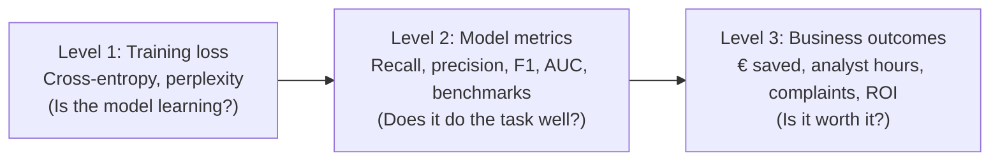
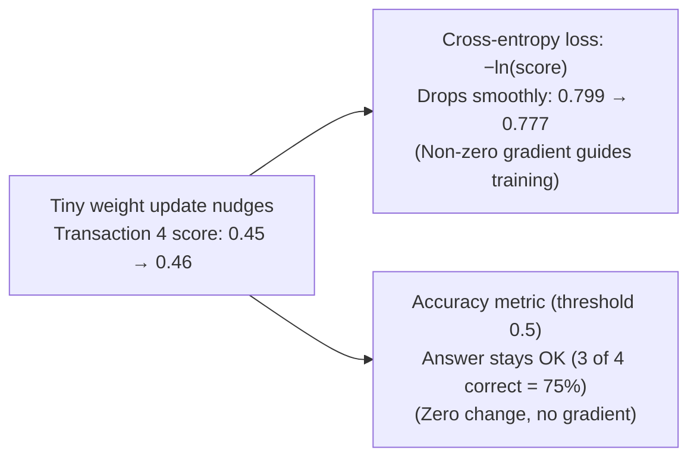
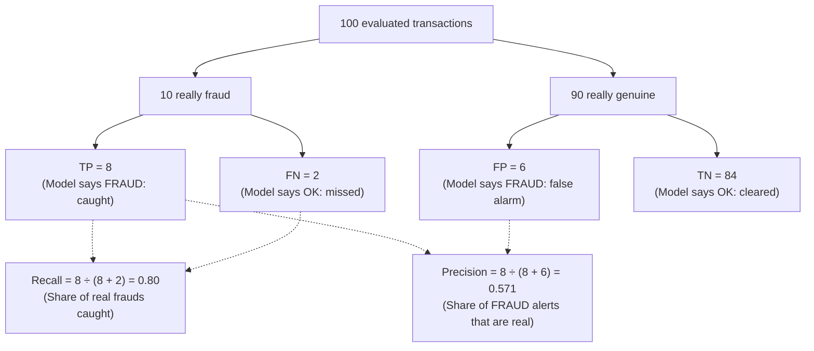
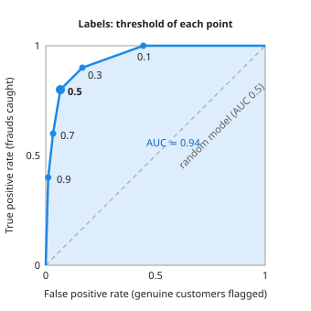
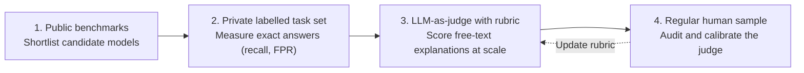
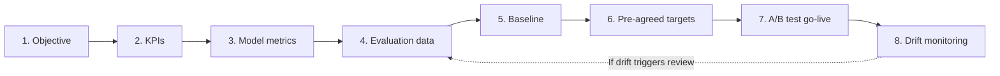

# Evaluation: How We Measure a Model

## The big picture

The earlier chapters explained how a model is built ([Chapter 1](01-transformers.md#the-big-picture)), trained ([Chapter 2](02-training.md#the-big-picture)), used ([Chapter 3](03-inference.md#the-big-picture)) and shrunk ([Chapter 4](04-quantization.md#the-big-picture)). Each step raised the same question: is the result any good? This chapter explains how that question is answered, from the single number that training watches to the business results that justify a project.

The chapter uses one running example from start to finish:

!!! note "The fraud example"
    A bank uses an LLM to label card transactions as **fraud** or **not fraud**. For each transaction, the prompt describes it (amount, merchant, country, time) and the model answers `FRAUD` or `OK`.

    Before it writes its answer, the model computes a probability for every token in its vocabulary, as for any next word ([Chapter 1](01-transformers.md#from-the-last-vector-back-to-a-word)). The bank reads one of those numbers, the probability of `FRAUD`, and calls it the **fraud score**: a number between 0 and 1 that says how strongly the model leans towards fraud. For example, if the model gives `FRAUD` 0.83, `OK` 0.15 and all other tokens 0.02 together, the fraud score is 0.83. Because it is a number rather than just a yes or no, the bank can choose the cut-off above which a transaction is flagged (0.5 in this chapter).

    - **Evaluation sample:** 100 past transactions with known answers, deliberately chosen to contain 10 fraud cases and 90 genuine ones, so there are enough fraud cases to measure.
    - **Real traffic:** 100,000 transactions a month, of which 2% (2,000) are fraud.

    All numbers in this example are made up for illustration.

    The answer can be guaranteed to be exactly `FRAUD` or `OK` with [constrained decoding](03-inference.md#constrained-decoding).

## Three levels of evaluation

A model can be measured at three levels, and each level answers a different question for a different audience. Confusing them is the most common evaluation mistake: a model can improve at one level and get worse at another.

| Level | Question it answers | Typical measures | Who uses it | Fraud example |
| --- | --- | --- | --- | --- |
| 1. Training loss | Is the model learning? | Cross-entropy loss, perplexity | The people training the model | The loss falls during fine-tuning on labelled transactions |
| 2. Model metrics | Does it do the task well? | Accuracy, precision, recall, F1, AUC; benchmarks; human ratings | Data scientists, ML engineers | 8 of the 10 fraud cases in the sample are caught |
| 3. Business outcomes | Is it worth it? | Money saved, hours saved, customer complaints, return on investment | Managers, the business owner | Fraud losses fall by half; analysts spend 311 fewer hours a month on reviews |

**Why look at the training loss at all?** Level 1 is not a verdict on the finished model: nobody decides to use a model because its loss is low. It is a health check **while training runs**, which can take days or weeks of expensive hardware. The loss is the only number available at every training step, and it costs nothing extra, because training computes it anyway to adjust the weights ([Chapter 2](02-training.md#the-loss-cross-entropy)). The people training the model watch it to answer three practical questions:

- **Is training working?** The loss should fall steadily towards 0. As a reminder ([Chapter 2](02-training.md#definitions)), the loss at one position is −ln of the probability the model gave to the correct token: 0 would mean the model gave the correct token a probability of 1 every time, and larger values mean worse predictions (probability 0.772 gives 0.259, probability 0.211 gives 1.556). In practice it never reaches 0, because text is never fully predictable: after `YOUR CAT IS A` several words are reasonable, so no model can be certain of the next one. If it stays flat or suddenly jumps up, something is wrong, for example a [learning rate](02-training.md#the-learning-rate-and-the-warm-up-schedule) that is too large or broken training data, and the run is stopped before more time and money are wasted.
- **When should training stop?** The loss is also measured on held-out text that the model never trains on, called the **validation loss**. While both losses fall, the model is learning patterns that work on new text. When the training loss keeps falling but the validation loss starts to rise, the model is memorising its training examples instead ([overfitting](02-training.md#dropout-forcing-the-model-not-to-rely-on-any-single-number)), and training should stop.
- **Which training run is better?** Two runs with different settings (data mixture, learning rate) can be compared by their loss long before either model is good enough to test on the real task.

In the fraud example, the team fine-tuning the model checks that the loss on held-out labelled transactions keeps falling. Once it stops falling, fine-tuning ends, and the model is then judged at Level 2 on what matters: how many frauds it catches.

The levels are connected but not interchangeable:

- **A lower loss usually means better metrics, but not always.** The loss rewards predicting every token well; a metric only checks the final answer.
- **Better metrics do not guarantee better business results.** A model that catches more fraud can also block more genuine customers, and the extra complaints can cost more than the fraud saved.
- **Each level needs the one below it.** Business results cannot be estimated without model metrics, and model metrics depend on a model that has learned.

The rest of the chapter climbs the three levels in order: loss and perplexity, then model metrics for classification and for generated text, then business outcomes, and finally a checklist for choosing metrics for a project.

## Loss vs metric

Training optimises a **loss**, but people judge a model by a **metric**. The two are often confused because both are "a number that says how good the model is". Knowing why they differ explains why training never optimises accuracy directly, and why a good loss alone does not prove a model is useful.

This section covers:

1. [Definitions](#definitions): loss and metric, and what each one must be able to do.
2. [Worked example: four fraud cases](#worked-example-four-fraud-cases): the same predictions scored with a loss and with a metric.
3. [Loss and metric side by side](#loss-and-metric-side-by-side): the differences in one table.

### Definitions

- **Loss:** a number the training process makes smaller. It must change smoothly when the weights change slightly, so that a **gradient** can be computed: for each weight, the gradient says in which direction, and how strongly, the loss changes when that weight is nudged slightly, and training then moves every weight a small step in the direction that lowers the loss ([Chapter 2](02-training.md#the-gradient-which-way-to-move-each-weight)). For LLMs it is the [cross-entropy](02-training.md#the-loss-cross-entropy): −ln of the probability given to the correct token.
- **Metric:** a number that measures what people actually care about, such as the share of correct answers. It does not need to change smoothly, because no gradient is ever computed from it.

### Worked example: four fraud cases

Four transactions in the sample are fraud. The model answers `FRAUD` when its fraud score is at least 0.5:

| Transaction | Fraud score (probability of `FRAUD`) | Loss = −ln(score) | Model's answer | Correct? |
| --- | --- | --- | --- | --- |
| 1 | 0.95 | 0.051 | FRAUD | Yes |
| 2 | 0.60 | 0.511 | FRAUD | Yes |
| 3 | 0.55 | 0.598 | FRAUD | Yes |
| 4 | 0.45 | 0.799 | OK | No |

- **The loss sees every difference.** Transactions 1 and 2 are both answered correctly, but they are not equally good: the model is very sure about transaction 1 (score 0.95) and only just sure about transaction 2 (score 0.60). The loss reflects this, because it is about ten times lower for the confident answer (0.051 against 0.511). The same is true for the wrong answer: if a small change to the weights raises transaction 4's score from 0.45 to 0.46, its loss goes down from 0.799 to 0.777. The answer is still wrong, but the loss shows that the model has moved in the right direction. This is exactly the signal training needs: for every weight, the [gradient](02-training.md#the-gradient-which-way-to-move-each-weight) says whether a small change to that weight makes the loss go up or down, and the optimiser moves the weight in the direction that makes it go down. Because the loss reacts to every small change, the gradient is never silent, and training can improve the model one small step at a time.
- **The accuracy metric sees only right or wrong.** Accuracy only counts how many answers are correct, here 3 out of 4 (75%). It does not care whether a correct answer was confident or only just above the threshold: transactions 1 to 3 each count as one correct answer, no more and no less. It also ignores progress on the wrong answer: raising transaction 4 from 0.45 to 0.46, or even to 0.49, leaves the answer `OK` and the accuracy at 75%. Then, when the score crosses 0.5 (for example from 0.49 to 0.51), the answer suddenly flips to `FRAUD` and the accuracy jumps to 100%. So accuracy behaves like a staircase: it stays flat for almost every small change of the weights and jumps only at the threshold. On the flat parts the gradient is 0, so it gives the optimiser no direction at all, and at the jump it is not defined. This is why a model cannot be trained on accuracy directly: training uses the smooth loss, and accuracy is only measured afterwards to judge the result.

### Loss and metric side by side

| | Loss | Metric |
| --- | --- | --- |
| Purpose | Guide training | Judge the result |
| Computed on | Every token, during training | Final answers, on test data |
| Must change smoothly? | Yes, to compute gradients | No |
| Example | Cross-entropy 0.383 per token | 92% of transactions labelled correctly |
| Read by | The optimiser | People |

The practical rule: watch the loss to check that training works, but decide whether a model is good with metrics measured on data the model never saw during training. The next section turns the loss into a friendlier number, perplexity; the sections after it cover the metrics.

## Perplexity

**Perplexity** measures how well a language model predicts a text it is given: how unsure the model is, on average, about each next token. It was introduced briefly in [Chapter 2](02-training.md#perplexity-the-same-number-in-friendlier-units); this section explains it in full.

- **How it differs from the loss.** Perplexity contains exactly the same information as the cross-entropy loss; only the scale changes. A loss of 0.383 is hard to picture, because it is a logarithm. Perplexity converts it into a count: e^0.383 = 1.47 means the model hesitates, on average, as if it were choosing between about 1.5 equally likely tokens. Lower is better for both, but perplexity starts at 1 (a perfect model) instead of 0.
- **How it differs from the other metrics.** Accuracy, recall and the other metrics later in this chapter check the model's **answers** to a task, such as "is this transaction fraud?", against the correct answers. Perplexity checks no answer and needs no labels: it only measures how well the model predicts ordinary text, token by token. It therefore belongs to Level 1 in the [three levels](#three-levels-of-evaluation): it tells you whether the model has learned the language, not whether it is useful for a particular task.

It is the main measure used during pre-training, and when checking that a quantized model still predicts as well as the original ([Chapter 4](04-quantization.md#how-to-check-a-quantized-model)), so it is worth knowing exactly what it means and when two values can be compared.

This section covers:

1. [Definition](#definition): perplexity as e raised to the average loss, and how to read it.
2. [Worked examples with the running numbers](#worked-examples-with-the-running-numbers): perplexity for good, average and poor predictions.
3. [What a good value is](#what-a-good-value-is): why there is no universal target.
4. [Only comparable with the same tokenizer](#only-comparable-with-the-same-tokenizer): why two models with different tokenizers cannot be compared this way.
5. [What perplexity does not tell you](#what-perplexity-does-not-tell-you): correctness, helpfulness and safety need other measures.

### Definition

**Perplexity** is e raised to the average cross-entropy loss per token:

$$
\text{perplexity} = e^{\bar{L}} \qquad \bar{L} = \frac{1}{N}\sum_{i=1}^{N} -\ln p_i
$$

- **L̄** is the average loss over the N tokens of a text.
- **p\_i** is the probability the model gave to the correct token at position i.
- **e** is the base of the natural logarithm (about 2.718).

It can be read as **"how many tokens the model is choosing between, on average"**. A perplexity of 4 means the model is as uncertain as if it were picking evenly among 4 tokens at every step. A perfect model, which always gives the correct token probability 1, has perplexity 1.

### Worked examples with the running numbers

| Case | Average loss | Perplexity | Reading |
| --- | --- | --- | --- |
| Chapter 1's example: CAT given 0.772 | −ln 0.772 = 0.259 | e^0.259 = 1.30 | Almost sure: about 1.3 choices |
| [Chapter 2's translation](02-training.md#from-one-position-to-a-whole-batch): 4 positions | 0.383 | e^0.383 = 1.47 | About 1.5 choices |
| A model guessing evenly among 4 tokens (each 0.25) | −ln 0.25 = 1.386 | e^1.386 = 4.00 | Exactly 4 choices |
| A perfect model (every correct token gets 1) | 0 | e^0 = 1 | No hesitation |

The third row shows why the reading works. Call **k** the number of tokens the model hesitates between at a position, all equally likely (in the third row, k = 4). Each of them then gets probability 1/k (here 1/4 = 0.25), and the perplexity comes out as exactly k (here 4). So when the perplexity is k, the model is as unsure as if it were picking at random among k equally likely tokens.

!!! note "Refresher: why e^(−ln p) equals 1 / p"
    The exponential function e^x and the natural logarithm ln(x) are inverses: e^(ln x) = x, and with a minus sign in the exponent, e^(−ln p) = 1 / p.

    - At a single position where the model gives the correct token probability p, the loss is L = −ln p, so e^L = 1 / p.
    - If the model guesses evenly among k = 4 tokens, each gets probability p = 1 / 4 = 0.25, and 1 / p = 4. Across N positions, averaging −ln p\_i before taking e^(L̄) computes the geometric average of 1 / p\_i across the text.

### What a good value is

It is tempting to ask what perplexity a "good" model should reach, but there is no such number, because perplexity does not measure the model alone: it measures the model **on a particular text**, cut into tokens by a particular tokenizer. It works like an exam mark, which says as much about how hard the exam was as about the student. The same model will reach a low perplexity on a children's story, where the next word is often obvious (after "Once upon a", almost any model expects "time"), and a much higher one on a legal contract or on source code, where many continuations are possible and rare words are frequent. A perplexity of 10 can therefore be excellent on one text and poor on another, and two values measured on different texts say nothing about which model is better.

The number becomes meaningful only when the text stays the same and only the model changes. Perplexity is therefore used for **comparisons on the same text**: two **checkpoints** (copies of the weights saved at different points of training), to check that training is still improving the model; a model before and after fine-tuning, to check that it has not lost its general knowledge of the language; or a quantized model against the original, to measure how much prediction quality the smaller number format has cost. In each case, the model with the lower perplexity on that shared text is the one that predicts it better.

### Only comparable with the same tokenizer

Perplexity is an average **per token**, so it depends on how the text was cut into tokens ([Chapter 1](01-transformers.md#bpe-tokenizer-from-text-to-token-ids)). Suppose two models give a sentence exactly the same total probability, so the same total loss of 3.0 (made-up numbers), but their tokenizers split it differently:

| Model | Tokens for the sentence | Average loss | Perplexity |
| --- | --- | --- | --- |
| A | 6 | 3.0 ÷ 6 = 0.5 | e^0.5 = 1.65 |
| B | 10 | 3.0 ÷ 10 = 0.3 | e^0.3 = 1.35 |

Model B looks better, but both models assign the text exactly the same probability: B only spreads the same loss over more, smaller tokens. Perplexities can be compared only between models that share a tokenizer. This is always true for a quantized model and its original, because quantization never changes the tokenizer.

**The fix: bits per byte.** The problem with perplexity is the "per token": the same total loss is divided by a different number of tokens for each tokenizer. **Bits per byte (BPB)** solves this by dividing the total loss by something every tokenizer agrees on, the length of the text itself. Two terms are needed to read it:

- A **byte** is the unit computers use to store text. In plain English, one character (a letter, a digit, a space or a punctuation mark) takes one byte, so "CAT IS" is 6 bytes. A text has the same number of bytes whichever tokenizer later cuts it into tokens.
- A **bit** is the smallest unit of information: the answer to one yes/no question. Saying how surprised a model is, in bits, means saying how many yes/no questions it would need, on average, to pin down the correct text.

The loss is already a measure of surprise, only in a different unit. As a reminder ([Chapter 2](02-training.md#definitions)), the loss at one position is **−ln p**, where p is the probability the model gave to the correct token and ln is the natural logarithm: −ln 1 = 0 (no surprise at all) and the value grows as p gets smaller. Natural logarithms count surprise in a unit called nats; dividing by ln 2 ≈ 0.693 converts it to bits, because log₂ x = ln x ÷ ln 2. For example, a token given probability p = 0.5 costs −ln 0.5 = 0.693, which is exactly 0.693 ÷ 0.693 = 1 bit: a fifty-fifty guess is worth one yes/no question.

Putting the two together, bits per byte is the total surprise of the model over the text, in bits, divided by the length of the text in bytes:

$$
\text{BPB} = \frac{\text{total loss}}{\ln 2 \times \text{number of bytes}}
$$

- **total loss** is the sum of −ln p over all the text's tokens (average loss × number of tokens).
- **ln 2** (≈ 0.693) converts the loss from natural-logarithm units into bits.
- **number of bytes** is the length of the same text in bytes, which does not depend on the tokenizer.

Suppose the sentence above is 30 bytes long. Both models have the same total loss of 3.0, so:

| Model | Tokens | Perplexity | Bits per byte |
| --- | --- | --- | --- |
| A | 6 | 1.65 | 3.0 ÷ (0.693 × 30) = 0.144 |
| B | 10 | 1.35 | 3.0 ÷ (0.693 × 30) = 0.144 |

Bits per byte gives both models the same score, correctly, since they assign the text the same probability. It can be read as "how many bits, on average, the model needs to encode each character", and lower is better. Bits per byte (or the closely related bits per character) is the measure to use when comparing models from different families on the same text.

### What perplexity does not tell you

Perplexity measures how well a model predicts text, not whether its answers are correct, helpful or safe. A model can have a low perplexity and still answer `OK` to an obvious fraud. Task metrics, covered next, are needed for that.

## Mean squared error (MSE)

**Cross-entropy** is the loss used so far in this chapter. It measures how far the model's predicted probabilities are from the correct answer, and it is computed from one number only: the probability p that the model gave to the correct answer. The loss is −ln p, minus the natural logarithm of that probability. A probability lies between 0 and 1, and the logarithm of such a number is 0 or negative, so the minus sign makes the loss 0 or positive. If the model gave the correct answer a probability of 1, it was certain and right, and the loss is −ln 1 = 0. The less probability it gave the correct answer, the larger the loss: after `YOUR CAT IS A LOVELY`, a model that gave the correct token `CAT` 0.772 pays −ln 0.772 = 0.259, while one that gave it only 0.211 pays −ln 0.211 = 1.556, and a probability close to 0 costs a very large amount. (The same loss is used for training in [Chapter 2](02-training.md#the-loss-cross-entropy).)

Cross-entropy needs the model to give a probability to every possible answer, so it suits answers that are one choice out of a list, such as the next token out of the vocabulary or `FRAUD` versus `OK`. When the answer is a **number**, such as an amount of money, the usual measure is the mean squared error. This section shows how it works and why it is the wrong tool for next-token prediction.

This section covers:

1. [Definitions](#definitions_1): regression, classification, and the MSE formula.
2. [Worked example: estimating the amount at risk](#worked-example-estimating-the-amount-at-risk): MSE on four fraud amounts.
3. [Why MSE does not suit next-token prediction](#why-mse-does-not-suit-next-token-prediction): token IDs have no meaningful distance.

### Definitions

- **Regression:** predicting a number on a continuous scale (an amount, a temperature, a price), as opposed to **classification**, which predicts a category (fraud / not fraud, or one token from the vocabulary).
- **Error:** predicted value minus true value.
- **Mean squared error (MSE):** the average of the squared errors.

$$
\text{MSE} = \frac{1}{n}\sum_{i=1}^{n} \left(\hat{y}_i - y_i\right)^2
$$

- **n** is the number of examples.
- **ŷ\_i** (y-hat) is the predicted value for example i, and **y\_i** the true value.

Squaring does two things: it makes every error positive, so errors above and below cannot cancel out, and it makes large errors count much more than small ones.

### Worked example: estimating the amount at risk

For each flagged transaction, the bank also asks the model to estimate how much money is at risk, in euros. Four cases, with made-up numbers:

| Case | True amount y | Predicted ŷ | Error ŷ − y | Squared error |
| --- | --- | --- | --- | --- |
| 1 | 120 | 100 | −20 | 400 |
| 2 | 80 | 90 | +10 | 100 |
| 3 | 300 | 240 | −60 | 3,600 |
| 4 | 50 | 55 | +5 | 25 |
| | | | **Sum** | 4,125 |
| | | | **MSE (÷ 4)** | **1,031.25** |

- **Large errors dominate.** Case 3's error of 60 contributes 3,600 of the 4,125 total, 87%, although it is only one case out of four.
- **The unit is squared.** An MSE of 1,031.25 is in "squared euros", which is hard to picture. Taking the square root gives the **root mean squared error (RMSE)**: √1,031.25 = 32.11 euros, a typical error size in the original unit.
- **A gentler alternative** is the **mean absolute error (MAE)**, the average of the errors without their signs: (20 + 10 + 60 + 5) ÷ 4 = 23.75 euros. It does not give large errors extra weight.

### Why MSE does not suit next-token prediction

MSE needs a meaningful distance between the predicted and the true value: 240 is closer to 300 than 100 is. Token IDs have no such distance. In the running example, CAT has ID 6587 and DOG has ID 4012 ([Chapter 1](01-transformers.md#what-is-a-token-id)). If the correct token is CAT, predicting the ID 6,500 is not "nearly right": 6,500 is just some other token, unrelated to cats. The IDs are labels, not quantities.

So for next-token prediction, the model outputs a probability for every token and is scored with cross-entropy, which only asks how much probability went to the correct token ([Chapter 2](02-training.md#the-loss-cross-entropy)).

| | Cross-entropy | MSE |
| --- | --- | --- |
| Kind of answer | A category (token, label) | A number on a scale |
| Model outputs | A probability for every category | One number |
| Measures | −ln of the probability of the correct category | Average squared distance from the true value |
| Used for | Next-token prediction, classification | Regression: amounts, scores, forecasts |

## Classification metrics: the fraud example

When a model sorts items into categories, its answers can be checked one by one against the truth. This section builds every common classification metric from a single table of counts, using the 100-transaction evaluation sample: 10 fraud cases and 90 genuine ones. The model answers `FRAUD` when its fraud score is at least 0.5.

This section covers:

1. [The confusion matrix](#the-confusion-matrix): the four possible outcomes of a yes/no prediction, counted.
2. [Accuracy, and why it misleads](#accuracy-and-why-it-misleads): a high score that hides missed frauds.
3. [Precision, recall and F1](#precision-recall-and-f1): two metrics that look only at the rare category, and their combination.
4. [Moving the threshold: the ROC curve and AUC](#moving-the-threshold-the-roc-curve-and-auc): how results change with the decision threshold, summed up in one number.

### The confusion matrix

A **confusion matrix** counts the four possible outcomes of a yes/no prediction. Here "positive" means "fraud", the thing being looked for.

- **True positive (TP):** fraud, and the model said FRAUD. A catch.
- **False negative (FN):** fraud, but the model said OK. A missed fraud.
- **False positive (FP):** genuine, but the model said FRAUD. A false alarm.
- **True negative (TN):** genuine, and the model said OK.

| | Model says FRAUD | Model says OK | Total |
| --- | --- | --- | --- |
| **Really fraud** | TP = 8 | FN = 2 | 10 |
| **Really genuine** | FP = 6 | TN = 84 | 90 |
| **Total** | 14 | 86 | 100 |

The model caught 8 of the 10 frauds, missed 2, and raised 6 false alarms among the 90 genuine transactions. Every metric below is computed from these four numbers.

### Accuracy, and why it misleads

**Accuracy** is the share of all answers that are correct:

$$
\text{accuracy} = \frac{TP + TN}{\text{all cases}} = \frac{8 + 84}{100} = 0.92
$$

92% sounds good. But consider a useless model that answers `OK` to every transaction:

| Model | Frauds caught | Accuracy on the sample (10% fraud) | Accuracy on real traffic (2% fraud) |
| --- | --- | --- | --- |
| The LLM at threshold 0.5 | 8 of 10 | 92% | about 93% |
| "Always OK" | 0 | 90% | **98%** |

The model that never catches a single fraud scores 98% accuracy on real traffic, higher than the useful model. When one category is much rarer than the other, data is called **imbalanced**, and accuracy is dominated by the common category. Fraud, disease screening and defect detection are all imbalanced, so accuracy alone should never be used for them.

### Precision, recall and F1

Two metrics look only at the rare category, from two different sides:

$$
\text{precision} = \frac{TP}{TP + FP} = \frac{8}{8 + 6} = 0.571 \qquad \text{recall} = \frac{TP}{TP + FN} = \frac{8}{8 + 2} = 0.80
$$

- **Precision** answers: "when the model says FRAUD, how often is it right?" Here 57% of alerts are real fraud; 43% are false alarms.
- **Recall** (also called **sensitivity** or **true positive rate**) answers: "of all real frauds, how many did the model catch?" Here 80%.

The "always OK" model has a recall of 0: precision and recall expose it immediately, where accuracy did not.

**F1** combines the two into one number, using the **harmonic mean**, which stays low if either of the two is low:

$$
F_1 = \frac{2 \times \text{precision} \times \text{recall}}{\text{precision} + \text{recall}} = \frac{2\,TP}{2\,TP + FP + FN} = \frac{16}{16 + 6 + 2} = 0.667
$$

The second form, written with the counts, gives the same value and avoids rounding: with the rounded 0.571 the first form gives 0.666.

!!! note "Refresher: why F1 uses the harmonic mean instead of the ordinary average"
    The ordinary (arithmetic) average of two numbers a and b is (a + b) ÷ 2, whereas the **harmonic mean** is 2 × a × b ÷ (a + b).

    To see why the difference matters, consider a trivial model that answers `FRAUD` to every transaction in the sample: it catches all 10 frauds (recall = 1.00), while only 10 of its 100 alerts are real (precision = 0.10). An ordinary average would give (1.00 + 0.10) ÷ 2 = 0.55, which looks respectable. The harmonic mean gives 2 × 1.00 × 0.10 ÷ (1.00 + 0.10) = 0.182, staying close to the smaller number so a model cannot hide a terrible precision behind a perfect recall (or vice versa).

**When to favour each:**

| Favour | When mistakes of this kind are expensive | Example |
| --- | --- | --- |
| Recall | Missing a positive costs a lot | Fraud losses, missed disease: catch as many as possible, accept more false alarms |
| Precision | A false alarm costs a lot | Blocking a genuine customer's card, sending a case to a costly investigation |
| F1 | Both matter and there is no clear cost difference | Comparing models with one number |

### Moving the threshold: the ROC curve and AUC

The model itself never says "fraud" or "not fraud": it gives every transaction a fraud score between 0 and 1. The **threshold** is the cut-off the bank chooses to turn that score into a decision: a transaction is flagged as fraud when its score is at or above the threshold. All the metrics so far used a threshold of 0.5, but 0.5 is a choice, not a law. Lowering the threshold flags more transactions: more frauds are caught, but more genuine customers are flagged too. Raising it does the opposite: fewer false alarms, but more frauds slip through. Each threshold gives a different confusion matrix, so the same model has a different recall and precision at every threshold.

This raises two questions that a single threshold cannot answer. How good is the model's fraud score itself, before anyone picks a threshold? And how can two models be compared fairly, when each might work best at a different threshold? The answer is to look at how well the scores **separate** the two groups. If frauds almost always get higher scores than genuine transactions, some threshold will catch most frauds while flagging few genuine customers, and the model is good. If the scores of frauds and genuine transactions are mixed together, no threshold can do that.

The **ROC curve** shows this separation by trying every threshold and recording, for each one, two rates:

- **True positive rate (TPR)** = TP ÷ 10 real frauds: the share of real frauds that are caught. It is the same as recall. Higher is better.
- **False positive rate (FPR)** = FP ÷ 90 genuine transactions: the share of genuine customers wrongly flagged. Lower is better.

Both rates run from 0 to 1. Every threshold is a trade between them: a lower threshold raises the TPR (good) and also raises the FPR (bad). The name ROC, **receiver operating characteristic**, comes from radar engineering in the Second World War, where operators had to set how strong a signal on the radar receiver had to be before they called it an enemy aircraft: the same trade between catching real targets and raising false alarms.

The model's results on the sample at several thresholds (made-up but consistent with the matrix above):

| Threshold (flag if fraud score ≥) | TP | FP | TPR (recall) | FPR | Precision |
| --- | --- | --- | --- | --- | --- |
| 1.0 (flag nothing) | 0 | 0 | 0.00 | 0.000 | — |
| 0.9 | 4 | 1 | 0.40 | 0.011 | 0.800 |
| 0.7 | 6 | 3 | 0.60 | 0.033 | 0.667 |
| **0.5** | **8** | **6** | **0.80** | **0.067** | **0.571** |
| 0.3 | 9 | 15 | 0.90 | 0.167 | 0.375 |
| 0.1 | 10 | 40 | 1.00 | 0.444 | 0.200 |
| 0.0 (flag everything) | 10 | 90 | 1.00 | 1.000 | 0.100 |

Each row of the table becomes one point on a chart: its FPR across (genuine customers flagged) and its TPR up (frauds caught). Joining the points gives the ROC curve:

How to read it:

- **The two ends are always the same.** At threshold 1.0 nothing is flagged, so both rates are 0: the point (0, 0). At threshold 0.0 everything is flagged, so both rates are 1: the point (1, 1). The shape in between is what tells models apart.
- **The dashed diagonal is a model with no skill.** A model that flags transactions at random flags the same share of frauds as of genuine transactions (flag 30% at random and you catch 30% of frauds and annoy 30% of customers), so its TPR always equals its FPR and its points lie on the diagonal.
- **The closer the curve gets to the top-left corner, the better.** The top-left corner (FPR 0, TPR 1) means catching every fraud without flagging a single genuine customer. The fraud model climbs steeply at first: at threshold 0.5 it already catches 80% of frauds while flagging only 6.7% of genuine customers. After that the curve flattens: catching the last frauds costs many false alarms (at 0.1, all 10 frauds are caught but 44% of genuine customers are flagged).

The **AUC** (area under the ROC curve) turns the whole curve into one number: the share of the chart's 1 × 1 square that lies below the curve (the shaded area in the chart). A curve that hugs the top-left corner leaves almost the whole square below it; a curve close to the diagonal leaves only half. So the AUC lies between 0 and 1, and higher is better:

- **AUC = 1.0:** a perfect model. The curve goes straight up to the top-left corner: some threshold catches every fraud with no false alarms.
- **AUC = 0.5:** no better than flipping a coin. The curve is the diagonal, which cuts the square in half.
- **A useful reading:** the AUC is the chance that a randomly chosen fraud gets a higher fraud score than a randomly chosen genuine transaction. Pick one of the 10 frauds and one of the 90 genuine transactions at random: with an AUC of 0.94, the fraud has the higher score about 94 times out of 100. This is why the AUC measures separation directly, without any threshold.

Estimating the area from the seven points above, as a series of trapezoids, gives **AUC ≈ 0.94** (each slice between two adjacent points has area ΔFPR × (TPR\_left + TPR\_right) ÷ 2, giving 0.0022 + 0.0111 + 0.0233 + 0.0850 + 0.2639 + 0.5556 = 0.9411): the model separates fraud from genuine transactions well. The AUC does not depend on any threshold, which makes it good for comparing models; but the business still has to choose one threshold to run the model, and that choice is about costs, as the business section below shows.

## Evaluating generative LLMs

A fraud label is either right or wrong, so it can be counted. Most LLM output is free text: an explanation, a summary, an answer to a question. There are many good answers and no single correct string to compare against, so other methods are needed. This section covers the three main ones and what each can and cannot tell you.

In the fraud example, the model also writes a short **explanation** for each flagged transaction, for example "Amount is 12 times this customer's average and the merchant is in a country the card has never been used in." Analysts read it before deciding. Its quality cannot be measured with a confusion matrix.

This section covers:

1. [Benchmarks](#benchmarks): fixed public test sets used to compare models.
2. [Benchmark families](#benchmark-families): the main groups of benchmarks and what each one measures.
3. [Scoring code: pass@k](#scoring-code-passk): the chance that at least one of k attempts is correct.
4. [Human evaluation](#human-evaluation): people judging outputs directly.
5. [Ranking models from votes: Elo ratings](#ranking-models-from-votes-elo-ratings): turning many pairwise votes into one ranking.
6. [LLM-as-judge](#llm-as-judge): a second model scoring outputs against a rubric.
7. [Choosing a method](#choosing-a-method): what each method measures, costs and risks.

### Benchmarks

A **benchmark** is a fixed, public set of test questions with a scoring rule, used to compare models on the same tasks. Two well-known examples:

- **MMLU** (Massive Multitask Language Understanding): about 16,000 multiple-choice questions across 57 subjects, from law to medicine. The score is plain accuracy.
- **HumanEval:** 164 programming tasks. The model's code is run against unit tests; the score is the share of tasks it solves.

Benchmarks make comparison cheap and repeatable, but have real limits:

- **Contamination.** Benchmark questions are published on the internet, and models are trained on huge amounts of internet text ([Chapter 2](02-training.md#stage-1-pre-training)). If the test questions and answers were in the training data, the model may simply remember them. A high score then measures memory, not ability. This is called **data contamination**, and it is hard to rule out for any public benchmark.
- **Saturation.** When the best models all score close to 100%, the benchmark can no longer tell them apart, and a newer, harder one is needed.
- **Distance from the real task.** A model that is excellent at multiple-choice exam questions may still write poor fraud explanations. A benchmark only measures what is in it.

The practical lesson: public benchmarks help to shortlist models, but the decision should rest on an evaluation set built from the real task, kept private so it cannot leak into training data.

### Benchmark families

Model announcements quote many benchmark names. Most belong to a few families, each measuring a different ability:

| Family | Examples | What the model must do | How it is scored |
| --- | --- | --- | --- |
| General knowledge | MMLU | Answer multiple-choice exam questions in 57 subjects | Accuracy |
| Expert knowledge | GPQA | Answer 448 graduate-level biology, physics and chemistry questions, written to be hard to look up | Accuracy |
| School and competition maths | GSM8K, MATH, AIME | Solve word problems (GSM8K's test set has 1,319), competition problems (MATH has 12,500), or the 15 problems of an AIME exam, whose answers are whole numbers from 0 to 999 | Share of final answers that are exactly right |
| Code | HumanEval | Write a function that passes hidden unit tests | pass@k (next subsection) |
| Software engineering | SWE-bench | Fix real issues from GitHub projects (2,294 in the full set; a human-checked subset, SWE-bench Verified, has 500) so that the project's tests pass | Share of issues resolved |
| Long context | Needle in a haystack, RULER | Find or combine facts placed at different depths of a long document ([Chapter 3](03-inference.md#a-bigger-window-is-not-a-perfect-memory)) | Accuracy at each length and depth |
| Human preference | Chatbot Arena | Give the answer people prefer in blind side-by-side comparisons | Elo rating (see below) |

Maths and code benchmarks are popular because answers can be **checked automatically**: a number is right or wrong, and tests pass or fail. The same property makes them useful for training reasoning models, as [Chapter 6](06-prompting.md#training-with-verifiable-rewards) explains.

### Scoring code: pass@k

Generated code is either correct or not, but the model can be asked several times, with sampling ([Chapter 3](03-inference.md#sampling-and-temperature)) giving different attempts. **pass@k** is the probability that **at least one** of k attempts is correct. It is estimated by generating n attempts per task (n at least k), counting the c correct ones, and computing:

$$
\text{pass@}k = 1 - \frac{\binom{n-c}{k}}{\binom{n}{k}}
$$

- **(n choose k)** is the number of ways to pick k attempts out of n.
- **(n − c choose k)** is the number of ways to pick k attempts that are **all wrong**.
- Their ratio is the chance that k randomly chosen attempts contain no correct one, so 1 minus it is the chance that at least one is correct.

**Worked example:** for one task, n = 10 attempts, of which c = 3 pass the tests.

| k | All-wrong choices ÷ all choices | pass@k |
| --- | --- | --- |
| 1 | (7 choose 1) ÷ (10 choose 1) = 7 ÷ 10 | 1 − 0.7 = **0.300** |
| 5 | (7 choose 5) ÷ (10 choose 5) = 21 ÷ 252 | 1 − 0.083 = **0.917** |

pass@1 is simply the share of correct attempts; pass@5 is much higher because five tries give five chances. The benchmark score is the average over all tasks. When comparing models, check that they are reported with the same k.

!!! note "Refresher: combinations (n choose k) and the 'at least one' trick"
    The combination symbol (n choose k) counts how many different groups of size k can be chosen from n items when order does not matter:

    $$
    \binom{n}{k} = \frac{n!}{k!\,(n-k)!}
    $$

    For example, picking 5 items out of 10 gives (10 × 9 × 8 × 7 × 6) ÷ (5 × 4 × 3 × 2 × 1) = 252 groups, and picking 5 out of the 7 wrong attempts gives 7! ÷ (5! × 2!) = (7 × 6) ÷ (2 × 1) = 21 all-wrong groups (the 5 × 4 × 3 × 2 × 1 cancels out).

    To find the probability of **at least one** correct attempt in k picks, counting directly is tedious because a group could contain 1, 2, or 3 correct attempts. Instead, probability calculations use the complement rule: every group either has *no* correct attempts or *at least one*, so the two probabilities add to 1. Subtracting the all-wrong fraction (21 ÷ 252 ≈ 0.083) from 1 gives the answer immediately (1 − 0.083 = 0.917).

### Human evaluation

People read the outputs and judge them. Two common forms:

- **Rating:** a reviewer scores each answer against a **rubric** (a written list of criteria), for example 1 to 5 for correctness, clarity and usefulness.
- **Pairwise comparison:** a reviewer sees two answers to the same prompt and picks the better one. People agree with each other more easily on "which is better" than on an absolute score. Public leaderboards such as Chatbot Arena rank models from many such votes.

Human evaluation is the closest measure of real usefulness, but it is slow and expensive, and reviewers disagree. A common check is to have two reviewers rate the same sample and measure how often they agree.

### Ranking models from votes: Elo ratings

Leaderboards such as Chatbot Arena turn many pairwise votes into one ranking with an **Elo rating**, the system used to rank chess players. Each model has a rating; the difference between two ratings predicts how often one beats the other:

$$
E_A = \frac{1}{1 + 10^{(R_B - R_A)/400}}
$$

- **R\_A** and **R\_B** are the two models' ratings.
- **E\_A** is the expected share of comparisons that model A wins.

After each vote, ratings move toward the result: R\_A ← R\_A + K × (S\_A − E\_A), where **S\_A** is 1 if A won and 0 if it lost, and **K** sets the step size.

**Worked example:** model A is rated 1,300 and model B 1,200.

1. **Expected result:** E\_A = 1 ÷ (1 + 10^(−100/400)) = 0.640. A is expected to win 64% of comparisons, B 36%.
2. **An upset:** a voter prefers B's answer. With K = 32, A drops to 1,300 + 32 × (0 − 0.640) = 1,279.5 and B rises to 1,200 + 32 × (1 − 0.360) = 1,220.5.

A surprising result moves the ratings a lot; an expected one moves them little. A gap of 100 points always means a 64% expected win rate, whatever the absolute ratings. Chatbot Arena now uses a variant, the **Bradley–Terry model**. Instead of updating the ratings one vote at a time, in the order the votes arrived, it looks at all the votes together and finds the one strength score per model that best explains them, with the same rule as Elo: the chance that A beats B depends only on the difference between their scores. The result no longer depends on the order of the votes, and it is still reported on the same Elo-style scale. The same rule is used to train the **reward model** of RLHF, a model that learns to give an answer a score from human choices between two answers ([Chapter 2](02-training.md#inside-rlhf-training-the-reward-model)): there, the two "players" are two answers to the same question.

### LLM-as-judge

An **LLM-as-judge** is a second model, given a rubric, that rates or compares outputs in place of a human. It is fast and cheap enough to run on every output.

**Worked example.** The bank uses a judge model to score fraud explanations as acceptable or not, with the rubric "states at least one concrete, checkable reason; contains no claim that contradicts the transaction data". To check the judge before trusting it, an analyst rates 50 explanations by hand (made-up numbers):

| | Analyst: acceptable | Analyst: not acceptable | Total |
| --- | --- | --- | --- |
| **Judge: acceptable** | 38 | 4 | 42 |
| **Judge: not acceptable** | 2 | 6 | 8 |
| **Total** | 40 | 10 | 50 |

The judge agrees with the analyst on 38 + 6 = 44 of 50 explanations, 88%. That is the same confusion matrix as before, used to evaluate the evaluator. Most disagreements are the 4 explanations the judge accepted but the analyst rejected, so the judge is a little too lenient, which is worth knowing before relying on its scores.

Known weaknesses of LLM judges, and the usual fixes:

| Weakness | What happens | Usual fix |
| --- | --- | --- |
| Position bias | In pairwise comparisons, the judge prefers the answer shown first (or second) | Judge each pair twice with the order swapped; keep only consistent verdicts |
| Length bias | Longer answers get higher scores even when they are not better | Rubric that rewards concision; compare answers of similar length |
| Self-preference | A judge rates answers from its own model family higher | Use a judge from a different model family |
| Drift from human judgement | The judge's idea of "good" differs from the users' | Regularly check the judge against a human-rated sample, as above |

### Choosing a method

| Method | Measures | Cost | Main risk |
| --- | --- | --- | --- |
| Public benchmark | General ability on standard tasks | Low | Contamination; far from the real task |
| Private task set with exact answers | Correctness on the real task (e.g. fraud labels) | Low once built | Must be kept up to date |
| Human evaluation | Real usefulness of free text | High | Slow; reviewers disagree |
| LLM-as-judge | Free-text quality at scale | Low | Biases; must be checked against humans |

In practice they are combined: benchmarks to shortlist models, a private labelled set for the measurable part of the task, an LLM judge for free text at scale, and a regular human sample to keep the judge honest.

## Business outcomes

Model metrics say how well the model does its task; business outcome metrics say whether using it is worth it. This is the level that decides whether a project goes live and stays live. This section turns the fraud model's metrics into money, hours and customer experience, and shows that the "best" threshold is a business decision, not a technical one.

The numbers below use real traffic: 100,000 transactions a month, 2% (2,000) fraud and 98,000 genuine. Further made-up assumptions, stated once:

- An analyst reviews each flagged transaction in **10 minutes**, at a cost of **€5** per review.
- A missed fraud costs the bank **€400** on average.
- Running the model costs **€0.002 per transaction**, so €200 a month ([Chapter 4](04-quantization.md#fewer-bytes-also-means-faster-generation) explains what drives this cost).
- About **5%** of genuine customers whose transaction is wrongly flagged complain.

This section covers:

1. [KPIs tied to a business objective](#kpis-tied-to-a-business-objective): the business numbers to track, each linked to the model metric behind it.
2. [From the sample to real traffic: precision falls](#from-the-sample-to-real-traffic-precision-falls): why precision drops when fraud is rarer in real use.
3. [Time, cost and resources: the model against the current process](#time-cost-and-resources-the-model-against-the-current-process): the model compared with the existing rules engine in hours and money.
4. [Customer satisfaction](#customer-satisfaction): the cost of wrongly blocking genuine customers.
5. [Comparing against a baseline](#comparing-against-a-baseline): why results only mean something next to an alternative.
6. [The trade-off: choosing the threshold](#the-trade-off-choosing-the-threshold): the same model at different thresholds, and why the choice is a business decision.

### KPIs tied to a business objective

A **KPI** (key performance indicator) is a number the business tracks to see whether it is meeting an objective. Each KPI should be linked to the model metric that drives it, so that a change in the model can be translated into a change the business cares about:

| Business objective | KPI | Driven by the model metric | Target (example) |
| --- | --- | --- | --- |
| Reduce fraud losses | Fraud lost per month (€) | Recall | Below €200,000 |
| Keep reviews affordable | Analyst hours per month | Number of flagged transactions, i.e. precision | Below 1,500 hours |
| Keep customers happy | Complaints per month; customer satisfaction score | False positive rate | Below 400 complaints |
| Keep running costs low | Model cost per month | Model size and number format | Below €1,000 |

### From the sample to real traffic: precision falls

Recall and the false positive rate carry over from the sample to real traffic: the model still catches 80% of frauds and still flags 6.7% of genuine transactions. Precision does **not** carry over, because it depends on how common fraud is:

| | Evaluation sample (10% fraud) | Real traffic (2% fraud) |
| --- | --- | --- |
| Frauds caught (recall 0.80) | 8 of 10 | 1,600 of 2,000 |
| Genuine transactions flagged (FPR 0.067) | 6 of 90 | 6,533 of 98,000 |
| Precision = caught ÷ all flagged | 8 ÷ 14 = **0.571** | 1,600 ÷ 8,133 = **0.197** |

In real traffic only about 1 alert in 5 is real fraud, not 4 in 7. Genuine transactions are so much more common that even a small false positive rate produces many false alarms. Any business estimate must use the real proportion of fraud, never the proportion in a test sample.

!!! note "Refresher: the base-rate effect (and exact vs rounded table counts)"
    In probability, the share of true positives among all alerts depends not only on how accurate the detector is (recall and false positive rate), but also on the **base rate**: how common the event is in the population. When fraud drops from 10% (1 in 10) in the test sample to 2% (1 in 50) in real traffic, there are 49 genuine transactions for every fraud instead of 9. Applying the same false positive rate (6 ÷ 90 ≈ 0.0667) to that much larger genuine pool produces 98,000 × (6 ÷ 90) = 6,533.33 false alarms against 1,600 caught frauds, pulling precision down from 0.571 to 1,600 ÷ 8,133.33 ≈ 0.197.

    Note on rounding: the tables in this section use the unrounded sample false positive rate 6 ÷ 90 (so 8,133.33 total flagged transactions, giving 8,133.33 × 10 ÷ 60 ≈ 1,356 analyst hours and 8,133.33 × €5 ≈ €40,667 in review cost).

### Time, cost and resources: the model against the current process

The bank's current process is a **rules engine** (hand-written rules such as "flag any purchase over €2,000 abroad") that flags 10,000 transactions a month and catches 1,200 frauds. The comparison, per month:

| | Rules engine (baseline) | LLM at threshold 0.5 |
| --- | --- | --- |
| Transactions flagged for review | 10,000 | 8,133 |
| Frauds caught (recall) | 1,200 (60%) | 1,600 (80%) |
| Analyst hours (flagged × 10 min) | 1,667 | 1,356 |
| Review cost (flagged × €5) | €50,000 | €40,667 |
| Fraud lost (missed × €400) | 800 × €400 = €320,000 | 400 × €400 = €160,000 |
| Model running cost | — | €200 |
| **Total monthly cost** | **€370,000** | **€200,867** |

The LLM saves about **€169,000 a month** and **311 analyst hours** a month, while catching 400 more frauds.

**Return on investment (ROI)** compares the benefit with the cost of the project. Suppose building, testing and integrating the model cost €300,000 once:

- Benefit in the first year: 12 × €169,133 = €2,029,596.
- ROI in the first year = (benefit − cost) ÷ cost = (2,029,596 − 300,000) ÷ 300,000 ≈ **5.8**, that is, every euro spent returns about €5.80 on top of itself.
- **Payback period:** €300,000 ÷ €169,133 per month ≈ **1.8 months**.

### Customer satisfaction

Every false positive is a genuine customer whose payment is blocked or delayed: a moment of friction, sometimes in a shop queue or abroad. This is why precision and the false positive rate matter to customers, not just to analysts.

- **CSAT** (customer satisfaction score): customers rate an interaction, for example from 1 to 5; CSAT is usually the share giving 4 or 5.
- **NPS** (net promoter score): customers answer "how likely are you to recommend us?" from 0 to 10; NPS is the percentage giving 9–10 minus the percentage giving 0–6.
- **Complaint rate:** complaints per month, or per 1,000 flagged customers.

With 5% of wrongly flagged customers complaining: the rules engine wrongly flags 10,000 − 1,200 = 8,800 genuine transactions and causes about 440 complaints; the LLM wrongly flags 6,533 and causes about 327. The LLM is better for customers as well as for costs.

### Comparing against a baseline

A model's results mean little on their own: "80% recall" is only good or bad compared with something. Always compare against a **baseline**, the best alternative available:

- **The current process:** manual review or a rules engine, as above.
- **The previous model**, when replacing one.
- **A simple model**, such as "always OK" or a small classical model: if the LLM cannot clearly beat it, its extra cost is not justified.

The comparison should be made on the same data. Two common designs:

- **A/B test:** for a period, a random half of the traffic goes through the old process (A) and half through the new model (B), and the KPIs of the two halves are compared. Because the split is random, a difference in results can be credited to the model rather than to, say, a seasonal change in fraud.
- **Before/after comparison:** KPIs before go-live are compared with KPIs after. It is simpler but weaker, since anything else that changed at the same time also affects the result.

### The trade-off: choosing the threshold

The threshold from the ROC section is where model metrics and business outcomes meet. The same model, per month, at each threshold:

| Threshold | Recall | Precision | False alarms (customer friction) | Complaints | Analyst hours | Fraud lost | Total cost (reviews + fraud + €200) |
| --- | --- | --- | --- | --- | --- | --- | --- |
| 0.9 | 0.40 | 0.424 | 1,089 | 54 | 315 | €480,000 | €489,644 |
| 0.7 | 0.60 | 0.269 | 3,267 | 163 | 744 | €320,000 | €342,533 |
| **0.5** | **0.80** | **0.197** | **6,533** | **327** | **1,356** | **€160,000** | **€200,867** |
| 0.3 | 0.90 | 0.099 | 16,333 | 817 | 3,022 | €80,000 | €170,867 |
| 0.1 | 1.00 | 0.044 | 43,556 | 2,178 | 7,593 | €0 | €227,978 |

- **Money alone** points to 0.3: it is the cheapest, at €170,867.
- **The KPI targets** rule 0.3 out: it needs 3,022 analyst hours (target below 1,500) and causes 817 complaints (target below 400).
- **Threshold 0.5** meets all four targets: fraud lost €160,000, 1,356 hours, 327 complaints, €200 running cost. It is the right choice for this bank.

A different bank, with more analysts or customers more tolerant of checks, could rightly choose 0.3. The model is the same; the best threshold depends on the business.

## Choosing metrics for a project

The previous sections described many measures. A real project needs only a few, chosen in the right order: start from what the business wants, and work down to what can be measured on the model. This checklist puts that order into steps, and fills them in for the fraud example.

This section covers:

1. [The checklist](#the-checklist): the steps from the business objective down to the model metrics.
2. [The checklist for the fraud example](#the-checklist-for-the-fraud-example): every step filled in.
3. [Drift: why measurement does not stop at go-live](#drift-why-measurement-does-not-stop-at-go-live): why a model must keep being measured after it goes live.

### The checklist

1. **Objective.** Write down, in one sentence, what the business wants to achieve. Not "use an LLM", but the result it should bring.
2. **KPIs.** Choose the few numbers that show whether the objective is met, including the ones that must **not** get worse (costs, customer experience).
3. **Model metrics.** For each KPI, name the model metric that drives it. Avoid accuracy on imbalanced data.
4. **Evaluation data.** Build a labelled test set from the real task, kept separate from any training or prompt-tuning data, and record the real proportion of each category.
5. **Baseline.** Measure the current process (or a simple model) on the same data and with the same metrics.
6. **Targets.** Set the value each KPI must reach for go-live, agreed with the business before the results are known, so the bar is not moved to fit the results.
7. **Go-live and measurement.** Launch carefully, ideally as an A/B test, and measure the KPIs on real traffic.
8. **Monitoring for drift.** Keep measuring after go-live, and decide in advance what triggers a review.

### The checklist for the fraud example

| Step | Fraud example |
| --- | --- |
| 1. Objective | Reduce fraud losses without raising review costs or harming customers |
| 2. KPIs | Fraud lost per month; analyst hours; complaints; model cost |
| 3. Model metrics | Recall (fraud lost), precision on real traffic (analyst hours), false positive rate (complaints); AUC to compare candidate models |
| 4. Evaluation data | 100 labelled past transactions (10 fraud) for development; real traffic has 2% fraud |
| 5. Baseline | Rules engine: recall 60%, 10,000 reviews and €370,000 total cost a month |
| 6. Targets | Fraud lost below €200,000; below 1,500 analyst hours; below 400 complaints; model cost below €1,000 |
| 7. Go-live | Threshold 0.5; A/B test against the rules engine for one month |
| 8. Monitoring | Weekly: recall from confirmed fraud reports, false positive rate, complaints; review if recall drops below 70% or the false positive rate rises above 8% |

### Drift: why measurement does not stop at go-live

**Drift** means that the data the model sees in use slowly stops looking like the data it was evaluated on, so its real performance changes even though the model itself has not.

- **Data drift:** the inputs change. New merchants, new payment methods, a holiday season.
- **Concept drift:** the meaning of the inputs changes. Fraudsters learn which patterns get caught and change their behaviour, so yesterday's warning signs no longer apply.

The model's weights are frozen at inference ([Chapter 3](03-inference.md#inference-vs-training)), so it cannot adapt on its own. Monitoring catches the drop; the response can be a new threshold, an updated prompt, fine-tuning on recent labelled cases ([Chapter 2](02-training.md#stage-2-supervised-fine-tuning-sft)), or a different model.

The same re-evaluation is needed after **any** change to the model, including ones meant only to save money: a quantized version ([Chapter 4](04-quantization.md#how-to-check-a-quantized-model)) or new decoding settings ([Chapter 3](03-inference.md#typical-settings)) must be measured on the same evaluation data, against the same targets, before it replaces the model in use.

## Cheat sheet

| Concept | One-line meaning |
| --- | --- |
| Three levels | Training loss → model metrics → business outcomes |
| Loss vs metric | Loss guides training and must be smooth; a metric judges results for people |
| Perplexity | e^(average cross-entropy): roughly how many tokens the model hesitates between |
| Perplexity caveat | Only comparable between models with the same tokenizer, on the same text |
| MSE | Average squared error, for numbers on a scale; RMSE is its square root, MAE the average absolute error |
| Confusion matrix | TP, FN, FP, TN: the four outcomes of a yes/no prediction |
| Accuracy | (TP + TN) ÷ all; misleading on imbalanced data |
| Precision | TP ÷ (TP + FP): how many alerts are real |
| Recall (TPR) | TP ÷ (TP + FN): how many real cases are caught |
| F1 | 2 TP ÷ (2 TP + FP + FN): one number balancing precision and recall |
| False positive rate | FP ÷ (FP + TN): share of negatives wrongly flagged |
| ROC curve | TPR against FPR for every threshold |
| AUC | Area under the ROC curve: 0.5 = coin flip, 1.0 = perfect |
| Base-rate effect | Precision falls when the positive class is rarer in real use than in the test sample |
| Benchmark | Public test set; watch for contamination and saturation |
| Contamination | Test questions present in the training data, so scores measure memory |
| LLM-as-judge | A model rates outputs with a rubric; check it against humans; watch position and length bias |
| KPI | Business number tied to an objective, linked to a model metric |
| ROI | (benefit − cost) ÷ cost |
| Baseline / A/B test | Compare against the current process; split traffic randomly to credit the difference to the model |
| Threshold | A business choice: trade recall against workload and customer friction |
| Drift | Real data stops matching evaluation data; keep measuring after go-live |
| Bits per byte | Total loss ÷ (ln 2 × bytes): compares models with different tokenizers |
| Benchmark families | Knowledge (MMLU, GPQA), maths (GSM8K, MATH, AIME), code (HumanEval, SWE-bench), long context, human preference |
| pass@k | Chance that at least one of k attempts is correct; 1 − (n−c choose k) ÷ (n choose k) |
| Elo rating | A rating gap predicts win rate: 100 points ≈ 64% |

## Sources

- [Speech and Language Processing, 3rd edition draft (Jurafsky and Martin)](https://web.stanford.edu/~jurafsky/slp3/): perplexity, classification metrics
- [An introduction to ROC analysis (Fawcett, 2006)](https://doi.org/10.1016/j.patrec.2005.10.010): ROC curves and AUC
- [Metrics and scoring, scikit-learn documentation](https://scikit-learn.org/stable/modules/model_evaluation.html): definitions of precision, recall, F1, ROC AUC, MSE and MAE
- [Measuring Massive Multitask Language Understanding (Hendrycks et al., 2020)](https://arxiv.org/abs/2009.03300): the MMLU benchmark
- [Evaluating Large Language Models Trained on Code (Chen et al., 2021)](https://arxiv.org/abs/2107.03374): the HumanEval benchmark
- [NLP Evaluation in trouble: On the Need to Measure LLM Data Contamination for each Benchmark (Sainz et al., 2023)](https://arxiv.org/abs/2310.18018): data contamination
- [Holistic Evaluation of Language Models (Liang et al., 2022)](https://arxiv.org/abs/2211.09110): evaluating LLMs on many tasks and criteria
- [Judging LLM-as-a-Judge with MT-Bench and Chatbot Arena (Zheng et al., 2023)](https://arxiv.org/abs/2306.05685): LLM judges and their position, length and self-preference biases
- [Chatbot Arena: An Open Platform for Evaluating LLMs by Human Preference (Chiang et al., 2024)](https://arxiv.org/abs/2403.04132): pairwise human comparison at scale
- [GPQA: A Graduate-Level Google-Proof Q&A Benchmark (Rein et al., 2023)](https://arxiv.org/abs/2311.12022)
- [Training Verifiers to Solve Math Word Problems (Cobbe et al., 2021)](https://arxiv.org/abs/2110.14168): the GSM8K benchmark
- [Measuring Mathematical Problem Solving With the MATH Dataset (Hendrycks et al., 2021)](https://arxiv.org/abs/2103.03874)
- [SWE-bench: Can Language Models Resolve Real-World GitHub Issues? (Jimenez et al., 2023)](https://arxiv.org/abs/2310.06770) and the [SWE-bench leaderboards](https://www.swebench.com/), including SWE-bench Verified
- [Needle in a haystack test (Kamradt, 2023)](https://github.com/gkamradt/LLMTest_NeedleInAHaystack) and [RULER (Hsieh et al., 2024)](https://arxiv.org/abs/2404.06654): long-context benchmarks
- [CME295: Transformers & Large Language Models, Lectures 2 and 3 (Stanford University, Afshine and Shervine Amidi)](https://cme295.stanford.edu/syllabus/): bits per byte, benchmarks and long-context topics
