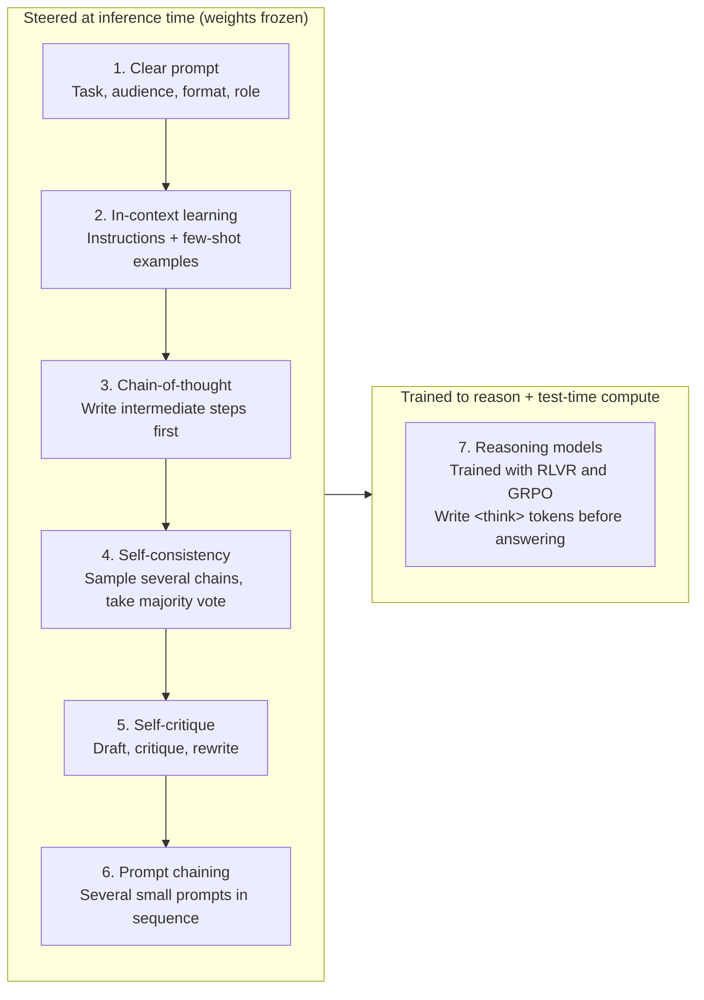
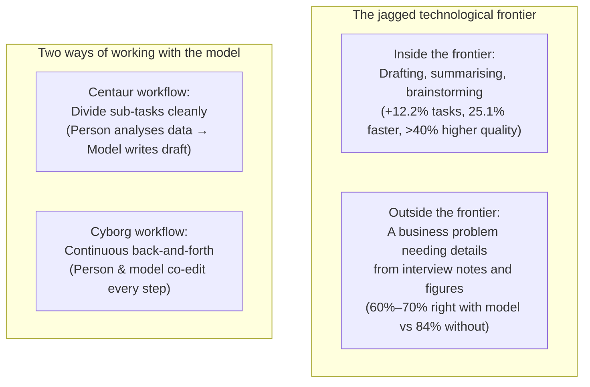
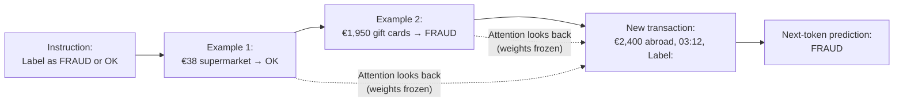
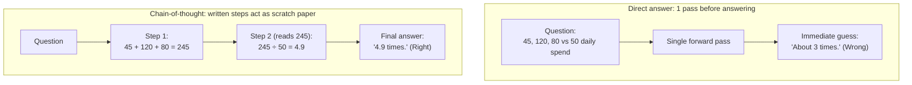
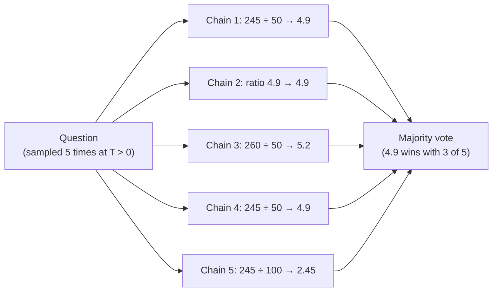
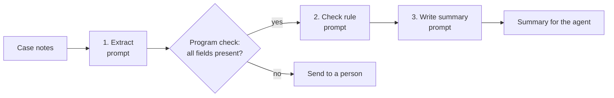
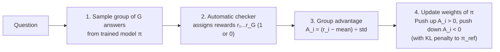

# Prompting and Reasoning

## The big picture

The earlier chapters explained how a model is built, trained and run. This chapter is about **using** a trained model well: how the text you give it steers what it does, and how models can be made to "think" before they answer. None of the techniques in the first sections change a single weight; they work entirely through the prompt and the decoding settings of [Chapter 3](03-inference.md#choosing-the-next-token) (such as temperature, which sets how strongly the model favours its most likely next token: at a low temperature it almost always picks it; at a higher one it samples more freely among several plausible tokens). The last section shows how newer **reasoning models** are trained to think on their own.

1. **Writing a clear prompt:** stating the task, the audience, the format and the role, and knowing where the model can be trusted.
2. **In-context learning:** teaching a task inside the prompt, with instructions or a few examples.
3. **Chain-of-thought:** asking for the steps before the answer.
4. **Self-consistency:** asking several times and taking the majority answer.
5. **Self-critique and refinement:** asking the model to review its own draft and improve it.
6. **Prompt chaining:** splitting a large task into a sequence of small prompts.
7. **Reasoning models:** models trained with reinforcement learning to write long reasoning before answering.



Seen together, these seven techniques form a single progression. Every step addresses a specific limit of predicting one token at a time: first by removing ambiguity in the input (techniques 1 and 2), then by giving the model more forward passes to work out intermediate steps, compare candidates, review its draft, or divide the work across a pipeline (techniques 3 to 6), and finally by training the model itself to generate and verify its own multi-step working before it commits to an answer (technique 7).

Two later chapters build on these techniques. [Chapter 7](07-rag.md#the-big-picture) adds **retrieval**: the application looks up relevant documents and puts them in the prompt, so the model can answer from facts it never saw in training. [Chapter 9](09-agents.md#the-big-picture) covers **agents**: a model that works in a loop, calling tools such as a search or a database and reading their results until the task is done.

## Writing a clear prompt

A model only sees the text it is given. Everything a colleague would know without being told (who the answer is for, how long it should be, what format the team uses) must be written into the prompt, or the model guesses. This section shows what a clear prompt contains and why each part changes the answer. It matters because a clearer prompt is the cheapest improvement there is: it costs a few extra tokens, needs no data and no training, and often fixes problems that look like a weak model.

This section covers:

1. [What a clear prompt states](#what-a-clear-prompt-states): the task, the audience, the constraints and the output format, with a before/after example.
2. [Roles and the system prompt](#roles-and-the-system-prompt): telling the model which expert to act as, and where the application puts its standing instructions.
3. [Where a model helps and where it fails: the jagged frontier](#where-a-model-helps-and-where-it-fails-the-jagged-frontier): why a model that is excellent at one task can be quietly wrong at a similar one.

### What a clear prompt states

A clear prompt answers four questions:

| Part | Question it answers | Example (fraud team) |
| --- | --- | --- |
| Task | What should the model do? | Summarise this fraud case |
| Audience | Who will read the answer? | A customer-service agent with no fraud training |
| Constraints | What must it include or avoid? | No internal risk scores; at most 3 bullet points |
| Format | What should the answer look like? | Bullets, then one line "Next step: …" |

**Worked example** (made up for illustration). The bank's fraud model has blocked a card, and a customer-service agent needs a summary before calling the customer.

**Before:**

```text
Summarise this case.
Case: card ending 4417 blocked 03:14; €2,400 electronics, Lisbon; risk score 0.93;
card usually used for groceries in Lyon; customer confirmed travel? no record.
```

A typical answer is a long paragraph that repeats the risk score (which agents must not share with customers) and ends without saying what the agent should do.

**After:**

```text
Summarise this fraud case for a customer-service agent who has no fraud training.
Write at most 3 bullet points in plain words. Do not mention the risk score.
End with one line that starts with "Next step:".
Case: card ending 4417 blocked 03:14; €2,400 electronics, Lisbon; risk score 0.93;
card usually used for groceries in Lyon; customer confirmed travel? no record.
```

A typical answer:

```text
- The card was blocked at 03:14 after a €2,400 purchase at an electronics shop in Lisbon.
- The customer normally uses this card for groceries in Lyon.
- We have no record that the customer is travelling.
Next step: ask the customer whether they made this purchase.
```

The second prompt is 3 lines longer, and every line removes a guess. Each added instruction is a few tokens; at the token counts of [in-context learning](#why-it-works-and-what-it-costs), the cost is small next to the time an agent would spend fixing a bad summary.

!!! tip "Key idea: how a clear prompt narrows the probability distribution"
    During pre-training, the model read millions of summaries written for different people and purposes: technical incident logs, legal memos, executive briefings, and customer notes. When the prompt says only `Summarise this case`, all of those styles remain plausible continuations, so the model spreads its probability across them and picks whichever pattern happens to score slightly higher. Each explicit detail in the prompt (the audience, the three-bullet limit, the forbidden risk score, and the `"Next step:"` line) gives self-attention ([Chapter 1](01-transformers.md#scaled-dot-product-attention-step-by-step)) specific tokens to attend to at every decode step, concentrating probability on the exact format and level of detail the team needs.

### Roles and the system prompt

- **Role (persona) framing** means telling the model which expert to act as, for example "You are a fraud analyst at a retail bank." The role is a short way of setting many expectations at once: the vocabulary, the level of detail, and which facts matter. It does not give the model knowledge it lacks; a model that knows nothing about a bank's internal rules still knows nothing after being told it is an expert.
- **The system prompt** is a message from the application, not from the user, placed before the conversation with the role `system`. In a chat model it is added with the same special tokens as every other message: a header that says `system`, the text, and an end-of-turn token ([Chapter 3](03-inference.md#decoder-only-how-chat-models-generate)). Models are fine-tuned to give it more weight than user messages, so it is where the application puts standing instructions that apply to every turn: the role, the audience, the format and the rules.

**Example.** The fraud team's summary tool sends the "After" instructions above once, as the system prompt. Each case is then sent as the user message, and the agent never has to retype the rules.

| Message | Role | Text |
| --- | --- | --- |
| 1 | System | You are a fraud analyst at a retail bank. Summarise cases for customer-service agents with no fraud training: at most 3 plain bullet points, never mention risk scores, end with "Next step:". |
| 2 | User | Case: card ending 4417 blocked 03:14; €2,400 electronics, Lisbon; … |

### Where a model helps and where it fails: the jagged frontier

The tasks a model does well and the tasks it does badly are not separated by a simple line such as "easy vs hard". Two tasks that look equally difficult to a person can fall on opposite sides. This uneven boundary is called the **jagged technological frontier**, a term from a 2023 field experiment by researchers from Harvard Business School and other universities with 758 consultants of the Boston Consulting Group.

| Task | Inside the frontier (the model is good at it) | Outside the frontier (a task the model gets wrong) |
| --- | --- | --- |
| What the consultants did | 18 realistic consulting tasks: ideas, writing, analysis | A business problem whose answer depended on details in interview notes and spreadsheet figures |
| Result with GPT-4 vs without | 12.2% more tasks finished, 25.1% faster, results rated more than 40% higher in quality | Less often correct: 84% of consultants without the model found the right answer, against roughly 60% to 70% of those using it |

The second column is the warning: people with a model did **worse**, because its answer was fluent and convincing, and they stopped checking. For a team using a model, this means:

- **Test the model on your own tasks** before trusting it, with a labelled sample as in [Chapter 5](05-evaluation.md#choosing-metrics-for-a-project). Success on one task says little about a neighbouring task.
- **Keep checking outputs** on tasks near the edge of what the model can do, especially when a wrong answer looks the same as a right one.

The study also described two ways of working with a model. **Centaurs** split the work: they hand whole sub-tasks to the model (a first draft, a summary) and do the rest themselves. **Cyborgs** work with the model continuously, going back and forth on every part of the task. Both groups benefited.



!!! note "Quick refresher: one likely reason the boundary is jagged"
    The study measured where the model helped and where it hurt; it does not explain the cause. One likely reason is that what feels hard to a person and what is hard for a model do not line up. The model generates text one token at a time from patterns learned during pre-training ([Chapter 2](02-training.md#what-training-is)): it has seen millions of well-structured memos and plans, so writing a polished one is easy for it. The task outside the frontier, a business problem whose answer depended on details in interview notes and figures, needed exact multi-step bookkeeping across several sources, which a fluent continuation can gloss over without any sign that something is missing. Because human effort and the model's difficulty do not line up, the boundary between where the model helps and where it fails is jagged rather than smooth.

## In-context learning

A pre-trained model has seen so much text that it can often do a new task just from how the prompt is written, without any fine-tuning. This is called **in-context learning**: the model picks up the task from the **context** (the prompt) at inference time, and its weights stay exactly as they were. It matters because it is the cheapest way to adapt a model: changing a prompt takes seconds, while fine-tuning ([Chapter 2](02-training.md#stage-2-supervised-fine-tuning-sft)) takes data, compute and a new copy of the weights.

This section covers:

1. [Zero-shot and few-shot prompts](#zero-shot-and-few-shot-prompts): describing a task, with or without solved examples, and a worked fraud-labelling example.
2. [Why it works, and what it costs](#why-it-works-and-what-it-costs): why next-token prediction can follow a pattern set up in the prompt, and the price of longer prompts.

### Zero-shot and few-shot prompts

- **Zero-shot:** the prompt only describes the task. No solved examples are given.
- **Few-shot:** the prompt also contains a few solved examples (often 1 to 10), so the model can copy their format and logic. GPT-3 (2020) showed that large models do this surprisingly well.

**Worked example: the fraud prompt** from [Chapter 5](05-evaluation.md#the-big-picture).

**Zero-shot:**

```text
Label the transaction as FRAUD or OK.
Transaction: €2,400 at an electronics shop in another country, 03:12, card usually used for groceries.
Label:
```

**Few-shot** (two solved examples first, made up for illustration):

```text
Label each transaction as FRAUD or OK.
Transaction: €38 at the usual supermarket, 18:05.
Label: OK
Transaction: €1,950 in gift cards, online, new device, 02:40.
Label: FRAUD
Transaction: €2,400 at an electronics shop in another country, 03:12, card usually used for groceries.
Label:
```

Both prompts end with `Label:`, so the most likely next token is the label itself. The examples in the few-shot prompt show the model the exact answer format and what kind of evidence points to fraud.

### Why it works, and what it costs

The model is still doing nothing but next-token prediction ([Chapter 1](01-transformers.md#from-the-last-vector-back-to-a-word)). During pre-training it saw countless texts where a pattern is set up and then continued, such as lists of questions and answers, so continuing the pattern in the prompt is exactly what it learned to do. Attention lets the last position look back at the examples while it predicts the label.



Examples are not free: every example adds tokens that must be processed at every request.

| | Zero-shot | Few-shot with 3 examples of about 60 tokens |
| --- | --- | --- |
| Extra tokens per request | 0 | 3 × 60 = 180 |
| Extra tokens per month at 100,000 transactions | 0 | 18,000,000 |
| Effect | Shortest prompt, fastest prefill | Usually more accurate and better-formatted answers; longer prefill, the initial forward pass that reads the whole prompt before the first output token appears ([Chapter 3](03-inference.md#prefill-vs-decode-why-the-first-token-is-slower)) |

Whether the extra cost is worth it is decided as in Chapter 5: measure both prompts on the same labelled sample, and compare the metrics and the costs.

**Practical tips:**

- Make the examples look like the real inputs, and include both labels, so the model does not learn that the answer is always the same.
- Keep the format identical in every example; the model copies the format very faithfully.
- For an exact output format, combine the prompt with [constrained decoding](03-inference.md#constrained-decoding), which zeroes out the probabilities of any token that would break the required format (such as allowing only `FRAUD` or `OK` after `Label:`).

## Chain-of-thought

Some questions need several steps of reasoning, and a model that must give the answer as its very next token has no room to work them out. **Chain-of-thought (CoT)** prompting asks the model to write the intermediate steps first and the answer last. It matters because, for multi-step problems in maths, logic and planning, this simple change makes answers much more often correct.

This section covers:

1. [Why writing the steps helps](#why-writing-the-steps-helps): each written step gives the model another forward pass of computation.
2. [Worked example](#worked-example): a multi-step question answered directly and with chain-of-thought.
3. [Limits](#limits): the extra cost, and the tasks where it does not help.

### Why writing the steps helps

A model produces one token per forward pass, and each pass does a fixed amount of computation ([Chapter 3](03-inference.md#generation-step-by-step)). When the answer must come immediately, all the reasoning has to happen inside a single pass. When the model first writes the steps, every written step becomes part of the input for the next token: the model can read its own intermediate results, exactly as a person uses scratch paper. More output tokens means more computation spent on the problem.



!!! tip "Key idea: turning fixed-depth passes into variable-length computation"
    In a Transformer, a single forward pass runs the input through a fixed number of layers (for example, 6 layers in our base model or 32 layers in a 7-billion-weight model) and immediately projects the last vector to vocabulary probabilities. Whether you ask for `2 + 2` or for the ratio of a sum of three purchases to a daily spend, a direct answer gives the model the exact same number of matrix multiplications before it must name the result. Writing out `245` first stores that intermediate sum as actual tokens in the sequence; when the model then predicts `4.9`, its attention layers read `245` and `50` directly from the context instead of having to compute both the sum and the division inside a single pass.

### Worked example

The question (made-up numbers): *A customer made three purchases of €45, €120 and €80 within ten minutes. Their usual daily spend is €50. How many times their usual daily spend is this?*

| Prompt style | What the model writes | Result |
| --- | --- | --- |
| Direct answer | `About 3 times.` | Wrong: a guess from the look of the numbers |
| Chain-of-thought ("Think step by step, then give the answer.") | `Total: 45 + 120 + 80 = 245 euros. Ratio: 245 ÷ 50 = 4.9. Answer: 4.9 times.` | Right: 4.9 |

Two ways to get a chain of thought:

- **Few-shot CoT:** include solved examples that show their working, not just the answers (the method of Wei et al., 2022).
- **Zero-shot CoT:** simply add an instruction such as "Let's think step by step." (Kojima et al., 2022).

### Limits

- **Longer answers cost more.** Every reasoning token is a decode step: 200 extra tokens at 7 ms each add 1.4 seconds ([Chapter 3](03-inference.md#worked-example-a-7-billion-weight-model)).
- **Little gain on simple tasks.** Looking up a fact or labelling an obvious case needs no steps.
- **The written steps are not guaranteed to be the real reason.** A model can write plausible steps and still reach a wrong answer, or a right answer for the wrong reason, so the steps are useful but must not be trusted blindly.

## Self-consistency

A single chain of thought can take a wrong turn. **Self-consistency** asks the same question several times, with sampling switched on so the chains differ, and returns the answer that comes up most often. It trades extra computation for accuracy, and it needs no change to the model or the prompt.

This section covers:

1. [How it works](#how-it-works): sample several chains, extract each answer, take a majority vote.
2. [Why voting helps, in numbers](#why-voting-helps-in-numbers): how the chance of a right answer grows with the number of chains.

### How it works

1. Sample several chains of thought for the same question, with a temperature above 0 (for example 0.7) so that they differ (at temperature 0, the model always picks the single highest-probability token and would write the exact same chain every time; a temperature above 0 picks randomly according to the token probabilities, [Chapter 3](03-inference.md#sampling-and-temperature)).
2. Extract the final answer from each chain.
3. Return the **majority answer**: the one that appears most often.

**Worked example:** the purchase question from the previous section, asked 5 times (made-up outputs):

| Chain | Reasoning (shortened) | Final answer |
| --- | --- | --- |
| 1 | 45 + 120 + 80 = 245; 245 ÷ 50 | 4.9 |
| 2 | Total 245; ratio 4.9 | 4.9 |
| 3 | 45 + 120 + 95 = 260; 260 ÷ 50 (copied a number wrongly) | 5.2 |
| 4 | 245 ÷ 50 | 4.9 |
| 5 | 245 ÷ 100 (used the wrong daily spend) | 2.45 |

4.9 appears 3 times out of 5, so self-consistency answers 4.9. Correct chains tend to agree with each other, while mistakes scatter in different directions.



### Why voting helps, in numbers

Suppose each chain is right with probability 0.6, independently of the others. The vote is certainly right when more than half of the chains are right:

| Chains sampled | Right chains needed for a majority | Probability the vote is right |
| --- | --- | --- |
| 1 | 1 | 0.600 |
| 5 | 3 | 0.683 |
| 11 | 6 | 0.753 |

(These are lower bounds: when the wrong answers all differ, a smaller group of matching right answers can still win the vote.)

!!! note "Quick refresher: how majority-vote probability is computed"
    When n chains are sampled independently and each has probability p = 0.6 of being right (and 1 − p = 0.4 of being wrong), the probability that **exactly k** chains are right is given by the binomial formula:

    $$
    P(\text{exactly } k \text{ right}) = \binom{n}{k} p^k (1 - p)^{n - k}
    $$

    - **$n$** is the total number of chains sampled, and **$k$** is the number of right chains being counted.
    - **$p$** is the probability that one chain is right (0.6), and **$1 - p$** is the probability that one chain is wrong (0.4).
    - **$\binom{n}{k}$** (read "n choose k") is the number of ways to pick which k chains are right out of n ([Chapter 5](05-evaluation.md#scoring-code-passk)).

    For n = 5 chains, a majority means 3, 4, or 5 right chains:

    - **Exactly 3 right:** (5 choose 3) × 0.6³ × 0.4² = 10 × 0.216 × 0.16 = 0.3456
    - **Exactly 4 right:** (5 choose 4) × 0.6⁴ × 0.4¹ = 5 × 0.1296 × 0.4 = 0.2592
    - **All 5 right:** (5 choose 5) × 0.6⁵ × 0.4⁰ = 1 × 0.07776 × 1 = 0.0778
    - **Total (at least 3 right):** 0.3456 + 0.2592 + 0.0778 = **0.6826 ≈ 0.683**

    Applying the exact same sum for n = 11 chains (adding the probabilities for k = 6, 7, 8, 9, 10, and 11 right chains) gives **0.7535 ≈ 0.753**.

The cost grows with every chain: 5 chains cost about 5 times the decode time and tokens of one. Self-consistency therefore suits questions with a short, checkable final answer, such as a number or a label, where the extra accuracy is worth the price. It does not help with open-ended writing, where no two answers are identical and there is nothing to vote on.

## Self-critique and refinement

Self-consistency needs a short answer to vote on. For longer outputs, such as a summary or an email, another technique works better: the model writes a draft, then reads its own draft against the instructions, lists what is wrong, and rewrites it. This is called **self-critique and refinement**. It matters because a first draft often breaks a rule that the model would easily spot if asked to check, in the same way that a person finds their own typos when they reread.

This section covers:

1. [Draft, critique, rewrite](#draft-critique-rewrite): the three steps, worked through on the fraud summary.
2. [What it costs and when it fails](#what-it-costs-and-when-it-fails): the extra calls, and why a model cannot fix an error it cannot see.

### Draft, critique, rewrite

The method, as described in the Self-Refine paper (Madaan et al., 2023), uses one model in three roles:

1. **Draft:** the model answers the task as usual.
2. **Critique:** in a second call, the model receives the task, its rules and the draft, and is asked to list every problem.
3. **Rewrite:** in a third call, the model receives the draft and the critique and writes an improved version.

Steps 2 and 3 can be repeated until the critique finds nothing more, or for a fixed number of rounds. No weights change and no training data is needed. Across seven tasks (among them dialogue replies, code improvement and maths problems), the paper reports an average gain of about 20 percentage points over the first draft.

**Worked example** (made up), with the rules from [the system prompt above](#roles-and-the-system-prompt):

| Step | What the model writes |
| --- | --- |
| 1. Draft | "- The card was blocked after a €2,400 purchase in Lisbon with a risk score of 0.93. - The customer usually shops in Lyon. - There is no travel record. - The purchase was at night. Next step: call the customer." |
| 2. Critique | "Rule broken: the draft mentions the risk score. Rule broken: 4 bullets, the limit is 3. 'Call the customer' does not say what to ask." |
| 3. Rewrite | "- The card was blocked at 03:14 after a €2,400 purchase at an electronics shop in Lisbon. - The customer normally uses this card for groceries in Lyon. - We have no record that the customer is travelling. Next step: ask the customer whether they made this purchase." |

The critique works because checking a short list of rules against a finished text is easier than following all the rules while writing.

### What it costs and when it fails

- **Three calls instead of one.** Each round adds the critique and the rewrite, each with the full draft in its prompt, so one round costs roughly three times the tokens and time of a single answer.
- **The model cannot fix what it cannot see.** If the draft is wrong because the model does not know a fact, or because its reasoning failed, the same model usually repeats the mistake in its critique. A 2023 study (Huang et al.) found that on reasoning problems, asking a model to review and correct its answers **without any outside feedback** did not improve accuracy, and sometimes changed right answers into wrong ones.
- **Outside feedback works better.** The critique is far more reliable when it is based on something the model did not write: a program that checks the rules (count the bullets, search for the words "risk score"), the result of running code, or a second model with a specific checklist ([LLM-as-judge](05-evaluation.md#llm-as-judge), where a separate prompt grades an output against explicit criteria).

!!! note "Quick refresher: why one refinement round costs roughly 3× a single answer, and when self-checking works"
    Suppose the system rules and case notes take 100 tokens, the draft takes 60 tokens, the critique takes 40 tokens, and the rewrite takes 60 tokens (made-up round numbers):

    - **Call 1 (Draft):** reads 100 input tokens and generates 60 output tokens (160 tokens total).
    - **Call 2 (Critique):** reads the 100-token task plus the 60-token draft (160 input tokens) and generates 40 output tokens (200 tokens total).
    - **Call 3 (Rewrite):** reads the 60-token draft plus the 40-token critique (100 input tokens) and generates 60 output tokens (160 tokens total).

    Across all three calls, the system processes 160 + 200 + 160 = **520 total tokens** (3.25 times Call 1's 160 tokens) and generates 60 + 40 + 60 = **160 output tokens** sequentially (2.67 times Call 1's 60 output tokens). That extra cost pays off when **verifying is easier than generating** (such as counting bullets or spotting the forbidden phrase `"risk score"` in a finished draft), but fails when verifying requires the exact same knowledge or multi-step reasoning that produced the mistake in Call 1.

## Prompt chaining

A single prompt that asks for everything at once (read the case, find the facts, check the bank's rules, write the summary) is hard to get right and hard to fix: when the answer is wrong, there is no way to tell which part failed. **Prompt chaining** splits the task into a sequence of small prompts, each with one job, where the output of one step becomes the input of the next. It matters because it turns one unpredictable prompt into a short pipeline whose steps can each be tested, measured and improved on their own. It is also the first step towards agents ([Chapter 9](09-agents.md#the-big-picture)).

This section covers:

1. [From one prompt to a chain](#from-one-prompt-to-a-chain): the fraud summary as a three-step chain, with a program check between the steps.
2. [Why chains are easier to improve](#why-chains-are-easier-to-improve): finding which step causes the errors, with numbers.

### From one prompt to a chain

The fraud-case summary of [Writing a clear prompt](#what-a-clear-prompt-states) becomes three prompts:

| Step | Single job | Input | Output |
| --- | --- | --- | --- |
| 1. Extract | Pull the facts out of the raw case notes | The case text | A fixed list of fields: amount, merchant, city, time, usual city, travel record |
| 2. Check | Decide which bank rule applies | The fields from step 1 | One label, for example `UNCONFIRMED_TRAVEL` |
| 3. Write | Write the summary for the agent | The fields and the label | 3 bullets and "Next step:" |



Between the steps, ordinary code can check the output before it moves on: here, that step 1 returned every field, and that the amount is a number. Each step's output can also be forced into an exact format with [constrained decoding](03-inference.md#constrained-decoding). A chain like this, where the steps are fixed in advance by the developer, is the simplest kind of system built around a model; Chapter 9 shows what changes when the model chooses the steps itself.

### Why chains are easier to improve

Suppose the bank tests both designs on the same 100 past cases, and an analyst marks each final summary as right or wrong (made-up numbers):

| Design | Wrong summaries | What the team can learn |
| --- | --- | --- |
| One large prompt | 12 of 100 | Only that 12 are wrong; the cause is hidden inside one answer |
| Three-step chain | 12 of 100 | Step 1 extracted a wrong field in 9 cases; step 3 broke a format rule in 3 |

With the chain, the team knows where to work: improving the extraction prompt (for example, adding two [few-shot examples](#zero-shot-and-few-shot-prompts) of messy case notes) addresses 9 of the 12 errors. Each step also gets its own metric (here, the share of cases with every field extracted correctly), which can be tracked after every prompt change, as in [Chapter 5](05-evaluation.md#choosing-metrics-for-a-project).

!!! note "Quick refresher: how step errors add up and why code checks between steps matter"
    In the 100-case test above, the three-step chain makes 12 errors in total: Step 1 fails on 9 cases (leaving 91 valid extractions), Step 2 succeeds on all 91, and Step 3 makes a formatting mistake on 3 of those 91 (leaving 88 right summaries out of 100, or 88% accuracy).

    - **Targeted fixes:** If adding two few-shot examples to Step 1 cuts its extraction errors from 9 to 2 without touching Steps 2 or 3, the total wrong summaries drop from 12 to 2 + 3 = **5 of 100** (raising end-to-end accuracy from 88% to 95%).
    - **Why code checks between steps are essential:** When a chain has many steps and no checks between them, small error rates multiply. If 5 steps each succeed with probability 0.95 (a 5% error rate per step), the probability that all 5 succeed in a row is $0.95^5 \approx 0.774$ (77.4% right, or 22.6% wrong). Putting a fast code check after each step catches outputs that are missing or badly formatted (a missing field, an amount that is not a number) before they reach the next step, so the step can be retried or the case sent to a person. A field that is present but wrong still passes the check; finding those needs a test set, as in the table above.

The price is more calls: three short prompts instead of one long one. The total number of tokens is often similar, because each step reads only what it needs, but the waiting time adds up, since each step must finish before the next can start.

## Reasoning models: thinking before answering

Chain-of-thought and self-consistency are tricks applied from outside, through the prompt. **Reasoning models** are trained to reason on their own: before every answer they write a long, often hidden, chain of thought, and they have learned through reinforcement learning which kinds of reasoning lead to correct answers. They are much stronger at maths, coding and planning, and they show a new way to buy accuracy: spending more computation at answer time.

This section covers:

1. [Thinking tokens and test-time compute](#thinking-tokens-and-test-time-compute): the hidden reasoning before the answer, and spending more computation to get better answers.
2. [Training with verifiable rewards](#training-with-verifiable-rewards): learning from problems whose answers can be checked automatically.
3. [GRPO: learning from a group of answers](#grpo-learning-from-a-group-of-answers): the reinforcement-learning method behind DeepSeek-R1, with numbers.
4. [What emerges](#what-emerges): the reasoning behaviours that appear during this training.
5. [Prompted reasoning vs reasoning models](#prompted-reasoning-vs-reasoning-models): chain-of-thought prompting and reasoning models compared.

### Thinking tokens and test-time compute

A reasoning model's output has two parts. DeepSeek-R1, for example, writes:

```text
<think>
Total of the three purchases: 45 + 120 + 80 = 245. Usual daily spend: 50.
245 ÷ 50 = 4.9. Check: 4.9 × 50 = 245. Correct.
</think>
The purchases total 4.9 times the customer's usual daily spend.
```

- **Thinking tokens** (between `<think>` and `</think>`): the model's working, including checks and corrections. Many applications hide this part and show only the answer.
- **The answer:** written after the thinking ends.

Spending more tokens at answer time to get better answers is called **test-time compute**. Pre-training improves a model by spending more computation **before** it is used; reasoning models add a second dial: more thinking per question, usually with better results on hard problems.

The cost is real, and Chapter 3's arithmetic applies to every thinking token (each token requires one sequential decode pass and adds its key and value vectors to the **KV cache**, the memory that stores past tokens' keys and values so they are not recomputed; **grouped-query attention (GQA)** cuts that memory by sharing key and value heads across groups of query heads). For 2,000 thinking tokens on the 7-billion-weight model of [Chapter 3](03-inference.md#worked-example-a-7-billion-weight-model):

| Cost | Calculation | Result |
| --- | --- | --- |
| Extra decode time | 2,000 × 7 ms | 14 seconds |
| Extra KV cache, multi-head attention ([Chapter 3](03-inference.md#how-much-memory-the-cache-needs)) | 2,000 × 0.52 MB | ≈ 1,049 MB |
| Extra KV cache with GQA, as in Llama 3 8B ([Chapter 4](04-quantization.md#grouped-query-attention-gqa)) | 2,000 × 0.13 MB | ≈ 262 MB |

This is why reasoning models are slower and more expensive per question, and why many let the user choose how much to think. (The cache totals use the unrounded per-token sizes from Chapters 3 and 4: 524,288 bytes = 0.524288 MB and 131,072 bytes = 0.131072 MB per token.)

### Training with verifiable rewards

How does a model learn to reason well? Writing thousands of good reasoning examples by hand is impractical. Instead, reasoning models are trained with **reinforcement learning** on problems whose answers can be **checked automatically**:

- **Maths:** compare the final number with the known answer.
- **Code:** run the program against tests.

The reward is simply 1 for a correct final answer and 0 otherwise. This is called **reinforcement learning with verifiable rewards (RLVR)**. It needs no human labels and no **reward model**. In ordinary preference training (RLHF), the reward model is a separate neural network trained on people's choices between two answers, which learns to give any answer a score ([Chapter 2](02-training.md#inside-rlhf-training-the-reward-model)). Because it is only an imitation of human judgement, the model being trained can learn to fool it, for example with long, confident answers that score well without being right. A checking program cannot be fooled this way: a wrong answer cannot be made to look right. The model is free to discover whatever reasoning works; only the result is graded.

### GRPO: learning from a group of answers

**GRPO** (group relative policy optimisation), introduced with DeepSeekMath and used to train DeepSeek-R1, is the reinforcement-learning method most associated with reasoning models. For each question:

1. The model writes a **group** of G answers (for example 4 to 16), with sampling switched on.
2. Each answer gets its reward r\_i from the checker.
3. Each answer's **advantage**, how much better it did than its group, is computed:

$$
A_i = \frac{r_i - \text{mean}(r)}{\text{std}(r)}
$$

- **$A_i$** is the advantage of answer $i$, and **$r_i$** is the reward that answer $i$ received from the checker (for example, 1 or 0).
- **mean(r)** is the average reward of the group, and **std(r)** its standard deviation (spread).
- A positive advantage means better than the group average; negative means worse.

4. Training raises the probability of every token in answers with a positive advantage and lowers it in answers with a negative advantage, with a **KL penalty** keeping the model close to its **reference**, as in RLHF ([Chapter 2](02-training.md#inside-rlhf-the-kl-penalty-and-reward-hacking)). The reference is a frozen copy of the model taken before this training starts. The KL penalty (from the Kullback–Leibler divergence, a measure of how different two sets of probabilities are) grows as the trained model's probabilities for the next token drift away from the reference's, so the model improves its reasoning without forgetting how to write normal text.



**Worked example:** a group of 4 answers to one question (rewards made up; standard deviation computed over the group):

| Group's rewards | Mean | Std | Advantages | What training does |
| --- | --- | --- | --- | --- |
| 1, 0, 1, 1 | 0.75 | 0.433 | +0.577, −1.732, +0.577, +0.577 | A strong push away from the one wrong answer, a mild push toward the three right ones |
| 0, 0, 0, 1 | 0.25 | 0.433 | −0.577, −0.577, −0.577, +1.732 | A strong push toward the single right answer |
| 1, 1, 1, 1 | 1.00 | 0 | none | Nothing: every answer equals the average, so there is nothing to learn |

!!! note "Quick refresher: computing the group mean, standard deviation and advantages"
    In the first row (`1, 0, 1, 1`), the four rewards are compared against each other using the same three steps as [layer normalisation in Chapter 1](01-transformers.md#layer-normalisation-in-detail):

    1. **Mean (average):** (1 + 0 + 1 + 1) ÷ 4 = **0.75**.
    2. **Standard deviation (typical distance from the mean):** subtract the mean from each reward (`+0.25, −0.75, +0.25, +0.25`), square those differences and average them to get the variance:
       (0.0625 + 0.5625 + 0.0625 + 0.0625) ÷ 4 = 0.1875,
       then take the square root: √0.1875 ≈ **0.433**.
    3. **Advantages (standardised scores):** divide each difference by 0.433. The three right answers get +0.25 ÷ 0.433 = **+0.577**, and the single wrong answer gets −0.75 ÷ 0.433 = **−1.732**.

    In the second row (`0, 0, 0, 1`), the mean is 0.25 and the standard deviation is again 0.433, so the three wrong answers get (0 − 0.25) ÷ 0.433 = **−0.577** and the single right answer gets (1 − 0.25) ÷ 0.433 = **+1.732**. Because the differences from the mean always add up to 0, the advantages in a group always sum to 0 (3 × 0.577 − 1.732 ≈ 0), and a rare success or rare failure automatically gets a stronger push than the common outcome.

The last row shows a practical point: questions that are always solved, or never solved, teach the model nothing. Training sets for reasoning models are therefore chosen to be hard but not impossible for the current model.

The group average replaces the **value model** of PPO. **PPO** (proximal policy optimisation) is the reinforcement-learning method used in RLHF. To decide whether an answer did better or worse than expected, it needs a baseline: what reward to expect for this question. PPO gets it from a value model, a second neural network about as large as the model being trained, trained alongside it to predict the reward from a question and a partial answer ([Chapter 2](02-training.md#rlhf-vs-dpo-what-each-costs)). GRPO gets the baseline for free: the average reward of the group of answers to the same question, as in the advantage formula above. With verifiable rewards there is no reward model either, so training needs only the model being trained and its frozen reference, plus a checking program.

### What emerges

The DeepSeek-R1 paper reports that when its earlier version, R1-Zero, was trained this way directly from the pre-trained model, without any supervised examples of reasoning, its answers grew steadily longer during training, and behaviours such as checking its own work and going back to reconsider a step appeared without being taught. Because R1-Zero's reasoning was hard to read (for example, mixing languages), the final R1 model first received a small amount of supervised fine-tuning on readable reasoning examples, then the same reinforcement learning.

Reasoning ability can also be passed to smaller models by **distillation**: a smaller student model is fine-tuned on the full thinking-and-answer outputs written by a larger teacher model. R1's reasoning answers were used this way to fine-tune much smaller models ([Chapter 2](02-training.md#distillation-a-small-model-learns-from-a-large-one)).

### Prompted reasoning vs reasoning models

| | Chain-of-thought prompting | Reasoning model |
| --- | --- | --- |
| Where the reasoning comes from | An instruction or examples in the prompt | Learned in training, written for every question |
| Training needed | None | Reinforcement learning with verifiable rewards (for example GRPO) |
| Reasoning length | Short, a few steps | Often thousands of tokens, with checks and corrections |
| Cost per question | A little more than a direct answer | Much more: decode time and KV cache grow with the thinking |
| Best for | Moderately multi-step tasks | Hard maths, code, planning |

## Cheat sheet

| Concept | One-line meaning |
| --- | --- |
| Clear prompt | States the task, the audience, the constraints and the output format |
| Role (persona) framing | "You are a fraud analyst": sets vocabulary and detail, adds no knowledge |
| System prompt | The application's standing instructions, sent before the conversation with the role `system` |
| Jagged frontier | Tasks a model does well and badly are mixed unevenly; test on your own tasks and keep checking |
| In-context learning | The model learns a task from the prompt alone; no weights change |
| Zero-shot / few-shot | Instructions only / instructions plus a few solved examples |
| Cost of examples | Every example adds tokens to every request: longer prefill, higher cost |
| Chain-of-thought | Ask for the steps before the answer; more tokens means more computation on the problem |
| Zero-shot CoT | Add "Let's think step by step" to the prompt |
| Self-consistency | Sample several chains at T > 0 and return the majority answer |
| Self-critique and refinement | Draft, critique against the rules, rewrite; works best with outside feedback |
| Prompt chaining | A fixed sequence of single-purpose prompts, with program checks between steps |
| Reasoning model | Trained to write long reasoning (for example between `<think>` tags) before answering |
| Test-time compute | Spending more tokens at answer time to get better answers |
| RLVR | Reinforcement learning with rewards from an automatic checker (correct answer, passing tests) |
| GRPO | Each answer's advantage = (reward − group mean) ÷ group std; no value model needed |
| No-signal groups | If all answers in a group score the same, the group teaches nothing |

## Sources

- [Language Models are Few-Shot Learners (Brown et al., 2020)](https://arxiv.org/abs/2005.14165): in-context learning, zero-shot and few-shot prompts
- [Chain-of-Thought Prompting Elicits Reasoning in Large Language Models (Wei et al., 2022)](https://arxiv.org/abs/2201.11903)
- [Large Language Models are Zero-Shot Reasoners (Kojima et al., 2022)](https://arxiv.org/abs/2205.11916): "Let's think step by step"
- [Self-Consistency Improves Chain of Thought Reasoning in Language Models (Wang et al., 2022)](https://arxiv.org/abs/2203.11171)
- [DeepSeekMath: Pushing the Limits of Mathematical Reasoning in Open Language Models (Shao et al., 2024)](https://arxiv.org/abs/2402.03300): GRPO
- [DeepSeek-R1: Incentivizing Reasoning Capability in LLMs via Reinforcement Learning (DeepSeek-AI, 2025)](https://arxiv.org/abs/2501.12948): thinking tokens, R1-Zero, emergent behaviour, distillation
- [Tulu 3: Pushing Frontiers in Open Language Model Post-Training (Lambert et al., 2024)](https://arxiv.org/abs/2411.15124): reinforcement learning with verifiable rewards
- [Navigating the Jagged Technological Frontier (Dell'Acqua et al., 2023)](https://www.hbs.edu/faculty/Pages/item.aspx?num=64700): the field experiment with 758 BCG consultants; [summary by co-author Ethan Mollick](https://www.oneusefulthing.org/p/centaurs-and-cyborgs-on-the-jagged): centaurs and cyborgs
- [Self-Refine: Iterative Refinement with Self-Feedback (Madaan et al., 2023)](https://arxiv.org/abs/2303.17651)
- [Large Language Models Cannot Self-Correct Reasoning Yet (Huang et al., 2023)](https://arxiv.org/abs/2310.01798)
- [Building effective agents (Anthropic, 2024)](https://www.anthropic.com/engineering/building-effective-agents): prompt chaining with program checks between steps
- [CME295: Transformers & Large Language Models, Lectures 2 and 3 (Stanford University, Afshine and Shervine Amidi)](https://cme295.stanford.edu/syllabus/): prompting, reasoning and GRPO topics
- [CS230: Deep Learning, Lecture 8: Agents, Prompts and RAG (Stanford University, Autumn 2025)](https://cs230.stanford.edu/): clear prompts, self-critique, prompt chaining and the jagged frontier
