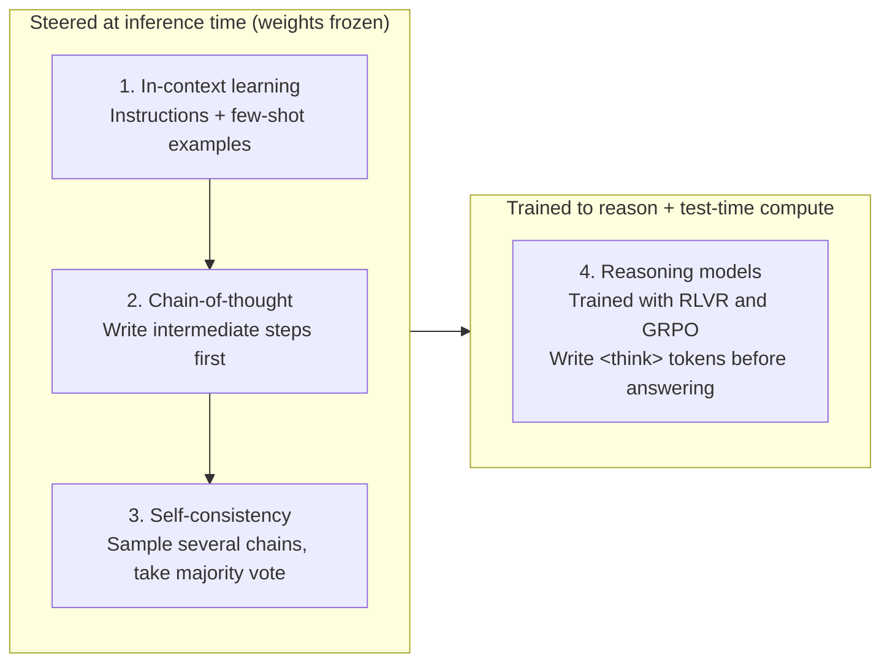
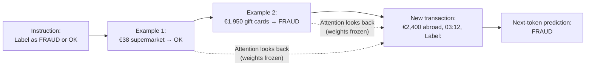
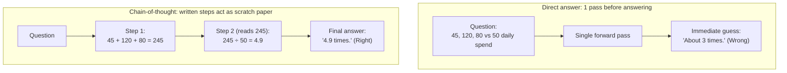
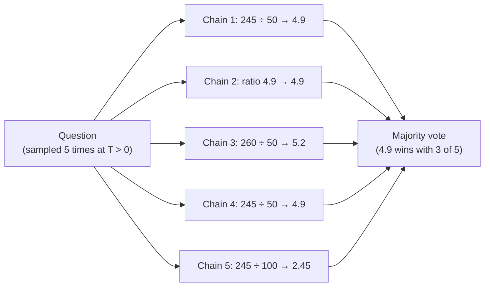
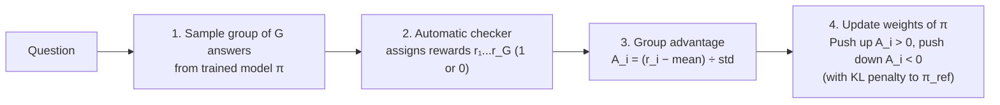

# Prompting, Reasoning and Agents

## The big picture

The earlier chapters explained how a model is built, trained and run. This chapter is about **using** a trained model well: how the text you give it steers what it does, and how models can be made to "think" before they answer. None of the techniques in the first sections change a single weight; they work entirely through the prompt and the decoding settings of [Chapter 3](03-inference.md). The last section shows how newer **reasoning models** are trained to think on their own.

1. **In-context learning:** teaching a task inside the prompt, with instructions or a few examples.
2. **Chain-of-thought:** asking for the steps before the answer.
3. **Self-consistency:** asking several times and taking the majority answer.
4. **Reasoning models:** models trained with reinforcement learning to write long reasoning before answering.



!!! note "Work in progress"
    Agents (models that use tools and act over many steps) and retrieval will be added to this chapter as the matching lectures of the CME295 course are reviewed.

## In-context learning

A pre-trained model has seen so much text that it can often do a new task just from how the prompt is written, without any fine-tuning. This is called **in-context learning**: the model picks up the task from the **context** (the prompt) at inference time, and its weights stay exactly as they were. It matters because it is the cheapest way to adapt a model: changing a prompt takes seconds, while fine-tuning ([Chapter 2](02-training.md#stage-2-supervised-fine-tuning-sft)) takes data, compute and a new copy of the weights.

### Zero-shot and few-shot prompts

- **Zero-shot:** the prompt only describes the task. No solved examples are given.
- **Few-shot:** the prompt also contains a few solved examples (often 1 to 10), so the model can copy their format and logic. GPT-3 (2020) showed that large models do this surprisingly well.

**Worked example: the fraud prompt** from [Chapter 5](05-evaluation.md#the-big-picture).

**Zero-shot:**

```text
Label the transaction as FRAUD or OK.
Transaction: €2,400 at an electronics shop in another country, 03:12, card usually used for groceries.
Label:
```

**Few-shot** (two solved examples first, made up for illustration):

```text
Label each transaction as FRAUD or OK.
Transaction: €38 at the usual supermarket, 18:05.
Label: OK
Transaction: €1,950 in gift cards, online, new device, 02:40.
Label: FRAUD
Transaction: €2,400 at an electronics shop in another country, 03:12, card usually used for groceries.
Label:
```

Both prompts end with `Label:`, so the most likely next token is the label itself. The examples in the few-shot prompt show the model the exact answer format and what kind of evidence points to fraud.

### Why it works, and what it costs

The model is still doing nothing but next-token prediction ([Chapter 1](01-transformers.md#from-the-last-vector-back-to-a-word)). During pre-training it saw countless texts where a pattern is set up and then continued, such as lists of questions and answers, so continuing the pattern in the prompt is exactly what it learned to do. Attention lets the last position look back at the examples while it predicts the label.



Examples are not free: every example adds tokens that must be processed at every request.

| | Zero-shot | Few-shot with 3 examples of about 60 tokens |
| --- | --- | --- |
| Extra tokens per request | 0 | 3 × 60 = 180 |
| Extra tokens per month at 100,000 transactions | 0 | 18,000,000 |
| Effect | Shortest prompt, fastest prefill | Usually more accurate and better-formatted answers; longer prefill ([Chapter 3](03-inference.md#prefill-vs-decode-why-the-first-token-is-slower)) |

Whether the extra cost is worth it is decided as in Chapter 5: measure both prompts on the same labelled sample, and compare the metrics and the costs.

**Practical tips:**

- Make the examples look like the real inputs, and include both labels, so the model does not learn that the answer is always the same.
- Keep the format identical in every example; the model copies the format very faithfully.
- For an exact output format, combine the prompt with [constrained decoding](03-inference.md#constrained-decoding).

## Chain-of-thought

Some questions need several steps of reasoning, and a model that must give the answer as its very next token has no room to work them out. **Chain-of-thought (CoT)** prompting asks the model to write the intermediate steps first and the answer last. It matters because, for multi-step problems in maths, logic and planning, this simple change makes answers much more often correct.

### Why writing the steps helps

A model produces one token per forward pass, and each pass does a fixed amount of computation ([Chapter 3](03-inference.md#generation-step-by-step)). When the answer must come immediately, all the reasoning has to happen inside a single pass. When the model first writes the steps, every written step becomes part of the input for the next token: the model can read its own intermediate results, exactly as a person uses scratch paper. More output tokens means more computation spent on the problem.



### Worked example

The question (made-up numbers): *A customer made three purchases of €45, €120 and €80 within ten minutes. Their usual daily spend is €50. How many times their usual daily spend is this?*

| Prompt style | What the model writes | Result |
| --- | --- | --- |
| Direct answer | `About 3 times.` | Wrong: a guess from the look of the numbers |
| Chain-of-thought ("Think step by step, then give the answer.") | `Total: 45 + 120 + 80 = 245 euros. Ratio: 245 ÷ 50 = 4.9. Answer: 4.9 times.` | Right: 4.9 |

Two ways to get a chain of thought:

- **Few-shot CoT:** include solved examples that show their working, not just the answers (the method of Wei et al., 2022).
- **Zero-shot CoT:** simply add an instruction such as "Let's think step by step." (Kojima et al., 2022).

### Limits

- **Longer answers cost more.** Every reasoning token is a decode step: 200 extra tokens at 7 ms each add 1.4 seconds ([Chapter 3](03-inference.md#worked-example-a-7-billion-weight-model)).
- **Little gain on simple tasks.** Looking up a fact or labelling an obvious case needs no steps.
- **The written steps are not guaranteed to be the real reason.** A model can write plausible steps and still reach a wrong answer, or a right answer for the wrong reason, so the steps are useful but must not be trusted blindly.

## Self-consistency

A single chain of thought can take a wrong turn. **Self-consistency** asks the same question several times, with sampling switched on so the chains differ, and returns the answer that comes up most often. It trades extra computation for accuracy, and it needs no change to the model or the prompt.

### How it works

1. Sample several chains of thought for the same question, with a temperature above 0 (for example 0.7) so that they differ ([Chapter 3](03-inference.md#sampling-and-temperature)).
2. Extract the final answer from each chain.
3. Return the **majority answer**: the one that appears most often.

**Worked example:** the purchase question from the previous section, asked 5 times (made-up outputs):

| Chain | Reasoning (shortened) | Final answer |
| --- | --- | --- |
| 1 | 45 + 120 + 80 = 245; 245 ÷ 50 | 4.9 |
| 2 | Total 245; ratio 4.9 | 4.9 |
| 3 | 45 + 120 + 95 = 260; 260 ÷ 50 (copied a number wrongly) | 5.2 |
| 4 | 245 ÷ 50 | 4.9 |
| 5 | 245 ÷ 100 (used the wrong daily spend) | 2.45 |

4.9 appears 3 times out of 5, so self-consistency answers 4.9. Correct chains tend to agree with each other, while mistakes scatter in different directions.



### Why voting helps, in numbers

Suppose each chain is right with probability 0.6, independently of the others. The vote is certainly right when more than half of the chains are right:

| Chains sampled | Right chains needed for a majority | Probability the vote is right |
| --- | --- | --- |
| 1 | 1 | 0.600 |
| 5 | 3 | 0.683 |
| 11 | 6 | 0.753 |

(These are lower bounds: when the wrong answers all differ, a smaller group of matching right answers can still win the vote.)

!!! note "Quick refresher: how majority-vote probability is computed"
    When n chains are sampled independently and each has probability p = 0.6 of being right (and 1 − p = 0.4 of being wrong), the probability that **exactly k** chains are right is given by the binomial formula:

    $$
    P(\text{exactly } k \text{ right}) = \binom{n}{k} p^k (1 - p)^{n - k}
    $$

    Here (n choose k) is the number of ways to pick which k chains are right ([Chapter 5](05-evaluation.md#scoring-code-passk)). For n = 5 chains, a majority means 3, 4, or 5 right chains:

    - **Exactly 3 right:** (5 choose 3) × 0.6³ × 0.4² = 10 × 0.216 × 0.16 = 0.3456
    - **Exactly 4 right:** (5 choose 4) × 0.6⁴ × 0.4¹ = 5 × 0.1296 × 0.4 = 0.2592
    - **All 5 right:** (5 choose 5) × 0.6⁵ × 0.4⁰ = 1 × 0.07776 × 1 = 0.0778
    - **Total (at least 3 right):** 0.3456 + 0.2592 + 0.0778 = **0.6826 ≈ 0.683**

The cost grows with every chain: 5 chains cost about 5 times the decode time and tokens of one. Self-consistency therefore suits questions with a short, checkable final answer, such as a number or a label, where the extra accuracy is worth the price. It does not help with open-ended writing, where no two answers are identical and there is nothing to vote on.

## Reasoning models: thinking before answering

Chain-of-thought and self-consistency are tricks applied from outside, through the prompt. **Reasoning models** are trained to reason on their own: before every answer they write a long, often hidden, chain of thought, and they have learned through reinforcement learning which kinds of reasoning lead to correct answers. They are much stronger at maths, coding and planning, and they show a new way to buy accuracy: spending more computation at answer time.

### Thinking tokens and test-time compute

A reasoning model's output has two parts. DeepSeek-R1, for example, writes:

```text
<think>
Total of the three purchases: 45 + 120 + 80 = 245. Usual daily spend: 50.
245 ÷ 50 = 4.9. Check: 4.9 × 50 = 245. Correct.
</think>
The purchases total 4.9 times the customer's usual daily spend.
```

- **Thinking tokens** (between `<think>` and `</think>`): the model's working, including checks and corrections. Many applications hide this part and show only the answer.
- **The answer:** written after the thinking ends.

Spending more tokens at answer time to get better answers is called **test-time compute**. Pre-training improves a model by spending more computation **before** it is used; reasoning models add a second dial: more thinking per question, usually with better results on hard problems.

The cost is real, and Chapter 3's arithmetic applies to every thinking token. For 2,000 thinking tokens on the 7-billion-weight model of [Chapter 3](03-inference.md#worked-example-a-7-billion-weight-model):

| Cost | Calculation | Result |
| --- | --- | --- |
| Extra decode time | 2,000 × 7 ms | 14 seconds |
| Extra KV cache, multi-head attention ([Chapter 3](03-inference.md#how-much-memory-the-cache-needs)) | 2,000 × 0.52 MB | ≈ 1,049 MB |
| Extra KV cache with GQA, as in Llama 3 8B ([Chapter 4](04-quantization.md#grouped-query-attention-gqa)) | 2,000 × 0.13 MB | ≈ 262 MB |

This is why reasoning models are slower and more expensive per question, and why many let the user choose how much to think. (The cache totals use the unrounded per-token sizes from Chapters 3 and 4: 524,288 bytes = 0.524288 MB and 131,072 bytes = 0.131072 MB per token.)

### Training with verifiable rewards

How does a model learn to reason well? Writing thousands of good reasoning examples by hand is impractical. Instead, reasoning models are trained with **reinforcement learning** on problems whose answers can be **checked automatically**:

- **Maths:** compare the final number with the known answer.
- **Code:** run the program against tests.

The reward is simply 1 for a correct final answer and 0 otherwise. This is called **reinforcement learning with verifiable rewards (RLVR)**. It needs no human labels and no reward model ([Chapter 2](02-training.md#inside-rlhf-training-the-reward-model)), so there is no learned reward model to exploit: a wrong answer cannot be made to look right. The model is free to discover whatever reasoning works; only the result is graded.

### GRPO: learning from a group of answers

**GRPO** (group relative policy optimisation), introduced with DeepSeekMath and used to train DeepSeek-R1, is the reinforcement-learning method most associated with reasoning models. For each question:

1. The model writes a **group** of G answers (for example 4 to 16), with sampling switched on.
2. Each answer gets its reward r\_i from the checker.
3. Each answer's **advantage**, how much better it did than its group, is computed:

$$
A_i = \frac{r_i - \text{mean}(r)}{\text{std}(r)}
$$

- **mean(r)** is the average reward of the group, and **std(r)** its standard deviation (spread).
- A positive advantage means better than the group average; negative means worse.

4. Training raises the probability of every token in answers with a positive advantage and lowers it in answers with a negative advantage, with a KL penalty keeping the model close to its reference, as in RLHF ([Chapter 2](02-training.md#inside-rlhf-the-kl-penalty-and-reward-hacking)).



**Worked example:** a group of 4 answers to one question (rewards made up; standard deviation computed over the group):

| Group's rewards | Mean | Std | Advantages | What training does |
| --- | --- | --- | --- | --- |
| 1, 0, 1, 1 | 0.75 | 0.433 | +0.577, −1.732, +0.577, +0.577 | A strong push away from the one wrong answer, a mild push toward the three right ones |
| 0, 0, 0, 1 | 0.25 | 0.433 | −0.577, −0.577, −0.577, +1.732 | A strong push toward the single right answer |
| 1, 1, 1, 1 | 1.00 | 0 | none | Nothing: every answer equals the average, so there is nothing to learn |

!!! note "Quick refresher: computing the group mean, standard deviation and advantages"
    In the first row (`1, 0, 1, 1`), the four rewards are compared against each other using the same three steps as [layer normalisation in Chapter 1](01-transformers.md#layer-normalisation-in-detail):

    1. **Mean (average):** (1 + 0 + 1 + 1) ÷ 4 = **0.75**.
    2. **Standard deviation (typical distance from the mean):** subtract the mean from each reward (`+0.25, −0.75, +0.25, +0.25`), square those differences and average them to get the variance:
       (0.0625 + 0.5625 + 0.0625 + 0.0625) ÷ 4 = 0.1875,
       then take the square root: √0.1875 ≈ **0.433**.
    3. **Advantages (standardised scores):** divide each difference by 0.433. The three right answers get +0.25 ÷ 0.433 = **+0.577**, and the single wrong answer gets −0.75 ÷ 0.433 = **−1.732**.

    Because the differences from the mean always add up to 0, the advantages in a group always sum to 0 (3 × 0.577 − 1.732 ≈ 0), and a rare success or rare failure automatically gets a stronger push than the common outcome.

The last row shows a practical point: questions that are always solved, or never solved, teach the model nothing. Training sets for reasoning models are therefore chosen to be hard but not impossible for the current model.

The group average replaces the **value model** that PPO uses to judge answers ([Chapter 2](02-training.md#rlhf-vs-dpo-what-each-costs)). With verifiable rewards there is no reward model either, so training needs only the model being trained and its frozen reference, plus a checking program.

### What emerges

The DeepSeek-R1 paper reports that when its earlier version, R1-Zero, was trained this way directly from the pre-trained model, without any supervised examples of reasoning, its answers grew steadily longer during training, and behaviours such as checking its own work and going back to reconsider a step appeared without being taught. Because R1-Zero's reasoning was hard to read (for example, mixing languages), the final R1 model first received a small amount of supervised fine-tuning on readable reasoning examples, then the same reinforcement learning.

Reasoning ability can also be passed to smaller models: R1's reasoning answers were used to fine-tune much smaller models ([Chapter 2](02-training.md#distillation-a-small-model-learns-from-a-large-one)).

### Prompted reasoning vs reasoning models

| | Chain-of-thought prompting | Reasoning model |
| --- | --- | --- |
| Where the reasoning comes from | An instruction or examples in the prompt | Learned in training, written for every question |
| Training needed | None | Reinforcement learning with verifiable rewards (for example GRPO) |
| Reasoning length | Short, a few steps | Often thousands of tokens, with checks and corrections |
| Cost per question | A little more than a direct answer | Much more: decode time and KV cache grow with the thinking |
| Best for | Moderately multi-step tasks | Hard maths, code, planning |

## Cheat sheet

| Concept | One-line meaning |
| --- | --- |
| In-context learning | The model learns a task from the prompt alone; no weights change |
| Zero-shot / few-shot | Instructions only / instructions plus a few solved examples |
| Cost of examples | Every example adds tokens to every request: longer prefill, higher cost |
| Chain-of-thought | Ask for the steps before the answer; more tokens means more computation on the problem |
| Zero-shot CoT | Add "Let's think step by step" to the prompt |
| Self-consistency | Sample several chains at T > 0 and return the majority answer |
| Reasoning model | Trained to write long reasoning (for example between `<think>` tags) before answering |
| Test-time compute | Spending more tokens at answer time to get better answers |
| RLVR | Reinforcement learning with rewards from an automatic checker (correct answer, passing tests) |
| GRPO | Each answer's advantage = (reward − group mean) ÷ group std; no value model needed |
| No-signal groups | If all answers in a group score the same, the group teaches nothing |

## Sources

- [Language Models are Few-Shot Learners (Brown et al., 2020)](https://arxiv.org/abs/2005.14165): in-context learning, zero-shot and few-shot prompts
- [Chain-of-Thought Prompting Elicits Reasoning in Large Language Models (Wei et al., 2022)](https://arxiv.org/abs/2201.11903)
- [Large Language Models are Zero-Shot Reasoners (Kojima et al., 2022)](https://arxiv.org/abs/2205.11916): "Let's think step by step"
- [Self-Consistency Improves Chain of Thought Reasoning in Language Models (Wang et al., 2022)](https://arxiv.org/abs/2203.11171)
- [DeepSeekMath: Pushing the Limits of Mathematical Reasoning in Open Language Models (Shao et al., 2024)](https://arxiv.org/abs/2402.03300): GRPO
- [DeepSeek-R1: Incentivizing Reasoning Capability in LLMs via Reinforcement Learning (DeepSeek-AI, 2025)](https://arxiv.org/abs/2501.12948): thinking tokens, R1-Zero, emergent behaviour, distillation
- [Tulu 3: Pushing Frontiers in Open Language Model Post-Training (Lambert et al., 2024)](https://arxiv.org/abs/2411.15124): reinforcement learning with verifiable rewards
- [CME295: Transformers & Large Language Models, Lectures 2 and 3 (Stanford University, Afshine and Shervine Amidi)](https://cme295.stanford.edu/syllabus/): prompting, reasoning and GRPO topics
