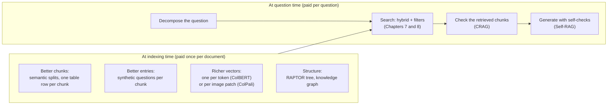
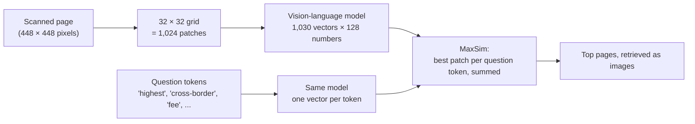
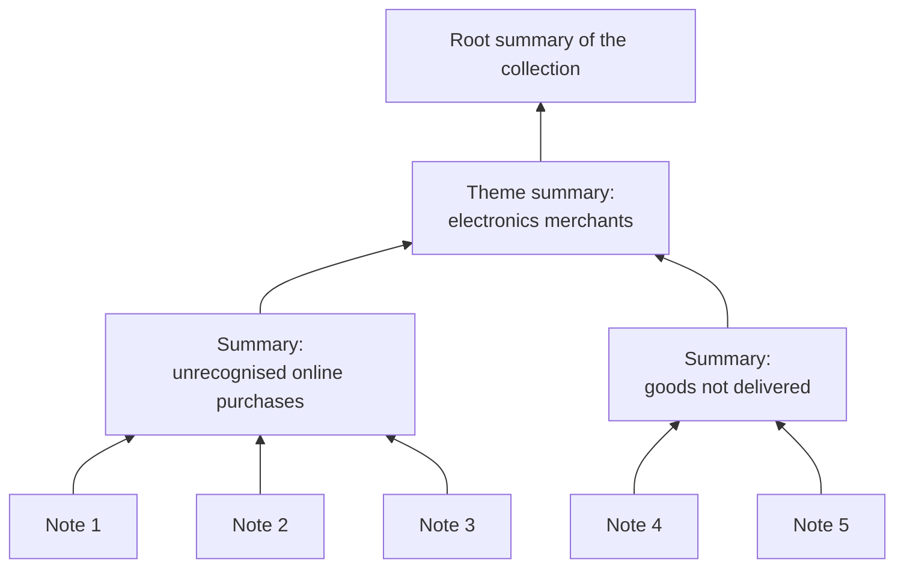
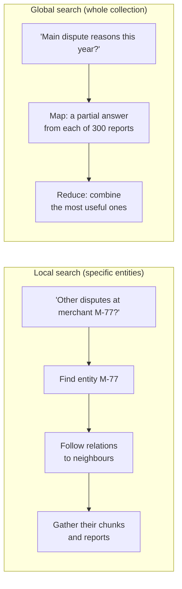
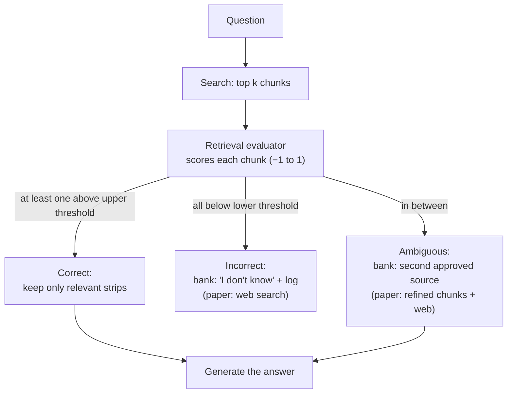

# Advanced RAG

## The big picture

[Chapter 7](07-rag.md#the-big-picture) built a retrieval-augmented generation (RAG) pipeline. It cuts documents into chunks, embeds each chunk as a vector, and finds the best chunks with hybrid search and re-ranking. It then puts those chunks in the prompt and answers with citations. [Chapter 8](08-rag-security.md#the-big-picture) made that pipeline safe to run, and [Chapter 12](12-agents.md#the-big-picture) covers models that work in a loop with tools.

This chapter covers the techniques teams add when that pipeline is still not good enough. It matters because each technique costs something. Much of what is written about them mixes real evidence with marketing, and choosing well means being able to tell the two apart. The debate about where retrieval is going, including the claim that "RAG is dead", is the subject of [Chapter 11](11-future-of-rag.md#the-big-picture).

**The running example of this chapter.** The bank's fraud-policy assistant of [Chapter 7](07-rag.md#the-big-picture) and [Chapter 8](08-rag-security.md#the-big-picture) is now in production. It answers analysts' questions from the 120-page fraud-policy manual (229 chunks of 400 tokens). It uses hybrid search, re-ranking and access-control filters. On Chapter 7's small test set it reaches recall@3 = 0.8: for 4 questions out of 5, the right chunk is among the top 3.

The bank now wants more from it. All of the following are made up for illustration:

- **Harder questions with several parts**, such as *"For an R-17 decline, what are the dispute deadline and the business-card chargeback fee, under the 2025 and the 2026 manuals?"*
- **A scanned 12-page chargeback fee schedule** full of tables and a bar chart.
- **The 50,000 case notes of [Chapter 7](07-rag.md#graphrag)**, for questions about the whole collection, such as *"What are the main reasons customers disputed payments at electronics shops this year?"*
- **Questions the manual does not answer at all**, which the assistant should recognise instead of inventing an answer.

**Where basic RAG still fails.** Each technique in this chapter answers one specific failure:

| What goes wrong (bank example) | Technique | Section |
| --- | --- | --- |
| A chunk mixes two topics, or a table is cut in half | Semantic chunking; one table row per chunk | [Better chunks](#better-chunks) |
| The analyst's words never appear in the answering chunk ("contest a charge" vs "dispute a payment") | Synthetic questions | [Better index entries](#better-index-entries) |
| One vector per chunk blurs an exact detail (R-17 ranked only fourth in Chapter 7) | Late interaction (ColBERT) | [Late interaction](#late-interaction-colbert) |
| The answer sits in a scanned table or a chart | Retrieving pages as images (ColPali) | [Pages as images](#retrieving-pages-as-images-colpali) |
| One question hides several (2025 and 2026; deadline and fee) | Sub-query decomposition | [Breaking a question into parts](#breaking-a-question-into-parts) |
| The question is about the whole collection, not one passage | RAPTOR; GraphRAG local and global search | [Whole collection](#questions-about-a-whole-collection) |
| The search found nothing useful, but the model answers anyway | Corrective RAG (CRAG); Self-RAG | [Checking retrieval](#checking-retrieval-before-answering) |
| "Why not put everything in the prompt, or let an agent search?" | The evidence on long context, agentic search and agentic RAG | [Chapter 11](11-future-of-rag.md#three-claims) |

Most of these techniques change the **index**, which is paid for once per document. The others change what happens at **question time**, which is paid for on every question:

The general shape of RAG systems, where they are going, and the names "naive", "advanced" and "modular" RAG come from the survey by Gao and colleagues (2023). This chapter uses plainer names and keeps the bank's numbers throughout.

This chapter covers:

1. [Better chunks](#better-chunks): splitting where the topic changes, and handling tables and code.
2. [Better index entries](#better-index-entries): storing the questions a chunk answers, the mirror image of HyDE.
3. [Late interaction (ColBERT)](#late-interaction-colbert): one vector per token, worked through on the R-17 question.
4. [Retrieving pages as images (ColPali)](#retrieving-pages-as-images-colpali): searching scanned tables and charts without extracting text.
5. [Breaking a question into parts](#breaking-a-question-into-parts): one search per sub-question.
6. [Questions about a whole collection](#questions-about-a-whole-collection): RAPTOR's tree of summaries, and GraphRAG's local and global search.
7. [Checking retrieval before answering](#checking-retrieval-before-answering): CRAG and Self-RAG.
8. [Choosing and measuring a technique](#choosing-and-measuring-a-technique): a decision table, the cost and risk of each technique, and a before-and-after measurement.

## Better chunks

Chapter 7 cut the manual every 350 tokens or at its headings, and [Chapter 8](08-rag-security.md#read-the-documents-structure-first) read the headings from the PDF bookmarks and Word styles. Two kinds of content still break:

- a long section that changes topic halfway through;
- tables and code, whose meaning depends on their layout.

This section shows how to split where the topic changes, and how to cut tables and code into pieces that make sense on their own. It matters because a chunk that mixes two topics produces a vector that is close to neither of them. A table cut in half returns numbers without their column names.

This section covers:

1. [Semantic chunking: splitting where the topic changes](#semantic-chunking-splitting-where-the-topic-changes): sentence distances and a threshold, worked through, and what the evidence says.
2. [Tables and code](#tables-and-code): one table row per chunk, and code cut at its functions.

### Semantic chunking: splitting where the topic changes

**Semantic chunking** places chunk boundaries where the meaning changes, instead of every n tokens:

1. Split the text into sentences.
2. Embed each sentence with the embedding model ([Chapter 7](07-rag.md#one-vector-for-a-whole-passage)).
3. For each pair of neighbouring sentences, compute their **distance**: 1 − their cosine similarity ([Chapter 7](07-rag.md#cosine-similarity-and-the-dot-product)). Sentences about the same thing are close, so their distance is small.
4. Split wherever the distance is unusually large. A common rule is "more than the average distance plus one standard deviation". Another is "above the 95th percentile of all distances".

**Worked example** (made-up distances). Section 4 of the manual has six sentences. Sentences 1 to 3 are about dispute deadlines, and sentences 4 to 6 are about chargeback fees:

| Neighbouring sentences | Distance | Above the threshold of 0.316? |
| --- | --- | --- |
| 1 → 2 | 0.08 | No |
| 2 → 3 | 0.12 | No |
| 3 → 4 | **0.46** | **Yes: split here** |
| 4 → 5 | 0.10 | No |
| 5 → 6 | 0.09 | No |

- The average distance is (0.08 + 0.12 + 0.46 + 0.10 + 0.09) ÷ 5 = 0.85 ÷ 5 = **0.17**.
- The standard deviation is about **0.146** (see the refresher below).
- The threshold is 0.17 + 0.146 = **0.316**. Only the jump from sentence 3 to sentence 4 exceeds it.

The section therefore becomes two chunks: one about deadlines and one about fees. A fixed 400-token cut could have produced one chunk that mixes both.

!!! note "Quick refresher: the standard deviation used as a splitting threshold"
    The **standard deviation** measures how far values typically sit from their average. Compute it in four steps:

    1. Subtract the average from each value.
    2. Square each result.
    3. Average the squares.
    4. Take the square root.

    For the five distances above, with an average of 0.17:

    - Differences from the average: −0.09, −0.05, **+0.29**, −0.07, −0.08.
    - Squares: 0.0081, 0.0025, 0.0841, 0.0049, 0.0064. Their sum is 0.106.
    - Average of the squares: 0.106 ÷ 5 = 0.0212.
    - Square root: √0.0212 ≈ **0.146**.

    A threshold of "average + 1 standard deviation" = 0.17 + 0.146 = **0.316** flags only distances that stand out from the rest. A larger multiplier, such as 2 standard deviations (0.17 + 2 × 0.146 = 0.461), would flag nothing here: 0.46 falls just below it. The multiplier is a setting to tune, which is part of the method's cost.

**What it costs, and whether it helps.** The text is embedded **twice**:

- once sentence by sentence, to find the boundaries (the manual's 60,000 words are about 3,000 sentences of about 20 words each);
- once more chunk by chunk, to build the index.

The threshold also has to be tuned. A systematic study by Qu, Tu and Bao (2024, published at NAACL 2025) compared semantic chunking with simple fixed-size chunking on document retrieval, evidence retrieval and answer generation. It found that the extra computation was not justified by consistent gains. On realistic documents (rather than documents artificially stitched together from unrelated texts), fixed-size chunking often did as well or better. Semantic chunking also ignores headings, which [Chapter 8](08-rag-security.md#hierarchical-chunks) relies on for citations and security tags.

The practical rule follows:

- Split on headings first.
- Use semantic splitting only inside sections that are too long for one chunk.
- Keep it only if recall@k on your own test set goes up ([Measuring before and after](#measuring-before-and-after)).

### Tables and code

**Tables.** Section 4.5 of the manual has a fee table (made up):

| Card type | Chargeback fee | Refund time |
| --- | --- | --- |
| Debit | €0 | 10 working days |
| Credit | €0 | 10 working days |
| Business | €25 | 15 working days |

Suppose a fixed cut falls after the "Credit" row. The next chunk then starts with "Business | €25 | 15 working days": a number without its column names. The question *"What chargeback fee applies to a business card?"* finds €25 with no way to tell whether it is a fee, a limit or a refund. The usual fix is to turn each **row** into a self-contained sentence that repeats the context, and index each row as its own chunk:

> *Fraud-policy manual, section 4.5, chargeback fees. Card type: Business. Chargeback fee: €25. Refund time: 15 working days.*

The whole table is kept as a larger **parent** chunk. The search finds the precise row, and the model receives the full table around it, as in [Chapter 7's multi-level chunking](07-rag.md#multi-level-chunking).

**Code.** The bank's fraud team also keeps its scoring rules as Python scripts. Cutting code every 400 tokens can separate a function from its name, or a condition from its body. Instead, a **parser** (the program a programming language uses to read source code) turns each file into an **abstract syntax tree**: a tree of the program's structure, in which every class and function is a node. Each function then becomes one chunk, and its file path and class name are stored as metadata. A question such as *"Above which score is a payment blocked?"* then retrieves the whole `block_if_score_above` function rather than half of it. This retrieval still runs behind the access filters of [Chapter 8](08-rag-security.md#why-the-search-ignores-access-rights), since the threshold is fraud-team-only.

## Better index entries

The index of Chapter 7 holds one vector per chunk. That vector is made from the chunk's own words, which are the manual's words. Analysts, however, ask in their own words. This section shows how to add to the index the questions each chunk answers, and compares this with HyDE from [Chapter 7](07-rag.md#hyde-searching-with-a-hypothetical-answer), which attacks the same gap from the other side. It matters because a vocabulary gap is one of the commonest reasons the right chunk is not found.

This section covers:

1. [Synthetic questions: indexing what a chunk answers](#synthetic-questions-indexing-what-a-chunk-answers): generating questions per chunk at indexing time.
2. [HyDE and synthetic questions compared](#hyde-and-synthetic-questions-compared): when each one is paid for, and what each one risks.

### Synthetic questions: indexing what a chunk answers

A question and a policy passage are different kinds of text, as [Chapter 7](07-rag.md#hyde-searching-with-a-hypothetical-answer) explained. **Synthetic question generation**, known in the research literature as **document expansion** or **doc2query** (Nogueira and colleagues, 2019), closes this gap at indexing time:

1. For each chunk, ask a model to write a few questions that the chunk answers.
2. Embed each question, and store it in the index with a pointer to its chunk.
3. At question time, search over chunks **and** generated questions. When a generated question matches, return the chunk it points to. If several of a chunk's questions match, count the chunk once, with its best score.

**Worked example** (made-up similarities). For chunk A, the 120-day rule, the model writes three questions:

- *"How long can a customer dispute a card payment?"*
- *"What is the deadline for a card dispute?"*
- *"From which date does the dispute period start?"*

An analyst then asks: *"How long does a cardholder have to contest a charge?"* None of "cardholder", "contest" or "charge" appears in chunk A.

| Compared with the analyst's question | Cosine similarity |
| --- | --- |
| Chunk A's own text | 0.71 |
| Generated question 1, *"How long can a customer dispute a card payment?"* | **0.93** |

The generated question is a question about a time limit, like the analyst's. Its vector is therefore much closer, and chunk A moves up the ranking.

**Cost.** Generation costs one model call per chunk, paid once: **229 calls** for the manual. With three questions per chunk, the index holds 229 × (1 + 3) = **916 vectors** instead of 229. At 1,024 numbers in 32-bit format ([Chapter 7](07-rag.md#what-a-vector-database-stores)), that is 916 × 1,024 × 4 = 3,751,936 bytes, about **3.75 MB** instead of 0.94 MB. Questions must be regenerated for every chunk that changes.

**Risk.** The generated questions are text written by a model and stored in the index, so they are **derived content**:

- They must carry the security tags and provenance of their chunk ([Chapter 8](08-rag-security.md#security-metadata-and-a-filtered-search)).
- A poisoned chunk ([Chapter 8](08-rag-security.md#data-poisoning)) gets three more vectors, so three more chances to rank first.

The rule is therefore: generate questions only from approved, already-scanned chunks, and regenerate them whenever the source chunk is corrected.

### HyDE and synthetic questions compared

Both techniques move the question and the passage into the same kind of text. They do it from opposite ends:

| | HyDE ([Chapter 7](07-rag.md#hyde-searching-with-a-hypothetical-answer)) | Synthetic questions |
| --- | --- | --- |
| What the model writes | A hypothetical **answer** to the user's question | Likely **questions** for each chunk |
| When it is paid | At every question | Once per chunk, at indexing |
| Model calls for the bank (20,000 questions a month) | 20,000 a month | 229 once, plus one per changed chunk |
| Extra waiting time per question | One model call before the search | None |
| What is stored | Nothing: the hypothetical answer is thrown away | The questions, which persist |
| Main risk | A misleading hypothetical answer steers the search | A bad or poisoned question stays in the index until it is regenerated |

They can be combined, but synthetic questions are usually tried first. They add no waiting time per question, and their cost does not grow with traffic.

## Late interaction (ColBERT)

[Chapter 7](07-rag.md#bi-encoder-vs-cross-encoder) presented two ways to compare a question with a chunk:

- A **bi-encoder** turns each into one vector, which is fast, but blurs details.
- A **cross-encoder** reads both together, which is precise, but has to be redone for every pair at question time.

**Late interaction**, introduced by ColBERT (Khattab and Zaharia, 2020), sits between the two. This section explains the idea, works through the R-17 question by hand, and computes what it costs to store. It matters because exact details such as codes, amounts and names are exactly what single-vector search loses, and they are what a bank's questions turn on.

This section covers:

1. [One vector per token](#one-vector-per-token): keep every token's vector, and match token by token.
2. [Worked example: MaxSim finds R-17](#worked-example-maxsim-finds-r-17): single-vector search and late interaction on the same two chunks.
3. [The storage cost of one vector per token](#the-storage-cost-of-one-vector-per-token): why it is usually a re-ranking stage.

### One vector per token

ColBERT encodes the question and each chunk **separately**, like a bi-encoder, so the chunks can still be encoded in advance. The difference is what it keeps: instead of averaging the token vectors into one ([mean pooling, Chapter 7](07-rag.md#one-vector-for-a-whole-passage)), it keeps **one small vector per token**, of 128 numbers in the original model.

At question time, each question token looks for the single chunk token it matches best. The chunk's score is the sum of these best matches. This is the **MaxSim** operator:

$$
\text{score}(q, d) = \sum_{i=1}^{|q|} \max_{j=1}^{|d|} \; q_i \cdot d_j
$$

- **q₁ … q|q|** are the question's token vectors, and **d₁ … d|d|** are the chunk's token vectors.
- For each question token **qᵢ**, the maximum picks the chunk token with the highest dot product.
- The sum adds up these best matches, one per question token.

The question and the chunk "interact" only at this last step, after both have been encoded: hence the name late interaction. A cross-encoder lets them interact inside every attention layer, which is why it cannot be prepared in advance.

### Worked example: MaxSim finds R-17

The analyst asks *"Can a customer dispute a payment declined with code R-17?"*. In Chapter 7, single-vector search ranked chunk D, which lists the decline codes, only fourth. Take made-up 2-number token vectors, where position 1 roughly stands for "disputes and payments" and position 2 for "decline codes and blocking". They are not normalised, to keep the arithmetic easy; real ColBERT vectors are.

Three question tokens:

| Question token | Vector |
| --- | --- |
| dispute | [0.9, 0.1] |
| R-17 | [0.1, 0.99] |
| declined | [0.3, 0.8] |

And four tokens for each of two chunks:

| Chunk D (decline codes) | Vector | Chunk B (card blocking) | Vector |
| --- | --- | --- | --- |
| R-17 | [0.1, 0.99] | card | [0.5, 0.3] |
| suspected | [0.3, 0.6] | blocked | [0.2, 0.7] |
| fraud | [0.4, 0.5] | fraud | [0.4, 0.5] |
| blocked | [0.2, 0.7] | new | [0.3, 0.1] |

**Single vector (mean pooling).** Each text is averaged into one vector:

- the question becomes [0.433, 0.630];
- chunk D becomes [0.250, 0.698];
- chunk B becomes [0.350, 0.400].

The cosine similarities are then **0.967** for chunk D and **0.993** for chunk B. **Chunk B wins.** Averaging diluted the one token that mattered: "R-17" is one of four tokens in chunk D, and its strong second number was pulled down by the others.

**Late interaction (MaxSim).** Each question token keeps its best match:

| Question token | Best match in chunk D | Best match in chunk B |
| --- | --- | --- |
| dispute [0.9, 0.1] | fraud: 0.9×0.4 + 0.1×0.5 = **0.410** | card: 0.9×0.5 + 0.1×0.3 = **0.480** |
| R-17 [0.1, 0.99] | R-17: 0.1×0.1 + 0.99×0.99 = **0.990** | blocked: 0.1×0.2 + 0.99×0.7 = **0.713** |
| declined [0.3, 0.8] | R-17: 0.3×0.1 + 0.8×0.99 = **0.822** | blocked: 0.3×0.2 + 0.8×0.7 = **0.620** |
| **Score (sum)** | **2.222** | **1.813** |

**Chunk D wins**, because the question's "R-17" found an almost identical token in chunk D. Keeping one vector per token preserves exactly the kind of detail that averaging wipes out.

!!! tip "Key idea: why averaging loses a rare token, and why MaxSim keeps it"
    Mean pooling gives every token of a 400-token chunk the same weight of 1/400. A code that appears once contributes 0.25% of the chunk's vector, so the vector says what the chunk is mostly about: "a list of codes and reasons". It does not record which code the list contains.

    MaxSim never averages over the chunk's tokens. For each question token it takes the **maximum** over the chunk's tokens, so one perfectly matching token is enough to score high, however many other tokens surround it. This is the same reason BM25 rewards a rare word ([Chapter 7](07-rag.md#bm25-in-plain-words)). Here the match is between learned vectors in context, so "R-17" can also match a near-variant such as "R17" or "code R 17", which BM25's exact word matching would miss.

### The storage cost of one vector per token

One vector per token means far more numbers:

| Index | Vectors | Calculation | Size |
| --- | --- | --- | --- |
| Manual, one 1,024-number vector per chunk, 32-bit ([Chapter 7](07-rag.md#what-a-vector-database-stores)) | 229 | 229 × 1,024 × 4 bytes | ≈ **0.94 MB** |
| Manual, one 128-number vector per token, 16-bit | 229 × 400 = 91,600 | 91,600 × 128 × 2 bytes | ≈ **23.4 MB** |
| 10 million bank chunks, one vector per chunk, 32-bit ([Chapter 7](07-rag.md#approximate-nearest-neighbour-search)) | 10,000,000 | 10,000,000 × 1,024 × 4 bytes | ≈ **41 GB** |
| 10 million bank chunks, one vector per token, 16-bit | 4,000,000,000 | 4,000,000,000 × 128 × 2 bytes | ≈ **1 TB** |

The index is about 25 times larger. ColBERTv2 (Santhanam and colleagues, 2022) compresses each token vector by storing it as a nearby shared "centroid" vector plus a small correction. The paper reports that this reduces the storage of late-interaction models by 6 to 10 times, which still leaves a large index.

In practice, many systems therefore use late interaction as a **re-ranking stage**:

1. Hybrid search finds about 100 candidates cheaply.
2. ColBERT re-scores those candidates from their stored token vectors.

This costs much less than a cross-encoder reading 100 pairs, and keeps most of the precision.

| | Bi-encoder | Late interaction (ColBERT) | Cross-encoder |
| --- | --- | --- | --- |
| Stored per chunk | 1 vector | 1 vector per token (400 for a chunk) | Nothing: reads the text at question time |
| How question and chunk meet | One dot product | Token by token, after encoding (MaxSim) | Inside every attention layer |
| Chunk work done in advance | Yes | Yes | No |
| Exact details such as R-17 | Often blurred | Kept | Kept |
| Storage for the manual | 0.94 MB | 23.4 MB (16-bit, before compression) | None |

## Retrieving pages as images (ColPali)

Every technique so far assumes the document has already been turned into text. For the bank's scanned 12-page chargeback fee schedule, that assumption fails: its meaning is in tables, column positions and a bar chart. This section explains why text extraction loses that meaning, how ColPali searches page images directly, and what it costs. It matters because a large share of company documents are slides, scanned forms and reports whose layout carries the information.

This section covers:

1. [Why text extraction fails on visual pages](#why-text-extraction-fails-on-visual-pages): what OCR and layout parsing lose.
2. [How ColPali scores a page](#how-colpali-scores-a-page): patches, vectors and MaxSim.
3. [Storage, answers and risks](#storage-answers-and-risks): the price of 1,030 vectors per page, and new security checks.

### Why text extraction fails on visual pages

The usual pipeline for a scanned PDF runs several steps one after another:

1. **OCR** (optical character recognition) turns the pixels into characters.
2. A **layout model** guesses where the columns, tables and headings are.
3. The text is chunked and embedded as in [Chapter 7](07-rag.md#chunking-cutting-documents-into-pieces).

Each step can lose information:

- OCR can read "€25" as "C25".
- The layout model can merge two columns, so "Business" lands next to the wrong fee.
- A bar chart showing that chargebacks doubled in March becomes no text at all.

The analyst asks *"Which card type has the highest cross-border chargeback fee?"*. The answer depends on which number sits in which row and column, which is exactly what flat text loses.

### How ColPali scores a page

**ColPali** (Faysse and colleagues, 2024) skips the text-extraction steps. It treats each page as an **image**, and searches it with the late interaction of the [previous section](#late-interaction-colbert):

1. Render each page as an image of 448 × 448 pixels.
2. Cut it into a grid of 32 × 32 = **1,024 patches** of 14 × 14 pixels.
3. A **vision-language model** (a model that reads both images and text; ColPali is built on Google's PaliGemma-3B) turns each patch into a vector. Thanks to attention ([Chapter 1](01-transformers.md#scaled-dot-product-attention-step-by-step)), each vector also carries what the surrounding patches show. A small final layer projects each vector to **128 numbers**. With 6 extra tokens the model adds, a page becomes **1,030 vectors**.
4. At question time, the question's tokens are embedded into the same space, and each page is scored with **MaxSim**. Each question token finds the patch it matches best, for example the token "Business" finding the patch containing that row label.

The authors also released **ViDoRe**, a benchmark of page-level retrieval on visually rich documents. On it, ColPali clearly outperformed pipelines built on text extraction. Its successors replace PaliGemma with other vision-language models, but keep the same design.

### Storage, answers and risks

**Storage** (32-bit numbers unless stated):

- **One page:** 1,030 × 128 × 4 bytes = 527,360 bytes ≈ **0.53 MB**.
- **The 12-page fee schedule:** 12 × 0.53 MB ≈ **6.3 MB**.
- **A million pages of bank archives:** ≈ **527 GB**, or about **264 GB** in 16-bit.

The same million pages with one 1,024-number vector per page would take 1,000,000 × 4,096 bytes ≈ **4.1 GB**, about 129 times less. ColPali is therefore used for the collections where layout matters, not for everything.

**Answers.** What comes back is a page **image**, so the answer must be written in one of two ways:

- by a model that can read images;
- from the OCR text of that single page, used only for writing the answer and not for searching.

The citation is the page. Checking faithfulness ([Chapter 7](07-rag.md#answer-metrics-faithfulness-and-answer-relevance)) is harder, because the judge must also see the image.

**Risks.** [Chapter 8](08-rag-security.md#defences-in-layers) scans **extracted text** for hidden instructions and personal data. Text drawn inside an image never passes through that scanner. Indexing pages as images therefore needs scanners that work on images too, for example OCR of every page used only for checks, before the page is admitted to the index.

## Breaking a question into parts

The basic pipeline runs **one** search per question. A question that combines several needs gets one vector that is a compromise between them, and the top 5 chunks may cover only some of the needs. This section shows how to split such a question into sub-questions that are each searched on their own, and how this differs from multi-query search and from agents. It matters because analysts' real questions often compare versions, products or rules.

This section covers:

1. [Sub-query decomposition](#sub-query-decomposition): the four-part R-17 question, worked through.
2. [Decomposition, multi-query and agents compared](#decomposition-multi-query-and-agents-compared): three ways to run several searches.

### Sub-query decomposition

**Sub-query decomposition** asks a model to split the question into independent sub-questions. It then searches for each one separately, merges the chunks, removes duplicates, and answers from all of them.

**Worked example** (made up). The analyst asks: *"For a payment declined with code R-17, how many days does the customer have to dispute it, and what chargeback fee applies to a business card, under the 2025 and the 2026 manuals?"* The model returns four sub-questions. Each one runs with the validity-date filter of [Chapter 8](08-rag-security.md#validity-dates-keeping-old-versions-out), using a date that falls in the right year:

| Sub-question | Validity date in the filter | Top 3 chunks |
| --- | --- | --- |
| Dispute deadline for an R-17 decline | 20250630 | 2025 manual 4.2, 7.1, 4.4 |
| Dispute deadline for an R-17 decline | 20261020 | 2026 manual 4.2, 7.1, 4.4 |
| Chargeback fee for a business card | 20250630 | 2025 manual 4.5, 4.5 (table row), 7.1 |
| Chargeback fee for a business card | 20261020 | 2026 manual 4.5, 4.5 (table row), 7.1 |

- The four searches return 4 × 3 = 12 chunks.
- Four are duplicates: section 7.1 appears in every list, and the decline codes did not change between versions, so it counts once.
- That leaves **8 unique chunks** for the prompt.
- The prompt is 8 × 400 + 300 = **3,500 tokens**, compared with 2,300 for a simple question, plus one short model call for the decomposition.

A single search with the whole question would most likely have returned a mix of the 2026 chunks only. The model would then have either guessed the 2025 rules or silently left them out.

### Decomposition, multi-query and agents compared

| | Multi-query ([Chapter 7](07-rag.md#query-rewriting)) | Sub-query decomposition | Agentic RAG ([Chapter 7](07-rag.md#agentic-rag), [Chapter 12](12-agents.md#the-agent-loop)) |
| --- | --- | --- | --- |
| What the searches contain | The **same** question, reworded | **Different** questions, one per need | Whatever the model decides, one step at a time |
| When the plan is made | Before searching | Before searching, in one step | After each result, step by step |
| Autonomy ([Chapter 12](12-agents.md#degrees-of-autonomy)) | Low: a fixed workflow | Low: a fixed workflow | Medium |
| Model calls per question | 1 rewrite + 1 answer | 1 split + 1 answer | Several (one per step) |
| Good for | Vocabulary gaps | Questions whose parts are known in advance | Questions whose next step depends on what was found |

Decomposition is a **workflow** in Chapter 12's sense: the developer fixes the steps, and the model only fills them in. That makes it predictable and cheap. When the second search depends on the first answer (*"find the merchant of this dispute, then check its other disputes"*), the plan cannot be made in advance, and an agent is needed.

## Questions about a whole collection

Some questions are not answered by any single passage. *"What are the main reasons customers disputed payments at electronics shops this year?"*, asked over 50,000 case notes, needs a view of the whole collection. Five retrieved chunks give five anecdotes. This section explains two ways of preparing a collection for such questions: RAPTOR's tree of summaries, and GraphRAG's local and global search. It also explains the access-control rule that both of them need. It matters because these indexes are expensive to build, so it pays to know which questions justify them.

This section covers:

1. [RAPTOR: a tree of summaries](#raptor-a-tree-of-summaries): clustering and summarising, level after level, worked through on the case notes.
2. [GraphRAG: local and global search](#graphrag-local-and-global-search): triples, communities, and the two ways of querying them.
3. [Derived text inherits its sources' rights](#derived-text-inherits-its-sources-rights): who may read a summary.

### RAPTOR: a tree of summaries

[Chapter 7's multi-level chunking](07-rag.md#multi-level-chunking) indexes two levels by hand: a summary of each document and its chunks. **RAPTOR** (recursive abstractive processing for tree-organised retrieval, Sarthi and colleagues, 2024) builds as many levels as the collection needs, automatically:

1. Cut the collection into short leaf chunks (about 100 tokens in the paper) and embed them.
2. Group similar chunks into **clusters**. The paper first shrinks the vectors to a few numbers with a method called UMAP, then groups them with a **Gaussian mixture model**. This allows "soft" clustering, so a note about both card testing and non-delivery can belong to two clusters.
3. Ask a model to write a summary of each cluster, and embed each summary.
4. Repeat steps 2 and 3 on the summaries, level after level, until there is too little left to cluster.

**Worked example** (made up). Each of the 50,000 case notes is short enough to be one leaf. Suppose clusters hold about 10 members at every level:

| Level | Nodes | What a node is |
| --- | --- | --- |
| 0 (leaves) | 50,000 | One case note each |
| 1 | 5,000 | A summary of about 10 notes |
| 2 | 500 | A summary of about 10 level-1 summaries |
| 3 | 50 | A theme, such as "electronics merchants" |
| 4 | 5 | A broad area, such as "card-not-present fraud" |
| 5 (root) | 1 | The whole collection |

- Building the tree costs one model call per summary: 5,000 + 500 + 50 + 5 + 1 = **5,556 calls**, once.
- The index then holds 50,000 + 5,556 = **55,556** embedded nodes.
- Soft clustering puts some notes in more than one cluster, so a real tree has somewhat more nodes.

**Searching the tree.** The paper tested two ways:

- **Tree traversal:** start at the top, choose the most relevant summaries, and go down their branches.
- **Collapsed tree:** put all 55,556 nodes, leaves and summaries alike, into one index, and run an ordinary top-k search that fills a token budget.

The collapsed tree did better in the paper's experiments, and it is the simpler of the two to run: it is just Chapter 7's search over a richer index.

For the electronics question, the collapsed search returns, for example:

- a level-3 summary: *"About 2,100 notes concern electronics merchants; the commonest reasons are unrecognised online purchases, goods not delivered, and card testing."*
- a few level-1 summaries and leaf notes, as concrete examples for the answer to cite.

The paper reports state-of-the-art results on several question-answering benchmarks that need reasoning across long documents. For example, paired with GPT-4, RAPTOR improved the best accuracy on the QuALITY benchmark by 20 percentage points.

**What it costs over time.** Case notes arrive every day. A new note changes the summaries on its path to the root: 5 summaries at levels 1 to 5 in the table above. Most teams therefore rebuild the affected branches in a nightly batch. Between rebuilds, the summaries are slightly out of date.

### GraphRAG: local and global search

[Chapter 7](07-rag.md#graphrag) introduced **GraphRAG** (Edge and colleagues, 2024):

1. A model extracts entities and relations from every chunk.
2. The graph is split into communities.
3. A model writes a summary, called a **community report**, for each community.

This section adds how the graph is stored and the two ways of querying it.

**Triples.** Each relation is stored as a **triple**, subject → relation → object. From the dispute case of [Chapter 12](12-agents.md#worked-example-one-dispute-step-by-step), for example:

- *Customer C-104 → disputed → transaction T-88231*;
- *T-88231 → was made at → merchant M-77 (electronics shop, Lisbon)*;
- *merchant M-77 → matches → fraud pattern "card testing"*.

**Communities.** The **Leiden algorithm** (Traag and colleagues, 2019) groups entities that are densely connected to each other, at several levels of detail: small tight groups inside larger ones. A model writes one report per community.

**Local search** answers questions about specific entities:

1. Find the entities named in the question.
2. Follow their relations to their neighbours.
3. Gather the text chunks and community reports attached to them.

*"Which other customers disputed payments at merchant M-77?"* starts at M-77 and follows its "was made at" relations. A local search typically reads a few thousand tokens, like ordinary RAG.

**Global search** answers questions about the whole collection, in two steps:

- **Map:** the model reads every community report at a chosen level, and writes a partial answer from each one, with a score for how useful it is.
- **Reduce:** the most useful partial answers are combined into one final answer.

**Worked example** (made-up sizes). The chosen level has 300 community reports of about 1,000 tokens each. One global question then reads about 300 × 1,000 = **300,000 input tokens** in the map step, which costs 300,000 × $3 ÷ 1,000,000 = **$0.90** at Chapter 7's price. A RAG question of 2,300 tokens costs about **$0.007**: the global question costs roughly 130 times more.

Building the graph costs at least one model call per case note: **50,000 extraction calls**, plus one call per community report.

**When it is worth it.** Global search makes sense for a few expensive questions, such as a monthly risk report, not for every analyst's question. Because the relations are extracted by a model from case notes that include customers' own letters, they can also be **poisoned** ([Chapter 8](08-rag-security.md#data-poisoning)). Each triple should therefore record which chunk it came from.

### Derived text inherits its sources' rights

RAPTOR summaries, GraphRAG reports, contextual prefixes ([Chapter 7](07-rag.md#contextual-retrieval)) and synthetic questions are all **derived content**: text written by a model from indexed chunks. A summary can reveal what its sources say, so it must be protected like them. Three rules follow from [Chapter 8](08-rag-security.md#security-metadata-and-a-filtered-search):

1. **The most restrictive rights win.** A derived text may be read only by the groups allowed to read **all** its sources: the intersection of their `allowed_groups`.
   - *Example* (made up): a level-1 summary covers 10 notes. Nine are tagged `["fraud_team", "customer_service"]`, and one is tagged `["fraud_team"]` because it describes the blocking threshold.
   - The summary is therefore tagged `["fraud_team"]` only. Otherwise a customer-service agent could read, in the summary, what they may not read in the note.
2. **Record the sources.** Each derived text stores the IDs of the chunks it was made from, for example in a `derived_from` field. This is so that a poisoned or corrected chunk can be traced to everything generated from it.
3. **Regenerate on change.** When a source chunk is corrected, removed or re-tagged, everything derived from it is regenerated, or at least re-tagged.

Applying the intersection rule at every level has a cost: high-level summaries end up readable by fewer people. For collections with very different access levels, it is often better to build **separate trees or graphs per access group** ([partitioning, Chapter 8](08-rag-security.md#filter-before-or-after-the-search)).

## Checking retrieval before answering

The pipeline of Chapter 7 passes the top chunks to the model even when none of them is relevant. The prompt's "I don't know" instruction ([Chapter 7](07-rag.md#the-prompt-template)) helps, but it relies on the model noticing. This section presents two methods that check the retrieved chunks explicitly: Corrective RAG, which adds a separate evaluator, and Self-RAG, which trains the model to critique its own retrieval. It matters because an irrelevant chunk can mislead the model into a confident, cited, wrong answer, which is worse than no retrieval at all.

This section covers:

1. [Corrective RAG (CRAG)](#corrective-rag-crag): an evaluator, three branches, and what a bank should do on the "incorrect" branch.
2. [Self-RAG: a model that critiques itself](#self-rag-a-model-that-critiques-itself): reflection tokens, and why few teams can use it directly.

### Corrective RAG (CRAG)

**Corrective RAG** (Yan and colleagues, 2024) places a small **retrieval evaluator** between the search and the answer. In the paper, this is a fine-tuned T5-large model. It reads each (question, chunk) pair and gives a relevance score between −1 and 1. Two thresholds then choose one of three actions:

- **Correct:** at least one chunk scores above the upper threshold. The chunks are **refined** with a method the paper calls decompose-then-recompose: each chunk is cut into short strips (about a sentence each), the strips are scored, and only the relevant ones are kept.
- **Incorrect:** every chunk scores below the lower threshold. The chunks are thrown away, and the paper searches the **web** instead.
- **Ambiguous:** anything in between. The refined chunks are combined with web results.

The thresholds are tuned on validation data for each dataset. For the PopQA dataset, the paper used 0.59 and −0.99.

**Worked example** (made-up scores, with thresholds of 0.5 and −0.5). Three analyst questions, each with its top 3 chunks:

| Question | Evaluator scores | Action | What the bank's assistant does |
| --- | --- | --- | --- |
| How many days to dispute a card payment? | 0.82, 0.31, −0.40 | **Correct** (0.82 > 0.5) | Keeps the relevant strips: 3 × 400 = 1,200 tokens become about 250, then answers |
| What is the policy on transfers to cryptocurrency exchanges? (not in the manual) | −0.71, −0.83, −0.90 | **Incorrect** (all < −0.5) | Answers "I don't know: the policy documents do not cover this", and logs the question for the policy team |
| Can a customer dispute a contactless payment made with a stolen phone? | 0.12, −0.20, −0.60 | **Ambiguous** | Searches a second **approved** collection (the bank's procedures), then answers with a warning that the evidence is partial |

The last column departs from the paper on purpose. A web search brings untrusted internet text into the prompt. This contradicts [Chapter 8](08-rag-security.md#defences-against-poisoning) (index only trusted, approved sources) and opens the door to [indirect prompt injection](08-rag-security.md#indirect-prompt-injection). In a bank, the fallback is a second **approved** source, or an honest "I don't know", never the open web.

**Cost and a shortcut.** The evaluator reads every retrieved chunk with the question, which is the same shape of work as the cross-encoder re-ranker of [Chapter 7](07-rag.md#re-ranking). Many teams therefore reuse the **re-ranker's scores** as the evaluator, with thresholds tuned on their own test set, and so pay for no extra model. The "incorrect" branch is then just a rule: if the best re-ranker score is below the threshold, do not answer from the chunks. That threshold is checked with the test-set questions the manual does not answer ([Chapter 7](07-rag.md#a-test-set-for-the-assistant)).

### Self-RAG: a model that critiques itself

**Self-RAG** (Asai and colleagues, 2023, published at ICLR 2024) builds the checks into the model itself. It fine-tunes a model, Llama 2 with 7 or 13 billion weights in the paper, to write special **reflection tokens** as part of its output:

| Reflection token | Question the model answers about itself |
| --- | --- |
| `[Retrieve]` | Do I need to retrieve passages before writing the next part? |
| `[IsRel]` | Is this retrieved passage relevant to the question? |
| `[IsSup]` | Is what I just wrote fully, partly, or not supported by the passage? |
| `[IsUse]` | How useful is my answer overall, on a scale of 1 to 5? |

At inference, the model can write several candidate continuations, one per retrieved passage. It then keeps the one whose reflection tokens are most favourable. In the paper, this means combining the probability of each reflection token with weights that can be tuned.

**Worked example** (made-up probabilities; the score here is simply the sum of three probabilities, a simplified version of the paper's weighted score). For the running question, the model writes two candidates:

| Candidate | Passage used | P(relevant) | P(fully supported) | P(useful = 5) | Score |
| --- | --- | --- | --- | --- | --- |
| "Customers have 120 days from the transaction date." | Chunk A (dispute deadline) | 0.95 | 0.90 | 0.80 | **2.65** |
| "Customers have 60 days." | Chunk B (card blocking) | 0.40 | 0.20 | 0.60 | **1.20** |

The first candidate is kept. When `[Retrieve]` predicts that no retrieval is needed (for "Thank you, that is all"), the model skips the search entirely. This saves time on questions that do not need documents.

**The catch.** Self-RAG needs a model **fine-tuned** to write these tokens. It cannot be added by prompting a model offered through an API. A bank using a hosted model would have to train and host its own open-weight model. That is why, in practice, its ideas are usually reproduced from outside the model:

- a CRAG-style evaluator to check relevance;
- an [LLM-as-judge](05-evaluation.md#llm-as-judge) or a faithfulness check ([Chapter 7](07-rag.md#answer-metrics-faithfulness-and-answer-relevance)) to check support;
- a router that decides whether to retrieve at all.

## Choosing and measuring a technique

Every technique in this chapter has a cost, and most add a risk. This section gives a way to choose:

- start from the failure you measured, not from the technique you read about;
- check what the technique adds in cost and risk;
- keep it only if the test set improves.

It matters because adding techniques without measuring them is the commonest way a RAG system becomes slow, expensive and no better.

This section covers:

1. [A decision table](#a-decision-table): from a measured symptom to the technique to try first.
2. [What each technique adds in cost and risk](#what-each-technique-adds-in-cost-and-risk): model calls, storage and new security work.
3. [Measuring before and after](#measuring-before-and-after): one technique, scored on Chapter 7's test set.

### A decision table

| Symptom on the test set ([Chapter 7](07-rag.md#evaluating-a-rag-system)) | Likely cause | Try first | Then, if still failing |
| --- | --- | --- | --- |
| Low recall@k when questions contain codes, amounts or names | One vector per chunk blurs exact details | Hybrid search with BM25 ([Chapter 7](07-rag.md#keyword-search-and-hybrid-search)) | Late interaction (ColBERT) as a re-ranking stage |
| Low recall@k when analysts word things differently from the manual | Vocabulary gap | Query rewriting ([Chapter 7](07-rag.md#query-rewriting)) | Synthetic questions; HyDE |
| The right chunk is retrieved but cut off, or mixes topics | Chunk boundaries | Structure-aware chunking ([Chapter 8](08-rag-security.md#read-the-documents-structure-first)) | Semantic splitting inside long sections; one table row per chunk |
| Wrong answers on scanned or visual pages | Text extraction loses the layout | Better OCR and layout parsing | ColPali for those collections |
| Multi-part questions are only partly answered | One search for several needs | Sub-query decomposition | Agentic RAG |
| Whole-collection questions are answered from a few anecdotes | No view of the whole collection | RAPTOR (collapsed tree) | GraphRAG global search, for a few high-value questions |
| Confident answers to questions the manual does not cover | Irrelevant chunks are passed on | An "I don't know" instruction ([Chapter 7](07-rag.md#the-prompt-template)) plus a re-ranker score threshold | A CRAG-style evaluator |
| The collection is small (under about 200,000 tokens) and stable, with one access level | Retrieval may not be needed | Whole collection in the prompt, with prompt caching | Self-Route if quality drops: every question goes through RAG first, and only those RAG cannot answer get the whole collection ([Chapter 11](11-future-of-rag.md#claim-1-long-context-windows-will-make-rag-unnecessary)) |

### What each technique adds in cost and risk

| Technique | Extra model calls | When they are paid | New risk or work | Defence ([Chapter 8](08-rag-security.md#production-checklist)) |
| --- | --- | --- | --- | --- |
| Semantic chunking | None (about twice the embedding work) | Indexing | Can ignore headings needed for citations and tags | Split on headings first |
| Table rows, code by function | None | Indexing | None new | — |
| Synthetic questions | 1 per chunk | Indexing | Stored model text; a poisoned chunk gets more vectors | Inherit tags and provenance; generate only from approved chunks |
| ColBERT | None | — | About 25 times the storage; token vectors reveal text like any embedding | Encrypt at rest, like other vectors |
| ColPali | None (a vision-model pass per page) | Indexing | Instructions or personal data inside images escape text scanners | Image-aware scanning before indexing |
| Sub-query decomposition | 1 per question | Question time | More chunks in the prompt | Filters applied to every sub-query |
| RAPTOR | About 1 per cluster | Indexing, and on every change | Summaries mix sources with different rights; summaries go stale | Intersection of tags; nightly rebuilds |
| GraphRAG | At least 1 per chunk, plus 1 per community; many per global question | Indexing and question time | Relations extracted from untrusted text; costly global queries | Provenance per triple; global search for selected users |
| CRAG | 1 small-model pass per retrieved chunk (or none, reusing the re-ranker) | Question time | The paper's web fallback brings in untrusted text | Fallback only to approved sources, or "I don't know" |
| Self-RAG | None extra, but needs a fine-tuned model | Training, then question time | The bank must train and host its own model | — |
| Agentic RAG | Several per question | Question time | Excessive agency; injected text in tool results | Policy check before every tool call ([Chapter 12](12-agents.md#a-policy-check-before-every-tool-call)) |

### Measuring before and after

**Worked example** (made up). On Chapter 7's 5-question test set, question 4 failed: its right chunk was not in the top 5 ([Chapter 7](07-rag.md#retrieval-metrics-recall-at-k-and-mean-reciprocal-rank)). Reading its trace shows a vocabulary gap: the analyst wrote "contest a charge". The team adds synthetic questions to the index (229 model calls, once) and runs the same test set again:

| Question | Rank before | Rank after | Reciprocal rank after |
| --- | --- | --- | --- |
| 1 | 1 | 1 | 1.000 |
| 2 | 3 | 3 | 0.333 |
| 3 | 2 | 2 | 0.500 |
| 4 | not in the top 5 | **2** | **0.500** |
| 5 | 1 | 1 | 1.000 |

| Metric | Before | After |
| --- | --- | --- |
| recall@3 | 4 ÷ 5 = 0.8 | 5 ÷ 5 = **1.0** |
| MRR | 2.833 ÷ 5 = 0.567 | 3.333 ÷ 5 = **0.667** |

The change is kept. Its indexing cost is small, and it adds nothing to the waiting time per question. On a real test set of a few hundred questions, the team would check three more things:

- that no other question got **worse**;
- that faithfulness did not drop;
- that the gain holds for each user group ([Chapter 8](08-rag-security.md#measuring-retrieval-quality)), since the generated questions inherit their chunks' access tags.

The same before-and-after test applies to every technique in this chapter, and to every claim about the future of RAG.

## Cheat sheet

| Concept | One-line meaning |
| --- | --- |
| Semantic chunking | Split where neighbouring sentences' distance jumps; evidence of gains is mixed (Qu et al., 2024) |
| Table rows as chunks | Each row rewritten as a self-contained sentence; the whole table kept as the parent |
| Code chunking | Cut at functions and classes using the parser's abstract syntax tree |
| Synthetic questions (doc2query) | Index the questions each chunk answers; paid once per chunk |
| HyDE vs synthetic questions | A hypothetical answer per question vs stored questions per chunk |
| Late interaction (ColBERT) | One small vector per token; score = sum over question tokens of their best match (MaxSim) |
| MaxSim | Σᵢ maxⱼ qᵢ · dⱼ: keeps a rare exact token that averaging would dilute |
| ColBERT storage | Manual: 23.4 MB vs 0.94 MB; usually a re-ranking stage; ColBERTv2 compresses 6–10× |
| ColPali | Page image → 1,030 patch vectors × 128 numbers; MaxSim; no OCR for search |
| Sub-query decomposition | Split a question into independent sub-questions; one search each; a workflow |
| RAPTOR | Cluster, summarise, repeat; search all levels at once (collapsed tree) |
| GraphRAG local vs global | Follow one entity's relations vs map-reduce over all community reports |
| Derived content rule | A generated text inherits the most restrictive rights of its sources, and records them |
| CRAG | An evaluator scores retrieved chunks: correct (refine), incorrect, ambiguous; no web fallback in a bank |
| Self-RAG | A fine-tuned model writes reflection tokens: Retrieve, IsRel, IsSup, IsUse |

## Sources

- [Retrieval-Augmented Generation for Large Language Models: A Survey (Gao et al., 2023)](https://arxiv.org/abs/2312.10997): naive, advanced and modular RAG
- [Is Semantic Chunking Worth the Computational Cost? (Qu, Tu and Bao, 2024; Findings of NAACL 2025)](https://arxiv.org/abs/2410.13070): semantic vs fixed-size chunking
- [Document Expansion by Query Prediction (Nogueira et al., 2019)](https://arxiv.org/abs/1904.08375): doc2query, indexing generated questions
- [ColBERT: Efficient and Effective Passage Search via Contextualized Late Interaction over BERT (Khattab and Zaharia, 2020)](https://arxiv.org/abs/2004.12832): late interaction and MaxSim
- [ColBERTv2: Effective and Efficient Retrieval via Lightweight Late Interaction (Santhanam et al., 2022)](https://arxiv.org/abs/2112.01488): residual compression, 6–10× smaller
- [ColPali: Efficient Document Retrieval with Vision Language Models (Faysse et al., 2024)](https://arxiv.org/abs/2407.01449): page images, patch vectors, the ViDoRe benchmark
- [RAPTOR: Recursive Abstractive Processing for Tree-Organized Retrieval (Sarthi et al., 2024; ICLR 2024)](https://arxiv.org/abs/2401.18059): tree of summaries, collapsed-tree search, +20 points on QuALITY
- [From Local to Global: A Graph RAG Approach to Query-Focused Summarization (Edge et al., 2024)](https://arxiv.org/abs/2404.16130): community reports, local and global search
- [From Louvain to Leiden: guaranteeing well-connected communities (Traag et al., 2019)](https://arxiv.org/abs/1810.08473): the Leiden algorithm
- [Corrective Retrieval Augmented Generation (Yan et al., 2024)](https://arxiv.org/abs/2401.15884): retrieval evaluator, three actions, decompose-then-recompose
- [Self-RAG: Learning to Retrieve, Generate, and Critique through Self-Reflection (Asai et al., 2023; ICLR 2024)](https://arxiv.org/abs/2310.11511): reflection tokens