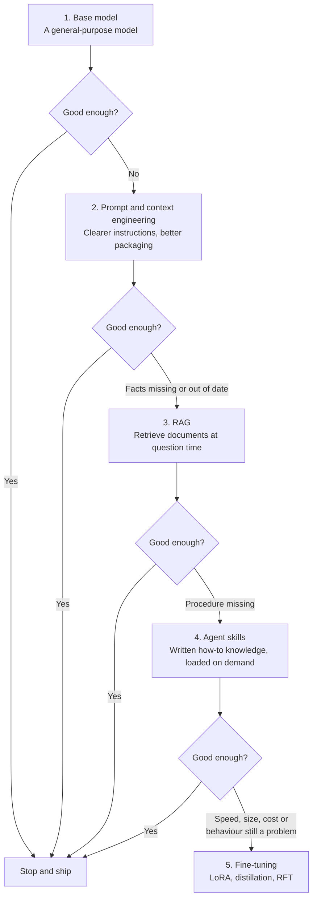
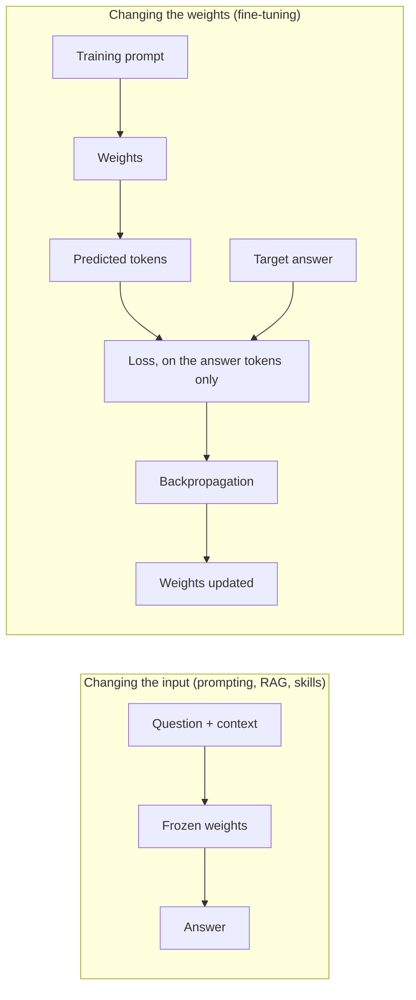
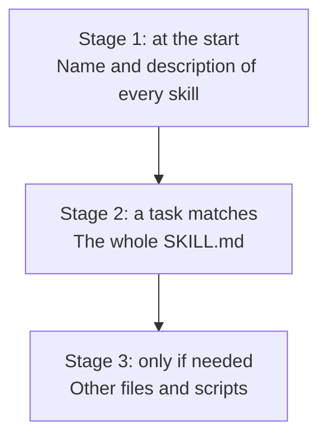
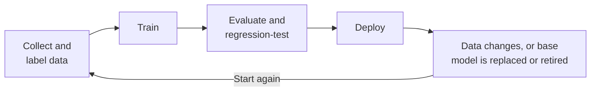
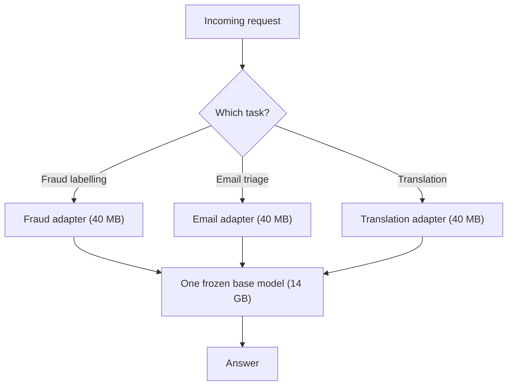
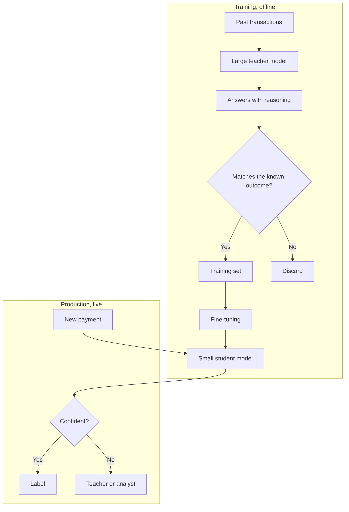
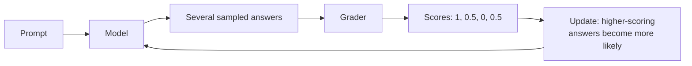
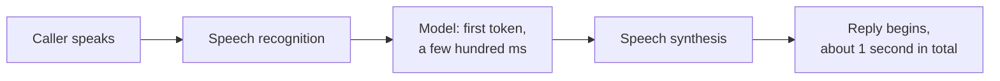

# Fine-tuning: when it is worth changing the weights

## The big picture

**Fine-tuning** means continuing to train a model that has already been trained, on a small dataset of your own, so that its **weights** (the numbers learned in training) change and it becomes better at one job. This chapter explains what fine-tuning is, why it is now used much less often than in 2023, when it is still the right choice, and which techniques are used today.

The main message is simple. **Fine-tuning is the last step, not the first.** A general model, a good prompt, the right documents and a few written procedures now solve most problems that once needed fine-tuning, and they cost far less to build and to keep working. Fine-tuning has not disappeared: it remains useful when a specific problem of speed, size, cost or behaviour is still unsolved after those steps.

!!! tip "Key idea: why fine-tuning is the last step, not the first"
    Changing the text a model reads is fast, cheap and easy to inspect. Changing its weights is slow, costly and hard to inspect.

    - **Prompting, RAG and agent skills** change the **input** at question time. If a policy changes, you edit a document or a prompt. The fix works at once, and it usually moves to a newer model with little work.
    - **Fine-tuning** changes the **weights**. Every change needs data, a training run and new tests. When the base model is retired, the model must be trained again.



The running example is the same bank as in earlier chapters. It labels card transactions as fraud or not fraud, runs a fraud-policy assistant, and handles disputed payments with an agent. All of the bank's numbers in this chapter are made up. The case studies are real, and each states who reported it.

This chapter covers:

1. [What fine-tuning is](#what-fine-tuning-is): what changes in the model, and what fine-tuning can and cannot teach it.
2. [Customising without changing the weights](#customising-without-changing-the-weights): a reminder of context engineering and RAG, and an introduction to agent skills.
3. [Why general models took over much of its job](#why-general-models-took-over-much-of-its-job): long context windows, reasoning at inference, and the moving target.
4. [Case studies: what the evidence shows](#case-studies-what-the-evidence-shows): a legal model and a finance model, and how far each result can be trusted.
5. [When to fine-tune: the decision order](#when-to-fine-tune-the-decision-order): the five steps, four requests from the bank, and whether a project pays for itself.
6. [Modern fine-tuning techniques](#modern-fine-tuning-techniques): LoRA, distillation, reinforcement fine-tuning, and small models for real-time work.

## What fine-tuning is

Before deciding when to fine-tune, you need to know exactly what it changes. This section defines fine-tuning, compares it with changing the prompt, and lists what it can and cannot teach a model. It matters because most fine-tuning mistakes come from expecting it to do a job it cannot do, usually storing facts.

This section covers:

1. [Changing the weights, not the input](#changing-the-weights-not-the-input): what happens during fine-tuning, with an example.
2. [What fine-tuning can and cannot teach](#what-fine-tuning-can-and-cannot-teach): behaviour yes, reliable facts no.

### Changing the weights, not the input

A model turns an input into an output using its weights. There are therefore two ways to change what it writes: change the **input** (the prompt, the documents placed in it) or change the **weights**. Fine-tuning does the second.



Training works the same way as the first time. The model reads an example, predicts the next tokens, a **loss** measures how wrong the prediction was, and **backpropagation** works out how to adjust each weight to reduce that error ([Chapter 2](02-training.md#stage-2-supervised-fine-tuning-sft)). Two things differ: training starts from the finished weights instead of random ones, and the dataset is small and chosen for one job. The usual form is **supervised fine-tuning (SFT)**, where each example is a prompt and the answer you want. The prompt tokens do not count in the loss; only the answer tokens do.

!!! note "Quick refresher: how the prompt is left out of the loss"
    The usual loss adds up one term for each of the $T$ tokens of a sequence. Each term is small when the model gave the true next token a high probability:

    $$
    L = -\sum_{t=1}^{T} \ln P(x_t \mid x_1, \dots, x_{t-1})
    $$

    Here $x_t$ is the token at position $t$, and $P$ is the probability that the model gave it after reading the tokens before it. If tokens 1 to $m$ are the prompt and tokens $m+1$ to $T$ are the answer, fine-tuning multiplies each term by a **mask** $M_t$:

    $$
    L_{\text{SFT}} = -\sum_{t=1}^{T} M_t \ln P(x_t \mid x_1, \dots, x_{t-1}) \qquad M_t = \begin{cases} 0 & \text{if } t \le m \text{ (prompt)} \\ 1 & \text{if } t > m \text{ (answer)} \end{cases}
    $$

    The prompt terms become zero, so the weights are adjusted only to produce the answer.

**Example** (one training example for the bank's fraud labeller, made up):

| Part | Text | Mask $M_t$ | Counts in the loss? |
| --- | --- | --- | --- |
| Prompt | Label this transaction. €2,400, electronics shop, Lisbon, 03:12, card ends in 4417, customer based in Paris. | 0 | No |
| Answer | `FRAUD`, reason code R-17 | 1 | Yes |

After a few thousand such examples, the model has moved towards the bank's labels and format. It now writes that format with no instructions in the prompt.

The two approaches compare as follows:

| | Changing the input | Changing the weights (fine-tuning) |
| --- | --- | --- |
| What changes | The text the model reads, at every question | The model itself, once, during training |
| When it takes effect | At once | After a training run and an evaluation |
| To update it | Edit the text | Collect data and train again |
| Tied to one model? | Mostly not: a prompt usually moves to a new model | Yes: the result belongs to one base model |
| Who can inspect it | Anyone can read a prompt | Nobody can read what changed in billions of numbers |
| What it takes to run | Ordinary application software, and a search index for RAG | Training runs, versions of the trained model, and often separate hosting |

### What fine-tuning can and cannot teach

Fine-tuning teaches **behaviour** far better than it teaches **facts**.

**What it does well:**

- **A fixed format or style**, such as the bank's labels and reason codes, without long instructions in every prompt.
- **A specialised task** that a model gets right only sometimes, by raising how often it gets it right.
- **Shorter prompts**, because what was written in the prompt is now in the weights. This lowers the cost and the delay of every request.

**What it does badly:**

- **Storing facts reliably.** Training on the sentence "a customer has 120 days to dispute a payment" makes that answer more likely, not certain. The model can still mix it up with other numbers, and it cannot say where the fact came from.
- **Facts that change.** When the limit changes, the model must be trained again. RAG only needs the document replaced.
- **Keeping secrets apart.** Text stored in weights is available to every user of the model. RAG can filter chunks by each user's access rights.

Fine-tuning also has a risk of its own. **Catastrophic forgetting** means that training on a new task damages an ability the network already had, because the same weights serve both. A model fine-tuned only on fraud labels may become worse at, for example, writing clear explanations. This is why a fine-tuned model must be tested on what it could already do, and not only on the new task. [LoRA](#lora-a-small-adapter-on-a-locked-model) reduces this risk, because it leaves the original weights unchanged.

## Customising without changing the weights

Before touching the weights, a team can change a model's behaviour from the outside. This section recalls the three methods that do this: context engineering, RAG and agent skills. It matters because each one is cheaper to build than fine-tuning, takes effect at once, and moves easily to a better model when one appears.

This section covers:

1. [Context engineering](#context-engineering): packaging the instructions and data for each request.
2. [RAG](#rag-looking-facts-up-at-question-time): fetching the right documents at question time.
3. [Agent skills](#agent-skills-how-to-knowledge-in-a-folder): written procedures that a model loads when it needs them.

### Context engineering

**Context engineering** means deciding, for every model call, what goes into the **context window** (all the text the model can read for one request) and what stays out. It goes further than writing a clear prompt. The application assembles a bundle: the system prompt (the standing instructions), the data relevant to this request, examples, and the format required for the answer.

**Example** (made up). For the fraud labeller, the bundle could be:

| Part of the bundle | Content |
| --- | --- |
| System prompt | "You label card transactions for the bank's fraud team. Answer `FRAUD` or `OK`, with one reason code." |
| Reference data | The list of reason codes, for example R-17 = suspected fraud, card blocked |
| Examples | Three labelled transactions, chosen to resemble this one |
| This request | The transaction to label, and the customer's usual country and spending |

The examples alone often deliver the fixed format that a team would otherwise fine-tune for. This is **in-context learning**: the model picks up the pattern from examples in the prompt, with no change to its weights ([Chapter 6](06-prompting.md#in-context-learning)). [Chapter 10](10-future-of-rag.md#from-rag-to-context-engineering) discusses context engineering as the direction RAG is taking.

### RAG: looking facts up at question time

**Retrieval-augmented generation (RAG)** searches a document collection at question time and places the most relevant passages in the prompt, so that the model answers from them ([Chapter 7](07-rag.md#the-big-picture)).

**Example.** An analyst asks: "How many days does a customer have to dispute a card payment?" The search finds section 4.2 of the bank's fraud-policy manual and puts it in the prompt, and the model answers "120 days [section 4.2]". If the limit changes tomorrow, the bank replaces one document and the next answer is correct. A fine-tuned model would keep saying 120 until it was trained again.

RAG is the right tool when the knowledge is **fresh, changing or private**. It also gives what fine-tuning cannot: a citation to check, and a filter on what each user may see.

### Agent skills: how-to knowledge in a folder

An **agent** is a model that works in a loop: it decides on a step, asks the application to run a tool, reads the result and decides again ([Chapter 11](11-agents.md#the-big-picture)). RAG gives an agent facts. A **skill** gives it a **procedure**: how to do a task, step by step.

In Anthropic's definition, a skill is, at its simplest, a folder that contains a file called `SKILL.md`. That file starts with a name and a description, followed by instructions. The folder can also hold more documents and scripts. Example, for the bank's dispute agent (made up):

```text
open-card-dispute/
├── SKILL.md              name, description, then the steps of the procedure
├── network-claims.md     read only when a refund goes through the card network
└── check_limits.py       a script that checks a refund against the limits
```

The important idea is **loading in stages**, which Anthropic calls progressive disclosure:



1. At the start, the agent reads only each skill's **name and description**, enough to know that the skill exists.
2. When a task matches, it reads the whole `SKILL.md`.
3. It opens the other files only if the task needs them.

**Worked example** (made-up sizes). The bank has 12 skills, each with a 100-token description and a 2,000-token `SKILL.md`.

| Approach | Tokens read for one dispute |
| --- | --- |
| All instructions in the prompt, always | 12 × 2,000 = **24,000** |
| Skills: every description, plus the one skill used | 12 × 100 + 2,000 = **3,200** |

The skill approach reads 7.5 times fewer tokens, and the bank can give the agent more procedures without making each request much longer.

Skills change the case for fine-tuning. A team that wants a model to write SQL queries for its own database once had a reason to fine-tune on SQL examples. Today a general model can usually write good SQL, so a skill that describes the tables, gives the query patterns and includes a script to run them may be enough. The procedure stays readable and is updated by editing a file.

!!! warning "A skill is code you run"
    A skill can contain instructions and scripts that the agent will follow, so a malicious skill can do real harm. Anthropic advises installing skills only from trusted sources and auditing the others before use.

## Why general models took over much of its job

In 2023, fine-tuning was often the obvious way to make a model useful for a company. Three changes have narrowed its role since then. This section explains each one, with what it does and does not prove. It matters because these reasons, not fashion, are why fine-tuning moved to the end of the decision order.

This section covers:

1. [Much larger context windows](#much-larger-context-windows): documents can go in the prompt instead of in the weights.
2. [Reasoning at inference](#reasoning-at-inference): the model works problems out while answering.
3. [The moving target](#the-moving-target): a fine-tuned model is expensive to keep, and the next general model may pass it.

### Much larger context windows

Early GPT-3 models accepted about 2,000 tokens in total. Google announced a 1-million-token window in 2024 with Gemini 1.5 Pro, and Anthropic's documentation now lists a 1-million-token window for most of its current models. That is about 488 times larger.

**Worked example.** The bank's fraud-policy manual has 120 pages and 80,000 tokens, or about 667 tokens per page.

| Context window | Pages of the manual that fit |
| --- | --- |
| 2,048 tokens | 2,048 ÷ 667 ≈ **3** |
| 1,000,000 tokens | 1,000,000 ÷ 667 ≈ **1,500** |

With a window of three pages, teams had a real reason to look for a way of getting knowledge into the weights. With a window of 1,500 pages, the whole manual fits in the prompt, which removes that reason.

A long window is not free, however. Each question pays for every token in the prompt, and models use the middle of a very long text less reliably, an effect called **lost in the middle** ([Chapter 3](03-inference.md#a-bigger-window-is-not-a-perfect-memory)). A large window can replace fine-tuning on documents, but it does not always replace RAG ([Chapter 10](10-future-of-rag.md#claim-1-long-context-windows-will-make-rag-unnecessary)).

### Reasoning at inference

**Inference** is the use of a trained model, with its weights frozen. A **reasoning model** writes out its thinking in extra tokens at inference, before it gives its answer ([Chapter 6](06-prompting.md#reasoning-models-thinking-before-answering)). It can work through a new problem step by step, instead of depending only on patterns stored when it was trained months earlier.

**Example** (a made-up rule). A refund above €1,000 needs an analyst's approval, unless the merchant has already refunded part of it. A team might once have fine-tuned a model on hundreds of cases until it picked up such exceptions. With the rule in the prompt, a reasoning model can apply it to each case by working through it.

This does not make a model know more. Reasoning makes better use of the facts in the prompt; it does not add facts that are missing. It also costs time and tokens, which matters in [real-time work](#small-models-for-real-time-work).

### The moving target

A fine-tuning project is not a one-off payment. It has lasting costs:

- **Data:** collecting and labelling examples, and keeping them up to date.
- **Evaluation:** a test set that shows whether the model really improved.
- **Regression testing:** checking again, after each change, that nothing else got worse.
- **Maintenance:** repeating all of this when the data or the base model changes.



Meanwhile, general models keep improving. A team can spend months closing a gap that the next general model closes for free. The [case studies](#case-studies-what-the-evidence-shows) show how that can happen.

There is a second, more direct risk: **a fine-tuned model depends on its base model**. OpenAI gives the clearest example so far. In May 2026 it began winding down its self-serve fine-tuning platform:

| Date | What OpenAI's deprecations page says |
| --- | --- |
| 7 May 2026 | Organisations that have never run fine-tuning cannot create jobs |
| 2 July 2026 | Organisations with no inference on a fine-tuned model in the past 60 days cannot create jobs |
| 6 January 2027 | Active existing customers can no longer create new jobs |

Fine-tuned models keep working only until their base model is retired. OpenAI's guides give those dates too: `o4-mini`, `gpt-4.1-nano` and their fine-tuned versions on 23 October 2026, and `gpt-4.1`, `gpt-4.1-mini` and theirs on 14 January 2027.

This does not mean that fine-tuning is over. Microsoft's Foundry documentation, updated in October 2026, still describes reinforcement fine-tuning, and services such as Tinker, from Thinking Machines, fine-tune open-weight models. The lesson is about dependence. A team that fine-tunes a hosted model owns a dataset, and may use the result only while the provider allows it. A team that fine-tunes an **open-weight** model, whose weights can be downloaded, keeps the base model and the result, but must host them itself. Offers change quickly, so check the provider's current page before planning a project.

## Case studies: what the evidence shows

Two well-known cases are often told as one story: a specialised model beat GPT-4, then general models overtook it. This section gives what each source really says. It matters because the story is broadly right, but the details limit how far it can be pushed, and in both cases the details also show where specialised models kept their lead.

This section covers:

1. [Legal: from 97% to overtaken](#legal-from-97-to-overtaken): Harvey's custom model and its own benchmark.
2. [Finance: BloombergGPT](#finance-bloomberggpt): a model trained for finance, compared with GPT-4.
3. [What the two cases show](#what-the-two-cases-show): the conclusions that hold, and those that do not.

### Legal: from 97% to overtaken

Harvey is a company that builds AI for lawyers. OpenAI published the first half of the story in April 2024:

- Harvey and OpenAI built a custom model for case law, adding the equivalent of about 10 billion tokens of legal data, starting with Delaware and extending to all US case law.
- Attorneys from 10 large law firms compared its answers with GPT-4's.
- The model gave 83% more factual responses, and attorneys preferred its output **97% of the time**.

Harvey's co-founder explained the preference: the answers were usually longer, more complete and covered more relevant case law. Note what the 97% measures. It is how often lawyers **preferred** one answer, not how often an answer was correct. It comes from the companies involved, and we found no statement that the test was blind.

In August 2024 Harvey published **BigLaw Bench**, its own benchmark. Tasks are built from lawyers' billable work, and attorneys write a scoring rubric for each, with points for required elements and penalties for errors such as invented facts. Harvey's systems led at first, completing 74% of a lawyer-quality work product by its measure.

In May 2025 Harvey wrote that "seven models (including three non-OAI models) now outperform the originally benchmarked Harvey system on BigLaw Bench", in less than a year. Later general models scored higher still, with GPT-5 reported at about 89% and GPT-5.5 at about 92%.

Three limits apply:

- **It is one company's benchmark.** Harvey wrote the tasks and publishes the scores.
- **The comparison is not clean.** Harvey's post compares models "incorporated into and optimized for Harvey systems", so the winners were not plain off-the-shelf models. It does not say how that optimisation works.
- **The two halves may not be the same model.** The sources do not state that the benchmarked 2024 system was the custom case-law model. It is safer to say that a specialised system was overtaken than that the 97% model was.

Harvey also did not stop customising. It reported in OpenAI's documentation that a reinforcement-fine-tuned model for extracting legal excerpts raised F1 (a score combining how many right passages were found and how many found passages were right) from 0.563 to 0.6765, about 20%.

### Finance: BloombergGPT

BloombergGPT (Wu and colleagues, 2023) is not a fine-tuned model. It is a **50-billion-weight model pre-trained for finance**, on 363 billion tokens of financial text plus 345 billion tokens of general text. Its authors reported that it beat the open models they compared it with on financial tasks.

Shortly after, Li and colleagues (2023) tested ChatGPT and GPT-4, neither trained for finance, on eight financial datasets. A few of their results (higher is better):

| Task | Measure | GPT-4 (best setting) | BloombergGPT | Small model trained for the task |
| --- | --- | --- | --- | --- |
| Sentiment of financial phrases | Weighted F1 | 0.86 | 0.51 | 0.84 (FinBert) |
| Sentiment by aspect | Weighted F1 | 88.11 | 75.07 | 87.09 (RoBERTa) |
| Classifying gold-news headlines | Weighted F1 | 86.00 | 82.20 | **95.36** (BERT) |
| Finding names in financial text | Entity F1 | 56.71 | 60.82 | **82.70** (CRF) |
| Conversational questions on financial reports | Accuracy | 76.48 | 43.41 | 61.24 (FinQANet) |

GPT-4 beat BloombergGPT on four of these five tasks. The authors suggest that this "might be due to the larger model size". This is a real result, with three cautions:

- **The numbers were not produced side by side.** Li and colleagues did not run BloombergGPT. Its numbers are copied from its own paper, and the authors note that their headline dataset had six labels where BloombergGPT's test had nine.
- **GPT-4 did not win everywhere.** BloombergGPT beat it on finding names.
- **Small models trained for one task won twice.** BERT on headlines and CRF on names (when trained on similar financial data) clearly beat GPT-4. CRF is an older, non-neural method. BERT's lead of about 9 points on headlines is exactly what task-specific training can still give.

!!! note "Quick refresher: F1 and weighted F1"
    Accuracy misleads when one class is much more common than the others ([Chapter 5](05-evaluation.md#accuracy-and-why-it-misleads)). These benchmarks therefore use [precision, recall and their combination, the F1 score](05-evaluation.md#precision-recall-and-f1). TP, FP and FN count true positives, false positives and false negatives:

    $$
    \text{Precision} = \frac{\text{TP}}{\text{TP} + \text{FP}} \qquad \text{Recall} = \frac{\text{TP}}{\text{TP} + \text{FN}} \qquad \text{F1} = 2 \cdot \frac{\text{Precision} \cdot \text{Recall}}{\text{Precision} + \text{Recall}}
    $$

    **Weighted F1** computes F1 for each class, then averages them, giving each class a weight equal to its share of the test examples.

### What the two cases show

**What holds:**

- A specialised lead can be short. A general model trained on much more data, or simply a newer one, can pass a model built for one field.
- Being trained on a field is not enough to stay ahead of a much larger model.

**What does not follow:**

- That general models win every task. On narrow tasks with clear labels, models trained for the task kept a lead in the study above.
- That the results apply today, to other fields or to your data. Both cases use public or vendor-run benchmarks. They do not measure a bank's fraud labels. The only test that decides for your project is an evaluation on your own data.

## When to fine-tune: the decision order

Fine-tuning should come after the cheaper options, not instead of them. This section gives the order to follow, applies it to four requests from the bank, and checks whether a fine-tuning project pays for itself. It matters because the order saves months of work: each step is cheaper than the next, and most projects stop before the last one.

This section covers:

1. [The five steps](#the-five-steps): the order, and the sign that tells you to move on.
2. [Four requests from the bank](#four-requests-from-the-bank): the same order applied to real kinds of need.
3. [Does it pay for itself?](#does-it-pay-for-itself): a worked break-even, and the cost of a worse model.

### The five steps

Measure each step on a fixed test set ([Chapter 5](05-evaluation.md#choosing-metrics-for-a-project)). Move on only when a measurement shows that the step is not enough.

1. **Base model.** Start with a general-purpose model and record its score. This is the baseline that every later step must beat.
2. **Prompt and context engineering.** Refine the instructions, add examples and package the context. Most format and style problems end here.
3. **RAG.** Add retrieval if the data is fresh, changing or private.
4. **Agent skills.** Add skills if what is missing is a procedure: the model knows the facts but not how your organisation does the work.
5. **Fine-tuning.** Use it only if a specific problem of latency, size, cost or behaviour remains, and you can name it.

A quick test separates the two kinds of failure. Paste the right document into the prompt by hand and ask again. If the answer becomes correct, the model lacked **knowledge**, and steps 2 and 3 are the fix. If it is still wrong, the problem is **behaviour**, and skills, a reasoning model or fine-tuning may help.

The order is a strong default, not a law. It fits [Chapter 7's advice](07-rag.md#when-to-use-which), and three exceptions are worth remembering:

- A hard limit may be known from day one. A phone agent must answer in under a second, whatever the prompt says, so a small model may enter the plan early.
- The steps combine. A fine-tuned model can still receive retrieved chunks and load skills.
- Skipping a step is fine when it clearly does not apply. A task with no documents needs no RAG.

### Four requests from the bank

| Request (made up) | What fails with a general model | Where the order stops | Why |
| --- | --- | --- | --- |
| "Tell analysts the dispute limit" | It does not know the bank's policy | **Step 3: RAG** | The limit is a private fact that can change, and analysts need a citation |
| "Write case notes in our format" | Wrong layout | **Step 2: prompt** | The template and two examples in the prompt fix it |
| "Handle a dispute our way" | It knows the rules but skips steps | **Step 4: skill** | The procedure is written down and changes a few times a year |
| "Label every card payment, millions a month, within 100 ms" | The large model is good, but too slow and too expensive | **Step 5: fine-tuning** | A latency and cost problem that no prompt can fix; here, [distillation](#distillation-teaching-a-small-model) into a small model |

Only one of the four reaches fine-tuning, and it does so because of speed and cost, not because of knowledge.

### Does it pay for itself?

Take the fourth request, and assume that a large model and a small fine-tuned model can both label a transaction with 1,500 input tokens and 100 output tokens. All prices are made up:

| Per transaction | Large model | Small fine-tuned model |
| --- | --- | --- |
| Price per million tokens (input, output) | $3, $15 | $0.30, $1.20 |
| Input: 1,500 tokens × price ÷ 1,000,000 | $0.00450 | $0.00045 |
| Output: 100 tokens × price ÷ 1,000,000 | $0.00150 | $0.00012 |
| Total per transaction | **$0.00600** | **$0.00057** |

The saving is $0.00543 per transaction. Assume that the project costs $60,000 in labelling, training and evaluation, and must be repeated about once a year, because of the [moving target](#the-moving-target). Each row below compares one year's cost with the saving at that volume, so a payback longer than 12 months means that the next year's cost arrives first.

| Transactions a month | Saving a month | Saving a year | Result after one year | Payback of one year's cost |
| --- | --- | --- | --- | --- |
| 100,000 (the bank's traffic in Chapter 5) | $543 | $6,516 | **−$53,484** | Never, at this volume |
| 1,000,000 | $5,430 | $65,160 | **+$5,160** | About 11 months |
| 10,000,000 | $54,300 | $651,600 | **+$591,600** | About 1 month |

!!! note "Quick refresher: the monthly break-even volume"
    The break-even volume $V$ is where twelve months of savings equal the yearly cost $C$. With a saving of $s$ per transaction, $12 \cdot V \cdot s = C$, so:

    $$
    V = \frac{C}{12 \cdot s} = \frac{\$60{,}000}{12 \times \$0.00543} \approx 920{,}810 \text{ transactions a month}
    $$

Below about 920,000 transactions a month, the fine-tuned model loses money on cost alone, however good it is. Cost-driven fine-tuning is a matter of **volume**.

The table assumes that quality stays the same, and that must be measured. In [Chapter 5](05-evaluation.md#accuracy-and-why-it-misleads), the bank's model catches 80% of frauds (recall 0.8), and real traffic is 100,000 transactions a month with 2% fraud, or 2,000 frauds.

| Model | Recall | Frauds caught | Frauds missed a month |
| --- | --- | --- | --- |
| Large model | 0.8 | 2,000 × 0.8 = 1,600 | 2,000 − 1,600 = **400** |
| Small model (made-up result) | 0.7 | 2,000 × 0.7 = 1,400 | 2,000 − 1,400 = **600** |

The small model misses 600 − 400 = 200 more frauds a month. At [Chapter 12's assumed €400 per missed fraud](12-deploying-agents.md#assumptions), that is €80,000 a month of extra loss, to save $543 of token cost. So the small model must pass the same quality bar as the large one before it replaces it.

## Modern fine-tuning techniques

Fine-tuning has not disappeared, but what remains is more focused than retraining a whole model. This section covers the three main techniques, and the case where a small model is needed whatever else is true. It matters because each technique solves a different problem, and choosing by the problem avoids most wasted projects.

| Technique | Problem it solves | What it needs |
| --- | --- | --- |
| LoRA | Fine-tuning is too expensive, or one base model must serve many tasks | Labelled examples, an open-weight model or a provider that offers it |
| Distillation | A good model is too slow or too expensive to run | A large model that already does the job well |
| Reinforcement fine-tuning | Answers can be scored, but correct answers are hard to write out | An automatic grader that experts trust |

This section covers:

1. [LoRA: a small adapter on a locked model](#lora-a-small-adapter-on-a-locked-model): train a little, keep the rest frozen.
2. [Distillation: teaching a small model](#distillation-teaching-a-small-model): a large model produces the training data.
3. [Reinforcement fine-tuning](#reinforcement-fine-tuning): learning from scores instead of model answers.
4. [Small models for real-time work](#small-models-for-real-time-work): when frontier models are too slow.

### LoRA: a small adapter on a locked model

**LoRA (low-rank adaptation)** freezes all the original weights and trains a small extra part, called an **adapter**. For a weight matrix $W_0$, the model uses:

$$
W = W_0 + B \cdot A
$$

- **$W_0$** is the original matrix, with $d$ rows and $k$ columns. It never changes.
- **$B$** is a thin trainable matrix of $d$ rows and $r$ columns. It starts at zero, so the model starts out unchanged.
- **$A$** is a thin trainable matrix of $r$ rows and $k$ columns.
- **$r$** is the **rank**, a small number chosen by the team, such as 8 or 16.

[Chapter 2](02-training.md#cheap-fine-tuning-lora) gives the full example and a diagram.

!!! note "Quick refresher: why two thin matrices give a full-sized matrix"
    To multiply two matrices, the inner sizes must match, and the result takes the outer sizes:

    $$
    \underbrace{B}_{d \times r} \cdot \underbrace{A}_{r \times k} = \underbrace{\Delta W}_{d \times k}
    $$

    $\Delta W$ is the change added to $W_0$. For a 4,096 × 4,096 matrix, changing every number directly means training 4,096 × 4,096 = 16,777,216 numbers. With rank 8, $B$ and $A$ have 4,096 × 8 + 8 × 4,096 = 65,536 numbers in total. That is 256 times fewer, a reduction of 99.6%, and the result still has the full 4,096 × 4,096 size.

**Worked example.** For a 7-billion-weight model with settings like Llama 2 7B, rank-8 adapters on every attention and feed-forward matrix train about 20 million numbers, or 0.3% of the model.

| Stored at 16 bits | Size |
| --- | --- |
| One adapter: 20 million × 2 bytes | About **40 MB** |
| One base model: 7 billion × 2 bytes | About **14 GB** |
| Five tasks, five fully fine-tuned copies | 5 × 14 = **70 GB** |
| Five tasks, one base model and five adapters | 14 GB + 0.2 GB ≈ **14.2 GB** |

So one server can hold one base model and switch adapters per request, for example one each for fraud labelling, email triage and translation:



Because the base weights stay frozen, removing the adapter gives back the original model exactly. That limits catastrophic forgetting: the old model is always one step away, though the adapted model can still behave worse on other tasks while its adapter is active.

LoRA is commonly described as the default for practical fine-tuning, and research reports quality close to full fine-tuning at a tiny share of the weights. We found no count of how much production fine-tuning uses it, so "most" should be read as practitioners' experience, not as a measurement.

### Distillation: teaching a small model

**Distillation** trains a small **student** model to imitate a large **teacher** model ([Chapter 2](02-training.md#distillation-a-small-model-learns-from-a-large-one)). A common form today is simple: the teacher writes high-quality answers, often including its reasoning, and those answers become fine-tuning data for the student.



The steps, for the bank's fraud labeller:

1. Run the large model on real past transactions, with a strong prompt and enough time to reason.
2. Compare each output with the known fraud outcome, and discard those that disagree. Otherwise the student will copy the teacher's mistakes as well.
3. Fine-tune the small model on the remaining pairs of transaction and output.
4. Test the student on transactions it has not seen, on the same pass bar as the teacher.
5. Move it to production only if it passes. Cases where it is unsure can go to the teacher or to an analyst.

Reasoning can be passed down in this way. DeepSeek reported that outputs from its R1 model were used to fine-tune much smaller models. OpenAI built the same pattern into its API in 2024, by storing production answers to use as training data.

Distillation works because a working large model gives what fine-tuning usually lacks: cheap, consistent, labelled data at scale. Check the licence first, because some providers restrict using their outputs to train other models.

### Reinforcement fine-tuning

In supervised fine-tuning, you write the correct answer. In **reinforcement fine-tuning (RFT)**, you write a **grader**: a program or a separate model that gives any answer a score. The training loop, as OpenAI describes it, is:

1. The model reads a prompt and writes several candidate answers.
2. The grader scores each one, for example from 0 to 1.
3. The weights are updated so that high-scoring answers become more likely.
4. This repeats through the dataset.



It is the same idea as [GRPO in Chapter 6](06-prompting.md#grpo-learning-from-a-group-of-answers), which compares each answer with the rest of its group, applied to your own task.

**Worked example** (made-up scores). The grader gives 1 for the right label with the right reason code, 0.5 for the right label only, and 0 for a wrong label. The model writes four answers about a fraudulent transaction:

| Answer | Score | Compared with the group average (0.5) | Effect of training |
| --- | --- | --- | --- |
| `FRAUD`, R-17 | 1 | +0.5 | Much more likely |
| `FRAUD`, wrong code | 0.5 | 0 | No change |
| `OK` | 0 | −0.5 | Much less likely |
| `FRAUD`, wrong code | 0.5 | 0 | No change |

**RFT works when a right answer exists.** OpenAI's guide says that it works best on unambiguous tasks where qualified experts agree on the ideal output. It adds further conditions: the base model must sometimes succeed, because a 0% success rate gives nothing to reinforce, and scores should be spread out rather than all at the minimum or maximum, because identical scores give nothing to learn from. It also says to start with several dozen to a few hundred examples, to find out whether RFT helps at all.

**The grader is the real work, and the danger.** A model learns what earns points, which is not always what you meant. This is called **reward hacking**.

| Bad grader | How the model cheats | Better grader |
| --- | --- | --- |
| Score 1 if the word "fraud" appears | It writes "this may or may not be fraud" every time | Compare an exact label field with the known outcome |
| Score by accuracy, with 2% fraud | Always answering `OK` scores 0.98 and catches nothing | Average the share correct on frauds (0) and on genuine payments (1): the same model scores only **0.5** |
| Score an easy two-way choice | Random guesses are right half the time, so the training signal is noisy | Ask for more than the label, such as the reason code, to make guessing harder |

**The reported results are promising, but self-reported.** OpenAI's use-case guide quotes customers: Ambience Healthcare's medical coding rose from 0.39 to 0.57 on its measure, against 0.45 for physicians, and SafetyKit's content moderation F1 rose from 86% to 90%. These are customer quotes on customers' own tests.

RFT on OpenAI's own platform is closing ([The moving target](#the-moving-target)), which shows the risk of depending on one offer. The method itself is not tied to OpenAI: Microsoft Foundry documents RFT, and the idea behind it is general reinforcement learning.

### Small models for real-time work

Some applications have a hard limit on time. A **voice agent** that talks on the phone has about one second to begin answering, or the caller thinks the line has failed. Practitioner guides for such systems give the model only a few hundred milliseconds to produce its first token, because speech recognition and speech synthesis use the rest. These are practical targets, not formal standards.



**Worked example** (made-up speed). A reasoning model writes 2,000 thinking tokens before it answers, the amount used in [Chapter 6](06-prompting.md#thinking-tokens-and-test-time-compute). At 100 tokens per second, the caller waits 2,000 ÷ 100 = **20 seconds** in silence. That is about 20 times the limit.

A smaller, faster model is the usual answer, and a short prompt helps as well, because every prompt token adds to [prefill](03-inference.md#prefill-vs-decode-why-the-first-token-is-slower), the step in which the model reads the prompt before writing. This is where fine-tuning keeps a clear role. A small model is fast but weak, a long prompt would make it slow, and fine-tuning moves the instructions into the weights. In OpenAI's guide, Harvey reported similar reasoning for its RFT model: comparable or better results than GPT-4o, "but with significantly faster inference".

Be precise about the cause. **Speed comes from the small model, not from fine-tuning.** Fine-tuning is what makes a small model good enough at the job. So first test a small general model with a short prompt: if it passes, no fine-tuning is needed.

## Cheat sheet

| Concept | One-line meaning |
| --- | --- |
| Fine-tuning | Continue training a finished model on your data, so its weights change |
| Decision order | Base model → prompt and context → RAG → agent skills → fine-tuning |
| The paste test | Paste the document in: right now means missing knowledge, still wrong means behaviour |
| Fine-tuning teaches | Format, style, specialised tasks, shorter prompts |
| Fine-tuning does not reliably teach | Facts, changing data, per-user secrets |
| Context engineering | Package instructions, data and examples for each request |
| RAG | Fetch relevant documents at question time |
| Agent skill | A folder with `SKILL.md`: a procedure loaded only when needed |
| Catastrophic forgetting | Training on a new task damages an old ability |
| Moving target | The cost of keeping a fine-tune, while general models keep improving |
| LoRA | Train a small adapter on frozen weights; about 40 MB against 14 GB in the example |
| Distillation | A large teacher's outputs train a small student |
| RFT | Update weights from a grader's scores on sampled answers |
| Reward hacking | The model learns to score well without being right |
| Valid reasons today | Latency, high volume cost, size, behaviour that cheaper steps could not fix |
| Fine-tuning pays when | Volume is high, the task is stable, and quality is proven on your own data |
| Break-even volume | Yearly project cost ÷ (12 × saving per request); about 920,000 a month in the bank's example |

## Sources

- [Reinforcement fine-tuning (OpenAI documentation)](https://developers.openai.com/api/docs/guides/reinforcement-fine-tuning): training loop, comparison with supervised fine-tuning, graders, reward hacking, how much data to start with, availability
- [Reinforcement fine-tuning use cases (OpenAI documentation)](https://developers.openai.com/api/docs/guides/rft-use-cases): conditions for RFT to work; customer results from Harvey, Ambience Healthcare and SafetyKit, as reported by those customers
- [Deprecations (OpenAI documentation)](https://developers.openai.com/api/docs/deprecations): the timeline for winding down the fine-tuning platform
- [Model optimization](https://developers.openai.com/api/docs/guides/model-optimization) and [Supervised fine-tuning](https://developers.openai.com/api/docs/guides/supervised-fine-tuning) (OpenAI documentation): methods, supported models, base-model shutdown dates
- [Fine-tune a model with reinforcement fine-tuning in Microsoft Foundry (Microsoft Learn, 2026)](https://learn.microsoft.com/en-us/azure/foundry/openai/how-to/reinforcement-fine-tuning): grader types and metrics
- [Tinker is a hosted fine-tuning service for open source LLMs (Hackster)](https://www.hackster.io/news/tinker-is-a-hosted-fine-tuning-service-for-open-source-llms-7a3efc3d5b1e): fine-tuning open-weight models with LoRA
- [Harvey: customer story (OpenAI)](https://openai.com/customer-stories/harvey/) and [Introducing improvements to the fine-tuning API and expanding our custom models program (OpenAI, 2024)](https://openai.com/index/introducing-improvements-to-the-fine-tuning-api-and-expanding-our-custom-models-program/): the custom case-law model, 10 billion tokens, 83% and 97%
- [Introducing BigLaw Bench (Harvey, 2024)](https://www.harvey.ai/blog/introducing-biglaw-bench): how the benchmark is built and scored
- [Expanding Harvey's model offerings (Harvey, 2025)](https://www.harvey.ai/blog/expanding-harveys-model-offerings): seven models ahead of the originally benchmarked Harvey system
- [GPT-5 tops Harvey's BigLaw Bench eval (Artificial Lawyer, 2025)](https://www.artificiallawyer.com/2025/08/08/gpt-5-tops-harveys-biglaw-bench-eval/) and [GPT-5.5 research preview results (Harvey, 2026)](https://www.harvey.ai/blog/gpt-5-5-research-preview-results): later scores
- [BloombergGPT: A Large Language Model for Finance (Wu et al., 2023)](https://arxiv.org/abs/2303.17564)
- [Are ChatGPT and GPT-4 General-Purpose Solvers for Financial Text Analytics? (Li et al., 2023)](https://arxiv.org/abs/2305.05862): the comparison table, tables 2, 3, 5, 6 and 8
- [Equipping agents for the real world with Agent Skills (Anthropic, 2025)](https://www.anthropic.com/engineering/equipping-agents-for-the-real-world-with-agent-skills): what a skill is, progressive disclosure, security
- [Context windows (Anthropic documentation)](https://platform.claude.com/docs/en/build-with-claude/context-windows): 1-million-token window sizes
- [Google unveils Gemini 1.5, a next-gen AI model with million-token context window (VentureBeat, 2024)](https://venturebeat.com/ai/google-unveils-gemini-1-5-a-next-gen-ai-model-with-million-token-context-window)
- [LoRA: Low-Rank Adaptation of Large Language Models (Hu et al., 2021)](https://arxiv.org/abs/2106.09685)
- [Overcoming catastrophic forgetting in neural networks (Kirkpatrick et al., 2017)](https://arxiv.org/abs/1612.00796)
- [Model distillation in the API (OpenAI, 2024)](https://openai.com/index/api-model-distillation/)
- [DeepSeek-R1: Incentivizing Reasoning Capability in LLMs via Reinforcement Learning (DeepSeek-AI, 2025)](https://arxiv.org/abs/2501.12948): distilled smaller models
- [The 800ms rule: budgeting latency for a real-time voice agent on AWS (AWS Builder Center)](https://builder.aws.com/content/3JDFAfXBiuwPP5MPzgf4RUWSAIp/the-800ms-rule-budgeting-latency-for-a-real-time-voice-agent-on-aws) and [Latency engineering for real-time voice agents (Simba Voice)](https://simbavoice.ai/resources/latency-engineering-for-real-time-voice-agents): practitioner latency budgets

The chapter's five-step order and its outline follow the video [Is Fine-Tuning Still Needed? LLMs, RAG, & LoRA (IBM Technology)](https://www.youtube.com/watch?v=-W2JdSl1v48); each claim was then checked against the sources above, and some were corrected. All numbers about the bank are illustrative, and every calculation was checked with a script.
